<!-- Page 153 -->

## 4.6 FOURIER APPROXIMATION

The approximation of a function by means of Fourier series, i.e., by a series of sines and cosines, is found useful in applications involving oscillating or vibrating systems. Let the function $f(t)$ be a periodic function with period $T > 0$, i.e., let
$$f(t + T) = f(t), \tag{4.67}$$
where $T$ is the smallest value satisfying Eq. (4.67). Then the Fourier series for $f(t)$ is written as
$$f(t) = \frac{a_0}{2} + \sum_{n=1}^\infty \left( a_n \cos \frac{2\pi nt}{T} + b_n \sin \frac{2\pi nt}{T} \right), \tag{4.68}$$
where $a_n$ and $b_n$ are real numbers independent of $t$ and $\omega_0 = 2\pi/T$ is called the *fundamental frequency*. The coefficients $2\pi k/T$, $k = 2, 3, \dots$ are called *harmonics*.

Integrating both the sides of Eq. (4.68) from $0$ to $T$, we obtain
$$\int_0^T f(t)\,dt = \frac{a_0}{2}\int_0^T dt + \int_0^T \left( a_n \cos \frac{2\pi nt}{T} + b_n \sin \frac{2\pi nt}{T} \right) dt = \frac{a_0}{2} T,$$

<!-- Page 154 -->

since
$$\int_0^T \cos\left(\frac{2\pi nt}{T}\right) dt = \int_0^T \sin\left(\frac{2\pi nt}{T}\right) dt = 0.$$
Hence
$$a_0 = \frac{2}{T}\int_0^T f(t)\,dt. \tag{4.69}$$
Again, multiplying both the sides of Eq. (4.68) by $\cos(2\pi nt/T)$ and then integrating from $0$ to $T$, we get
$$a_n = \frac{2}{T}\int_0^T f(t)\cos\left(\frac{2\pi nt}{T}\right) dt, \tag{4.70}$$
since
$$\int_0^T \cos\left(\frac{2\pi nt}{T}\right)\sin\left(\frac{2\pi nt}{T}\right) dt = 0.$$
Finally, multiplying both the sides of Eq. (4.68) by $\sin(2\pi nt/T)$ and then integrating from $0$ to $T$, we obtain
$$b_n = \frac{2}{T}\int_0^T f(t)\sin\left(\frac{2\pi nt}{T}\right) dt. \tag{4.71}$$
Thus the coefficients $a_0$, $a_n$ and $b_n$ in the representation (4.68) are evaluated. If $T = 2\pi$, i.e. if $f(t)$ is of period $2\pi$, Eqs. (4.69)–(4.71) become:
$$
\left.\begin{aligned}
a_0 &= \frac{1}{\pi}\int_{-\pi}^\pi f(t)\,dt, \\[2mm]
a_n &= \frac{1}{\pi}\int_{-\pi}^\pi f(t)\cos nt\,dt, \\[2mm]
b_n &= \frac{1}{\pi}\int_{-\pi}^\pi f(t)\sin nt\,dt.
\end{aligned}\right\} \tag{4.72}
$$
The Fourier series becomes further simplified if $f(t)$ is an even or odd function. If $f(t)$ is even, then we have
$$
\left.\begin{aligned}
f(t) &= \frac{a_0}{2} + \sum_{n=1}^\infty a_n \cos nt, \\
\text{where} \quad a_n &= \frac{2}{\pi}\int_0^\pi f(t)\cos nt\,dt,
\end{aligned}\right\} \tag{4.73}
$$
since $b_n = 0$.

<!-- Page 155 -->

Similarly, if $f(t)$ is an odd function, then we have
$$
\left.\begin{aligned}
f(t) &= \sum_{n=1}^\infty b_n \sin nt, \\
\text{where} \quad b_n &= \frac{2}{\pi}\int_0^\pi f(t)\sin nt\,dt.
\end{aligned}\right\} \tag{4.74}
$$
since $a_0 = a_n = 0$.

The formulae (4.68)–(4.71) can be expressed in a different way. For this, the well-known relations are used:
$$\cos nt = \frac{e^{int} + e^{-int}}{2} \quad \text{and} \quad \sin nt = \frac{e^{int} - e^{-int}}{2i}. \tag{4.75}$$
Using Eq. (4.75), Eqs. (4.68)–(4.71) can be expressed as
$$f(t) = \sum_{p=-\infty}^\infty A_p e^{2\pi ipt/T}, \tag{4.76}$$
where
$$A_p = \frac{1}{T}\int_{-T/2}^{T/2} f(t) e^{-2\pi ipt/T}\,dt, \quad p = 0, 1, 2, \dots \tag{4.77}$$
These formulae directly lead us to the discussion of Fourier transforms but, before this, we consider an illustrative example on Fourier series.

> [!NOTE] EXAMPLE 4.15
> Find the Fourier series of the function defined by
> $$f(t) = \begin{cases} -1, & -\pi < t < 0 \\ 0, & t = 0 \\ 1, & 0 < t < \pi. \end{cases}$$
> 
> The graph of the given function is shown in Fig. 4.2
> 
> 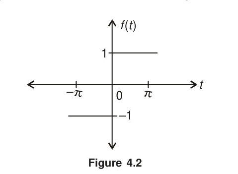
> *Figure 4.2*
> 
> **Solution:**
> From the graph, it can be seen that $f(t)$ is an odd function. Hence the Fourier series for $f(t)$ contains only the coefficients $b_n$.

<!-- Page 156 -->

We, therefore, have
$$f(t) = \sum_{n=1}^\infty b_n \sin nt,$$
where
$$
\begin{aligned}
b_n &= \frac{2}{\pi}\int_0^\pi f(t)\sin nt\,dt \\
&= \frac{2}{\pi}\int_0^\pi \sin nt\,dt, \quad \text{since } f(t) = 1 \\
&= \frac{2}{\pi}\left[ -\frac{1}{n}\cos nt \right]_0^\pi \\
&= \frac{2}{n\pi}[1 - (-1)^n] \\
&= \frac{4}{n\pi}, \quad n = 1, 3, 5, \dots
\end{aligned}
$$
It follows that
$$f(t) = \sum_{n=1,3,5,\dots}^\infty \frac{4}{n\pi}\sin nt = \frac{4}{\pi}\left( \sin t + \frac{1}{3}\sin 3t + \frac{1}{5}\sin 5t + \cdots \right).$$
$\blacktriangleleft$

### 4.6.1 Fourier Transform

In the preceding section, we considered the Fourier series for periodic functions. There exist, however, several functions which are not periodic. Similarly, we come across, in nature, many phenomena (for example, lightning) which are *aperiodic*. The study of such phenomena is of great importance to the engineer. In such cases, the Fourier transform is the applicable tool and this can be derived, from Eqs. (4.76) and (4.77), by making $T$ approach infinity so that the function becomes aperiodic. When $T \to \infty$, Eq. (4.77) can be written in the form
$$F(i\omega_0) = \int_{-\infty}^\infty f(t) e^{-i\omega_0 t}\,dt, \tag{4.78}$$
and is called the *Fourier transform* of $f(t)$. Similarly, Eq. (4.76) is written as
$$f(t) = \frac{1}{2\pi}\int_{-\infty}^\infty F(i\omega_0) e^{i\omega_0 t}\,d\omega_0, \tag{4.79}$$
and is called the *inverse Fourier transform* of $f(t)$. Equations (4.78) and (4.79) enable us to transform from time domain to frequency domain and from frequency to time domain, respectively. Physically, $F(i\omega_0)$ represents the frequency content of the signal. In Eq. (4.78), the function $f(t)$ is given in the continuous form which is rarely the case with a signal. In fact, the function

<!-- Page 157 -->

$f(t)$ is available only in a discrete form. In such a case, discrete analogues of both the integrals are used to compute the transforms. These equations, called the *Discrete Fourier Transforms*, are discussed below.

### 4.6.2 Discrete Fourier Transform (DFT)

Let $f(t)$ be specified at the points $t_i$, $i = 0, 1, 2, \dots, N-1$, and $\Delta t = \frac{T}{N}$. If $f_k$ denotes the value of $f(t)$ at $t = t_k$, then the discrete Fourier transform (DFT) and the *inverse discrete Fourier transform* (IDFT) are defined by
$$F_p = \sum_{k=0}^{N-1} f_k \cdot e^{-2\pi ikp/N}, \quad p = 0, 1, 2, \dots, N-1 \tag{4.80}$$
and
$$f_k = \frac{1}{N}\sum_{p=0}^{N-1} F_p \cdot e^{2\pi ikp/N}, \quad k = 0, 1, 2, \dots, N-1 \tag{4.81}$$
Denoting
$$W_N = e^{-2\pi i/N}, \tag{4.82}$$
Equations (4.80) and (4.81) become
$$F_p = \sum_{k=0}^{N-1} f_k \cdot W_N^{kp}, \quad p = 0, 1, 2, \dots, N-1 \tag{4.83}$$
and
$$f_k = \frac{1}{N}\sum_{p=0}^{N-1} F_p \cdot W_N^{-kp}, \quad k = 0, 1, 2, \dots, N-1 \tag{4.84}$$
The above equations are, respectively, called the discrete Fourier transform (DFT) and the inverse DFT. The coefficients $|F_p|$ form a periodic sequence when extended outside of the range $p = 0, 1, 2, \dots, N-1$, and we have
$$F_{p+N} = F_p \tag{4.85}$$
From Eq. (4.83), it may be seen that to compute each point of the DFT, we have to perform $N$ complex multiplications and $(N-1)$ complex additions. Hence the $N$-point DFT requires $N^2$ complex multiplications and $N(N-1)$ complex additions.

#### Properties of $W_N$

**(i) Symmetric property**
$$W_N^{k+\frac{N}{2}} = W_N^k \cdot W_N^{N/2} = -W_N^k, \quad \text{since } W_N^{N/2} = e^{-2\pi i\frac{N}{2N}} = e^{-\pi i} = -1.$$

<!-- Page 158 -->

**(ii) Periodic property**
$$W_N^{k+N} = W_N^k \cdot W_N^N = W_N^k, \quad \text{since } W_N^N = e^{-2\pi i N/N} = e^{-2\pi i} = 1.$$

**(iii) Another useful property**
$$W_N^2 = e^{-2\pi i 2/N} = e^{-4\pi i/N}$$
and
$$W_{N/2} = e^{-2\pi i/(N/2)} = e^{-4\pi i/N}$$
Hence
$$W_{N/2} = W_N^2.$$

A useful analysis that is important in the practical applications of Fourier transform (such as *smoothing of noisy data*) is called the *power spectrum* which is a plot of the power versus frequency. If $f(t)$ is a discrete time signal with period $N$, then the *power* $P$ is defined by the relation
$$P = \frac{1}{N}\sum_{k=0}^{N-1} |F_k|^2 = \sum_{k=0}^{N-1} |f_k|^2 \tag{4.86}$$
Therefore, the sequence
$$P_k = |f_k|^2, \quad k = 0, 1, 2, \dots, N-1 \tag{4.87}$$
is the distribution of power as a function of frequency and is called the *power density spectrum* of the periodic signal. Since $F_k$ is a periodic sequence with period $N$, it follows that the spectrum of $F_k$ ($k = 0, 1, 2, \dots, N-1$) is also a periodic sequence with period $N$.

#### Matrix Representations of Equations (4.83) and (4.84)

We have
$$
\begin{aligned}
F(p) &= \sum_{k=0}^{N-1} f_k W_N^{kp}, \quad p = 0, 1, 2, \dots, N-1. \\
&= f_0 + f_1 W_N^p + f_2 W_N^{2p} + \cdots + f_{N-1} W_N^{(N-1)p}, \quad p = 0, 1, \dots, N-1.
\end{aligned}
$$
Putting $p = 0, 1, 2, \dots, N-1$, in the above equation, we obtain
$$
\begin{aligned}
F_0 &= f_0 + f_1 W_N^0 + f_2 W_N^0 + \cdots + f_{N-1} W_N^0 \\
F_1 &= f_0 + f_1 W_N^1 + f_2 W_N^2 + \cdots + f_{N-1} W_N^{N-1} \\
&\;\;\vdots \qquad\qquad \vdots \\
F_{N-1} &= f_0 + f_1 W_N^{N-1} + f_2 W_N^{2(N-1)} + \cdots + f_{N-1} W_N^{(N-1)(N-1)}
\end{aligned}
$$

<!-- Page 159 -->

The preceding can be expressed in the matrix form:
$$\begin{bmatrix} F_0 \\ F_1 \\ \vdots \\ F_{N-1} \end{bmatrix} = \begin{bmatrix} 1 & 1 & 1 & \cdots & 1 \\ 1 & W_N^1 & W_N^2 & \cdots & W_N^{N-1} \\ \vdots & \vdots & \vdots & & \vdots \\ 1 & W_N^{N-1} & W_N^{2(N-1)} & \cdots & W_N^{(N-1)(N-1)} \end{bmatrix} \begin{bmatrix} f_0 \\ f_1 \\ \vdots \\ f_{N-1} \end{bmatrix} \tag{4.88}$$
or
$$[F] = [W_N][f]$$
In a similar way, Eq. (4.84) can be expressed as
$$[f] = \frac{1}{N}[W_N^*][F], \tag{4.89}$$
where $W_N^*$ is the complex conjugate of $W_N$.

> [!NOTE] EXAMPLE 4.16
> Using matrices, find the DFT of the sequence
> $$f_k = \{1,\, 2,\, 3,\, 4\}.$$
> 
> **Solution:**
> We have
> $$F_p = \sum_{k=0}^3 W_4^{kp} \cdot f_k, \quad p = 0, 1, 2, 3.$$
> The matrix representation is
> $$\begin{bmatrix} F_0 \\ F_1 \\ F_2 \\ F_3 \end{bmatrix} = \begin{bmatrix} 1 & 1 & 1 & 1 \\ 1 & W_4^1 & W_4^2 & W_4^3 \\ 1 & W_4^2 & W_4^4 & W_4^6 \\ 1 & W_4^3 & W_4^6 & W_4^9 \end{bmatrix} \begin{bmatrix} f_0 \\ f_1 \\ f_2 \\ f_3 \end{bmatrix}$$
> $$\Rightarrow \begin{bmatrix} 1 & 1 & 1 & 1 \\ 1 & -i & -1 & i \\ 1 & -1 & 1 & -1 \\ 1 & i & -1 & -i \end{bmatrix} \begin{bmatrix} 1 \\ 2 \\ 3 \\ 4 \end{bmatrix} = \begin{bmatrix} 10 \\ -2 + 2i \\ -2 \\ -2 - 2i \end{bmatrix}$$
> $\blacktriangleleft$

> [!NOTE] EXAMPLE 4.17
> Find the inverse DFT of the sequence
> $$F_p = \{1,\, 1-i,\, -1,\, 1+i\}.$$
> 
> **Solution:**
> We have
> $$[f] = \frac{1}{N}[W_N^*][F]$$

<!-- Page 160 -->

For $N = 4$,
$$[W_n] = \begin{bmatrix} 1 & 1 & 1 & 1 \\ 1 & -i & -1 & i \\ 1 & -1 & 1 & -1 \\ 1 & i & -1 & -i \end{bmatrix}$$
Therefore,
$$[W_N^*] = \begin{bmatrix} 1 & 1 & 1 & 1 \\ 1 & i & -1 & -i \\ 1 & -1 & 1 & -1 \\ 1 & -i & -1 & i \end{bmatrix}$$
Hence
$$
\begin{aligned}
[f] &= \frac{1}{4}\begin{bmatrix} 1 & 1 & 1 & 1 \\ 1 & i & -1 & -i \\ 1 & -1 & 1 & -1 \\ 1 & -i & -1 & i \end{bmatrix} \begin{bmatrix} 1 \\ 1-i \\ -1 \\ 1+i \end{bmatrix} = \frac{1}{4}\begin{bmatrix} 2 \\ 4 \\ -2 \\ 0 \end{bmatrix} \\[2mm]
&= \begin{bmatrix} 0.5 \\ 1.0 \\ -0.5 \\ 0 \end{bmatrix}
\end{aligned}
$$
$\blacktriangleleft$

> [!NOTE] EXAMPLE 4.18
> Find the DFT of the sequence
> $$f_k = \{2,\, 2,\, 2,\, \dots,\, 2\}, \quad \text{for } k = 0, 1, 2, \dots, N-1.$$
> 
> **Solution:**
> We have
> $$
> \begin{aligned}
> F_p &= \sum_{k=0}^{N-1} f_k \, e^{-2\pi i pk/N}, \quad p = 0, 1, 2, \dots, N-1 \\
> &= 2\sum_{k=0}^{N-1} e^{-2\pi i kp/N}, \quad \text{since } f(k) = 2 \text{ for all } k. \\
> &= 2\left[ 1 + e^{-2\pi i p/N} + e^{-2\pi i 2p/N} + \cdots + e^{-2\pi i p(N-1)/N} \right],
> \end{aligned}
> $$
> which is a geometric progression with $r = e^{-2\pi i p/N}$.
> $$= 2 \cdot \frac{1 - r^N}{1 - r}.$$
> i.e.,
> $$F_p = 2\cdot \left[ \frac{1 - e^{-2\pi i p}}{1 - e^{-2\pi i p/N}} \right], \quad p = 0, 1, 2, \dots, N-1.$$

<!-- Page 161 -->

For $p = 1, 2, 3, \dots, N-1$,
$$F_p = 0.$$
For $p = 0$, $F_p$ is of the form $\frac{0}{0}$. By L'Hospital's rule, we obtain
$$F_0 = 2\lim_{p\to 0}\frac{1 - e^{-2\pi i p}}{1 - e^{-2\pi i p/N}} = 2N.$$
Hence
$$F_p = \begin{cases} 2N, & p = 0 \\ 0, & p = 1, 2, 3, \dots, N-1 \end{cases}$$
$\blacktriangleleft$

### 4.6.3 Fast Fourier Transform (FFT)

The computation of DFT by formula (4.83) requires $N^2$ complex multiplications and $N(N-1)$ complex additions. It also requires memory to store the values of $f(t)$ and $W_N^{kp}$. Besides, it does not make use of the periodic and symmetric properties of $W_N^{kp}$. As $N$ increases, the computation of DFT demands very high memory requirements and becomes a time-consuming process.

The *Fast Fourier Transform* (FFT) algorithms make use of the symmetric and periodic properties of $W_N^{kp}$ and compute the DFT in an economic fashion. It requires $N\log_2 N$ operations, which means that in terms of computing time and memory requirements, the FFT is far superior to the DFT. For $N = 50$, for example, the FFT requires about 250 complex operations compared to about 2500 complex operations required by the direct use of Eq. (4.83).

There exist several FFT algorithms and the basic idea behind all these is that a DFT of length $N$ is *decimated* (or split) into successive smaller DFT's. One class of algorithms, called *radix-2* algorithms, assume that $N$ is a power of 2. The decimation is carried out in either the time domain or frequency domain. Accordingly, we have two types of algorithms in this class, namely, (a) decimation-in-time (DIT) and (b) Decimation-in-frequency (DIF). The Cooley–Tukey algorithm belongs to the type (a), whereas, the Sande–Tukey algorithm to the type (b). Both the algorithms require $N\log_2 N$ operations and the Cooley–Tukey algorithm is discussed in the next section.

### 4.6.4 Cooley–Tukey Algorithm

This algorithm assumes that $N$ is an integral power of 2, i.e., $N = 2^m$, where $m$ is an integer. The basic idea of this algorithm is to decompose the $N$-point DFT into two $N/2$-point DFT's then decompose each of the $N/2$-point DFT's into two $N/4$-point DFT's and continuing this process until we obtain $N/2$ two-point DFT's. It is clear that we require $m$ steps to achieve this.

<!-- Page 162 -->

To describe the algorithm, we first consider the case $N = 4$, i.e., $m = 2$. Let $f_0, f_1, f_2, f_3$ be the sequence of values of $f(t)$. The DFT for $f_k$ is given by
$$F_p = \sum_{k=0}^3 f_k W_4^{pk}, \quad p = 0, 1, 2, 3. \tag{4.90}$$
where
$$W_4 = e^{-2\pi i/4} = -i$$
We split the sum on the right side of Eq. (4.90) into two equal parts of length 2, one containing the even-indexed values of $f(t)$ and the other, the odd-indexed values. We, therefore, write
$$F_p = \sum_{k=0,2} f_k W_4^{kp} + \sum_{k=1,3} f_k W_4^{kp} \tag{4.91}$$
Putting $k = 2r$ in the first sum and $k = 2r + 1$ in the second sum of Eq. (4.91), we obtain
$$
\begin{aligned}
F_p &= \sum_{r=0}^1 f_{2r} W_4^{2rp} + \sum_{r=0}^1 f_{2r+1} W_4^{(2r+1)p} \\
&= \sum_{r=0}^1 f_{2r} W_2^{rp} + W_4^p \sum_{r=0}^1 f_{2r+1} W_2^{rp}, \quad p = 0, 1
\end{aligned}
$$
It may be seen that the first sum consists of $f_0$ and $f_2$ (even-indexed values) and the second sum $f_1$ and $f_3$ (odd-indexed values). A convenient notation is to use the superscripts $e$ and $o$ for the first and second sums, respectively\*. We therefore write
$$F_p = F_p^e + W_4^p F_p^o, \quad p = 0, 1 \tag{4.92}$$
where
$$
\left.\begin{aligned}
F_p^e &= \sum_{r=0}^1 f_{2r} W_2^{rp} \\
\text{and} \quad F_p^o &= \sum_{r=0}^1 f_{2r+1} W_2^{rp}
\end{aligned}\right\} \quad p = 0, 1 \tag{4.93}
$$
Since $F_p$ is periodic with period 2, we have
$$
\begin{aligned}
F_{p+2} &= F_p^e + W_4^{p+2} F_p^o, \quad p = 0, 1 \\
&= F_p^e - W_4^p F_p^o, \quad p = 0, 1 \tag{4.94}
\end{aligned}
$$

---
\* Numerical Recipes in FORTRAN, CUP, Indian edition [1994].

<!-- Page 163 -->

since
$$W_4^2 = -1.$$
From Eqs. (4.92) and (4.94), we obtain
$$
\left.\begin{aligned}
F_0 &= f_0 + f_2 + f_1 + f_3 \\
F_1 &= f_0 - f_2 - i(f_1 - f_3) \\
F_2 &= f_0 + f_2 - (f_1 + f_3) \\
F_3 &= f_0 - f_2 + i(f_1 - f_3)
\end{aligned}\right\} \tag{4.95}
$$
Results of Example 4.16 follow easily from Eqs. (4.95).

The computations involving Eqs. (4.92) and (4.94) of the 4-point DIT–FFT are shown in Fig. 4.3 called *flow-graph*.

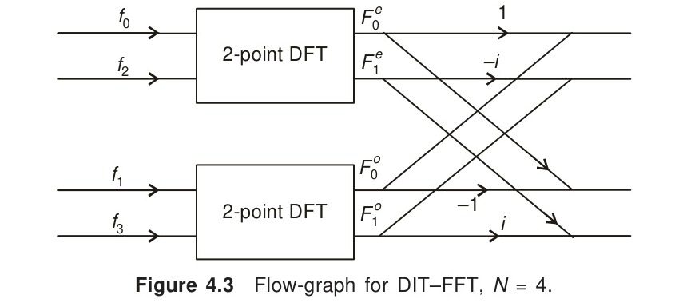
*Figure 4.3 Flow-graph for DIT–FFT, $N = 4$.*

We next consider the case $N = 8$. Let the sequence of values of $f(t)$ be
$$f_k = \{f_0,\, f_1,\, f_2,\, f_3,\, \dots,\, f_7\}.$$
The DFT for $f_k$ is
$$F_p = \sum_{k=0}^7 f_k W_8^{pk}, \quad p = 0, 1, 2, \dots, 7,$$
where
$$W_8 = e^{-2\pi i/8}$$
Splitting the 8-point DFT into two equal parts of length 4, one containing the even-indexed $f_k$ and the other of the odd-indexed $f_k$, we write
$$F_p = F_p^e + W_8^p F_p^o \tag{4.96}$$
where
$$
\left.\begin{aligned}
F_p^e &= \sum_{r=0}^3 f_{2r} W_4^{rp} \\
\text{and} \quad F_p^o &= \sum_{r=0}^3 f_{2r+1} W_4^{rp}
\end{aligned}\right\} \quad p = 0, 1, 2, 3 \tag{4.97}
$$

<!-- Page 164 -->

Using the periodic properties, we also have
$$
\begin{aligned}
F_{p+4} &= F_p^e + W_8^{p+4} F_p^o, \quad p = 0, 1, 2, 3 \\
&= F_p^e + W_8^p \cdot W_8^4 F_p^o \\
&= F_p^e - W_8^p F_p^o, \quad p = 0, 1, 2, 3 \tag{4.98}
\end{aligned}
$$
since
$$W_8^4 = W_2^1 = -1.$$
It may be seen that $F_p^e$ and $F_p^o$ are both 4-point DFT's. This completes the first stage of the decimation process and the computations are shown in the flow-graph in Fig. 4.4.

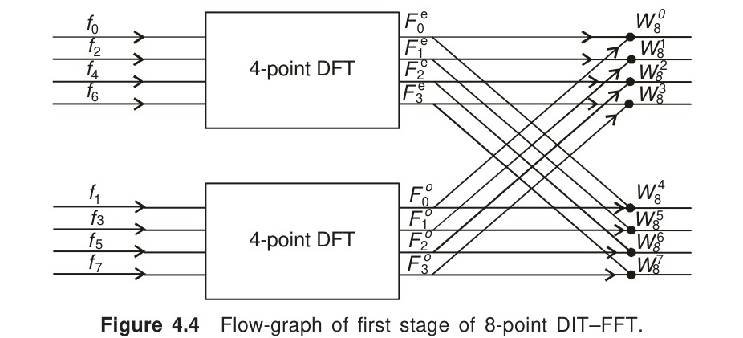
*Figure 4.4 Flow-graph of first stage of 8-point DIT–FFT.*

In Fig. 4.4, values of the factor $W_8^{kp}$ are given below.
$$
\left.\begin{aligned}
W_8^0 &= 1, & W_8^1 &= \frac{1-i}{\sqrt{2}}, & W_8^2 &= -i, & W_8^3 &= -\frac{1+i}{\sqrt{2}}, \\[2mm]
W_8^4 &= -1, & W_8^5 &= \frac{-1+i}{\sqrt{2}}, & W_8^6 &= i, & W_8^7 &= \frac{1+i}{\sqrt{2}}
\end{aligned}\right\} \tag{4.99}
$$
In the second stage of decimation, each of the 4-point DFT's in Fig. 4.4 is split into two 2-point DFT's. We then write
$$
\begin{aligned}
F_p^e &= \sum_{r=0}^3 f_{2r} W_4^{pr} \\
&= \sum_{s=0}^1 f_{4s} W_2^{sp} + W_4^p \sum_{s=0}^1 f_{4s+2} W_2^{sp} \\
&= F_p^{ee} + W_4^p \cdot F_p^{eo}, \tag{4.100}
\end{aligned}
$$

<!-- Page 165 -->

where
$$
\left.\begin{aligned}
F_p^{ee} &= \sum_{s=0}^1 f_{4s} W_2^{sp} \\
\text{and} \quad F_p^{eo} &= \sum_{s=0}^1 f_{4s+2} W_2^{sp}
\end{aligned}\right\} \tag{4.101}
$$
Similarly, we obtain
$$F_p^o = F_p^{oe} + W_4^p F_p^{oo} \tag{4.102}$$
where
$$
\left.\begin{aligned}
F_p^{oe} &= \sum_{l=0}^1 f_{4l+1} W_2^{lp} \\
\text{and} \quad F_p^{oo} &= \sum_{l=0}^1 f_{4l+3} W_2^{lp}
\end{aligned}\right\} \quad p = 0, 1 \tag{4.103}
$$
Using the periodic properties, we also have
$$F_{p+2}^e = F_p^{ee} + W_4^{p+2} F_p^{eo}, \quad p = 0, 1. \tag{4.104}$$
and
$$F_{p+2}^o = F_p^{oe} + W_4^{p+2} F_p^{oo}, \quad p = 0, 1. \tag{4.105}$$
This completes the second stage of decimation where each of the 4-point transforms is broken into two 2-point transforms. The flow-graph of the second stage is shown in Fig. 4.5.

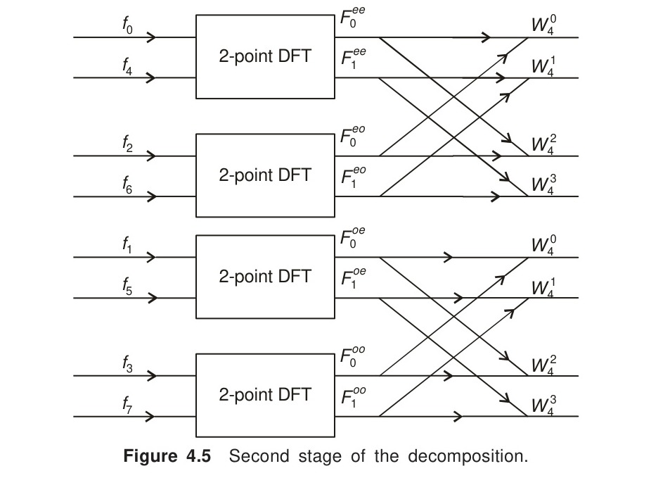
*Figure 4.5 Second stage of the decomposition.*

<!-- Page 166 -->

From Eq. (4.101), we find
$$
\begin{aligned}
F_p^{ee} &= \sum_{s=0}^1 f_{4s} W_2^{sp}, \quad p = 0, 1 \\
&= f_0 + f_4 W_2^p
\end{aligned}
$$
and
$$
\begin{aligned}
F_p^{eo} &= \sum_{s=0}^1 f_{4s+2} W_2^{sp}, \quad p = 0, 1 \\
&= f_2 + f_6 W_2^p, \quad p = 0, 1
\end{aligned}
$$
It follows that at the third stage of decimation, we obtain
$$F_p^{eee} = f_0, \quad F_p^{eeo} = f_4, \quad F_p^{eoe} = f_2 \quad \text{and} \quad F_p^{eoo} = f_6.$$
Thus, for the 8-point DFT, we start with the input sequence $f_0, f_4, f_2, f_6, f_1, f_5, f_3$ and $f_7$, and obtain the output in the natural order, i.e., $F_0, F_1, F_2, F_3, F_4, F_5, F_6$ and $F_7$.

The three stages of computation can be shown in a single flow-graph (Fig. 4.6).

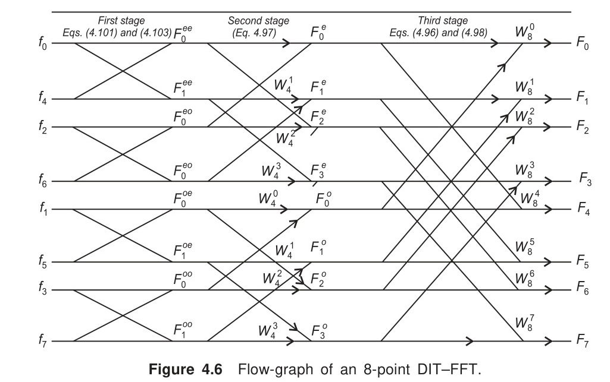
*Figure 4.6 Flow-graph of an 8-point DIT–FFT.*

From Fig. 4.6, the following observations can be made
(i) The input is in the *bit-reversed* order, namely $f_0, f_4, f_2, f_6, f_1, f_5, f_3, f_7$, as shown in Table 4.2.

<!-- Page 167 -->

**Table 4.2 Input Data in the Reversed Bits**

| Input position | Binary digits | Reversed bits | Index of the sequence |
| :---: | :---: | :---: | :---: |
| 0 | 000 | 000 | 0 |
| 1 | 001 | 100 | 4 |
| 2 | 010 | 010 | 2 |
| 3 | 011 | 110 | 6 |
| 4 | 100 | 001 | 1 |
| 5 | 101 | 101 | 5 |
| 6 | 110 | 011 | 3 |
| 7 | 111 | 111 | 7 |

(ii) The output for the Fourier coefficients $F_k$ is in the natural order.
(iii) Computations are carried out in terms of what is called a *butterfly*. A typical butterfly is shown in Fig. 4.7.

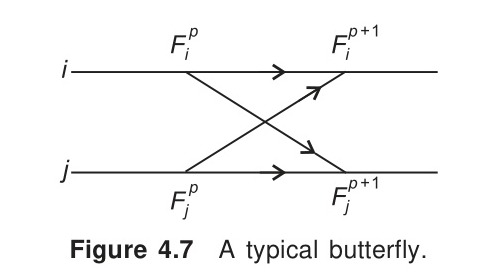
*Figure 4.7 A typical butterfly.*

> [!NOTE] EXAMPLE 4.19
> Apply Cooley–Tukey algorithm to compute the DFT of the sequence
> $$f_k = \{1,\, 2,\, 3,\, 4\}.$$
> 
> **Solution:**
> The key equations are
> $$F_p = F_p^e + W_4^p F_p^o \quad \text{and} \quad F_{p+2} = F_p^e - W_4^p F_p^o, \quad p = 0, 1 \tag{i}$$
> Also
> $$
> \left.\begin{aligned}
> F_p^e &= f_0 + f_2 W_2^p, \quad p = 0, 1 \\
> \text{and} \quad F_p^o &= f_1 + f_3 W_2^p, \quad p = 0, 1
> \end{aligned}\right\} \tag{ii}
> $$
> We, therefore, obtain
> $$
> \begin{aligned}
> F_0^e &= f_0 + f_2 = 4, & F_1^e &= f_0 - f_2 = -2 \\
> F_0^o &= f_1 + f_3 = 6, & F_1^o &= f_1 - f_3 = -2
> \end{aligned}
> $$
> Equation (i) now gives
> $$
> \begin{aligned}
> F_0 &= 4 + 6 = 10, & F_1 &= -2 + W_4^1(-2) = -2 + 2i \\
> F_2 &= 4 - 6 = -2, & F_3 &= -2 - W_4^1(-2) = -2 - 2i
> \end{aligned}
> $$
> $\blacktriangleleft$

<!-- Page 168 -->

The flow-graph for this computation is shown in Fig. 4.8.

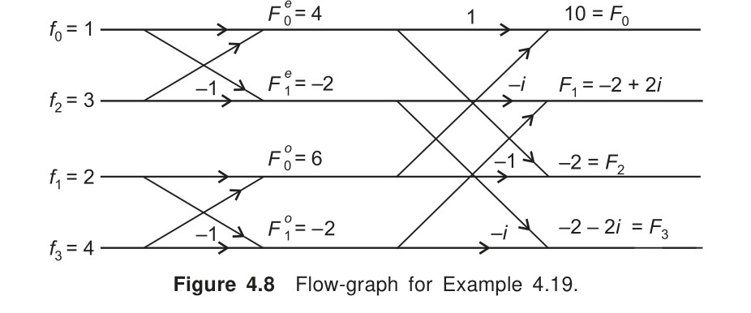
*Figure 4.8 Flow-graph for Example 4.19.*

> [!NOTE] EXAMPLE 4.20
> Use the Cooley–Tukey algorithm to find the DFT of the sequence
> $$f_k = \{1,\, 2,\, 3,\, 4,\, 4,\, 3,\, 2,\, 1\}.$$
> 
> **Solution:**
> *First stage:* The key-equations are
> $$
> \begin{aligned}
> F_p^{ee} &= f_0 + W_2^p f_4, & F_p^{eo} &= f_2 + W_2^p f_6 \\
> F_p^{oe} &= f_1 + W_2^p f_5, & F_p^{oo} &= f_3 + W_2^p f_7.
> \end{aligned}
> $$
> From these equations, we obtain
> $$
> \begin{aligned}
> F_0^{ee} &= f_0 + f_4 = 5, & F_1^{ee} &= f_0 - f_4 = -3, \\
> F_0^{eo} &= f_2 + f_6 = 5, & F_1^{eo} &= f_2 - f_6 = 1, \\
> F_0^{oe} &= f_1 + f_5 = 5, & F_1^{oe} &= f_1 - f_5 = -1, \\
> F_0^{oo} &= f_3 + f_7 = 5, & F_1^{oo} &= f_3 - f_7 = 3.
> \end{aligned}
> $$
> *Second stage:* The key-equations are
> $$
> \begin{aligned}
> F_p^e &= F_p^{ee} + W_4^p F_p^{eo}, & F_p^o &= F_p^{oe} + W_4^p F_p^{oo}, \quad p = 0, 1 \\
> F_{p+2}^e &= F_p^{ee} - W_4^p F_p^{eo}, & F_{p+2}^o &= F_p^{oe} - W_4^p F_p^{oo}, \quad p = 0, 1
> \end{aligned}
> $$
> From these equations, we obtain
> $$
> \begin{aligned}
> F_0^e &= 5 + 5 = 10, & F_1^e &= -3 - i, & F_2^e &= 5 - 5 = 0, & F_3^e &= -3 + i, \\
> F_0^o &= 5 + 5 = 10, & F_1^o &= -1 - 3i, & F_2^o &= 0, & F_3^o &= -1 + 3i
> \end{aligned}
> $$
> For the third stage, we have
> $$F_p = F_p^e + W_8^p F_p^o, \quad p = 0, 1, 2, 3$$
> and
> $$F_{p+4} = F_p^e - W_8^p F_p^o, \quad p = 0, 1, 2, 3$$

<!-- Page 169 -->

where,
$$
\begin{aligned}
W_8^0 &= 1, & W_8^1 &= \frac{1-i}{\sqrt{2}}, & W_8^2 &= -i, & W_8^3 &= -\frac{1+i}{\sqrt{2}}, \\[2mm]
W_8^4 &= -1, & W_8^5 &= -\frac{1-i}{\sqrt{2}}, & W_8^6 &= i, & W_8^7 &= \frac{1+i}{\sqrt{2}}.
\end{aligned}
$$
From these equations, we obtain
$$
\begin{aligned}
F_0 &= F_0^e + F_0^o = 20, \\[2mm]
F_1 &= F_1^e + W_8^1 F_1^o = -3 - i + \frac{1-i}{\sqrt{2}}(-1-3i) = -5.828 - i(2.414), \\[2mm]
F_2 &= 0, \\[2mm]
F_3 &= -3 + i - \frac{(1+i)}{\sqrt{2}}(-1+3i) = -0.172 - i(0.414), \\[2mm]
F_4 &= 0, \\[2mm]
F_5 &= -3 - i - \frac{(1-i)}{\sqrt{2}}(-1-3i) = -0.172 + i(0.414), \\[2mm]
F_6 &= 0, \\[2mm]
F_7 &= -3 + i + \frac{(1+i)}{\sqrt{2}}(-1+3i) = -5.828 + i(2.414).
\end{aligned}
$$
The flow-graph for this computation is given in Fig. 4.9.

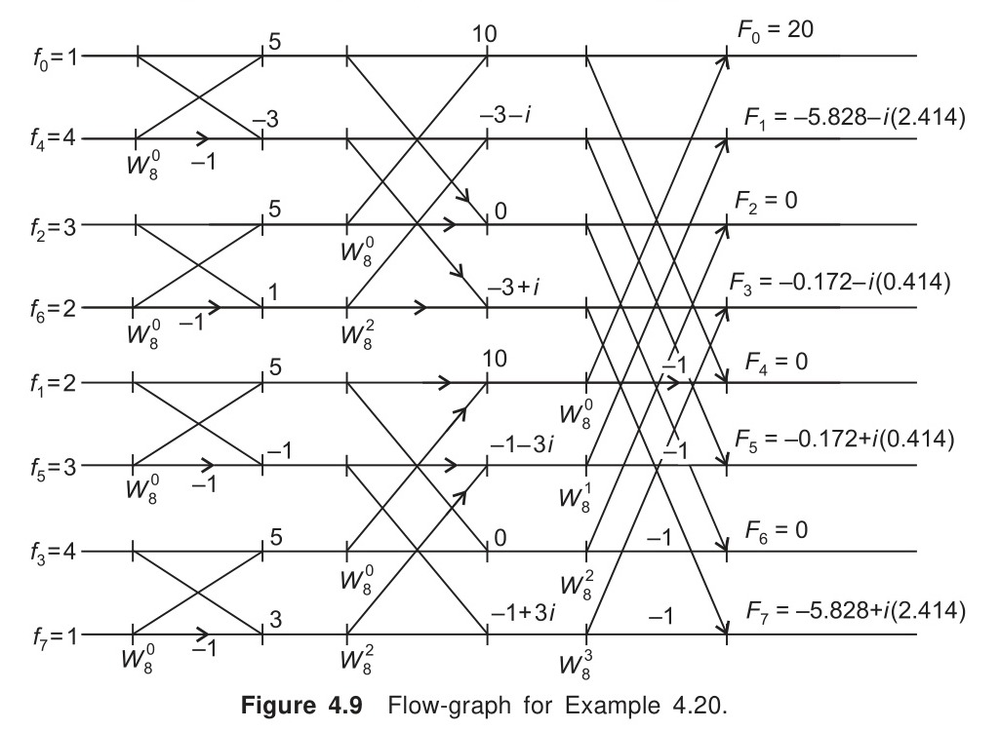
*Figure 4.9 Flow-graph for Example 4.20.*
$\blacktriangleleft$

<!-- Page 170 -->

### 4.6.5 Sande–Tukey Algorithm (DIF–FFT)

This alternative approach is a member of the class of algorithms called *decimation-in-frequency* techniques. It is the reverse of the Cooley–Tukey algorithm described in the previous section. In this case, the output is in the *bit-reversed order*.

To start with we take $N = 4$, i.e.,
$$f_k = \{f_0,\, f_1,\, f_2,\, f_3\}.$$
Then we have
$$F_p = \sum_{k=0}^3 f_k W_4^{pk}, \quad p = 0, 1, 2, 3$$
In the method, the above sum is divided in terms of the first two and last two points as:
$$
\begin{aligned}
F_p &= \sum_{k=0,1} f_k W_4^{pk} + \sum_{k=2,3} f_k W_4^{pk} \\
&= \sum_{k=0}^1 f_k W_4^{pk} + \sum_{k=0}^1 f_{k+2} W_4^{p(k+2)}; \quad p = 0, 1, 2, 3 \tag{4.106}
\end{aligned}
$$
Now,
$$W_4^{p(k+2)} = W_4^{pk} \cdot W_4^{2p} = W_4^{pk}(-1)^p,$$
since
$$W_4^{2p} = W_2^p = (-1)^p.$$
Hence, Eq. (4.106) becomes
$$F_p = \sum_{k=0}^1 \left[ f_k + (-1)^p \cdot f_{k+2} \right] W_4^{pk}, \quad p = 0, 1, 2, 3 \tag{4.107}$$
which consists of both even and odd components.

Let
$$F_p = F_{2r} + F_{2r+1},$$
where
$$
\left.\begin{aligned}
F_{2r} &= \sum_{k=0}^1 (f_k + f_{k+2}) W_4^{2rk} \\
&= \sum_{k=0}^1 (f_k + f_{k+2}) W_2^{rk} \\[2mm]
\text{and} \quad F_{2r+1} &= \sum_{k=0}^1 (f_k - f_{k+2}) W_4^{k(2r+1)} \\
&= \sum_{k=0}^1 (f_k - f_{k+2}) W_4^{2kr} \cdot W_4^k \\
&= \sum_{k=0}^1 (f_k - f_{k+2}) W_2^{kr} \cdot W_4^k, \quad r = 0, 1
\end{aligned}\right\} \tag{4.108}
$$

<!-- Page 171 -->

We define
$$
\left.\begin{aligned}
g_k &= f_k + f_{k+2} \\
\text{and} \quad h_k &= (f_k - f_{k+2}) W_4^k
\end{aligned}\right\} \tag{4.109}
$$
Then
$$
\left.\begin{aligned}
F_{2r} &= \sum_{k=0}^1 g_k W_2^{rk}, \quad r = 0, 1 \\[2mm]
\text{and} \quad F_{2r+1} &= \sum_{k=0}^1 h_k W_2^{rk}, \quad r = 0, 1
\end{aligned}\right\} \tag{4.110}
$$
It can be seen that the output is in the order $F_0, F_2, F_1$ and $F_3$. We now consider the case $N = 8$. Let
$$f_k = \{f_0,\, f_1,\, f_2,\, f_3,\, f_4,\, f_5,\, f_6,\, f_7\}.$$
Then
$$F_p = \sum_{k=0}^7 f_k W_8^{pk}, \quad p = 0, 1, \dots, 7.$$
We split the above sum in terms of the first four and last four points as
$$
\begin{aligned}
F_p &= \sum_{k=0,1,2,3} f_k W_8^{pk} + \sum_{k=4,5,6,7} f_k W_8^{pk} \\
&= \sum_{k=0,1,2,3} f_k W_8^{pk} + \sum_{k=0,1,2,3} f_{k+4} W_8^{p(k+4)} \tag{4.111}
\end{aligned}
$$
Now,
$$W_8^{p(k+4)} = W_8^{pk} \cdot W_8^{4p} = (-1)^p W_8^{pk}$$
Hence Eq. (4.111) becomes
$$F_p = \sum_{k=0}^3 \left[ f_k + (-1)^p f_{k+4} \right] W_8^{pk}, \quad p = 0, 1, \dots, 7. \tag{4.112}$$
Since the right side of Eq. (4.112) consists of both even and odd Fourier coefficients, we write
$$F_p = F_{2r} + F_{2r+1},$$

<!-- Page 172 -->

where
$$
\left.\begin{aligned}
F_{2r} &= \sum_{k=0}^3 [f_k + f_{k+4}] W_8^{2rk} \\
&= \sum_{k=0}^3 [f_k + f_{k+4}] W_4^{rk}, \quad r = 0, 1, 2, 3 \\[2mm]
\text{and} \quad F_{2r+1} &= \sum_{k=0}^3 [f_k - f_{k+4}] W_8^{k(2r+1)}, \\
&= \sum_{k=0}^3 [f_k - f_{k+4}] W_4^{rk} \cdot W_8^k, \quad r = 0, 1, 2, 3
\end{aligned}\right\} \tag{4.113}
$$
For brevity, let
$$
\left.\begin{aligned}
f_k + f_{k+4} &= g_k \\
\text{and} \quad W_8^k (f_k - f_{k+4}) &= h_k
\end{aligned}\right\}, \quad k = 0, 1, 2, 3 \tag{4.114}
$$
Then Eq. (4.113) becomes
$$
\left.\begin{aligned}
F_{2r} &= \sum_{k=0}^3 g_k W_4^{rk} \\[2mm]
\text{and} \quad F_{2r+1} &= \sum_{k=0}^3 h_k W_4^{rk}
\end{aligned}\right\}, \quad r = 0, 1, 2, 3 \tag{4.115}
$$
The flow-graph for the first stage of this algorithm is given in Fig. 4.10.

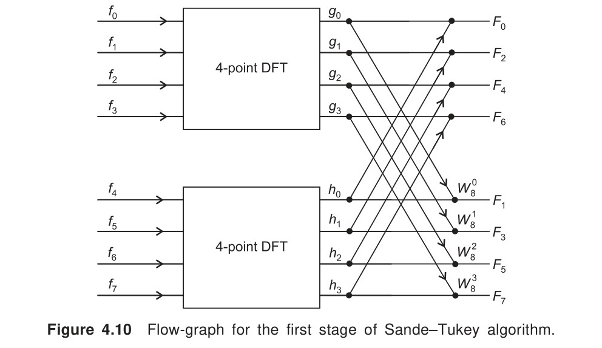
*Figure 4.10 Flow-graph for the first stage of Sande–Tukey algorithm.*

Clearly, this approach can be repeated at the second stage to split each of the 4-point DFT's into two 2-point transforms. Flow-graph for this computation is shown in Fig. 4.11.

<!-- Page 173 -->

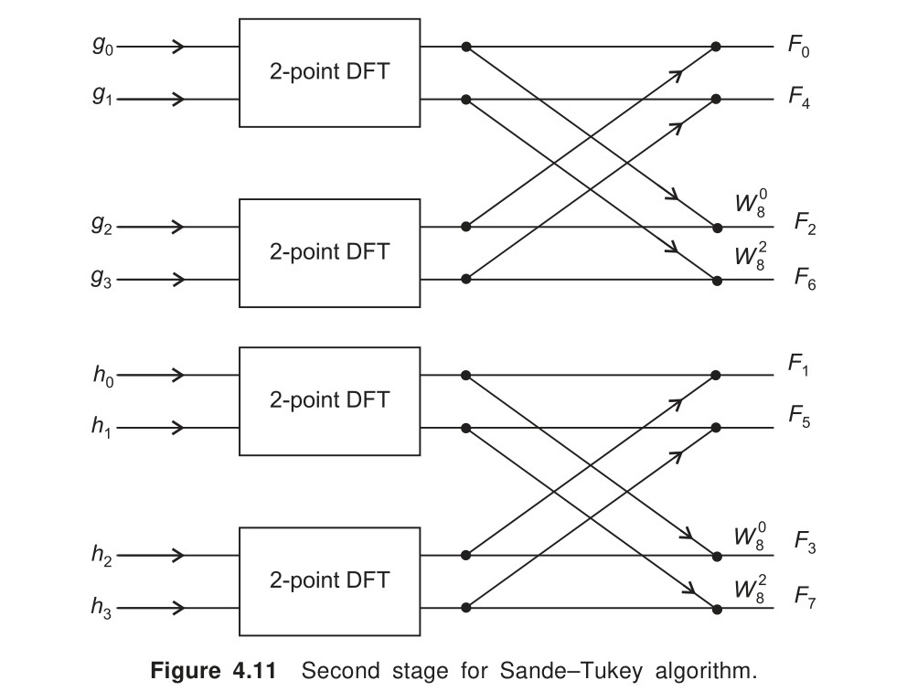
*Figure 4.11 Second stage for Sande–Tukey algorithm.*

In the general case, the final result is obtained after $\log_2 N$ stages. Figure 4.12 shows the flow-graph for the 8-point decimation in frequency FFT.

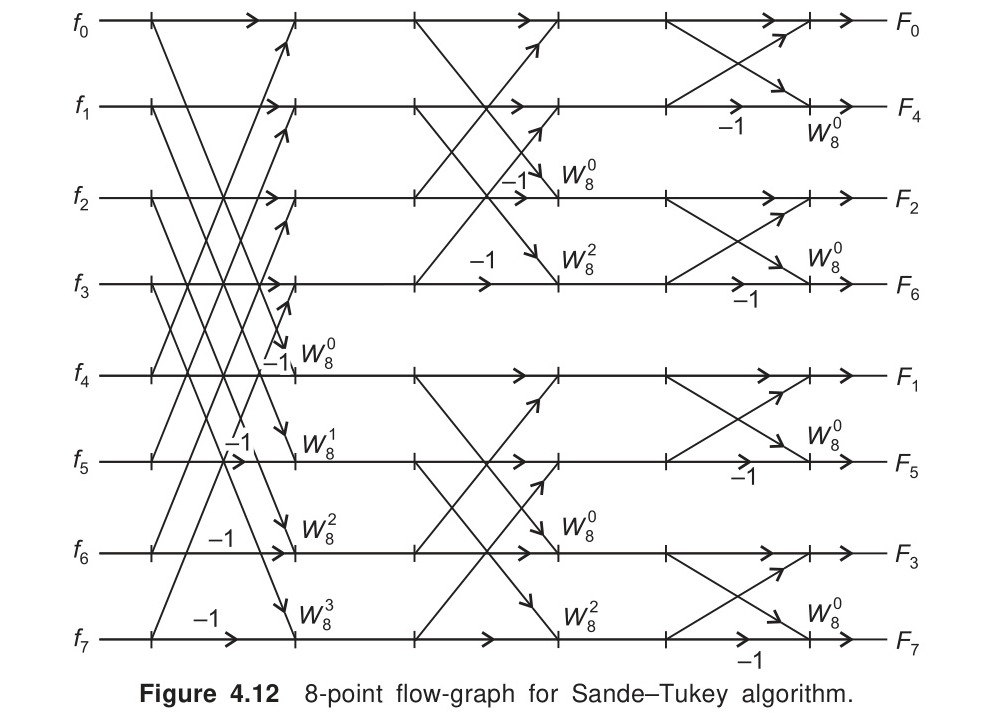
*Figure 4.12 8-point flow-graph for Sande–Tukey algorithm.*

<!-- Page 174 -->

We observe that the input is in the natural order, whereas the output for the frequency components is in the bit-reversed order.

### 4.6.6 Computation of the Inverse DFT

The inverse DFT is defined by
$$f_k = \frac{1}{N}\sum_{p=0}^{N-1} F_p W_N^{-kp}, \quad k = 0, 1, \dots, N-1.$$
Comparison with DFT shows that the factors $W_N^{kp}$ have changed signs, the input and output have interchanged, and that the final output is divided by $N$. Hence the flow-graph for the calculation of DFT can also be adopted for the computation of inverse DFT after making the above changes.

> [!NOTE] EXAMPLE 4.21
> Using Sande–Tukey algorithm, find the DFT of the sequence
> $$f_k = \{1,\, 2,\, 3,\, 4\}.$$
> 
> **Solution:**
> We have the key-equations
> $$
> \left.\begin{aligned}
> F_{2r} &= \sum_{k=0}^1 g_k W_2^{rk} \\
> \text{and} \quad F_{2r+1} &= \sum_{k=0}^1 h_k W_2^{rk}
> \end{aligned}\right\} \quad r = 0, 1
> $$
> where
> $$g_k = f_k + f_{k+2} \quad \text{and} \quad h_k = (f_k - f_{k+2}) W_4^k$$
> With $f_k = \{1,\, 2,\, 3,\, 4\}$, we obtain
> $$
> \begin{aligned}
> g_0 &= f_0 + f_2 = 4, & g_1 &= f_1 + f_3 = 6; \\
> h_0 &= f_0 - f_2 = -2, & h_1 &= (f_1 - f_3) W_4^1 = -2(-i) = 2i
> \end{aligned}
> $$
> Hence
> $$
> \begin{aligned}
> F_0 &= g_0 + g_1 = 10, & F_2 &= g_0 + g_1 W_2^1 = g_0 - g_1 = -2 \\
> F_1 &= \sum_{k=0}^1 h_k W_2^0 = h_0 + h_1 = -2 + 2i, \\
> F_3 &= \sum_{k=0}^1 h_k W_2^k = h_0 + h_1 W_2^1 = h_0 - h_1 = -2 - 2i.
> \end{aligned}
> $$
> Hence
> $$F_k = \{10,\, -2 + 2i,\, -2,\, -2 - 2i\}.$$
> $\blacktriangleleft$

<!-- Page 175 -->

The flow-graph for this computation is shown in Fig. 4.13.

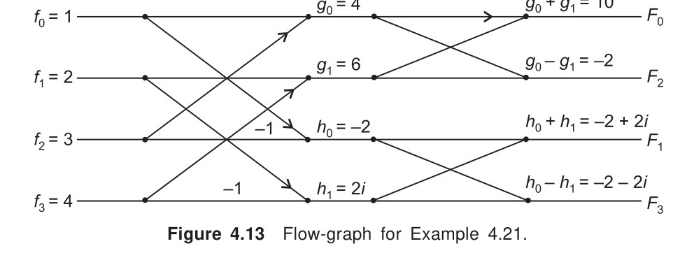
*Figure 4.13 Flow-graph for Example 4.21.*

> [!NOTE] EXAMPLE 4.22
> Using Sande–Tukey algorithm, find the DFT of the sequence
> $$f_k = \{1,\, 2,\, 3,\, 4,\, 4,\, 3,\, 2,\, 1\}$$
> 
> **Solution:**
> We have
> $$F_p = \sum_{k=0}^7 f_k W_8^{pk}, \quad p = 0, 1, \dots, 7$$
> *First stage:*
> $$F_{2r} = \sum_{k=0}^3 g_k W_4^{rk}, \quad F_{2r+1} = \sum_{k=0}^3 h_k W_4^{rk}, \quad r = 0, 1, 2, 3.$$
> $$g_k = f_k + f_{k+4}, \quad h_k = (f_k - f_{k+4}) W_8^k$$
> Then
> $$
> \begin{aligned}
> g_0 &= 5, & g_1 &= 5, & g_2 &= 5, & g_3 &= 5, \\
> h_0 &= -3, & h_1 &= -W_8^1, & h_2 &= W_8^2, & h_3 &= 3 W_8^3.
> \end{aligned}
> $$
> *Second stage:*
> $$
> \begin{aligned}
> F_{2r} &= F_{4s} + F_{4s+2}, & F_{2r+1} &= F_{4t+1} + F_{4t+3}, \\
> F_{4s} &= \sum_{k=0}^1 p_k \cdot W_2^{sk}, & F_{4s+2} &= \sum_{k=0}^1 q_k \cdot W_2^{sk}, \quad s = 0, 1. \\
> p_k &= g_k + g_{k+2}, & q_k &= (g_k - g_{k+2}) W_4^k, \quad k = 0, 1. \\
> F_{4t+1} &= \sum_{k=0}^1 u_k \cdot W_2^{sk}, & F_{4t+3} &= \sum_{k=0}^1 v_k \cdot W_2^{sk}, \\
> u_k &= h_k + h_{k+2}, & v_k &= (h_k - h_{k+2}) W_4^k
> \end{aligned}
> $$
> We obtain,
> $$
> \begin{aligned}
> p_0 &= 10, & p_1 &= 10, & q_0 &= 0, & q_1 &= 0; \\
> u_0 &= -3 + W_8^2 = -3 - i, & u_1 &= h_1 + h_3 = -2\sqrt{2} - i\sqrt{2}, \\
> v_0 &= -3 + i, & v_1 &= 2\sqrt{2} - i\sqrt{2}.
> \end{aligned}
> $$

<!-- Page 176 -->

Finally,
$$
\begin{aligned}
F_0 &= p_0 + p_1 = 20, & F_4 &= p_0 - p_1 = 0, \\
F_2 &= q_0 + q_1 = 0, & F_6 &= q_0 - q_1 = 0, \\
F_1 &= -3 - i - 2\sqrt{2} - i\sqrt{2} = -5.828 - i(2.414) \\
F_5 &= -3 - i + 2\sqrt{2} + i\sqrt{2} = -0.172 + i(0.414) \\
F_3 &= v_0 + v_1 = -0.172 - i(0.414) \\
F_7 &= v_0 - v_1 = -5.828 + i(2.414)
\end{aligned}
$$
$\blacktriangleleft$
