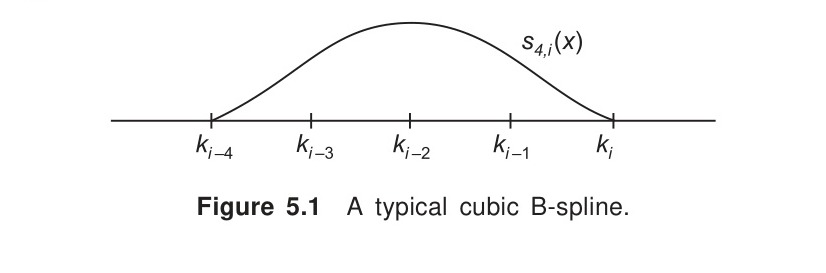
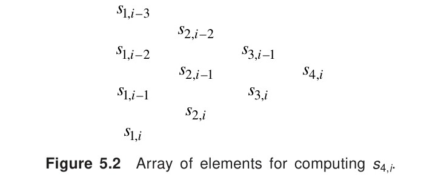
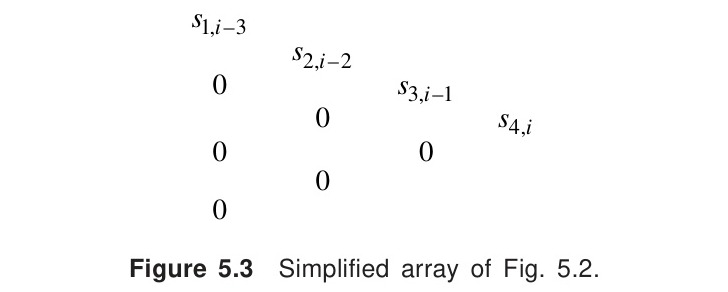

# 5.4 Cubic B-splines

<!-- Page 197 -->

The cubic spline formulae derived in the preceding section are global in nature, which means that they do not permit any local changes in the given data. Hence, efforts were made to derive spline formulae which are 'nonglobal'. We require *basis functions* which allow the degree of the resulting curve to be changed without any change in the data. The B-splines are such *basis functions* which have important applications in computer graphics. The B-splines can be of any degree but those of second or third degree are usually found to be sufficient.

The theory of B-splines was first suggested by Schoenberg [1946], but recurrence formulae for their computation were discovered independently by Cox [1972] and de Boor [1972].

A B-spline of *order $n$* (or *degree $n - 1$*), denoted by $s_{n, i}(x)$, is a spline of degree $(n - 1)$ with knots $k_{i-n}, k_{i-n+1}, \dots, k_i$, which is zero everywhere except in the interval $k_{i-n} < x < k_i$. The cubic B-spline $s_{4, i}(x)$ with knots $k_{i-4}, k_{i-3}, k_{i-2}, k_{i-1}, k_i$, is such that
(i) on each interval, $s_{4, i}(x)$ is a polynomial in $x$ of degree 3 or less,
(ii) $s_{4, i}(x)$, $s'_{4, i}(x)$ and $s''_{4, i}(x)$ are continuous, and
(iii) $s_{4, i}(x) > 0$ inside $[k_{i-4}, k_i]$ and is identically zero outside $[k_{i-4}, k_i]$.

A typical cubic B-spline with knots $k_{i-4}, k_{i-3}, k_{i-2}, k_{i-1}, k_i$, is shown in Fig. 5.1.

*Figure 5.1 — A typical cubic B-spline.*

<!-- Page 198 -->

### 5.4.1 Representations of B-splines

To represent the cubic B-spline $s_{4, i}(x)$ at $x = k_i$, we consider the five knots
$$k_{i-4}, k_{i-3}, k_{i-2}, k_{i-1}, k_i$$
which are such that
$$k_{i-4} < k_{i-3} < k_{i-2} < k_{i-1} < k_i \tag{5.56}$$

We also define the function
$$P_+^3 = \begin{cases} P^3, & \text{when } P \ge 0 \\ 0, & \text{when } P \le 0 \end{cases} \tag{5.57}$$

Then, a unique representation of the cubic B-spline with knots $k_{i-4}, \dots, k_i$, is given by Greville [1968]:
$$s_{4, i}(x) = \sum_{r=0}^3 \alpha_r x^r + \sum_{m=i-4}^i \beta_m (x - k_m)_+^3 \tag{5.58}$$

Another representation based on the concept of divided differences is given below.
$$
\begin{aligned}
s_{4, i}(x) &= [k_{i-4}, k_{i-3}, k_{i-2}, k_{i-1}, k_i] \tag{5.59} \\
&= \frac{(k_{i-4} - x)_+^3}{(k_{i-4} - k_{i-3})(k_{i-4} - k_{i-2})(k_{i-4} - k_{i-1})(k_{i-4} - k_i)} \\
&\quad + \frac{(k_{i-3} - x)_+^3}{(k_{i-3} - k_{i-4})(k_{i-3} - k_{i-2})(k_{i-3} - k_{i-1})(k_{i-3} - k_i)} \\
&\quad + \dots + \frac{(k_i - x)_+^3}{(k_i - k_{i-4})(k_i - k_{i-3})(k_i - k_{i-2})(k_i - k_{i-1})} \tag{5.60}
\end{aligned}
$$

Denoting
$$\Pi_{4, i}(x) = (x - k_{i-4})(x - k_{i-3})(x - k_{i-2})(x - k_{i-1})(x - k_i) \tag{5.61}$$
We obtain
$$\Pi'_{4, i}(k_i) = (k_i - k_{i-4})(k_i - k_{i-3})(k_i - k_{i-2})(k_i - k_{i-1}) \tag{5.62}$$
Hence, Eq. (5.60) can be written as
$$
\begin{aligned}
s_{4, i}(x) &= \frac{(k_{i-4} - x)_+^3}{\Pi'_{4, i}(k_{i-4})} + \frac{(k_{i-3} - x)_+^3}{\Pi'_{4, i}(k_{i-3})} + \frac{(k_{i-2} - x)_+^3}{\Pi'_{4, i}(k_{i-2})} \\
&\quad + \frac{(k_{i-1} - x)_+^3}{\Pi'_{4, i}(k_{i-1})} + \frac{(k_i - x)_+^3}{\Pi'_{4, i}(k_i)} \\
&= \sum_{m=i-4}^i \frac{(k_m - x)_+^3}{\Pi'_{4, i}(k_m)} \tag{5.63}
\end{aligned}
$$

<!-- Page 199 -->

More generally, a B-spline of order $n$ (degree $n - 1$) is defined by
$$
\begin{aligned}
s_{n, i}(x) &= [k_{i-n}, k_{i-n+1}, \dots, k_i] \tag{5.64} \\
&= \sum_{m=i-n}^i \frac{(k_m - x)_+^3}{\Pi'_{n, i}(k_m)} \tag{5.65}
\end{aligned}
$$
where
$$\Pi_{n, i}(x) = (x - k_{i-n})(x - k_{i-n+1}) \dots (x - k_i) \tag{5.66}$$
and $\Pi'_{n, i}(x)$ denoting its derivative with respect to $x$. From the definition of a divided difference, we have
$$
\begin{aligned}
[k_{i-4}, k_{i-3}, k_{i-2}, k_{i-1}, k_i] &= \frac{[k_{i-3}, k_{i-2}, k_{i-1}, k_i] - [k_{i-4}, k_{i-3}, k_{i-2}, k_{i-1}]}{k_i - k_{i-4}} \\
&= \frac{s_{3, i}(x) - s_{3, i-1}(x)}{k_i - k_{i-4}} \tag{5.67}
\end{aligned}
$$
Thus,
$$s_{4, i}(x) = \frac{s_{3, i}(x) - s_{3, i-1}(x)}{k_i - k_{i-4}}, \tag{5.68}$$
which is a recurrence relation. Similarly, for B-splines of order $n$, we have the recurrence relation
$$s_{n, i}(x) = \frac{s_{n-1, i}(x) - s_{n-1, i-1}(x)}{k_i - k_{i-n}} \tag{5.69}$$

In practice, however, formulae given in Eqs. (5.58), (5.68) and (5.69) are not used since they are found to be computationally inefficient. Instead, a recurrence formula discovered independently by Cox [1972] and de Boor [1972] is found to be efficient. This formula is
$$s_{n, i}(x) = \frac{(x - k_{i-n})s_{n-1, i-1}(x) + (k_i - x)s_{n-1, i}(x)}{k_i - k_{i-n}}, \tag{5.70}$$
for all $x$. For proof of Eq. (5.70), see Cox [1972].

From Eq. (5.70), it can be seen that the computation of $s_{n, i}(x)$ depends on $s_{n-1, i-1}(x)$ and $s_{n-1, i}(x)$. Thus, if the knots are $k_{i-4}, k_{i-3}, k_{i-2}, k_{i-1}$ and $k_i$, then the cubic B-spline $s_{4, i}(x)$ can be computed, from left to right, as in the following Fig. 5.2.

<!-- Page 200 -->

*Figure 5.2 — Array of elements for computing $s_{4,i}$.*

Further, simplification in the computation of the above array may be made by using the property
$$s_{1, j} = \begin{cases} \dfrac{1}{k_j - k_{j-1}} & \text{if } k_{j-1} \le x < k_j \\ 0, & \text{otherwise.} \end{cases} \tag{5.71}$$

For example, if $k_{i-4} \le x < k_{i-3}$, the array in Fig. 5.2 simplifies to the following Fig. 5.3.

*Figure 5.3 — Simplified array of Fig. 5.2.*

The numerical computation of B-splines will now become more simpler. The following examples demonstrate the use of formulae (5.64) and (5.70) for the computation of B-splines.

> [!NOTE] EXAMPLE 5.8
> With respect to the knots $0, 1, 2, 3, 4$, compute cubic B-splines at $x = 1$ and $x = 2$ using formula (5.64).
> 
> **Solution:**
> We have
> $$s_{4, i}(x) = \sum_{m=i-4}^i \frac{(k_m - x)_+^3}{\Pi'_{4, i}(k_m)} \tag{i}$$
> 
> **(a) $x = 1$**
> Here $i = 4$, $k_0 = 0$, $k_1 = 1$, $k_2 = 2$, $k_3 = 3$ and $k_4 = 4$.

<!-- Page 201 -->

> Therefore,
> $$
> \begin{aligned}
> s_{4, 4}(1) &= \sum_{m=0}^4 \frac{(k_m - x)_+^3}{\Pi'_{4, 4}(k_m)} \\
> &= \frac{(k_0 - 1)_+^3}{\Pi'_{4, 4}(k_0)} + \frac{(k_1 - 1)_+^3}{\Pi'_{4, 4}(k_1)} + \frac{(k_2 - 1)_+^3}{\Pi'_{4, 4}(k_2)} + \frac{(k_3 - 1)_+^3}{\Pi'_{4, 4}(k_3)} + \frac{(k_4 - 1)_+^3}{\Pi'_{4, 4}(k_4)} \\
> &= 0 + 0 + \frac{1}{\Pi'_{4, 4}(2)} + \frac{8}{\Pi'_{4, 4}(3)} + \frac{27}{\Pi'_{4, 4}(4)}
> \end{aligned} \tag{ii}
> $$
> Now,
> $$
> \begin{aligned}
> \Pi'_{4, 4}(2) &= (2 - 0)(2 - 1)(2 - 3)(2 - 4) = 4, \\
> \Pi'_{4, 4}(3) &= (3 - 0)(3 - 1)(3 - 2)(3 - 4) = -6,
> \end{aligned}
> $$
> and
> $$\Pi'_{4, 4}(4) = (4 - 0)(4 - 1)(4 - 2)(4 - 3) = 24.$$
> Hence, (ii) gives
> $$
> \begin{aligned}
> s_{4, 4}(1) &= \frac{1}{4} - \frac{8}{6} + \frac{27}{24} \\
> &= \frac{1}{24}.
> \end{aligned}
> $$
> 
> **(b) $x = 2$**
> We have
> $$
> \begin{aligned}
> s_{4, 4}(2) &= \frac{(3 - 2)_+^3}{\Pi'_{4, 4}(3)} + \frac{(4 - 2)_+^3}{\Pi'_{4, 4}(4)} \\
> &= \frac{1}{-6} + \frac{8}{24} = \frac{1}{6}.
> \end{aligned}
> $$
> $\blacktriangleleft$

> [!NOTE] EXAMPLE 5.9
> With the same data as in Example 5.8, compute cubic B-splines at $x = 1$ and $x = 2$, using formula (5.70).
> 
> **Solution:**
> The formula is
> $$s_{4, i}(x) = \frac{(x - k_{i-4})s_{3, i-1}(x) + (k_i - x)s_{3, i}(x)}{k_i - k_{i-4}} \tag{iii}$$
> 
> **(a) $x = 1$**
> We have $1 \le x < 2$. Then $s_{1, 2} = \dfrac{1}{k_2 - k_1} = 1$.

<!-- Page 202 -->

> Hence we need to compute the elements in the following array
> $$
> \begin{matrix}
> 0 & & & \\
> & s_{2, 2} & & \\
> s_{1, 2} & & s_{3, 3} & \\
> & s_{2, 3} & & s_{4, 4} \\
> 0 & & s_{3, 4} & \\
> & 0 & & \\
> 0 & & &
> \end{matrix}
> $$
> Now,
> $$
> \begin{aligned}
> s_{2, 2} &= \frac{(1 - k_0)s_{1, 1} + (k_2 - 1)s_{1, 2}}{k_2 - k_0} = \frac{1}{2}, \\
> s_{2, 3} &= \frac{(1 - k_1)s_{1, 2} + (k_3 - 1)s_{1, 3}}{k_3 - k_1} = 0, \\
> s_{3, 3} &= \frac{(1 - k_0)s_{2, 2} + (k_3 - 1)s_{2, 3}}{k_3 - k_0} = \frac{\frac{1}{2}}{3} = \frac{1}{6}, \\
> s_{3, 4} &= \frac{(1 - k_1)s_{2, 3} + (k_4 - 1)s_{2, 4}}{k_4 - k_1} = 0, \\
> s_{4, 4} &= \frac{(1 - k_0)s_{3, 3} + (k_4 - 1)s_{3, 4}}{k_4 - k_0} = \frac{1}{24}.
> \end{aligned}
> $$
> 
> **(b) $x = 2$**
> We have $2 \le x < 3$
> Then
> $$s_{1, 3} = \frac{1}{k_3 - k_2} = 1.$$
> In this case, the array to be computed is given below.
> $$
> \begin{matrix}
> 0 & & & \\
> & 0 & & \\
> 0 & & s_{3, 3} & \\
> & s_{2, 3} & & s_{4, 4} \\
> s_{1, 3} & & s_{3, 4} & \\
> & s_{2, 4} & & \\
> 0 & & &
> \end{matrix}
> $$
> $$
> \begin{aligned}
> s_{2, 3} &= \frac{(2 - k_1)s_{1, 2} + (3 - 2)s_{1, 3}}{3 - k_1} = \frac{1}{2}, \\
> s_{2, 4} &= \frac{(2 - k_2)s_{1, 3} + (4 - 2)s_{1, 4}}{2} = 0,
> \end{aligned}
> $$

<!-- Page 203 -->

> $$
> \begin{aligned}
> s_{3, 3} &= \frac{(2 - 0)s_{2, 2} + (3 - 2)s_{2, 3}}{3} = \frac{1}{6}, \\
> s_{3, 4} &= \frac{(2 - 1)s_{2, 3} + (4 - 2)s_{2, 4}}{3} = \frac{1}{6},
> \end{aligned}
> $$
> and
> $$s_{4, 4} = \frac{(2 - 0)s_{3, 3} + (4 - 2)s_{3, 4}}{4} = \frac{1}{6}.$$
> $\blacktriangleleft$

### 5.4.2 Least Squares Solution

Let the set of data points be $(x_i, y_i)$, $i = 1, 2, \dots, m$, and $a \le x \le b$. Let $s(x)$ be the cubic spline with knots $k_1, k_2, \dots, k_p$, where $a < k_1 < k_2 < \dots < k_p < b$. To define the full set of B-splines, it is necessary to introduce eight additional knots, namely, $k_{-3}, k_{-2}, k_{-1}, k_0$, $k_{p+1}, k_{p+2}, k_{p+3}$ and $k_{p+4}$. These knots are chosen such that
$$k_{-3} < k_{-2} < k_{-1} < k_0 = a \quad \text{and} \quad b = k_{p+1} < k_{p+2} < k_{p+3} < k_{p+4} \tag{5.72}$$

We now have $(p + 4)$ B-splines (of order 4) in the range $a \le x \le b$, and then the general cubic spline $s(x)$ with knots $k_1, k_2, \dots, k_p$ has a unique representation, in the range $a \le x \le b$, of the form
$$s(x) = \sum_{i=1}^{p+4} \alpha_i s_{4, i}(x), \quad a \le x \le b, \tag{5.73}$$
where $\alpha_i$ are constants to be determined.

To determine the constants $\alpha_i$ in Eq. (5.73), we substitute $x = x_r$ and obtain
$$s(x_r) = y_r = \sum_{i=1}^{p+4} \alpha_i s_{4, i}(x_r), \quad r = 1, 2, \dots, m \tag{5.74}$$
where $m \gg p + 4$. In matrix notation, Eq. (5.74) can be written as
$$A \boldsymbol{\alpha} = \mathbf{y} \tag{5.75}$$
where $A$ is an $m \times (p + 4)$ band matrix and $\boldsymbol{\alpha}$, $\mathbf{y}$ are column vectors. The required solution is obtained by solving the normal equations
$$A^T A \boldsymbol{\alpha} = A^T \mathbf{y} \tag{5.76}$$

### 5.4.3 Applications of B-splines

An important application of the B-spline theory is in *digital signal processing* where the B-splines are used for noise reduction in wavelet domain. See, for example, Poornachandra et al. [2004], where B-splines are adopted to obtain noisefree signals.
