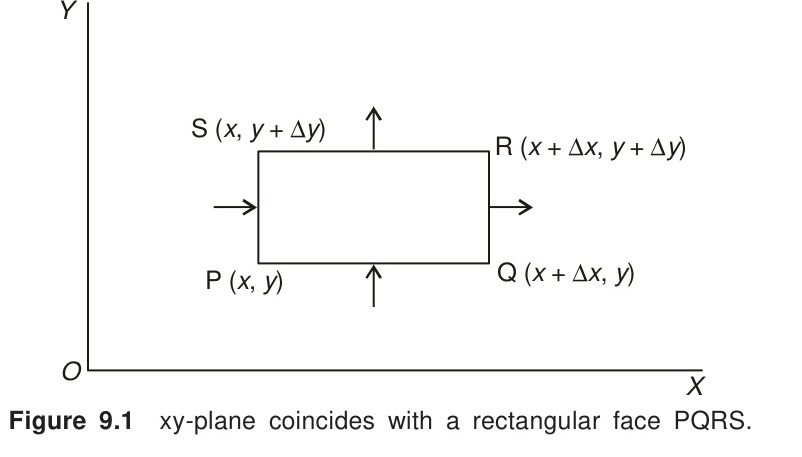

# 9.2 Laplace's Equation

<!-- Page 344 -->

The equation defined by
$$\frac{\partial^2 u}{\partial x^2} + \frac{\partial^2 u}{\partial y^2} = 0 \tag{9.10}$$
is called *Laplace's equation*. It occurs in all problems involving potential functions and is of elliptic type. To derive this equation, we consider a heated plate which is insulated everywhere except at its edges where the temperature is constant. Assuming that the $xy$-plane coincides with one rectangular face PQRS (see Fig. 9.1), we find that the quantity of heat entering the face PS in time $\Delta t$
$$= - k\alpha \,\Delta y \left[ \frac{\partial u}{\partial x} \right]_x \Delta t,$$

*Figure 9.1 — xy-plane coincides with a rectangular face PQRS.*

where $\alpha$ is the thickness of the plate, $u(x, t)$ is the temperature at a distance $x$ at time $t$ and $k$ is the conductivity of the material of the plate. Similarly, the amount of heat leaving the face QR in time $\Delta t$ is
$$- k\alpha \,\Delta y \left[ \frac{\partial u}{\partial x} \right]_{x + \Delta x} \Delta t$$
From the above two expressions, we obtain the gain of heat during time $\Delta t$
$$= k\alpha \,\Delta y \left( \left[ \frac{\partial u}{\partial x} \right]_{x + \Delta x} - \left[ \frac{\partial u}{\partial x} \right]_x \right) \Delta t$$
In the same way, we obtain the gain of heat from the faces PQ and SR in time $\Delta t$ as
$$k\alpha \,\Delta x \left( \left[ \frac{\partial u}{\partial y} \right]_{y + \Delta y} - \left[ \frac{\partial u}{\partial y} \right]_y \right) \Delta t$$

<!-- Page 345 -->

Hence the total gain of heat in the plate
$$= k\alpha \,\Delta x \Delta y \left( \frac{\left[\frac{\partial u}{\partial x}\right]_{x + \Delta x} - \left[\frac{\partial u}{\partial x}\right]_x}{\Delta x} + \frac{\left[\frac{\partial u}{\partial y}\right]_{y + \Delta y} - \left[\frac{\partial u}{\partial y}\right]_y}{\Delta y} \right) \Delta t$$
This heat raises the temperature in the plate which is equal to
$$\rho \alpha s \,\Delta x \Delta y \,\Delta u,$$
where $s$ is the specific heat and $\rho$ is the density of the material. Hence we have
$$\rho \alpha s \,\Delta x \Delta y \,\Delta u = k\alpha \,\Delta x \Delta y \left( \frac{\left[\frac{\partial u}{\partial x}\right]_{x + \Delta x} - \left[\frac{\partial u}{\partial x}\right]_x}{\Delta x} + \frac{\left[\frac{\partial u}{\partial y}\right]_{y + \Delta y} - \left[\frac{\partial u}{\partial y}\right]_y}{\Delta y} \right) \Delta t \tag{9.11}$$
Dividing both sides of Eq. (9.11) by $\Delta t$ and proceeding to the limit, we obtain
$$
\begin{aligned}
\frac{\partial u}{\partial t} &= \frac{k}{\rho s} \left( \frac{\partial^2 u}{\partial x^2} + \frac{\partial^2 u}{\partial y^2} \right) \\
&= a^2 \left( \frac{\partial^2 u}{\partial x^2} + \frac{\partial^2 u}{\partial y^2} \right),
\end{aligned} \tag{9.12}
$$
where $a^2 = \frac{k}{\rho s}$. Equation (9.12) gives the temperature distribution in the plate in the *transient state*. When the temperature $u(x, t)$ is constant, i.e., at the *steadystate* condition, $\frac{\partial u}{\partial t} = 0$ and Eq. (9.12) reduces to Laplace's equation (9.10).

Using the method of separation of variables, it can be shown that Eq. (9.10) possesses the solutions
$$u(x, y) = (c_1 e^{kx} + c_2 e^{-kx})(c_3 \cos ky + c_4 \sin ky) \tag{9.13}$$
$$u(x, y) = (c_5 \cos kx + c_6 \sin kx)(c_7 e^{ky} + c_8 e^{-ky}) \tag{9.14}$$
The proper form of solution has to be chosen depending upon the physical conditions of the problem.
