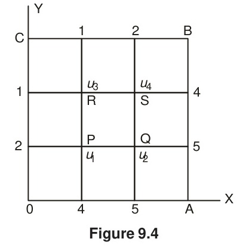
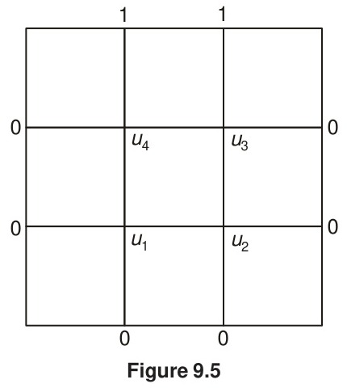
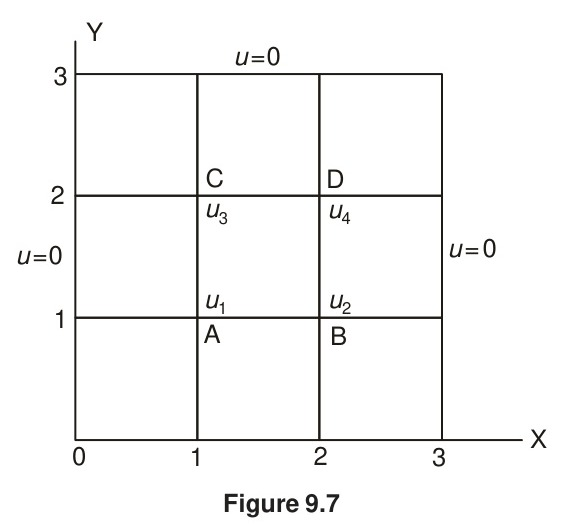
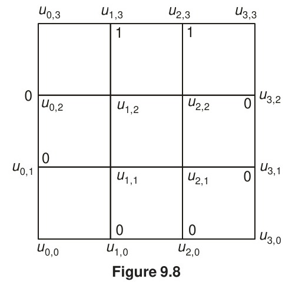

# 9.4 Solution of Laplace's Equation

<!-- Page 348 -->

We wish to solve Laplace's equation
$$u_{xx} + u_{yy} = 0 \tag{9.30}$$
in a bounded region R with boundary C. As in Dirichlet's problem, let the value of $u$ be specified everywhere on C. For simplicity, let R be a square region so that it can be divided into a network of small squares of side $h$. Let the values of $u(x, y)$ on the boundary C be given by $c_i$ and let the interior mesh points and the boundary points be as in Fig. 9.3.

*Figure 9.3 — Interior mesh points and boundary points.*

<!-- Page 349 -->

Then, as shown in the previous section, Eq. (9.30) can be replaced by either the standard five-point formula, viz. Eq. (9.25); or the diagonal five-point formula given in Eq. (9.27). The approximate function values at the interior mesh points can now be computed according to the scheme: we first use the diagonal five-point formula Eq. (9.27) and compute $u_5, u_7, u_9, u_1$ and $u_3$ in this order. Thus, we obtain
$$
\begin{aligned}
u_5 &= \frac{1}{4}(c_1 + c_5 + c_9 + c_{13}); & u_7 &= \frac{1}{4}(c_{15} + u_5 + c_{11} + c_{13}); \\
u_9 &= \frac{1}{4}(u_5 + c_7 + c_9 + c_{11}); & u_1 &= \frac{1}{4}(c_1 + c_3 + u_5 + c_{15}); \\
u_3 &= \frac{1}{4}(c_3 + c_5 + c_7 + u_5). & &
\end{aligned}
$$
We then compute, in the order, the remaining quantities, viz., $u_8, u_4, u_6$ and $u_2$ by the *standard five-point formula* (9.25). Thus, we have
$$
\begin{aligned}
u_8 &= \frac{1}{4}(u_5 + u_9 + c_{11} + u_7); & u_4 &= \frac{1}{4}(u_1 + u_5 + u_7 + c_{15}); \\
u_6 &= \frac{1}{4}(u_3 + c_7 + u_9 + u_5); & u_2 &= \frac{1}{4}(c_3 + u_3 + u_5 + u_1).
\end{aligned}
$$
When once all the $u_i, (i = 1, 2, 3, \dots, 9)$ are computed, their accuracy can be improved by any of the iterative methods described below.

### 9.4.1 Jacobi's Method

Let $u_{i, j}^{(n)}$ denotes the $n$th iterative value of $u_{i, j}$. An iterative procedure to solve Eq. (9.25) is
$$u_{i, j}^{(n+1)} = \frac{1}{4} [u_{i-1, j}^{(n)} + u_{i+1, j}^{(n)} + u_{i, j-1}^{(n)} + u_{i, j+1}^{(n)}] \tag{9.31}$$
for the interior mesh points. This is called the *point Jacobi method*.

### 9.4.2 Gauss–Seidel Method

The method uses the latest iterative values available and scans the mesh points systematically from left to right along successive rows. The iterative formula is:
$$u_{i, j}^{(n+1)} = \frac{1}{4} [u_{i-1, j}^{(n+1)} + u_{i+1, j}^{(n)} + u_{i, j-1}^{(n+1)} + u_{i, j+1}^{(n)}] \tag{9.32}$$
It can be shown that the Gauss–Seidel scheme converges twice as fast as the Jacobi scheme. This method is also referred to as *Liebmann's method*.

<!-- Page 350 -->

### 9.4.3 Successive Over Relaxation (SOR) Method

Equation (9.32) can be written as
$$
\begin{aligned}
u_{i, j}^{(n+1)} &= u_{i, j}^{(n)} + \frac{1}{4} [u_{i-1, j}^{(n+1)} + u_{i+1, j}^{(n)} + u_{i, j-1}^{(n+1)} + u_{i, j+1}^{(n)} - 4u_{i, j}^{(n)}] \\
&= u_{i, j}^{(n)} + \frac{1}{4} R_{i, j}
\end{aligned}
$$
which shows that $(1/4) R_{i, j}$ is the change in the value of $u_{i, j}$ for one Gauss–Seidel iteration. In the SOR method, a larger change than this is given to $u_{i, j}^{(n)}$, and the iteration formula is written as
$$
\begin{aligned}
u_{i, j}^{(n+1)} &= u_{i, j}^{(n)} + \frac{1}{4} \omega R_{i, j} \\
&= \frac{1}{4}\omega [u_{i-1, j}^{(n+1)} + u_{i+1, j}^{(n)} + u_{i, j-1}^{(n+1)} + u_{i, j+1}^{(n)}] + (1 - \omega) u_{i, j}^{(n)} \\
&= \omega u_{i, j}^{(n+1)} + (1 - \omega) u_{i, j}^{(n)}
\end{aligned} \tag{9.33}
$$
The rate of convergence of Eq. (9.33) depends on the choice of $\omega$, which is called the *accelerating factor* and lies between 1 and 2.

The percentage error in the value $u_{ij}$ is given by
$$|\varepsilon_{ij}| = \left| \frac{u_{i, j}^{(n+1)} - u_{i, j}^{(n)}}{u_{ij}^{(n+1)}} \right| \times 100\% \tag{9.34}$$
It was shown by B.A. Carré that for $\omega = 1.875$, the rate of convergence of Eq. (9.33) is twice as fast as that when $\omega = 1$, and for $\omega = 1.9$, the rate of convergence is 40 times greater than that when $\omega = 1$. In general, however, it is difficult to estimate the best value of $\omega$. The following examples illustrate the methods of solution.

> [!NOTE] EXAMPLE 9.1
> Solve Laplace's equation for the square region shown in Fig. 9.4, the boundary values being as indicated.
> 
> 
> *Figure 9.4*
> 
> **Solution:**

<!-- Page 351 -->

> It is seen from the figure that the boundary values are symmetric about the diagonal AC. Hence, $u_1 = u_4$ and we need find only $u_1$, $u_2$ and $u_3$. The standard five-point formula applied at the point P gives
> $$u_2 + u_3 + 2 + 4 - 4u_1 = 0.$$
> Hence we have
> $$u_1 = \frac{1}{4}(u_2 + u_3 + 6).$$
> The iteration formula is therefore
> $$u_1^{(n+1)} = \frac{1}{4} [u_2^{(n)} + u_3^{(n)} + 6].$$
> Similarly, the iteration formulae at the points Q and R are given by
> $$u_2^{(n+1)} = \frac{1}{2} u_1^{(n+1)} + \frac{5}{2},$$
> and
> $$u_3^{(n+1)} = \frac{1}{2} u_1^{(n+1)} + \frac{1}{2}.$$
> For the first iteration, let $u_2 = 5$ (since it is nearer to the value $u = 5$), and $u_3^{(0)} = 1$. Hence
> $$
> \begin{aligned}
> u_1^{(1)} &= \frac{1}{4}(5 + 1 + 6) = 3, \\
> u_2^{(1)} &= \frac{1}{2}(3) + \frac{5}{2} = 4, \\
> u_3^{(1)} &= \frac{1}{2}(3) + \frac{1}{2} = 2.
> \end{aligned}
> $$
> For the second iteration, we have
> $$
> \begin{aligned}
> u_1^{(2)} &= \frac{1}{4}(4 + 2 + 6) = 3, \\
> u_2^{(2)} &= \frac{1}{2}(3) + \frac{5}{2} = 4,
> \end{aligned}
> $$
> and
> $$u_3^{(2)} = \frac{1}{2}(3) + \frac{1}{2} = 2.$$
> Since the values are unchanged, we conclude that $u_1 = 3$, $u_2 = 4$, $u_3 = 2$ and $u_4 = 3$.
> $\blacktriangleleft$

> [!NOTE] EXAMPLE 9.2
> Solve the equation $u_{xx} + u_{yy} = 0$ in the domain of Fig. 9.5, below by (a) Jacobi's method, (b) Gauss–Seidel's method, and (c) SOR method.

<!-- Page 352 -->

> 
> *Figure 9.5*
> 
> **Solution:**
> (a) To start *Jacobi's iteration process*, we obtain the approximate values of $u_1$, $u_2$, $u_3$ and $u_4$ as follows:
> $$
> \begin{aligned}
> u_1^{(1)} &= \frac{1}{4}(0 + 0 + 0 + 1) = 0.25; \\
> u_2^{(1)} &= \frac{1}{4}(0 + 0 + 0 + 1) = 0.25; \\
> u_3^{(1)} &= \frac{1}{4}(1 + 1 + 0 + 0) = 0.5; \\
> u_4^{(1)} &= \frac{1}{4}(1 + 1 + 0 + 0) = 0.5.
> \end{aligned}
> $$
> The iterations have been continued using Eq. (9.31), and seven successive iterates are given below:
> 
> | $u_1$ | $u_2$ | $u_3$ | $u_4$ |
> | :---: | :---: | :---: | :---: |
> | 0.1875 | 0.1875 | 0.4375 | 0.4375 |
> | 0.15625 | 0.15625 | 0.40625 | 0.40625 |
> | 0.14062 | 0.14062 | 0.39062 | 0.39062 |
> | 0.13281 | 0.13281 | 0.38281 | 0.38281 |
> | 0.12891 | 0.12891 | 0.37891 | 0.37891 |
> | 0.12695 | 0.12695 | 0.37695 | 0.37695 |
> | 0.12598 | 0.12598 | 0.37598 | 0.37598 |
> 
> (b) *Gauss–Seidel method*: Five successive iterates are given below:
> 
> | $u_1$ | $u_2$ | $u_3$ | $u_4$ |
> | :---: | :---: | :---: | :---: |
> | 0.25 | 0.3125 | 0.5625 | 0.46875 |
> | 0.21875 | 0.17187 | 0.42187 | 0.39844 |
> | 0.14844 | 0.13672 | 0.38672 | 0.38086 |
> | 0.13086 | 0.12793 | 0.37793 | 0.37646 |
> | 0.12646 | 0.12573 | 0.37573 | 0.37537 |

<!-- Page 353 -->

> (c) *SOR method*: With $\omega = 1.1$, three successive iterates obtained by using Eq. (9.33) are given below.
> 
> | $u_1$ | $u_2$ | $u_3$ | $u_4$ |
> | :---: | :---: | :---: | :---: |
> | 0.275 | 0.35062 | 0.35062 | 0.35062 |
> | 0.16534 | 0.10683 | 0.38183 | 0.37432 |
> | 0.11785 | 0.12181 | 0.37216 | 0.37341 |
> $\blacktriangleleft$

> [!NOTE] EXAMPLE 9.3
> Solve Laplace's equation for Fig. 9.6 given below:
> 
> 
> *Figure 9.6*
> 
> **Solution:**
> We first compute the quantities $u_5, u_7, u_9, u_1$ and $u_3$ by using the diagonal five-point formula given in Eq. (9.27). Thus, we obtain
> $$
> \begin{aligned}
> u_5^{(1)} &= 25.00; & u_7^{(1)} &= 42.75; & u_9^{(1)} &= 43.75; \\
> u_1^{(1)} &= 6.25; & u_3^{(1)} &= 6.25. & &
> \end{aligned}
> $$
> We now compute $u_8, u_4, u_6$ and $u_2$ successively by using the standard five-point formula given in Eq. (9.25)
> $$
> \begin{aligned}
> u_8^{(1)} &= 53.12; & u_4^{(1)} &= 18.75; \\
> u_6^{(1)} &= 18.75; & u_2^{(1)} &= 9.38.
> \end{aligned}
> $$
> We have thus obtained the first approximations of all the nine mesh points and we can now use one of the iterative formulae given in Section 9.4. We give below the first-four iterates obtained by using the Gauss–Seidel formula:
> 
> | $u_1$ | $u_2$ | $u_3$ | $u_4$ | $u_5$ | $u_6$ | $u_7$ | $u_8$ | $u_9$ |
> | :---: | :---: | :---: | :---: | :---: | :---: | :---: | :---: | :---: |
> | 7.03 | 9.57 | 7.08 | 18.94 | 25.10 | 18.98 | 43.02 | 52.97 | 42.99 |
> | 7.13 | 9.83 | 7.20 | 18.81 | 25.15 | 18.84 | 42.94 | 52.77 | 42.90 |
> | 7.16 | 9.88 | 7.18 | 18.81 | 25.08 | 18.79 | 42.89 | 52.72 | 42.88 |
> | 7.17 | 9.86 | 7.16 | 18.78 | 25.04 | 18.77 | 42.88 | 52.70 | 42.87 |
> $\blacktriangleleft$

<!-- Page 354 -->

> [!NOTE] EXAMPLE 9.4
> Solve the Poisson equation
> $$u_{xx} + u_{yy} = -10 (x^2 + y^2 + 10).$$
> in the domain of Fig. 9.7.
> 
> 
> *Figure 9.7*
> 
> **Solution:**
> Let the values of $u$ at the four grid points, A, B, C, D be $u_1$, $u_2$, $u_3$, $u_4$, respectively. Let the grid points be defined by $x = ih$, $y = jh$, where $h = 1$, $i, j = 0, 1, 2, 3$. At the point A, $i = 1$, $j = 1$. The standard five-point formula applied at the point A gives
> $$u_2 + u_3 + 0 + 0 - 4u_1 = -10(1 + 1 + 10)$$
> i.e.,
> $$u_1 = \frac{1}{4}(u_2 + u_3 + 120) \tag{i}$$
> Again, the standard five-point formula applied at the point B gives
> $$u_1 + u_4 + 0 + 0 - 4u_2 = -10(4 + 1 + 10)$$
> i.e.,
> $$u_2 = \frac{1}{4}(u_1 + u_4 + 150) \tag{ii}$$
> Similarly, the standard five-point formula applied at the points C and D gives, respectively
> $$u_3 = \frac{1}{4}(u_1 + u_4 + 150) \tag{iii}$$
> and
> $$u_4 = \frac{1}{4}(u_2 + u_3 + 180) \tag{iv}$$

<!-- Page 355 -->

> From (ii) and (iii), it is seen that $u_2 = u_3$ and so we need to find only $u_1$, $u_2$ and $u_4$ from (i), (ii) and (iv). The iteration formulae are therefore given by
> $$
> \begin{aligned}
> u_1^{(n+1)} &= \frac{1}{2} u_2^{(n)} + 30 \\
> u_2^{(n+1)} &= \frac{1}{4} [u_1^{(n+1)} + u_4^{(n)} + 150] \\
> u_4^{(n+1)} &= \frac{1}{2} u_2^{(n+1)} + 45.
> \end{aligned}
> $$
> For the first iteration, we assume that $u_2^{(0)} = u_4^{(0)} = 0$. Hence we obtain
> $$
> \begin{aligned}
> u_1^{(1)} &= 30, \\
> u_2^{(1)} &= \frac{1}{4}(30 + 0 + 150) = 45 \\
> u_4^{(1)} &= \frac{1}{2}(45) + 45 = 67.5.
> \end{aligned}
> $$
> For the second iteration, we have
> $$
> \begin{aligned}
> u_1^{(2)} &= \frac{1}{2} u_2^{(1)} + 30 = \frac{1}{2}(45) + 30 = 52.5 \\
> u_2^{(2)} &= \frac{1}{4} [u_1^{(2)} + u_4^{(1)} + 150] = \frac{1}{4}[52.5 + 67.5 + 150] = 67.5 \\
> u_4^{(2)} &= \frac{1}{2} [u_2^{(2)}] + 45 = 78.75.
> \end{aligned}
> $$
> For the third iteration, we obtain
> $$
> \begin{aligned}
> u_1^{(3)} &= \frac{1}{2} u_2^{(2)} + 30 = \frac{1}{2}(67.5) + 30 = 63.75 \\
> u_2^{(3)} &= \frac{1}{4} [u_1^{(3)} + u_4^{(2)} + 150] = \frac{1}{4}[63.75 + 78.75 + 150] = 73.125 \\
> u_4^{(3)} &= \frac{1}{2} u_2^{(3)} + 45 = \frac{1}{2}(73.125) + 45 = 81.5625.
> \end{aligned}
> $$
> The fourth iteration gives
> $$
> \begin{aligned}
> u_1^{(4)} &= \frac{1}{2} u_2^{(3)} + 30 = \frac{1}{2}(73.125) + 30 = 66.5625 \\
> u_2^{(4)} &= \frac{1}{4} [u_1^{(4)} + u_4^{(3)} + 150] = \frac{1}{4}[66.5625 + 81.5625 + 150] = 74.53125 \\
> u_4^{(4)} &= \frac{1}{2} u_2^{(4)} + 45 = \frac{1}{2}(74.53125) + 45 = 82.2656.
> \end{aligned}
> $$

<!-- Page 356 -->

> For the fifth iteration, we obtain
> $$
> \begin{aligned}
> u_1^{(5)} &= \frac{1}{2} u_2^{(4)} + 30 = \frac{1}{2}(74.53125) + 30 = 67.2656 \\
> u_2^{(5)} &= \frac{1}{4} [u_1^{(5)} + u_4^{(4)} + 150] = \frac{1}{4}[67.2656 + 82.2656 + 150] = 74.8828 \\
> u_4^{(5)} &= \frac{1}{2} u_2^{(5)} + 45 = \frac{1}{2}(74.8828) + 45 = 82.4414.
> \end{aligned}
> $$
> The sixth iteration gives
> $$
> \begin{aligned}
> u_1^{(6)} &= \frac{1}{2} u_2^{(5)} + 30 = \frac{1}{2}(74.8828) + 30 = 67.4414 \\
> u_2^{(6)} &= \frac{1}{4} [u_1^{(6)} + u_4^{(5)} + 150] = \frac{1}{4}[67.4414 + 82.4414 + 150] = 74.9707 \\
> u_4^{(6)} &= \frac{1}{2} u_2^{(6)} + 45 = \frac{1}{2}(74.9707) + 45 = 82.4854.
> \end{aligned}
> $$
> From the last two iterates, we conclude that
> $$u_1 = 67, \quad u_2 = u_3 = 75, \quad \text{and} \quad u_4 = 83.$$
> $\blacktriangleleft$

### 9.4.4 ADI Method

This is an efficient method for the numerical solution of elliptic partial differential equations and was proposed by Peaceman and Rachford. It is quite general but, for easy understanding, we demonstrate its applicability with reference to the Laplace equation in two dimensions. For more details, the reader is referred to Isaacson and Keller [1966].

We consider Laplace's equation in two dimensions, viz.,
$$\frac{\partial^2 u}{\partial x^2} + \frac{\partial^2 u}{\partial y^2} = 0 \tag{9.35}$$
and the standard five-point formula
$$u_{i-1, j} + u_{i+1, j} + u_{i, j-1} + u_{i, j+1} - 4u_{i, j} = 0 \tag{9.25}$$
The use of formula given in Eq. (9.25) involves the solution of a system of algebraic equations, whose coefficient matrix, for $n = 6$, is of the form
$$
A = \begin{bmatrix}
-4 & 1 & 0 & 1 & 0 & 0 \\
1 & -4 & 1 & 0 & 1 & 0 \\
0 & 1 & -4 & 0 & 0 & 1 \\
1 & 0 & 0 & -4 & 1 & 0 \\
0 & 1 & 0 & 1 & -4 & 1 \\
0 & 0 & 1 & 0 & 1 & -4
\end{bmatrix} \tag{9.36}
$$

<!-- Page 357 -->

The general form of such a system is given by
$$
B = \begin{bmatrix}
T & I & & 0 \\
I & T & I & & \\
\vdots & \vdots & \vdots & \vdots & \vdots & \vdots \\
& 0 & & I & T & I \\
& & & & I & T
\end{bmatrix}, \tag{9.37}
$$
where $T$ is a tridiagonal matrix of the form
$$
T = \begin{bmatrix}
-4 & 1 & & & \\
1 & -4 & 1 & 0 & \\
\vdots & \vdots & \vdots & \vdots & \vdots \\
& 0 & 1 & -4 & 1 \\
& & & 1 & -4
\end{bmatrix} \tag{9.38}
$$
System A is called a *block tridiagonal* system and such systems are solved by Gaussian elimination or, in the case of large systems, by Gauss–Seidel iterations. But tridiagonal systems of the type of Eq. (9.38) are much easier to solve than block tridiagonal systems. Hence the question arises as to whether we can obtain directly tridiagonal systems in the numerical solution of Laplace's equation. Peaceman and Rachford showed that this is possible and their method of procedure, called the *alternating direction implicit* method (or the ADI method) is described below.

We rearrange Eq. (9.25) in either of two ways:
$$u_{i-1, j} - 4u_{i, j} + u_{i+1, j} = -u_{i, j-1} - u_{i, j+1} \tag{9.39}$$
or
$$u_{i, j-1} - 4u_{i, j} + u_{i, j+1} = -u_{i-1, j} - u_{i+1, j} \tag{9.40}$$
The ADI is an *iteration* method and Eqs. (9.39) and (9.40) are used as iteration formulae
$$u_{i-1, j}^{(r+1)} - 4u_{i, j}^{(r+1)} + u_{i+1, j}^{(r+1)} = -u_{i, j-1}^{(r)} - u_{i, j+1}^{(r)} \tag{9.41}$$
and
$$u_{i, j-1}^{(r+2)} - 4u_{i, j}^{(r+2)} + u_{i, j+1}^{(r+2)} = -u_{i-1, j}^{(r+1)} - u_{i+1, j}^{(r+1)} \tag{9.42}$$
Equation (9.41) is used to compute function values at all internal mesh points along rows and Eq. (9.42) those along columns. For $j = 1, 2, 3, \dots, n-1$, Eq. (9.41) yields a tridiagonal system of equations and can easily be solved. Similarly, for $i = 1, 2, 3, \dots, n-1$, Eq. (9.42) also yields a tridiagonal system of equations.

In the ADI method, formulae (9.41) and (9.42) are used alternately. For example, for the first row $j = 1$, and Eq. (9.41) gives

<!-- Page 358 -->

$$u_{i-1, 1}^{(r+1)} - 4u_{i, 1}^{(r+1)} + u_{i+1, 1}^{(r+1)} = -u_{i, 0}^{(r)} - u_{i, 2}^{(r)}, \quad (i = 1, 2, 3, \dots, n-1) \tag{9.43}$$
Together with the boundary conditions, Eq. (9.43) represents a tridiagonal system of equations and are easily solved for $u_{i, 1}^{(r+1)}$. We next put $j = 2$ and obtain the values of $u_{i, 2}^{(r+1)}$ on the second row. The process is repeated for all the rows, viz. up to $j = n-1$. We next alternate the direction, i.e. we use Eq. (9.42) to compute $u_{i, j}^{(r+2)}$. It is easy to see that at every stage we will be solving a tridiagonal system of equations. Example 9.5 demonstrates the method of solution.

> [!NOTE] EXAMPLE 9.5
> Solve Laplace's equation, $u_{xx} + u_{yy} = 0$, in the domain of Fig. 9.8 (see Example 9.2).
> 
> 
> *Figure 9.8*
> 
> **Solution:**
> To apply formulae given in Eqs. (9.41) and (9.42), we relabel the internal mesh points, as in Fig. 9.8.
> 
> To start the iterations, we set $r = 0$. For the first row, $j = 1$. Then, Eq. (9.41) gives
> $$u_{i-1, 1}^{(1)} - 4u_{i, 1}^{(1)} + u_{i+1, 1}^{(1)} = -u_{i, 0}^{(0)} - u_{i, 2}^{(0)}. \tag{i}$$
> With $i = 1$ and $i = 2$, this gives two equations
> $$u_{0, 1}^{(1)} - 4u_{1, 1}^{(1)} + u_{2, 1}^{(1)} = -u_{1, 0}^{(0)} - u_{1, 2}^{(0)}$$
> and
> $$u_{1, 1}^{(1)} - 4u_{2, 1}^{(1)} + u_{3, 1}^{(1)} = -u_{2, 0}^{(0)} - u_{2, 2}^{(0)}.$$
> Substituting the boundary values and assuming that $u_{1, 2}^{(0)} = 1$ and $u_{2, 2}^{(0)} = 1$, the above equations yield
> $$u_{1, 1}^{(1)} = u_{2, 1}^{(1)} = \frac{1}{3} = 0.3333.$$

<!-- Page 359 -->

> For computing the function values on the second row, we set $j = 2$ in (9.41) to obtain
> $$u_{i-1, 2}^{(1)} - 4u_{i, 2}^{(1)} + u_{i+1, 2}^{(1)} = -u_{i, 1}^{(0)} - u_{i, 3}^{(0)} \tag{ii}$$
> With $i = 1$ and $i = 2$, Eq. (ii) gives
> $$u_{0, 2}^{(1)} - 4u_{1, 2}^{(1)} + u_{2, 2}^{(1)} = -u_{1, 1}^{(0)} - u_{1, 3}^{(0)}$$
> and
> $$u_{1, 2}^{(1)} - 4u_{2, 2}^{(1)} + u_{3, 2}^{(1)} = -u_{2, 1}^{(0)} - u_{2, 3}^{(0)}$$
> Substituting the boundary values and solving the above, we obtain
> $$u_{1, 2}^{(1)} = u_{2, 2}^{(1)} = \frac{1}{3} = 0.3333.$$
> Having completed the computations on the two rows, we now alternate the direction and compute the function values on the columns, starting with the first one. For this, we use Eq. (9.42) with $r = 0$. Setting $i = 1$, Eq. (9.42) becomes
> $$u_{1, j-1}^{(2)} - 4u_{1, j}^{(2)} + u_{1, j+1}^{(2)} = -u_{0, j}^{(1)} - u_{2, j}^{(1)} \tag{iii}$$
> Putting $j = 1$ and $j = 2$ in the above, we obtain the equations
> $$u_{1, 0}^{(2)} - 4u_{1, 1}^{(2)} + u_{1, 2}^{(2)} = -u_{0, 1}^{(1)} - u_{2, 1}^{(1)}$$
> and
> $$u_{1, 1}^{(2)} - 4u_{1, 2}^{(2)} + u_{1, 3}^{(2)} = -u_{0, 2}^{(1)} - u_{2, 2}^{(1)}.$$
> Substituting the boundary values and solving the above equations, we obtain
> $$u_{1, 1}^{(2)} = \frac{8}{45} = 0.1778 \quad \text{and} \quad u_{1, 2}^{(2)} = \frac{17}{45} = 0.3778$$
> To compute the values on the second column, we now set $i = 2$ in Eq. (9.42)
> $$u_{2, j-1}^{(2)} - 4u_{2, j}^{(2)} + u_{2, j+1}^{(2)} = -u_{1, j}^{(1)} - u_{3, j}^{(1)} \tag{iv}$$
> Putting $j = 1$ and $j = 2$ in the above, we obtain the equations
> $$u_{2, 0}^{(2)} - 4u_{2, 1}^{(2)} + u_{2, 2}^{(2)} = -u_{1, 1}^{(1)} - u_{3, 1}^{(1)}$$
> and
> $$u_{2, 1}^{(2)} - 4u_{2, 2}^{(2)} + u_{2, 3}^{(2)} = -u_{1, 2}^{(1)} - u_{3, 2}^{(1)}$$
> Substituting the boundary values in the above two equations and solving them, we obtain
> $$u_{2, 1}^{(2)} = 0.1778 \quad \text{and} \quad u_{2, 2}^{(2)} = 0.3778$$

<!-- Page 360 -->

> The iterations are continued to improve the function values obtained first on the rows, then on the columns, and so on. The reader is advised to continue these computations for the next iteration.
> $\blacktriangleleft$
