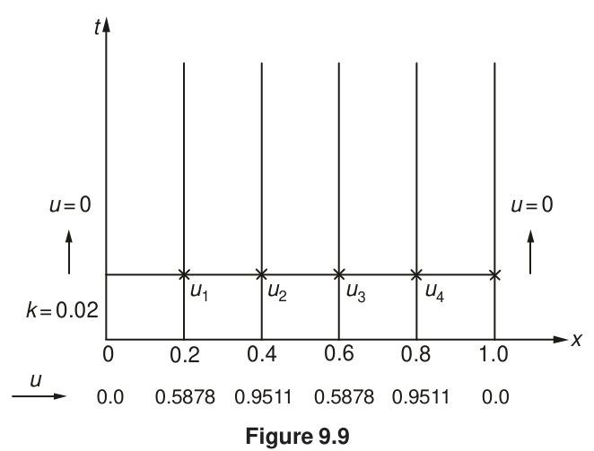

<!-- Page 365 -->

## 9.6 ITERATIVE METHODS FOR THE SOLUTION OF EQUATIONS

The iterative methods discussed in Section 9.4 can be applied to solve the finite-difference equations obtained in the preceding section. In the Crank–Nicolson method, the partial differential equation
$$\frac{\partial u}{\partial t} = \frac{\partial^2 u}{\partial x^2}$$
is replaced by the finite-difference equation
$$(1+r) u_{i,\, j+1} = u_{i,\, j} + \frac{1}{2} r (u_{i-1,\, j+1} + u_{i+1,\, j} + u_{i+1,\, j+1} + u_{i-1,\, j} - 2u_{i,\, j}) \tag{9.53}$$
where $r = k/h^2$.

In Eq. (9.53), the unknowns are $u_{i,\, j+1}$, $u_{i-1,\, j+1}$ and $u_{i+1,\, j+1}$, and all others are known since they were already computed at the $j$th step. Hence, dropping the $j$'s and setting
$$c_i = u_{i,\, j} + \frac{1}{2} r (u_{i-1,\, j} - 2u_{i,\, j} + u_{i+1,\, j}) \tag{9.54}$$
Eq. (9.53) can be written as
$$u_i = \frac{r}{2(1+r)} (u_{i-1} + u_{i+1}) + \frac{c_i}{1+r} \tag{9.55}$$
From Eq. (9.55), we obtain the iteration formula
$$u_i^{(n+1)} = \frac{r}{2(1+r)} [u_{i-1}^{(n)} + u_{i+1}^{(n)}] + \frac{c_i}{1+r}, \tag{9.56}$$
which expresses the $(n+1)$th iterate in terms of the $n$th iterates only, and is known as *Jacobi's iteration formula*.

<!-- Page 366 -->

It can be seen from Eq. (9.56) that at the time of computing $u_i^{(n+1)}$, the latest value of $u_{i-1}$, namely $u_{i-1}^{(n+1)}$, is already available. Hence, the convergence of Jacobi's iteration formula can be improved by replacing $u_{i-1}^{(n)}$ in formula given in Eq. (9.56) by its latest value available, namely by $u_{i-1}^{(n+1)}$. Accordingly, we obtain the formula
$$u_i^{(n+1)} = \frac{r}{2(1+r)} [u_{i-1}^{(n+1)} + u_{i+1}^{(n)}] + \frac{c_i}{1+r} \tag{9.57}$$
which is called the *Gauss–Seidel iteration formula*. It can be shown that Eq. (9.57) converges for all finite values of $r$ and that it converges twice as fast as Jacobi's scheme.

Equation (9.57) can be rewritten as
$$u_i^{(n+1)} = u_i^{(n)} + \left\{ \frac{r}{2(1+r)} [u_{i-1}^{(n+1)} + u_{i+1}^{(n)}] + \frac{c_i}{1+r} - u_i^{(n)} \right\}$$
from which it is clear that the expression within the curly brackets is the difference between the $n$th and $(n+1)$th iterates. If we take the difference to be $\omega$ times this expression, we then obtain
$$u_i^{(n+1)} = u_i^{(n)} + \omega \left\{ \frac{r}{2(1+r)} [u_{i-1}^{(n+1)} + u_{i+1}^{(n)}] + \frac{c_i}{1+r} - u_i^{(n)} \right\} \tag{9.58}$$
which is called the *successive over-relaxation* (or SOR) method. $\omega$ is called the *relaxation factor* and it lies, generally, between 1 and 2.

> [!NOTE] EXAMPLE 9.9
> Solve
> $$\frac{\partial u}{\partial t} = \frac{\partial^2 u}{\partial x^2}$$
> subject to the initial condition $u = \sin \pi x$ at $t = 0$ for $0 \le x \le 1$ and $u = 0$ at $x = 0$ and $x = 1$ for $t > 0$, by the Gauss–Seidel method.
> 
> **Solution:**
> We choose $h = 0.2$ and $k = 0.02$ so that $r = k/h^2 = 1/2$. Equation (9.57) therefore becomes
> $$u_i^{(n+1)} = \frac{1}{6} [u_{i-1}^{(n+1)} + u_{i+1}^{(n)}] + \frac{2}{3} c_i \tag{i}$$
> Let the values of $u$ at the interior mesh points on the row corresponding to $t = 0.02$ be $u_1, u_2, u_3, u_4$, as shown in Fig. 9.9.
> 
> Applying formula given in Eq. (i) at the four interior mesh points, we obtain successively
> $$u_1^{(n+1)} = \frac{1}{6} [0 + u_2^{(n)}] + \frac{2}{3} \left[ 0.5878 + \frac{1}{4} (0 - 2 \times 0.5878 + 0.9511) \right]$$
> $$= \frac{1}{6} u_2^{(n)} + 0.3544 \tag{ii}$$
> 
> <!-- Page 367 -->
> 
> 
> *Figure 9.9*
> 
> $$u_2^{(n+1)} = \frac{1}{6} [u_1^{(n+1)} + u_3^{(n)}] + \frac{2}{3} \left[ 0.9511 + \frac{1}{4} (0.5878 - 2 \times 0.9511 + 0.5878) \right]$$
> $$= \frac{1}{6} [u_1^{(n+1)} + u_3^{(n)}] + 0.5736 \tag{iii}$$
> 
> $$u_3^{(n+1)} = \frac{1}{6} [u_2^{(n+1)} + u_4^{(n)}] + \frac{2}{3} \left[ 0.9511 + \frac{1}{4} (0.9511 - 2 \times 0.9511 + 0.5878) \right]$$
> $$= \frac{1}{6} [u_2^{(n+1)} + u_4^{(n)}] + 0.5736 \tag{iv}$$
> 
> $$u_4^{(n+1)} = \frac{1}{6} [u_3^{(n+1)} + 0] + \frac{2}{3} \left[ 0.5878 + \frac{1}{4} (0.9511 - 2 \times 0.5878 + 0.0) \right]$$
> $$= \frac{1}{6} u_3^{(n+1)} + 0.3544 \tag{v}$$
> 
> Equations (ii), (iii), (iv) and (v) can now be used to obtain better approximations for $u_1$, $u_2$, $u_3$ and $u_4$, respectively. The table below gives the successive iterates of $u_1$, $u_2$, $u_3$ and $u_4$ corresponding to $t = 0.02$.
> 
> | $x$ | 0.0 | 0.2 | 0.4 | 0.6 | 0.8 | 1.0 |
> | :---: | :---: | :---: | :---: | :---: | :---: | :---: |
> | $u(x)$ | 0.0 | 0.5878 | 0.9511 | 0.9511 | 0.5878 | 0.0 |
> | $n = 0$ | 0.0 | 0.5878 | 0.9511 | 0.9511 | 0.5878 | 0.0 |
> | $n = 1$ | 0.0 | 0.5129 | 0.8176 | 0.8078 | 0.4890 | 0.0 |
> | $n = 2$ | 0.0 | 0.4907 | 0.7900 | 0.7868 | 0.4855 | 0.0 |
> | $n = 3$ | 0.0 | 0.4861 | 0.7858 | 0.7855 | 0.4853 | 0.0 |
> | $n = 4$ | 0.0 | 0.4854 | 0.7854 | 0.7854 | 0.4853 | 0.0 |
> | $n = 5$ | 0.0 | 0.4853 | 0.7854 | 0.7854 | 0.4853 | 0.0 |
> 
> <!-- Page 368 -->
> 
> The symmetry of the solution about $x = 0.5$ is quite clear in the above table. The analytical solution of the problem is given by $u = e^{-\pi^2 t} \sin \pi x$ and the exact values of $u$ for $x = 0.2$ and $x = 0.4$ are respectively 0.4825 and 0.7807. The percentage error in both the solutions is about 0.6%, and the error can be reduced by taking a finer mesh. The reader should check some of the figures given in the table.
> $\blacktriangleleft$
