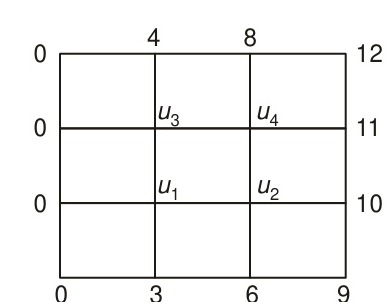
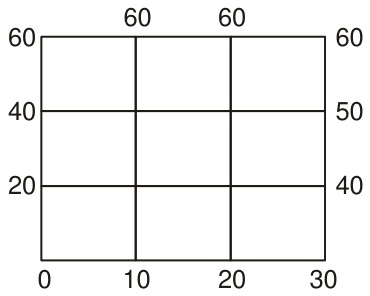
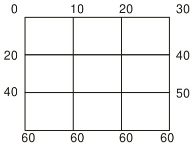
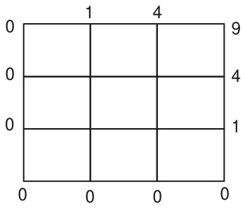
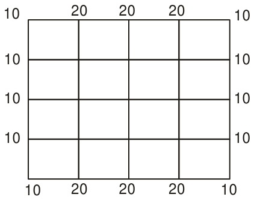
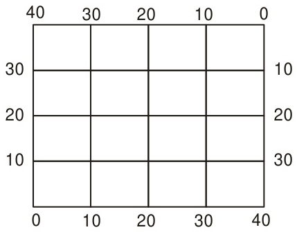
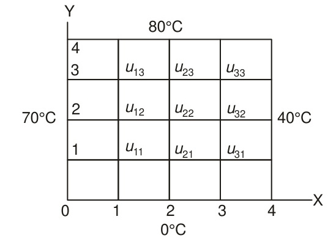
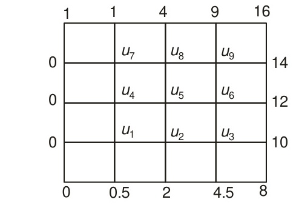
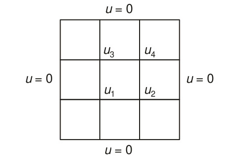
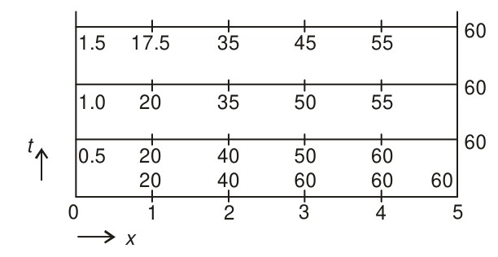

<!-- Page 372 -->

## EXERCISES

The function $u(x, y)$ satisfies Laplace’s equation at all points within the squares given below and has the boundary values as indicated. Compute a solution correct to two decimal places by the finite difference method (Problems 9.1–9.6).

**9.1**

**9.2**

**9.3**

**9.4**

<!-- Page 373 -->

**9.5**

**9.6**

**9.7** Solve
$$\frac{\partial^2 u}{\partial x^2} + \frac{\partial^2 u}{\partial y^2} = 0$$
for the temperature of the heated plate for the square region shown in the figure below. Use successive over relaxation with $\omega = 1.5$ and determine the temperatures at the internal mesh points upto the third iteration. Give an estimate of the per cent error in the value of $u_{22}$.

**9.8** Solve Laplace’s equation with $h = 1/3$ over the boundary of a square of unit length with $u(x, y) = 9x^2 y^2$ on the boundary.

<!-- Page 374 -->

**9.9** Write down the finite difference analogue of the equation $u_{xx} + u_{yy} = 0$ and solve it for the square region given below.

With $h = k = 1.0$, use the Gauss–Seidel method to compute, correct two decimal places, values of $u$ at the internal mesh points.

**9.10** Solve Poisson’s equation
$$\nabla^2 u = 8x^2 y^2$$
for the square grid shown below ($h = 1$).

**9.11** Use the Bender–Schmidt formula to solve the problem
$$
\begin{aligned}
u_t &= 5u_{xx}, \\
u(0, t) &= 0, \quad u(5, t) = 60, \\
\text{and} \quad u(x, 0) &= \begin{cases} 20x, & 0 \le x \le 3 \\ 60, & 3 \le x \le 5 \end{cases}
\end{aligned}
$$
With $h = 1$ and $l = 0.5$, compute the values of $u(x, 0.5)$, $u(x, 1.0)$ and $u(x, 1.5)$ for $1 \le x \le 4$.

**9.12** Solve the equation
$$\frac{\partial u}{\partial t} = \frac{\partial^2 u}{\partial x^2}$$
with the conditions
$$
\begin{aligned}
u(x, 0) &= \sin x, \quad 0 \le x \le \pi \\
\text{and} \quad u(0, t) &= u(\pi, t) = 0, \quad t > 0.
\end{aligned}
$$
Compare the values obtained by Bender–Schmidt, Crank–Nicolson and Cubic Spline formulae for $u\left(\frac{\pi}{2}, \frac{\pi^2}{16}\right)$.

<!-- Page 375 -->

**9.13** Use the explicit formula to solve the equation
$$\frac{\partial u}{\partial t} = \frac{\partial^2 u}{\partial x^2}$$
with the conditions $u(0, t) = u(5, t) = 0$ and $u(x, 0) = x^2(25 - x^2)$. With $h = 1$ and $l = 0.5$, tabulate the values of $u_i^k$ for $i = 0, 1, 2, 3, 4, 5$ and $k = 0, 1, 2$.

**9.14** Solve the heat equation
$$\frac{\partial u}{\partial t} = \frac{\partial^2 u}{\partial x^2}$$
subject to the conditions $u(x, 0) = 0 < u(0, t) = 0$ and $u(1, t) = t$. With $h = \frac{1}{4}$ and $l = \frac{1}{16}$, compute the value of $u\left(\frac{1}{2}, \frac{1}{8}\right)$ using Crank–Nicolson formula.

**9.15** Solve the heat conduction equation
$$\frac{\partial u}{\partial t} = \frac{\partial^2 u}{\partial x^2}$$
with the conditions $u(x, 0) = \sin x$, $0 \le x \le \pi$, $\frac{\partial u}{\partial t}(0, t) = e^{-t}$ and $\frac{\partial u}{\partial x}(\pi, t) = -e^{-t}$. Using Crank–Nicolson and cubic spline formulae. Taking $h = \frac{\pi}{2}$ and $l = \frac{\pi^2}{4\sqrt{20}}$, compute $u\left(\frac{\pi}{2}, \frac{\pi^2}{4\sqrt{20}}\right)$. Compare with the exact value.

**9.16** Derive a cubic spline finite difference formula for the solution of the equation
$$\frac{\partial u}{\partial t} = a \frac{\partial^2 u}{\partial x^2} + b \frac{\partial u}{\partial x} + cu \quad (a, b, c \text{ being constants})$$
with the conditions $u(x, 0) = g(x)$, $0 \le x \le a$ and $\frac{\partial u}{\partial t}(0, t) = f_1(t)$ and $\frac{\partial u}{\partial t}(a, t) = f_2(t)$.

**9.17** Du Fort–Frankel formula: The formula
$$u_i^{k+1} = \frac{1 - 2r}{1 + 2r} u_i^{k-1} + \frac{2r}{1 + 2r} (u_{i-1}^k + u_{i+1}^k)$$
where $r = \frac{l}{h^2}$, is known as Du Fort–Frankel formula for the solution of the one-dimensional heat equation $\frac{\partial u}{\partial t} = \frac{\partial^2 u}{\partial x^2}$. It is a three level

<!-- Page 376 -->

formula since we require function values on $(k - 1)$th and $k$th time levels in order to compute those on the $(k + 1)$th time level. Solve the equation given above with the conditions $u(x, 0) = \sin x$, $0 \le x \le \pi$ and $u(0, t) = u(\pi, t) = 0$ using both the explicit and Du Fort–Frankel formulae with $h = \frac{\pi}{4}$ and $l = \frac{\pi^2}{32}$. Estimate the value of $u\left(\frac{\pi}{2}, \frac{\pi^2}{16}\right)$ and compare with the exact value.

**9.18** Order of Accuracy of Finite Difference Formulae: The explicit formula
$$u_i^{k+1} = r(u_{i-1}^k + u_{i+1}^k) + (1 - 2r)u_i^k$$
is an approximation to the one-dimensional heat equation $\frac{\partial u}{\partial t} = \frac{\partial^2 u}{\partial x^2}$. Expanding both sides of this formula by Taylor’s series, we obtain
$$u_i^{k+1} - r(u_{i-1}^k + u_{i+1}^k) - (1 - 2r)u_i^k = \left( \frac{l^2}{2} - \frac{lh^2}{12} \right) \left[ \frac{\partial^2 u}{\partial t^2} \right]_{i,\, k} + \cdots$$
In such a case, we say that the *local order of accuracy* of the explicit formula is $\text{O}(l + h^2)$. This is also called the *local truncation error* of the formula. Show that the local truncation error of the Crank–Nicolson formula is $\text{O}(l^2 + h^2)$.

**9.19** Show that the local truncation error of formula given in Eq. (9.69) is given by
$$\frac{k^2 h^2}{12} (\alpha^2 - 1) \frac{\partial^4 u}{\partial x^4} + \frac{k^2 h^4}{360} (\alpha^4 - 1) \frac{\partial^6 u}{\partial x^6} + \cdots$$

**9.20** Solve the equation
$$\frac{\partial^2 u}{\partial t^2} = \frac{\partial^2 u}{\partial x^2}$$
with the conditions $u(0, t) = u(1, t) = 0$, $u(x, 0) = \sin \pi x$, and $\frac{\partial u}{\partial t}(x, 0) = 0$. Taking $h = 0.25$ and $l = 0.2$, compute $u(0.5, 0.4)$ in two time steps and compare your result with the exact solution given by $u(x, t) = \sin \pi x \cos \pi t$.

<!-- Page 377 -->

## Answers to Exercises

**9.1** $u_1 = 3.33$, $u_2 = 6.67$, $u_3 = 3.67$, $u_4 = 7.33$.

**9.2** $u_1 = 26.7$, $u_2 = 33.3$, $u_3 = 43.3$, $u_4 = 46.7$.

**9.3** $u_1^{(5)} = 43.33$, $u_2^{(5)} = 46.66$, $u_3^{(5)} = 26.66$, $u_4^{(5)} = 33.33$.

**9.4** $u_1^{(6)} = 0.498$, $u_2^{(6)} = 0.9998$, $u_3^{(6)} = 0.9998$, $u_4^{(6)} = 2.4999$.

**9.5** 12th iteration values
$$
\begin{aligned}
u_1 &= 15, & u_2 &= 16.25, & u_3 &= 15 \\
u_4 &= 13.75, & u_5 &= 15, & u_6 &= 13.75 \\
u_7 &= 15, & u_8 &= 16.25, & u_9 &= 15.
\end{aligned}
$$

**9.6**
$$
\begin{aligned}
u_1 &= 15, & u_2 &= 20, & u_3 &= 25, & u_4 &= 20, \\
u_5 &= 20, & u_6 &= 20, & u_7 &= 25, & u_8 &= 20, & u_9 &= 15.
\end{aligned}
$$

**9.7**
$$
\begin{aligned}
u_{11}^{(1)} &= 26.25, & u_{21}^{(1)} &= 9.84375, & u_{31}^{(1)} &= 10.691406 \\
u_{12}^{(1)} &= 36.09375, & u_{22}^{(1)} &= 17.226562, & u_{32}^{(1)} &= 25.469238 \\
u_{13}^{(1)} &= 69.785156, & u_{23}^{(1)} &= 62.629394, & u_{33}^{(1)} &= 78.036987.
\end{aligned}
$$

Second iteration values: $\text{Error in } u_{22}^{(2)} = 65\%$

Third iteration: $\text{Error in } u_{22}^{(3)} = 13\%$.

**9.8** See Problem 9.4.

**9.9**
$$
\begin{aligned}
u_1 &= 1.57, & u_2 &= 3.70, & u_3 &= 6.57, \\
u_4 &= 2.06, & u_5 &= 4.69, & u_6 &= 8.06, \\
u_7 &= 2.09, & u_8 &= 4.92, & u_9 &= 9.00.
\end{aligned}
$$

**9.10** $u_{11} = -13$, $u_{21} = u_{12} = -22$, $u_{22} = -43$.

**9.11**

<!-- Page 378 -->

**9.12**
(a) $\text{Error} = 0.03964$,
(b) $\text{Error} = 0.00728$,
(c) $\text{Error} = 0.00728$.

**9.13**

| $k \backslash i$ | 0 | 1 | 2 | 3 | 4 | 5 |
| :---: | :---: | :---: | :---: | :---: | :---: | :---: |
| **0** | 0 | 24.0 | 84.0 | 144.0 | 144.0 | 0 |
| **1** | 0 | 42.0 | 78.0 | 78.0 | 57.0 | 0 |
| **2** | 0 | 39.0 | 60.0 | 67.5 | 39.0 | 0 |

**9.14** $u_1^2 = 0.005899$, $u_2^2 = 0.019132$, $u_3^2 = 0.052771$.
Exact values are
$$u\left(\frac{1}{4}, \frac{1}{8}\right) = 0.00541, \quad u\left(\frac{1}{2}, \frac{1}{8}\right) = 0.01878, \quad u\left(\frac{3}{4}, \frac{1}{8}\right) = 0.05240.$$

**9.15** Exact solution is
$$u(x, t) = e^{-t} \sin x.$$
$$u_1^1 = 0.659726 \quad (\text{error} = 0.0837)$$
Spline solution
$$u_1^1 = 0.6415 \quad (\text{error} = 0.0655)$$

**9.17** Exact solution is
$$u\left(\frac{\pi}{2}, t\right) = e^{-t}$$
Explicit formula:
$$
\begin{aligned}
k = 0&: \text{Error in } u_4^1 = 0.0011, \\
k = 1&: \text{Error in } u_4^2 = 0.0020, \\
k = 2&: \text{Error in } u_4^3 = 0.0028.
\end{aligned}
$$
Du Fort–Frankel formula
$$\text{Error in } u_4^2 = 0.0016$$

**9.20** $u_2^2 \approx u(0.5, 0.4) = 0.320469$,
Exact $u(0.5, 0.4) = 0.309017$.
