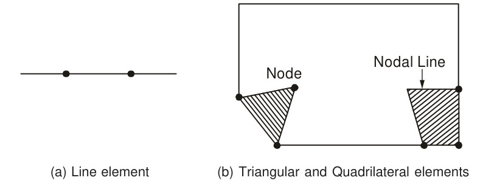

# 11.1 Introduction

<!-- Page 405 -->

In Chapters 8 and 9 we discussed finite difference methods for the solution of boundary-value problems defined by ordinary and partial differential equations. We now describe another class of methods for the solution of such problems, known as the *finite element methods*. A full discussion of these methods is outside the scope of this book—as normally this does not form part of an introductory course on numerical methods. We give here only a brief presentation so as to enable the reader to know that such methods exist. The discussion includes an elementary formulation of the method with simple applications to ordinary differential equations. For details, the reader is referred to the excellent book by Reddy [1985].

The basic idea behind the finite element method is to replace a continuous function by means of piecewise polynomials. Such an approximation, called the *piecewise polynomial approximation*, will be discussed in Section 11.1.2. The reader is already aware of the importance of polynomial approximations in numerical analysis. These are used in the numerical solution of practical problems where the exact functions are difficult to obtain or cumbersome to use. The idea of piecewise polynomial approximation is also not new to the reader, since the cubic spline already discussed, belongs to this class of polynomials.

In engineering applications, several approximate methods of solution are used and the reader is familiar with a few of them, e.g. the method of least squares, method of collocation, etc. In Section 11.2, we discuss two important methods of approximation, viz., the Rayleigh–Ritz method and the Galerkin

<!-- Page 406 -->

technique. Rayleigh developed the method to solve certain vibration problems and Ritz provided a mathematical basis for it and also applied it to more general problems. Whereas the Rayleigh–Ritz method is based on the existence of a *functional* (see Section 11.1.1), the Galerkin technique uses the governing equations of the problem and minimizes the error of the approximate solution. The latter does not require a functional. A disadvantage of both these methods is that higher-order polynomials have to be used to obtain reasonable accuracy.

The finite element method, described in the present chapter, is one of the most important numerical applications of the Rayleigh–Ritz and Galerkin methods. Its mathematical software is quite popular and used extensively in the solution of many practical problems of engineering and applied science. In the finite element method, the domain of integration is subdivided into a number of smaller regions called *elements* and over each of these elements the continuous function is approximated by a suitable piecewise polynomial. To obtain a better approximation one need not use higher-order polynomials but only use a finer subdivision, i.e. increase the number of elements.

In practice, several types of elements are in use, the type used being largely dependent upon the geometrical shape of the region under consideration. In two-dimensional problems, the elements used are triangles, rectangles and quadrilaterals. For three-dimensional problems, tetrahedra, hexahedra and parallelopiped elements are used. Since our attempt in this chapter is only to introduce the finite element method, we restrict its application to the solution of simple one-dimensional problems (see Section 11.4.1).

Examples of typical finite elements are shown in Fig. 11.1.

*Figure 11.1 — Typical finite elements.*

### 11.1.1 Functionals

The concept of a functional is required to understand the Rayleigh–Ritz method, which will be discussed in the next section. This concept arises in the study of variational principles, which occur widely in physical and other problems. Mathematically, a variational principle consists in determining the extreme value of the integral of a typical function, say $f(x, y, y')$. Here the integrand is a function of the coordinates and their derivatives and the

<!-- Page 407 -->

integration is performed over a region. Consider, for example, the integral defined by
$$I(y) = \int_a^b f(x, y, y')\,dx, \tag{11.1}$$
where $y(x)$ satisfies the boundary conditions $y(a) = y(b) = 0$.

The integrand $f$ is integrated over the one-dimensional domain $x$. $I$ is said to be a functional and is defined as a function which transforms a function $y$ into a real number, the value of the definite integral in Eq. (11.1). From calculus of variations we know that a necessary condition for $I(y)$ to have an extremum is that $y(x)$ must satisfy the Euler–Lagrange differential equation
$$\frac{\partial f}{\partial y} - \frac{d}{dx}\left(\frac{\partial f}{\partial y'}\right) = 0. \tag{11.2*}$$

Similarly, for functionals of the form
$$I(y) = \int_a^b f(x, y, y', y'')\,dx \tag{11.3}$$
the Euler–Lagrange equation takes the form
$$\frac{\partial f}{\partial y} - \frac{d}{dx}\left(\frac{\partial f}{\partial y'}\right) + \frac{d^2}{dx^2}\left(\frac{\partial f}{\partial y''}\right) = 0. \tag{11.4}$$

The Euler–Lagrange equation (11.2) has several solutions and the one which satisfies the given boundary conditions is selected. Thus, one determines the functional so that it takes on an extremum value from a set of permissible functions. This is the central problem of a variational principle. An important point here is that an extremum may not exist. In other words, a variational principle may exist, but an extremum may not exist. Furthermore, not all differential equations have a variational principle. These difficulties are serious and therefore impose limitations on the application of the variational principle to the solution of engineering problems.

Many problems arising in physics and engineering are modelled by boundary-value problems and initial boundary-value problems. Frequently, these equations are equivalent to the problem of the minimization of a functional which can be interpreted in terms of the total energy of the given system. In any physical situation, therefore, the functional is obtained from a consideration of the total energy explicitly. Mathematically, however, it would be useful to be able to determine the functional from the governing differential equation itself. This is illustrated below with an example.

[^1]

[^1]: \*For example, see Sastry [2004].

<!-- Page 408 -->

> [!NOTE] EXAMPLE 11.1
> Find the functional for the boundary-value problem defined by
> $$\frac{d^2y}{dx^2} = f(x) \tag{i}$$
> and
> $$y(a) = y(b) = 0. \tag{ii}$$
> 
> **Solution:**
> We have
> $$
> \begin{aligned}
> \delta \int_a^b f y\,dx &= \int_a^b f\,\delta y\,dx \\
> &= \int_a^b \frac{d^2y}{dx^2}\,\delta y\,dx, \quad \text{since } f(x) = \frac{d^2y}{dx^2} \\
> &= \left[\frac{dy}{dx}\delta y\right]_a^b - \int_a^b \frac{dy}{dx}\frac{d}{dx}(\delta y)\,dx, \quad \text{on integrating by parts} \\
> &= -\int_a^b \frac{dy}{dx}\frac{d}{dx}(\delta y)\,dx, \quad \text{since } \delta y(a) = \delta y(b) = 0 \\
> &= -\int_a^b \frac{dy}{dx}\delta\left(\frac{dy}{dx}\right)\,dx, \quad \text{since } \frac{d}{dx}(\delta y) = \delta\left(\frac{dy}{dx}\right) \\
> &= -\int_a^b \frac{1}{2}\delta\left(\frac{dy}{dx}\right)^2\,dx \\
> &= -\delta \int_a^b \frac{1}{2}\left(\frac{dy}{dx}\right)^2\,dx.
> \end{aligned}
> $$
> Hence
> $$\delta \int_a^b \left[ f y + \frac{1}{2}\left(\frac{dy}{dx}\right)^2 \right] dx = 0.$$
> It follows that a unique solution of the problem (i) to (ii) exists at a minimum value of the integral defined by
> $$I(v) = \int_a^b \left[ f v + \frac{1}{2}\left(\frac{dv}{dx}\right)^2 \right] dx. \tag{iii}$$
> $\blacktriangleleft$

<!-- Page 409 -->

A quicker way of finding the functional of a boundary value problem is the following (See Reddy [1985]).

Let $v(x)$ be a function satisfying the essential boundary conditions, viz. $v(a) = v(b) = 0$. Multiply the differential equation written in the form
$$-y'' + f(x) = 0$$
by $v$ and integrate with respect to $x$. We then obtain
$$
\begin{aligned}
0 &= -\int_a^b v y''\,dx + \int_a^b v f\,dx \\
&= \left[-v y'\right]_a^b + \int_a^b v' y'\,dx + \int_a^b v f\,dx \\
&= \int_a^b (v' y' + v f)\,dx
\end{aligned}
$$
Finally, substitute $y = v$ in the above and multiply the *bilinear* terms by $1/2$. We then obtain the required functional
$$I(v) = \int_a^b \left[\frac{1}{2} v'^2 + v f\right] dx,$$
which is the same as Eq. (iii) obtained earlier.

By definition, therefore, the integral in (iii) represents the required functional of the problem. In a similar way, functionals of other boundary-value and initial boundary-value problems can be derived.

It is outside the scope of this book to deal extensively with the determination of functionals corresponding to boundary-value problems. We list below some familiar boundary-value problems with their associated functionals and these would be useful in understanding the problems discussed in this chapter.

(i)
$$\frac{d^2y}{dx^2} = f(x), \quad y(a) = y(b) = 0 \tag{11.5}$$
$$I(v) = \int_a^b v(2f - v'')\,dx. \tag{11.6}$$

(ii)
$$\frac{d^2y}{dx^2} + ky = x^2, \quad 0 < x < 1; \quad y(0) = 0, \quad \left(\frac{dy}{dx}\right)_{x=1} = 1 \tag{11.7}$$
$$I(v) = \frac{1}{2} \int_0^1 \left[ \left(\frac{dv}{dx}\right)^2 - kv^2 + 2vx^2 \right] dx - v(1). \tag{11.8}$$

<!-- Page 410 -->

(iii)
$$x^2 y'' + 2x y' = f(x), \quad y(a) = y(b) = 0 \tag{11.9}$$
$$I(v) = \int_a^b v\left[ 2f - \frac{d}{dx}(x^2 y') \right] dx. \tag{11.10}$$

(iv)
$$\nabla^2 u = 0, \quad u = 0 \text{ on the boundary } C \text{ of } R. \tag{11.11}$$
$$I(v) = \iint_R \frac{1}{2}\left[ \left(\frac{\partial u}{\partial x}\right)^2 + \left(\frac{\partial u}{\partial y}\right)^2 \right] dx\,dy. \tag{11.12}$$

(v)
$$\nabla^2 u = -f, \quad u = 0 \text{ on the boundary } C \text{ of } R. \tag{11.13}$$
$$I(v) = \iint_R \left\{ \frac{1}{2}\left[ \left(\frac{\partial u}{\partial x}\right)^2 + \left(\frac{\partial u}{\partial y}\right)^2 \right] - uf \right\} dx\,dy. \tag{11.14}$$

(vi)
$$
\left.\begin{aligned}
EI\frac{d^4y}{dx^4} + ky &= f(x), \quad 0 < x < l \\
y &= 0 = \frac{d^2y}{dx^2} \text{ at } x = 0, l
\end{aligned}\right\} \tag{11.15}
$$
$$I(v) = \frac{1}{2}\int_0^l \left[ EI\left(\frac{d^2v}{dx^2}\right)^2 + kv^2 - 2vf \right] dx. \tag{11.16}$$

### 11.1.2 Base Functions

Suppose we wish to approximate a real-valued function $f(x)$ over a finite interval $[a, b]$. A usual approach is to divide $[a, b]$ into a number of subintervals $[x_i, x_{i+1}]$, $i = 0, 1, 2, \dots, n-1$, where $x_0 = a$ and $x_n = b$, and to interpolate linearly between the values of $f(x)$ at the end points of each subinterval. In $[x_i, x_{i+1}]$, the linear approximating function is given by
$$l_i(x) = \frac{1}{h_i} \left[ (x_{i+1} - x)f_i + (x - x_i)f_{i+1} \right], \tag{11.17}$$
where $h_i = x_{i+1} - x_i$. From this, we construct the piecewise linear interpolating function over $[x_0, x_n]$ by the formula
$$P(x) = \sum_{i=0}^n \phi_i(x) f_i \tag{11.18}$$

<!-- Page 411 -->

where
$$
\left.\begin{aligned}
\phi_0(x) &= \begin{cases} (x_1 - x)/h_0, & x_0 \le x \le x_1 \\ 0, & x_1 \le x \le x_n \end{cases} \\
\phi_i(x) &= \begin{cases} (x - x_{i-1})/h_{i-1}, & x_{i-1} \le x \le x_i \\ (x_{i+1} - x)/h_i, & x_i \le x \le x_{i+1} \\ 0, & x \ge x_{i+1} \end{cases} \\
\phi_n(x) &= \begin{cases} 0, & x_0 \le x \le x_{n-1} \\ (x - x_{n-1})/h_{n-1}, & x_{n-1} \le x \le x_n \end{cases}
\end{aligned}\right\} \tag{11.19}
$$

The functions $\phi_i(x)$, $i = 1, 2, \dots, n$ are called *base functions* or *shape functions*. It is easily seen that the base functions $\phi_i(x)$ are identically zero except for the range $[x_{i-1}, x_{i+1}]$ with $\phi_i(x_i) = 1$.

Other types of base functions such as piecewise Hermite polynomials, cubic splines, etc., are also used in the literature but these will not be considered in this book.
