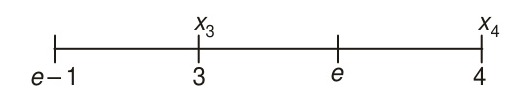

# 11.4 Finite Element Method

<!-- Page 419 -->

The Rayleigh–Ritz and Galerkin methods, discussed in the previous sections, cannot be applied directly for obtaining the global approximate solutions of engineering problems. An important reason for this is the difficulty associated with the choice of trial functions (satisfying the boundary conditions) particularly for complicated boundaries. This means that the application is restricted to problems with a simple geometry. Another reason is that very high-order polynomials have to be used to obtain global solutions with a reasonable accuracy. In the finite element method, the ideas of both the Rayleigh–Ritz and Galerkin methods are used in such a way that the above mentioned difficulties are overcome.

<!-- Page 420 -->

In the finite element method the region of interest is subdivided into a finite number of subregions, called the *elements*, and over each element the variational formulation of the given differential equation is constructed using simple functions for approximations. The individual elements are then assembled and the equations for the whole problem are formed by a piecewise application of the variational method. For better accuracy it will not be necessary to increase the order of the functions used, but it would be sufficient to use a finer mesh. In this way, the difficulties encountered in the direct application of the variational methods are overcome. The basic steps involved in the finite element method are as follows:

(i) *Discretization*: The given domain is divided into a number of finite elements. The points of intersection are called *nodes*. The nodes and the elements are both numbered.

(ii) *Derivation of element equations*: For the given differential equation, a variational formulation is constructed over a typical element. The element equations are obtained by substituting a typical dependent variable, say
$$u = \sum_{i=1}^n u_i \psi_i$$
into the variational formulation. After choosing $\psi_i$, the interpolation functions, the element matrices are computed.

(iii) *Assembly*: The next step is the assembly of the element equations so that the total solution is continuous. When this is done, the entire system takes the matrix form
$$\mathbf{Ku'} = \mathbf{F'},$$
where $K =$ assemblage property matrix, and $\mathbf{u'}$ and $\mathbf{F'}$ are column vectors containing unknowns and external forces.

(iv) *Boundary conditions*: The above system of equations is modified using the boundary conditions of the problem.

(v) *Solution of the equations*: After incorporating the boundary conditions, the system is solved by any standard technique, for example, the $LU$ decomposition.

The preceding steps are quite general but they are common to most finite element approaches. In the following section, these steps are elaborated and explained with an example of one-dimensional problem. Since the two-dimensional problems are modelled by partial differential equations, their finite element analysis is more complicated and are therefore not considered here.

<!-- Page 421 -->

### 11.4.1 Finite Element Method for One-dimensional Problems

We consider the two-point boundary value problem defined by
$$\frac{d^2y}{dx^2} = -f(x), \quad 0 < x < 1 \tag{11.27}$$
with the boundary conditions
$$y(0) = 0, \quad \left[\frac{dy}{dx}\right]_{x=1} = 0 \tag{11.28}$$

The basic steps involved in the finite element method are now elaborated and explained (see Reddy [1985]):

*Step 1 (Discretization of the region)*: In the present problem, the region of interest is the $x$-axis from $x = 0$ to $x = 1$. Suppose that this is divided into a set of subintervals, called *elements*, of unequal length, in general. The intersection points are called *nodes*. Let these be given by $x_0, x_1, x_2, \dots, x_{n-1}, x_n$, where $x_0 = 0$ and $x_n = 1$. The elements are numbered as ①, ②, ③, $\dots$, ⓝ, a typical element being the $e$th element of length $h_e$ from node $e - 1$ to node $e$. Let $x_{e-1}$ and $x_e$ be the values of $x$ at the nodes $e - 1$ and $e$, and let $y^{(e-1)}$ and $y^{(e)}$ be the values of $y$ at these nodes, respectively. In general, $y^{(e)}$ satisfies the condition that *outside* $e$.
$$y^{(e)}(x) = 0 \quad \text{for all elements } e. \tag{11.29}$$

For example, in Fig. 11.2 $y^{(e)}(x_3)$ is nonzero whereas $y^{(e)}(x_4) = 0$.

*Figure 11.2 — Typical eth element.*

Using Eq. (11.29), it follows that the global approximate solution, $y(x)$, can be written as
$$y(x) = \sum_e y^{(e)}(x), \tag{11.30}$$
where the summation is taken over all the elements.

This completes the discretization process and in the next step, we choose a particular element $e$ and formulate a variational principle for it.

*Step 2 (Variational formulation over the element e)*: From Eq. (11.27), we obtain
$$\int_{x_{e-1}}^{x_e} v \frac{d^2y}{dx^2}\,dx = -\int_{x_{e-1}}^{x_e} v f\,dx$$

<!-- Page 422 -->

which is written as
$$
\begin{aligned}
0 &= \int_{x_{e-1}}^{x_e} \left[ v \frac{d^2y}{dx^2} + vf \right] dx \\
&= \left[ v \frac{dy}{dx} \right]_{x_{e-1}}^{x_e} - \int_{x_{e-1}}^{x_e} v' \frac{dy}{dx}\,dx + \int_{x_{e-1}}^{x_e} vf\,dx \\
&= -\int_{x_{e-1}}^{x_e} [v'y' - vf]\,dx + v(x_e)D_2^{(e)} + v(x_{e-1})D_1^{(e)}, \tag{11.31}
\end{aligned}
$$
where
$$D_1^{(e)} = \left[ -\frac{dy}{dx} \right]_{x_{e-1}} \quad \text{and} \quad D_2^{(e)} = \left[ \frac{dy}{dx} \right]_{x_e}. \tag{11.32}$$

In the next step, we use a variational method to approximate Eq. (11.31). We demonstrate this by using the Rayleigh–Ritz method.

*Step 3 (Rayleigh–Ritz approximation over the element e)*: Let $y_e(x)$ be an approximation to $y(x)$ over the element $e$, so that
$$y_e(x) = \sum_{j=1}^n \alpha_j^{(e)} \phi_j(x), \tag{11.33}$$
where the $\alpha_j$ are parameters to be determined and $\phi_j(x)$ are approximation functions to be chosen. Substituting Eq. (11.33) in Eq. (11.31), we obtain
$$\sum_{j=1}^n \alpha_j^{(e)} \left[ \int_{x_{e-1}}^{x_e} \phi_j'(x)\phi_i'(x)\,dx \right] = \int_{x_{e-1}}^{x_e} f\phi_i(x)\,dx + \phi_i(x_e)D_2^{(e)} + \phi_i(x_{e-1})D_1^{(e)}, \quad i = 1, 2, \dots, n. \tag{11.34}$$

Equation (11.34) can be written in the matrix form
$$K_{ij}^{(e)}\alpha_j^{(e)} = F_i^{(e)}, \tag{11.35}$$
where $K_{ij}$ and $F_i$ are called the *stiffness matrix* and *force vector* respectively, and are given by
$$K_{ij}^{(e)} = \int_{x_{e-1}}^{x_e} \phi_i'(x)\phi_j'(x)\,dx \tag{11.36}$$

<!-- Page 423 -->

and
$$F_i^{(e)} = \int_{x_{e-1}}^{x_e} f\phi_i(x)\,dx + \phi_i(x_e)D_2^{(e)} + \phi_i(x_{e-1})D_1^{(e)}. \tag{11.37}$$

In the Rayleigh–Ritz and Galerkin methods, the system of equations is obtained in terms of the arbitrary parameters $\alpha_j$. In the finite element method, on the other hand, the unknown values of the dependent variable $y$ at the nodes are taken as parameters. This is done in the following way. Let
$$y(x) = \alpha_1 + \alpha_2 x \tag{11.38}$$
be an approximation in the element $e$. We have
$$
\left.\begin{aligned}
y(x_{e-1}) &= \alpha_1 + \alpha_2 x_{e-1} = y_1^{(e)} \\
y(x_e) &= \alpha_1 + \alpha_2 x_e = y_2^{(e)}.
\end{aligned}\right\} \tag{11.39}
$$

Solving the equations given in Eq. (11.39), we obtain
$$\alpha_1 = \frac{y_1^{(e)}x_e - y_2^{(e)}x_{e-1}}{x_e - x_{e-1}} \tag{11.40}$$
and
$$\alpha_2 = \frac{y_2^{(e)} - y_1^{(e)}}{x_e - x_{e-1}}. \tag{11.41}$$

Equation (11.38) now becomes
$$
\begin{aligned}
y(x) &= \frac{y_1^{(e)}x_e - y_2^{(e)}x_{e-1}}{x_e - x_{e-1}} + \frac{y_2^{(e)} - y_1^{(e)}}{x_e - x_{e-1}}x \\
&= \frac{x_e - x}{x_e - x_{e-1}}y_1^{(e)} + \frac{x - x_{e-1}}{x_e - x_{e-1}}y_2^{(e)} \tag{11.42} \\
&= \sum_{i=1}^2 y_i^{(e)}\phi_i^{(e)}(x)
\end{aligned}
$$
where
$$\phi_1^{(e)}(x) = \frac{x_e - x}{x_e - x_{e-1}} \quad \text{and} \quad \phi_2^{(e)}(x) = \frac{x - x_{e-1}}{x_e - x_{e-1}}. \tag{11.43}$$

With $x_1 = x_{e-1}$ and $x_2 = x_e$, the functions $\phi_i^{(e)}$ have the property
$$\phi_i^{(e)}(x_j) = \begin{cases} 0, & i \ne j \\ 1, & i = j. \end{cases} \tag{11.44}$$

<!-- Page 424 -->

Instead of Eq. (11.35), we now have
$$K_{ij}^{(e)} y_j^{(e)} = F_i^{(e)}, \tag{11.45}$$
where $K_{ij}^{(e)}$ and $F_i^{(e)}$ are given by Eq. (11.36) and (11.37).

With the choice of $\phi_i^{(e)}(x)$ as in Eq. (11.43), we now demonstrate the computation of $K^{(e)}$ and $F^{(e)}$. In particular, we choose $f = 2$. With $h_e = x_e - x_{e-1}$, we obtain
$$\frac{d\phi_1^{(e)}}{dx} = -\frac{1}{h_e} \quad \text{and} \quad \frac{d\phi_2^{(e)}}{dx} = \frac{1}{h_e} \tag{11.46}$$
where
$$
\left.\begin{aligned}
K_{11} &= \int_{x_{e-1}}^{x_e} \left(-\frac{1}{h_e}\right)^2 dx = \frac{1}{h_e} \\
K_{12} &= \int_{x_{e-1}}^{x_e} -\frac{1}{h_e^2}\,dx = -\frac{1}{h_e} = K_{21} \\
K_{22} &= \int_{x_{e-1}}^{x_e} \frac{1}{h_e^2}\,dx = \frac{1}{h_e}
\end{aligned}\right\} \tag{11.47}
$$
and
$$
\left.\begin{aligned}
F_1^{(e)} &= 2\int_{x_{e-1}}^{x_e} \frac{x_e - x}{h_e}\,dx + D_1^{(e)} = h_e + D_1^{(e)} \\
F_2^{(e)} &= 2\int_{x_{e-1}}^{x_e} \frac{x - x_{e-1}}{h_e}\,dx + D_2^{(e)} = h_e + D_2^{(e)}.
\end{aligned}\right\} \tag{11.48}
$$

As a particular case, we consider the following example.

> [!NOTE] EXAMPLE 11.6
> We consider the following problem defined by
> $$\frac{d^2y}{dx^2} = -2, \quad 0 < x < 1, \quad y(0) = 0, \quad y'(1) = 0. \tag{i}$$
> The exact solution of the above problem is given by
> $$y(x) = 2x - x^2 \tag{ii}$$
> Comparison with Eq. (11.27) shows that $f(x) = 2$.
> 
> <!-- Page 425 -->
> 
> (a) To demonstrate the steps involved in the finite element solution, we divide $[0, 1]$ into two equal subintervals with $h_e = 1/2$. From Eqs. (11.43) and (11.44), we obtain the equations for both elements.
> 
> (i) $e = 1$: $x_{e-1} = 0, x_e = 1/2$,
> $$K^{(1)} = \begin{bmatrix} 2 & -2 \\ -2 & 2 \end{bmatrix}, \quad F^{(1)} = \begin{bmatrix} \frac{1}{2} + D_1^{(1)} \\ \frac{1}{2} + D_2^{(1)} \end{bmatrix}$$
> 
> (ii) $e = 2$: $x_{e-1} = 1/2, x_e = 1$
> $$K^{(2)} = \begin{bmatrix} 2 & -2 \\ -2 & 2 \end{bmatrix}, \quad F^{(2)} = \begin{bmatrix} \frac{1}{2} + D_1^{(2)} \\ \frac{1}{2} + D_2^{(2)} \end{bmatrix}.$$
> 
> Having determined the equations for each element, these have to be assembled now to determine the global approximations. This will be the next step in the finite element solution.
> 
> *Step 4 (Assembly of element equations)*: We shall explain this step with reference to the two elements obtained in Example 11.6. In this case, the two elements are connected at the node 2. Since the function $y(x)$ is continuous, it follows that $y_2$ of element 1 should be the same as $y_1$ of element 2. For the two elements of Example 11.6, the correspondence can be expressed mathematically as follows:
> $$y_1^{(1)} = Y_1, \quad y_2^{(1)} = Y_2 = y_1^{(2)}, \quad y_2^{(2)} = Y_3.$$
> In the finite element analysis, such relations are usually called *interelement continuity conditions*.
> 
> Using the above relations, the global finite element model of the given boundary value problem is
> $$\begin{bmatrix} 2 & -2 & 0 \\ -2 & 2+2 & -2 \\ 0 & -2 & 2 \end{bmatrix} \begin{bmatrix} Y_1 \\ Y_2 \\ Y_3 \end{bmatrix} = \begin{bmatrix} 1/2 + D_1^{(1)} \\ 1 + D_2^{(1)} + D_1^{(2)} \\ 1/2 + D_2^{(2)} \end{bmatrix}.$$
> 
> The next step is the imposition of boundary conditions.
> 
> *Step 5 (Imposition of boundary conditions)*: The homogeneous boundary condition gives $Y_1 = 0$. Then, we obtain the equations:
> $$4Y_2 - 2Y_3 = 1, \quad -2Y_2 + 2Y_3 = \frac{1}{2}$$
> since $D_2^{(1)}$ and $D_1^{(2)}$ cancel each other and $D_2^{(2)} = 0$ is the natural boundary condition.
> 
> <!-- Page 426 -->
> 
> The solution of this system is given by
> $$Y_2 = \frac{3}{4} \quad \text{and} \quad Y_3 = 1$$
> Finally, the approximate solution throughout the interval $[0, 1]$ can now be found using the formula
> $$
> \begin{aligned}
> y(x) &= \sum_{i=1}^2 Y_i \phi_i^{(e)}(x) = \begin{cases} Y_1\phi_1^{(1)}(x) + Y_2\phi_2^{(1)}(x), & 0 \le x \le \frac{1}{2} \\ Y_2\phi_1^{(2)}(x) + Y_3\phi_2^{(2)}(x), & \frac{1}{2} \le x \le 1 \end{cases} \\
> &= \begin{cases} \frac{3}{2}x, & 0 \le x \le \frac{1}{2} \\ \frac{x+1}{2}, & \frac{1}{2} \le x \le 1 \end{cases}
> \end{aligned}
> $$
> on substitutions and simplification.
> 
> From the above, we obtain the approximate value of $y(1/4) \approx 3/8 = 0.375$, whereas its exact value $= 2(1/4) - 1/16 = 7/16$.
> 
> (b) To improve the accuracy, we now consider four elements of length 1/4. In this case, the element matrices become
> 
> (i) $e = 1$: $x_{e-1} = 0, x_e = 1/4$
> $$K_{11}^{(1)} = 4, \quad K_{12}^{(1)} = K_{21}^{(1)} = -4, \quad K_{22}^{(1)} = 4$$
> $$F_1^{(1)} = \frac{1}{4} + D_1^{(1)}, \quad F_2^{(1)} = \frac{1}{4} + D_2^{(1)}$$
> $$K^{(1)} = \begin{bmatrix} 4 & -4 \\ -4 & 4 \end{bmatrix}, \quad F^{(1)} = \begin{bmatrix} 1/4 + D_1^{(1)} \\ 1/4 + D_2^{(1)} \end{bmatrix}$$
> 
> (ii) $e = 2$: $x_{e-1} = 1/4, x_e = 1/2$
> $$K^{(2)} = \begin{bmatrix} 4 & -4 \\ -4 & 4 \end{bmatrix}, \quad F^{(2)} = \begin{bmatrix} 1/4 + D_1^{(2)} \\ 1/4 + D_2^{(2)} \end{bmatrix}$$
> 
> (iii) $e = 3$: $x_{e-1} = 1/2, x_e = 3/4$
> $$K^{(3)} = \begin{bmatrix} 4 & -4 \\ -4 & 4 \end{bmatrix}, \quad F^{(3)} = \begin{bmatrix} 1/4 + D_1^{(3)} \\ 1/4 + D_2^{(3)} \end{bmatrix}$$
> 
> (iv) $e = 4$: $x_{e-1} = 3/4, x_e = 1$
> $$K^{(4)} = \begin{bmatrix} 4 & -4 \\ -4 & 4 \end{bmatrix}, \quad F^{(4)} = \begin{bmatrix} 1/4 + D_1^{(4)} \\ 1/4 + D_2^{(4)} \end{bmatrix}$$
> 
> <!-- Page 427 -->
> 
> To avoid confusion, we now write down the complete system for each element
> $$e = 1 \qquad \begin{bmatrix} 4 & -4 & 0 & 0 & 0 \\ -4 & 4 & 0 & 0 & 0 \\ 0 & 0 & 0 & 0 & 0 \\ 0 & 0 & 0 & 0 & 0 \\ 0 & 0 & 0 & 0 & 0 \end{bmatrix} \begin{bmatrix} Y_1 \\ Y_2 \\ Y_3 \\ Y_4 \\ Y_5 \end{bmatrix} = \begin{bmatrix} 1/4 + D_1^{(1)} \\ 1/4 + D_2^{(1)} \\ 0 \\ 0 \\ 0 \end{bmatrix}$$
> 
> $$e = 2 \qquad \begin{bmatrix} 0 & 0 & 0 & 0 & 0 \\ 0 & 4 & -4 & 0 & 0 \\ 0 & -4 & 4 & 0 & 0 \\ 0 & 0 & 0 & 0 & 0 \\ 0 & 0 & 0 & 0 & 0 \end{bmatrix} \begin{bmatrix} Y_1 \\ Y_2 \\ Y_3 \\ Y_4 \\ Y_5 \end{bmatrix} = \begin{bmatrix} 0 \\ 1/4 + D_1^{(2)} \\ 1/4 + D_2^{(2)} \\ 0 \\ 0 \end{bmatrix}$$
> 
> $$e = 3 \qquad \begin{bmatrix} 0 & 0 & 0 & 0 & 0 \\ 0 & 0 & 0 & 0 & 0 \\ 0 & 0 & 4 & -4 & 0 \\ 0 & 0 & -4 & 4 & 0 \\ 0 & 0 & 0 & 0 & 0 \end{bmatrix} \begin{bmatrix} Y_1 \\ Y_2 \\ Y_3 \\ Y_4 \\ Y_5 \end{bmatrix} = \begin{bmatrix} 0 \\ 0 \\ 1/4 + D_1^{(3)} \\ 1/4 + D_2^{(3)} \\ 0 \end{bmatrix}$$
> 
> $$e = 4 \qquad \begin{bmatrix} 0 & 0 & 0 & 0 & 0 \\ 0 & 0 & 0 & 0 & 0 \\ 0 & 0 & 0 & 0 & 0 \\ 0 & 0 & 0 & 4 & -4 \\ 0 & 0 & 0 & -4 & 4 \end{bmatrix} \begin{bmatrix} Y_1 \\ Y_2 \\ Y_3 \\ Y_4 \\ Y_5 \end{bmatrix} = \begin{bmatrix} 0 \\ 0 \\ 0 \\ D_1^{(4)} \\ D_2^{(4)} \end{bmatrix}$$
> 
> Adding up the above, we obtain
> $$\begin{bmatrix} 4 & -4 & 0 & 0 & 0 \\ -4 & 4+4 & -4 & 0 & 0 \\ 0 & -4 & 4+4 & -4 & 0 \\ 0 & 0 & -4 & 4+4 & -4 \\ 0 & 0 & 0 & -4 & 4 \end{bmatrix} \begin{bmatrix} Y_1 \\ Y_2 \\ Y_3 \\ Y_4 \\ Y_5 \end{bmatrix} = \begin{bmatrix} 1/4 + D_1^{(1)} \\ 1/2 + D_2^{(1)} + D_1^{(2)} \\ 1/2 + D_2^{(2)} + D_1^{(3)} \\ 1/2 + D_2^{(3)} + D_1^{(4)} \\ 1/4 + D_2^{(4)} \end{bmatrix}$$
> 
> By boundary condition, we have $Y_1 = 0$.
> 
> <!-- Page 428 -->
> 
> The system now becomes
> $$
> \begin{aligned}
> 8Y_2 - 4Y_3 &= 1/2 \\
> -4Y_2 + 8Y_3 - 4Y_4 &= 1/2 \\
> -4Y_3 + 8Y_4 - 4Y_5 &= 1/2 \\
> -4Y_4 + 4Y_5 &= 1/4 + D_2^{(4)}
> \end{aligned}
> $$
> 
> But $D_2^{(4)} = y'(1) = 0$.
> The solution of the system is
> $$Y_2 = \frac{7}{16}, \quad Y_3 = \frac{3}{4}, \quad Y_4 = \frac{15}{16}, \quad Y_5 = 1.$$
> 
> Then the approximate solution valid for $[0, 1]$ is
> $$y(x) = \begin{cases} \dfrac{7x}{4}, & 0 \le x \le \dfrac{1}{4} \\[2ex] \dfrac{10x + 1}{8}, & \dfrac{1}{4} \le x \le \dfrac{1}{2} \\[2ex] \dfrac{6x + 3}{8}, & \dfrac{1}{2} \le x \le \dfrac{3}{4} \\[2ex] \dfrac{x + 3}{4}, & \dfrac{3}{4} \le x \le 1 \end{cases}$$
> 
> From the above, we obtain $y(1/4) = 7/16$, which is the same as the exact solution.
> $\blacktriangleleft$
