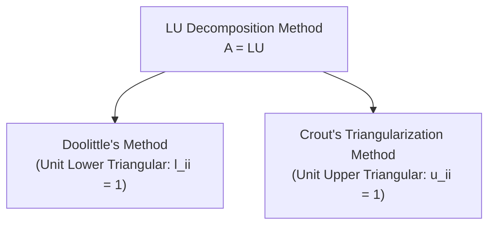

# Systems of Linear Equations: Direct and Iterative Methods

<!-- Page 20 -->

## 1. Gauss Elimination Method

The **Gauss Elimination Method** is a direct method for solving systems of linear equations. It transforms the augmented matrix $[A \mid B]$ into an upper triangular (row echelon) form using elementary row operations, followed by **back-substitution** to compute the unknowns.

---

### 1.1 Problem Statement

**Solve the following system of linear equations by Gauss Elimination method:**

$$
\begin{aligned}
4x + y + 3z &= 11 \\
3x + 4y + 2z &= 11 \\
2x + 3y + z &= 7
\end{aligned}
$$

---

### 1.2 Rearranging Equations for Pivoting

> [!tip] Pedagogical Guidance (Pivoting Strategy)
> **Author's Note:** *"x এর co-efficient ছোট থেকে বড় সাজাতে হবে -"*  
> **Translation & Context:** *Arrange equations in ascending order of the coefficient of $x$ (or place the equation with the simplest/smallest non-zero pivot at the top).*  
> Choosing an equation with the smallest or unit coefficient for the pivot variable simplifies subsequent row operations and avoids early fractions.

Rearranging the equations in ascending order of the coefficient of $x$:

$$
\begin{aligned}
2x + 3y + z &= 7 \quad \text{--- (i)} \\
3x + 4y + 2z &= 11 \quad \text{--- (ii)} \\
4x + y + 3z &= 11 \quad \text{--- (iii)}
\end{aligned}
$$

---

### 1.3 Matrix Representation

The system can be expressed in matrix form:

$$
AX = B
$$

Where:

$$
A = \begin{bmatrix}
2 & 3 & 1 \\
3 & 4 & 2 \\
4 & 1 & 3
\end{bmatrix}, \quad
X = \begin{bmatrix}
x \\
y \\
z
\end{bmatrix}, \quad
B = \begin{bmatrix}
7 \\
11 \\
11
\end{bmatrix}
$$

The augmented matrix form $[A \mid B]$ is:

$$
[A \mid B] = \left[\begin{array}{ccc:c}
2 & 3 & 1 & 7 \\
3 & 4 & 2 & 11 \\
4 & 1 & 3 & 11
\end{array}\right]
$$

---

<!-- Page 21 -->

### 1.4 Reduction to Row Echelon Form (Forward Elimination)

We now apply elementary row operations to reduce $[A \mid B]$ into upper triangular (echelon) form:

#### Step 1: Normalize Row 1 Pivot
Perform $R_1 \to R_1 - R_2$:

$$
\sim \left[\begin{array}{ccc:c}
-1 & -1 & -1 & -4 \\
3 & 4 & 2 & 11 \\
4 & 1 & 3 & 11
\end{array}\right]
$$

Multiply Row 1 by $-1$ ($R_1 \to (-1)R_1$):

$$
= \left[\begin{array}{ccc:c}
1 & 1 & 1 & 4 \\
3 & 4 & 2 & 11 \\
4 & 1 & 3 & 11
\end{array}\right]
$$

#### Step 2: Eliminate $x$ from Rows 2 and 3
Perform $R_2 \to R_2 - 3R_1$ and $R_3 \to R_3 - 4R_1$:

$$
= \left[\begin{array}{ccc:c}
1 & 1 & 1 & 4 \\
0 & 1 & -1 & -1 \\
0 & -3 & -1 & -5
\end{array}\right]
$$

*Detailed arithmetic:*
- Row 2: $\begin{bmatrix} 3 - 3(1) & 4 - 3(1) & 2 - 3(1) & \mid & 11 - 3(4) \end{bmatrix} = \begin{bmatrix} 0 & 1 & -1 & \mid & -1 \end{bmatrix}$
- Row 3: $\begin{bmatrix} 4 - 4(1) & 1 - 4(1) & 3 - 4(1) & \mid & 11 - 4(4) \end{bmatrix} = \begin{bmatrix} 0 & -3 & -1 & \mid & -5 \end{bmatrix}$

#### Step 3: Eliminate $y$ from Row 3
Perform $R_3 \to R_3 + 3R_2$:

$$
\sim \left[\begin{array}{ccc:c}
1 & 1 & 1 & 4 \\
0 & 1 & -1 & -1 \\
0 & 0 & -4 & -8
\end{array}\right]
$$

*Detailed arithmetic:*
- Row 3: $\begin{bmatrix} 0 + 3(0) & -3 + 3(1) & -1 + 3(-1) & \mid & -5 + 3(-1) \end{bmatrix} = \begin{bmatrix} 0 & 0 & -4 & \mid & -8 \end{bmatrix}$

---

### 1.5 Back-Substitution

Converting the reduced upper triangular matrix back into algebraic equations:

$$
\begin{bmatrix}
1 & 1 & 1 \\
0 & 1 & -1 \\
0 & 0 & -4
\end{bmatrix}
\begin{bmatrix}
x \\
y \\
z
\end{bmatrix}
=
\begin{bmatrix}
4 \\
-1 \\
-8
\end{bmatrix}
$$

This gives the system:

$$
\begin{aligned}
x + y + z &= 4 \quad \text{--- (4)} \\
y - z &= -1 \quad \text{--- (5)} \\
-4z &= -8 \quad \text{--- (6)}
\end{aligned}
$$

1. **From equation (6):**
   $$
   -4z = -8 \implies z = \frac{-8}{-4} = 2
   $$

2. **Substitute $z = 2$ into equation (5):**
   $$
   y - 2 = -1 \implies y = -1 + 2 = 1
   $$

3. **Substitute $y = 1, z = 2$ into equation (4):**
   $$
   x + 1 + 2 = 4 \implies x + 3 = 4 \implies x = 1
   $$

$$
\therefore \mathbf{x = 1, \quad y = 1, \quad z = 2}
$$

---

<!-- Page 22 -->

## 2. Gauss Elimination — Algebraic Multiplier Method

An alternative, standard algebraic formulation of Gauss elimination relies on calculating explicit row multipliers $m_k = \frac{a_{ik}}{a_{kk}}$ without writing full augmented matrix arrays.

### 2.1 Problem Formulation

Let the system be ordered as:

$$
\begin{aligned}
2x + 3y + z &= 7 \quad \text{--- (1)} \\
3x + 4y + 2z &= 11 \quad \text{--- (2)} \\
4x + y + 3z &= 11 \quad \text{--- (3)}
\end{aligned}
$$

---

### 2.2 Elimination of $x$

#### Step 1: Eliminate $x$ from equations (1) and (2)
Define multiplier $m_1$:

$$
m_1 = \frac{\text{Coefficient of } x \text{ in (2)}}{\text{Coefficient of } x \text{ in (1)}} = \frac{3}{2}
$$

Multiply equation (1) by $m_1 = \frac{3}{2}$:

$$
\frac{3}{2} \times (2x + 3y + z = 7) \implies 3x + \frac{9}{2}y + \frac{3}{2}z = \frac{21}{2} \quad \text{--- (5)}
$$

Subtract $(2) - (5)$:

$$
(3x - 3x) + \left(4 - \frac{9}{2}\right)y + \left(2 - \frac{3}{2}\right)z = 11 - \frac{21}{2}
$$

$$
-\frac{1}{2}y + \frac{1}{2}z = \frac{1}{2}
$$

Multiplying throughout by $-2$:

$$
\implies y - z = -1 \quad \text{--- (A)}
$$

#### Step 2: Eliminate $x$ from equations (1) and (3)
Define multiplier $m_2$:

$$
m_2 = \frac{\text{Coefficient of } x \text{ in (3)}}{\text{Coefficient of } x \text{ in (1)}} = \frac{4}{2} = 2
$$

---

<!-- Page 23 -->

Multiply equation (1) by $m_2 = 2$:

$$
2 \times (2x + 3y + z = 7) \implies 4x + 6y + 2z = 14 \quad \text{--- (6)}
$$

Subtract $(3) - (6)$:

$$
(4x - 4x) + (1 - 6)y + (3 - 2)z = 11 - 14
$$

$$
\implies -5y + z = -3 \quad \text{--- (B)}
$$

---

### 2.3 Elimination of $y$

Now eliminate $y$ between the reduced equations (A) and (B):

$$
\begin{aligned}
y - z &= -1 \quad \text{--- (A)} \\
-5y + z &= -3 \quad \text{--- (B)}
\end{aligned}
$$

Define multiplier $m_3$:

$$
m_3 = \frac{\text{Coefficient of } y \text{ in (B)}}{\text{Coefficient of } y \text{ in (A)}} = \frac{-5}{1} = -5
$$

Multiply equation (A) by $m_3 = -5$:

$$
-5(y - z = -1) \implies -5y + 5z = 5 \quad \text{--- (7)}
$$

Subtract $(B) - (7)$:

$$
(-5y - (-5y)) + (z - 5z) = -3 - 5
$$

$$
-4z = -8 \implies z = \frac{-8}{-4} = 2
$$

---

### 2.4 Back-Substitution

1. **Substitute $z = 2$ into equation (A):**
   $$
   y - 2 = -1 \implies y = 1
   $$

2. **Substitute $y = 1, z = 2$ into original equation (1):**
   $$
   2x + 3(1) + 2 = 7 \implies 2x + 5 = 7 \implies 2x = 2 \implies x = 1
   $$

$$
\therefore \mathbf{x = 1, \quad y = 1, \quad z = 2} \quad \text{(Ans.)}
$$

---

<!-- Page 24 -->

## 3. Gauss-Jordan Method

The **Gauss-Jordan Method** is an extension of Gauss elimination. Instead of reducing the coefficient matrix into an upper triangular form, it reduces the matrix completely into a **diagonal matrix** (or identity matrix). Consequently, the values of the unknowns are obtained directly without any back-substitution step.

---

### 3.1 Problem Statement

**Solve the following system of linear equations by Gauss-Jordan method:**

$$
\begin{aligned}
4x + y + 3z &= 11 \\
3x + 4y + 2z &= 11 \\
2x + 3y + z &= 7
\end{aligned}
$$

---

### 3.2 Rearranging Equations

> [!note] Note on Ordering
> **Author's Annotation:** *"সাজাতে হবে"* $\implies$ *Must be rearranged.*  
> Placing $2x + 3y + z = 7$ first provides a convenient pivot.

$$
\begin{aligned}
2x + 3y + z &= 7 \quad \text{--- (1)} \\
3x + 4y + 2z &= 11 \quad \text{--- (2)} \\
4x + y + 3z &= 11 \quad \text{--- (3)}
\end{aligned}
$$

Matrix form $AX = B$:

$$
A = \begin{bmatrix}
2 & 3 & 1 \\
3 & 4 & 2 \\
4 & 1 & 3
\end{bmatrix}, \quad
X = \begin{bmatrix}
x \\
y \\
z
\end{bmatrix}, \quad
B = \begin{bmatrix}
7 \\
11 \\
11
\end{bmatrix}
$$

Augmented matrix $[A \mid B]$:

$$
[A \mid B] = \left[\begin{array}{ccc:c}
2 & 3 & 1 & 7 \\
3 & 4 & 2 & 11 \\
4 & 1 & 3 & 11
\end{array}\right]
$$

---

### 3.3 Forward & Backward Elimination to Diagonal Form

#### Step 1: Create Lead 1 in Row 1
Perform $R_1 \to R_1 - R_2$:

$$
\sim \left[\begin{array}{ccc:c}
-1 & -1 & -1 & -4 \\
3 & 4 & 2 & 11 \\
4 & 1 & 3 & 11
\end{array}\right]
$$

Multiply Row 1 by $-1$ ($R_1 \to (-1)R_1$):

$$
= \left[\begin{array}{ccc:c}
1 & 1 & 1 & 4 \\
3 & 4 & 2 & 11 \\
4 & 1 & 3 & 11
\end{array}\right]
$$

---

<!-- Page 25 -->

#### Step 2: Clear Column 1 Below the Pivot
Perform $R_2 \to R_2 - 3R_1$ and $R_3 \to R_3 - 4R_1$:

$$
= \left[\begin{array}{ccc:c}
1 & 1 & 1 & 4 \\
0 & 1 & -1 & -1 \\
0 & -3 & -1 & -5
\end{array}\right]
$$

#### Step 3: Clear Column 2 Above and Below Pivot ($a_{22} = 1$)
Perform $R_1 \to R_1 - R_2$ and $R_3 \to R_3 + 3R_2$:

$$
= \left[\begin{array}{ccc:c}
1 & 0 & 2 & 5 \\
0 & 1 & -1 & -1 \\
0 & 0 & -4 & -8
\end{array}\right]
$$

*Detailed arithmetic:*
- Row 1: $\begin{bmatrix} 1 - 0 & 1 - 1 & 1 - (-1) & \mid & 4 - (-1) \end{bmatrix} = \begin{bmatrix} 1 & 0 & 2 & \mid & 5 \end{bmatrix}$
- Row 3: $\begin{bmatrix} 0 + 3(0) & -3 + 3(1) & -1 + 3(-1) & \mid & -5 + 3(-1) \end{bmatrix} = \begin{bmatrix} 0 & 0 & -4 & \mid & -8 \end{bmatrix}$

#### Step 4: Normalize Pivot in Row 3
Perform $R_3 \to -\frac{1}{4} R_3$:

$$
= \left[\begin{array}{ccc:c}
1 & 0 & 2 & 5 \\
0 & 1 & -1 & -1 \\
0 & 0 & 1 & 2
\end{array}\right]
$$

#### Step 5: Clear Column 3 Above the Pivot ($a_{33} = 1$)
Perform $R_1 \to R_1 - 2R_3$ and $R_2 \to R_2 + R_3$:

$$
\sim \left[\begin{array}{ccc:c}
1 & 0 & 0 & 1 \\
0 & 1 & 0 & 1 \\
0 & 0 & 1 & 2
\end{array}\right]
$$

*Detailed arithmetic:*
- Row 1: $\begin{bmatrix} 1 - 2(0) & 0 - 2(0) & 2 - 2(1) & \mid & 5 - 2(2) \end{bmatrix} = \begin{bmatrix} 1 & 0 & 0 & \mid & 1 \end{bmatrix}$
- Row 2: $\begin{bmatrix} 0 + 0 & 1 + 0 & -1 + 1 & \mid & -1 + 2 \end{bmatrix} = \begin{bmatrix} 0 & 1 & 0 & \mid & 1 \end{bmatrix}$

---

### 3.4 Direct Solution

Expressing the diagonal system:

$$
\begin{bmatrix}
1 & 0 & 0 \\
0 & 1 & 0 \\
0 & 0 & 1
\end{bmatrix}
\begin{bmatrix}
x \\
y \\
z
\end{bmatrix}
=
\begin{bmatrix}
1 \\
1 \\
2
\end{bmatrix}
$$

$$
\therefore \mathbf{x = 1, \quad y = 1, \quad z = 2} \quad \text{(Ans.)}
$$

> [!important] Core Rule of Gauss-Jordan
> **Author's Note:** `[ Diagonal matrix করতে হবে ]`  
> **Pedagogical Meaning:** The core objective in Gauss-Jordan elimination is to reduce the coefficient matrix to a **diagonal matrix** (specifically an identity matrix $I$). By performing both forward and backward row operations simultaneously, the solution vector is produced directly in the rightmost column, entirely bypassing the need for back-substitution.

---

<!-- Page 26 -->

## 4. LU Decomposition Methods (Matrix Factorization)

LU Decomposition expresses the coefficient matrix $A$ as the product of a **Lower triangular matrix ($L$)** and an **Upper triangular matrix ($U$)**:

$$
A = LU
$$

| Method | Lower Triangular Matrix ($L$) | Upper Triangular Matrix ($U$) |
| :--- | :--- | :--- |
| **Doolittle's Method** | **Unit diagonal**: $l_{11} = l_{22} = l_{33} = 1$ | Full upper triangular with computed diagonal elements |
| **Crout's Method** | Full lower triangular with computed diagonal elements | **Unit diagonal**: $u_{11} = u_{22} = u_{33} = 1$ |

---

## 5. Doolittle's LU Decomposition Method

### 5.1 Problem Statement

**Solve the following system of equations by triangularization method (Doolittle's method):**

$$
\begin{aligned}
2x - 6y + 8z &= 24 \\
5x + 4y - 3z &= 2 \\
3x + y + 2z &= 16
\end{aligned}
$$

---

### 5.2 Matrix Formulation

Express the equations in matrix form $AX = B$:

$$
\begin{aligned}
2x - 6y + 8z &= 24 \quad \text{--- (1)} \\
5x + 4y - 3z &= 2 \quad \text{--- (2)} \\
3x + y + 2z &= 16 \quad \text{--- (3)}
\end{aligned}
$$

$$
A = \begin{bmatrix}
2 & -6 & 8 \\
5 & 4 & -3 \\
3 & 1 & 2
\end{bmatrix}, \quad
X = \begin{bmatrix}
x \\
y \\
z
\end{bmatrix}, \quad
B = \begin{bmatrix}
24 \\
2 \\
16
\end{bmatrix}
$$

---

<!-- Page 27 -->

### 5.3 Factoring $A = LU$ (Doolittle's Form)

In Doolittle's method, $L$ has diagonal elements equal to $1$:

$$
A = \begin{bmatrix}
1 & 0 & 0 \\
l_{21} & 1 & 0 \\
l_{31} & l_{32} & 1
\end{bmatrix}
\begin{bmatrix}
u_{11} & u_{12} & u_{13} \\
0 & u_{22} & u_{23} \\
0 & 0 & u_{33}
\end{bmatrix}
$$

Carrying out matrix multiplication:

$$
\begin{bmatrix}
2 & -6 & 8 \\
5 & 4 & -3 \\
3 & 1 & 2
\end{bmatrix}
=
\begin{bmatrix}
u_{11} & u_{12} & u_{13} \\
l_{21}u_{11} & l_{21}u_{12} + u_{22} & l_{21}u_{13} + u_{23} \\
l_{31}u_{11} & l_{31}u_{12} + l_{32}u_{22} & l_{31}u_{13} + l_{32}u_{23} + u_{33}
\end{bmatrix}
$$

#### Solving for Doolittle Matrix Elements:

1. **Row 1 of $U$:**
   $$
   u_{11} = 2, \quad u_{12} = -6, \quad u_{13} = 8
   $$

2. **Column 1 of $L$ & Row 2 of $U$:**
   $$
   l_{21} u_{11} = 5 \implies l_{21}(2) = 5 \implies l_{21} = \frac{5}{2}
   $$
   $$
   l_{21} u_{12} + u_{22} = 4 \implies \left(\frac{5}{2}\right)(-6) + u_{22} = 4 \implies -15 + u_{22} = 4 \implies u_{22} = 19
   $$
   $$
   l_{21} u_{13} + u_{23} = -3 \implies \left(\frac{5}{2}\right)(8) + u_{23} = -3 \implies 20 + u_{23} = -3 \implies u_{23} = -23
   $$

3. **Column 2 of $L$ & Row 3 of $U$:**
   $$
   l_{31} u_{11} = 3 \implies l_{31}(2) = 3 \implies l_{31} = \frac{3}{2}
   $$
   $$
   l_{31} u_{12} + l_{32} u_{22} = 1 \implies \left(\frac{3}{2}\right)(-6) + l_{32}(19) = 1 \implies -9 + 19 l_{32} = 1 \implies 19 l_{32} = 10 \implies l_{32} = \frac{10}{19}
   $$
   $$
   l_{31} u_{13} + l_{32} u_{23} + u_{33} = 2 \implies \left(\frac{3}{2}\right)(8) + \left(\frac{10}{19}\right)(-23) + u_{33} = 2
   $$
   $$
   12 - \frac{230}{19} + u_{33} = 2 \implies u_{33} = 2 - 12 + \frac{230}{19} = -10 + \frac{230}{19} = \frac{-190 + 230}{19} = \frac{40}{19}
   $$

Thus, the decomposed matrices are:

$$
L = \begin{bmatrix}
1 & 0 & 0 \\
5/2 & 1 & 0 \\
3/2 & 10/19 & 1
\end{bmatrix}, \quad
U = \begin{bmatrix}
2 & -6 & 8 \\
0 & 19 & -23 \\
0 & 0 & 40/19
\end{bmatrix}
$$

---

<!-- Page 28 -->

### 5.4 Step 2: Forward-Substitution ($LZ = B$)

Since $A = LU$, the equation $AX = B$ becomes:

$$
(LU)X = B \implies L(UX) = B
$$

Define an intermediate vector $Z$ such that:

$$
UX = Z \quad \text{--- (4)}, \quad \text{where } Z = \begin{bmatrix} z_1 \\ z_2 \\ z_3 \end{bmatrix}
$$

Then solve $LZ = B$:

$$
\begin{bmatrix}
1 & 0 & 0 \\
5/2 & 1 & 0 \\
3/2 & 10/19 & 1
\end{bmatrix}
\begin{bmatrix}
z_1 \\
z_2 \\
z_3
\end{bmatrix}
=
\begin{bmatrix}
24 \\
2 \\
16
\end{bmatrix}
$$

#### Forward-Substitution for Z (Doolittle):

1. **First row:**
   $$
   z_1 = 24
   $$

2. **Second row:**
   $$
   \frac{5}{2} z_1 + z_2 = 2 \implies \frac{5}{2}(24) + z_2 = 2 \implies 60 + z_2 = 2 \implies z_2 = -58
   $$

3. **Third row:**
   $$
   \frac{3}{2} z_1 + \frac{10}{19} z_2 + z_3 = 16
   $$
   $$
   \frac{3}{2}(24) + \frac{10}{19}(-58) + z_3 = 16
   $$
   $$
   36 - \frac{580}{19} + z_3 = 16
   $$
   $$
   z_3 = 16 - 36 + \frac{580}{19} = -20 + \frac{580}{19} = \frac{-380 + 580}{19} = \frac{200}{19}
   $$

Hence:

$$
Z = \begin{bmatrix}
24 \\
-58 \\
200/19
\end{bmatrix}
$$

---

<!-- Page 29 -->

### 5.5 Step 3: Back-Substitution ($UX = Z$)

Substitute $U$ and $Z$ into equation (4) ($UX = Z$):

$$
\begin{bmatrix}
2 & -6 & 8 \\
0 & 19 & -23 \\
0 & 0 & 40/19
\end{bmatrix}
\begin{bmatrix}
x \\
y \\
z
\end{bmatrix}
=
\begin{bmatrix}
24 \\
-58 \\
200/19
\end{bmatrix}
$$

#### Back-Substitution for X (Doolittle):

1. **From row 3:**
   $$
   \frac{40}{19} z = \frac{200}{19} \implies z = \frac{200}{40} = 5
   $$

2. **From row 2:**
   $$
   19y - 23z = -58 \implies 19y - 23(5) = -58
   $$
   $$
   19y - 115 = -58 \implies 19y = 57 \implies y = \frac{57}{19} = 3
   $$

3. **From row 1:**
   $$
   2x - 6y + 8z = 24 \implies 2x - 6(3) + 8(5) = 24
   $$
   $$
   2x - 18 + 40 = 24 \implies 2x + 22 = 24 \implies 2x = 2 \implies x = 1
   $$

$$
\therefore \mathbf{x = 1, \quad y = 3, \quad z = 5} \quad \text{(Ans.)}
$$

---

## 6. Crout's Triangularization Method

In **Crout's Method**, the upper triangular matrix $U$ has ones along its principal diagonal ($u_{11} = u_{22} = u_{33} = 1$), while $L$ carries the full lower-triangular values.

---

### 6.1 Problem Statement

**Solve the following system of linear equations using Crout's triangularization method:**

$$
\begin{aligned}
2x + y + 3z &= 13 \\
x + 5y + z &= 14 \\
3x + y + 4z &= 17
\end{aligned}
$$

---

### 6.2 Matrix Representation

Matrix form $AX = B$:

$$
A = \begin{bmatrix}
2 & 1 & 3 \\
1 & 5 & 1 \\
3 & 1 & 4
\end{bmatrix}, \quad
X = \begin{bmatrix}
x \\
y \\
z
\end{bmatrix}, \quad
B = \begin{bmatrix}
13 \\
14 \\
17
\end{bmatrix}
$$

---

<!-- Page 30 -->

### 6.3 Factoring $A = LU$ (Crout's Form)

Let $A = LU$:

$$
A = \begin{bmatrix}
l_{11} & 0 & 0 \\
l_{21} & l_{22} & 0 \\
l_{31} & l_{32} & l_{33}
\end{bmatrix}
\begin{bmatrix}
1 & u_{12} & u_{13} \\
0 & 1 & u_{23} \\
0 & 0 & 1
\end{bmatrix}
$$

Carrying out matrix multiplication:

$$
\begin{bmatrix}
2 & 1 & 3 \\
1 & 5 & 1 \\
3 & 1 & 4
\end{bmatrix}
=
\begin{bmatrix}
l_{11} & l_{11}u_{12} & l_{11}u_{13} \\
l_{21} & l_{21}u_{12} + l_{22} & l_{21}u_{13} + l_{22}u_{23} \\
l_{31} & l_{31}u_{12} + l_{32} & l_{31}u_{13} + l_{32}u_{23} + l_{33}
\end{bmatrix}
$$

#### Solving for Crout Matrix Elements:

1. **First Column of $L$:**
   $$
   l_{11} = 2, \quad l_{21} = 1, \quad l_{31} = 3
   $$

2. **First Row of $U$:**
   $$
   l_{11} u_{12} = 1 \implies 2 u_{12} = 1 \implies u_{12} = \frac{1}{2}
   $$
   $$
   l_{11} u_{13} = 3 \implies 2 u_{13} = 3 \implies u_{13} = \frac{3}{2}
   $$

3. **Second Column of $L$:**
   $$
   l_{21} u_{12} + l_{22} = 5 \implies (1)\left(\frac{1}{2}\right) + l_{22} = 5 \implies l_{22} = 5 - \frac{1}{2} = \frac{9}{2}
   $$
   $$
   l_{31} u_{12} + l_{32} = 1 \implies (3)\left(\frac{1}{2}\right) + l_{32} = 1 \implies l_{32} = 1 - \frac{3}{2} = -\frac{1}{2}
   $$

4. **Second Row of $U$:**
   $$
   l_{21} u_{13} + l_{22} u_{23} = 1 \implies (1)\left(\frac{3}{2}\right) + \frac{9}{2} u_{23} = 1
   $$
   $$
   \frac{9}{2} u_{23} = 1 - \frac{3}{2} = -\frac{1}{2} \implies u_{23} = -\frac{1}{9}
   $$

5. **Third Column of $L$ ($l_{33}$):**
   $$
   l_{31} u_{13} + l_{32} u_{23} + l_{33} = 4
   $$
   $$
   (3)\left(\frac{3}{2}\right) + \left(-\frac{1}{2}\right)\left(-\frac{1}{9}\right) + l_{33} = 4
   $$
   $$
   \frac{9}{2} + \frac{1}{18} + l_{33} = 4 \implies \frac{81 + 1}{18} + l_{33} = 4 \implies \frac{82}{18} + l_{33} = 4 \implies \frac{41}{9} + l_{33} = 4
   $$
   $$
   \implies l_{33} = 4 - \frac{41}{9} = \frac{36 - 41}{9} = -\frac{5}{9}
   $$

---

<!-- Page 31 -->

### 6.4 Resulting Factors $L$ and $U$

$$
L = \begin{bmatrix}
2 & 0 & 0 \\
1 & 9/2 & 0 \\
3 & -1/2 & -5/9
\end{bmatrix}, \quad
U = \begin{bmatrix}
1 & 1/2 & 3/2 \\
0 & 1 & -1/9 \\
0 & 0 & 1
\end{bmatrix}
$$

*(Note: In the handwritten note on page 31, the $(3,3)$ element of $L$ is written with positive sign in the array header, but correctly calculated and used as $-5/9$ in the arithmetic).*

---

### 6.5 Step 2: Forward-Substitution ($LZ = B$)

Let $UX = Z$, where $Z = \begin{bmatrix} z_1 \\ z_2 \\ z_3 \end{bmatrix}$. Solve $LZ = B$:

$$
\begin{bmatrix}
2 & 0 & 0 \\
1 & 9/2 & 0 \\
3 & -1/2 & -5/9
\end{bmatrix}
\begin{bmatrix}
z_1 \\
z_2 \\
z_3
\end{bmatrix}
=
\begin{bmatrix}
13 \\
14 \\
17
\end{bmatrix}
$$

#### Forward-Substitution for Z (Crout):

1. **Row 1:**
   $$
   2 z_1 = 13 \implies z_1 = \frac{13}{2}
   $$

2. **Row 2:**
   $$
   z_1 + \frac{9}{2} z_2 = 14 \implies \frac{13}{2} + \frac{9}{2} z_2 = 14
   $$
   $$
   \frac{9}{2} z_2 = 14 - \frac{13}{2} = \frac{15}{2} \implies 9 z_2 = 15 \implies z_2 = \frac{15}{9} = \frac{5}{3}
   $$

3. **Row 3:**
   $$
   3 z_1 - \frac{1}{2} z_2 + \left(-\frac{5}{9}\right) z_3 = 17
   $$
   $$
   3\left(\frac{13}{2}\right) - \frac{1}{2}\left(\frac{5}{3}\right) - \frac{5}{9} z_3 = 17
   $$
   $$
   \frac{39}{2} - \frac{5}{6} - \frac{5}{9} z_3 = 17 \implies \frac{117 - 5}{6} - \frac{5}{9} z_3 = 17 \implies \frac{112}{6} - \frac{5}{9} z_3 = 17
   $$
   $$
   \frac{56}{3} - 17 = \frac{5}{9} z_3 \implies \frac{5}{3} = \frac{5}{9} z_3 \implies z_3 = \frac{5}{3} \times \frac{9}{5} = 3
   $$

Thus:

$$
Z = \begin{bmatrix}
13/2 \\
5/3 \\
3
\end{bmatrix}
$$

---

<!-- Page 32 -->

### 6.6 Step 3: Back-Substitution ($UX = Z$)

Now substitute $U$ and $Z$ into $UX = Z$:

$$
\begin{bmatrix}
1 & 1/2 & 3/2 \\
0 & 1 & -1/9 \\
0 & 0 & 1
\end{bmatrix}
\begin{bmatrix}
x \\
y \\
z
\end{bmatrix}
=
\begin{bmatrix}
13/2 \\
5/3 \\
3
\end{bmatrix}
$$

This expands to the system:

$$
\begin{aligned}
x + \frac{1}{2}y + \frac{3}{2}z &= \frac{13}{2} \\
y - \frac{1}{9}z &= \frac{5}{3} \\
z &= 3
\end{aligned}
$$

#### Back-Substitution for X (Crout):

1. **From row 3:**
   $$
   z = 3
   $$

2. **From row 2:**
   $$
   y - \frac{1}{9}(3) = \frac{5}{3} \implies y - \frac{1}{3} = \frac{5}{3} \implies y = \frac{5}{3} + \frac{1}{3} = \frac{6}{3} = 2
   $$

3. **From row 1:**
   $$
   x + \frac{1}{2}(2) + \frac{3}{2}(3) = \frac{13}{2}
   $$
   $$
   x + 1 + \frac{9}{2} = \frac{13}{2} \implies x + \frac{11}{2} = \frac{13}{2} \implies x = \frac{13}{2} - \frac{11}{2} = \frac{2}{2} = 1
   $$

$$
\therefore \mathbf{x = 1, \quad y = 2, \quad z = 3} \quad \text{(Ans.)}
$$

---

## 7. Gauss-Seidel Iteration Method

The **Gauss-Seidel Iteration Method** is an iterative technique for solving linear systems $AX = B$. Unlike direct methods that find the exact solution in a fixed sequence of row operations, iterative methods start from an initial estimate and refine the solution step-by-step.

### 7.1 Diagonal Dominance Requirement

For the Gauss-Seidel iterations to **converge** to the unique solution, the coefficient matrix must be **diagonally dominant**:

$$
|a_{ii}| \ge \sum_{j \ne i} |a_{ij}| \quad \text{for all } i
$$

> [!important] Bengali Annotation Translation & Rule
> **Author's Notes:**
> - *"1st eqn এ x এর coefficient বড় হবে"* $\implies$ In the 1st equation, the coefficient of $x$ must be largest/dominant.
> - *"2nd eqn এ y এর coefficient বড় হবে"* $\implies$ In the 2nd equation, the coefficient of $y$ must be largest/dominant.
> - *"3rd eqn এ z এর coefficient বড় হবে"* $\implies$ In the 3rd equation, the coefficient of $z$ must be largest/dominant.

---

### 7.2 Problem Statement

**Solve the following system of linear equations by using Gauss-Seidel method:**

$$
\begin{aligned}
5x + y + 2z &= 19 \quad \text{--- (1)} \\
x + 4y - 2z &= -2 \quad \text{--- (2)} \\
2x + 3y + 8z &= 39 \quad \text{--- (3)}
\end{aligned}
$$

#### Verifying Diagonal Dominance:
1. In Eq (1): $|5| > |1| + |2| = 3$ $\implies$ **Dominant in $x$** $\checkmark$
2. In Eq (2): $|4| > |1| + |-2| = 3$ $\implies$ **Dominant in $y$** $\checkmark$
3. In Eq (3): $|8| > |2| + |3| = 5$ $\implies$ **Dominant in $z$** $\checkmark$

The system is strictly diagonally dominant, guaranteeing convergence.

---

<!-- Page 33 -->

### 7.3 Iteration Formulas

Express each unknown in terms of the remaining variables:

From (1):
$$
x = \frac{1}{5}(19 - y - 2z) \quad \text{--- (iv)}
$$

From (2):
$$
y = \frac{1}{4}(-2 - x + 2z) = \frac{1}{4}(-2 + 2z - x) \quad \text{--- (v)}
$$

From (3):
$$
z = \frac{1}{8}(39 - 2x - 3y) \quad \text{--- (vi)}
$$

> [!note] Gauss-Seidel Update Rule
> In Gauss-Seidel iteration, as soon as an updated value for a variable is computed (e.g., $x^{(k)}$), it is **immediately** used in the remaining formulas of the current iteration, accelerating convergence compared to Jacobi's method.

---

### 7.4 First Approximation ($k = 1$)

Assume initial values: $y^{(0)} = 0, \quad z^{(0)} = 0$.

1. **Calculate $x^{(1)}$ using (iv):**
   $$
   x^{(1)} = \frac{1}{5}(19 - 0 - 2(0)) = \frac{19}{5} = 3.8
   $$

2. **Calculate $y^{(1)}$ using updated $x = x^{(1)} = 3.8$ and $z = 0$ in (v):**
   $$
   y^{(1)} = \frac{1}{4}(-2 + 2(0) - 3.8) = \frac{-5.8}{4} = -1.45
   $$

3. **Calculate $z^{(1)}$ using updated $x = x^{(1)} = 3.8$ and $y = y^{(1)} = -1.45$ in (vi):**
   $$
   z^{(1)} = \frac{1}{8}(39 - 2(3.8) - 3(-1.45)) = \frac{39 - 7.6 + 4.35}{8} = \frac{35.75}{8} = 4.4688
   $$

---

<!-- Page 34 -->

### 7.5 Second Approximation ($k = 2$)

Substitute $y = y^{(1)} = -1.45$ and $z = z^{(1)} = 4.4688$ into (iv):

1. **Calculate $x^{(2)}$:**
   $$
   x^{(2)} = \frac{1}{5}(19 - (-1.45) - 2(4.4688)) = \frac{19 + 1.45 - 8.9376}{5} = \frac{11.5124}{5} = 2.3025
   $$

2. **Calculate $y^{(2)}$ using $x = x^{(2)} = 2.3025$ and $z = z^{(1)} = 4.4688$ in (v):**
   $$
   y^{(2)} = \frac{1}{4}(-2 + 2(4.4688) - 2.3025) = \frac{-2 + 8.9376 - 2.3025}{4} = \frac{4.6351}{4} = 1.1588
   $$

3. **Calculate $z^{(2)}$ using $x = x^{(2)} = 2.3025$ and $y = y^{(2)} = 1.1588$ in (vi):**
   $$
   z^{(2)} = \frac{1}{8}(39 - 2(2.3025) - 3(1.1588)) = \frac{39 - 4.605 - 3.4764}{8} = \frac{30.9186}{8} = 3.8648
   $$

---

### 7.6 Third Approximation ($k = 3$)

Substitute $y = y^{(2)} = 1.1588$ and $z = z^{(2)} = 3.8648$ into (iv):

1. **Calculate $x^{(3)}$:**
   $$
   x^{(3)} = \frac{1}{5}(19 - 1.1588 - 2(3.8648)) = \frac{19 - 1.1588 - 7.7296}{5} = \frac{10.1116}{5} = 2.0223
   $$

2. **Calculate $y^{(3)}$ using $x = x^{(3)} = 2.0223$ and $z = z^{(2)} = 3.8648$ in (v):**
   $$
   y^{(3)} = \frac{1}{4}(-2 + 2(3.8648) - 2.0223) = \frac{-2 + 7.7296 - 2.0223}{4} = \frac{3.7073}{4} \approx 0.9266
   $$

3. **Calculate $z^{(3)}$ using $x = x^{(3)} = 2.0223$ and $y = y^{(3)} = 0.9266$ in (vi):**
   $$
   z^{(3)} = \frac{1}{8}(39 - 2(2.0223) - 3(0.9266)) = \frac{39 - 4.0446 - 2.7798}{8} = \frac{32.1756}{8} = 4.0220
   $$

---

<!-- Page 35 -->

### 7.7 Fourth Approximation ($k = 4$)

Substitute $y = y^{(3)} = 0.9266$ and $z = z^{(3)} = 4.0220$ into (iv):

1. **Calculate $x^{(4)}$:**
   $$
   x^{(4)} = \frac{1}{5}(19 - 0.9266 - 2(4.0220)) = \frac{19 - 0.9266 - 8.0440}{5} = \frac{10.0294}{5} = 2.0059
   $$

2. **Calculate $y^{(4)}$ using $x = x^{(4)} = 2.0059$ and $z = z^{(3)} = 4.0220$ in (v):**
   $$
   y^{(4)} = \frac{1}{4}(-2 + 2(4.0220) - 2.0059) = \frac{-2 + 8.0440 - 2.0059}{4} = \frac{4.0381}{4} = 1.0095
   $$

3. **Calculate $z^{(4)}$ using $x = x^{(4)} = 2.0059$ and $y = y^{(4)} = 1.0095$ in (vi):**
   $$
   z^{(4)} = \frac{1}{8}(39 - 2(2.0059) - 3(1.0095)) = \frac{39 - 4.0118 - 3.0285}{8} = \frac{31.9597}{8} = 3.9950
   $$

---

### 7.8 Convergence and Final Solution

#### Iteration Summary Table:

| Iteration ($k$) | $x^{(k)}$ | $y^{(k)}$ | $z^{(k)}$ |
| :---: | :---: | :---: | :---: |
| **0** (Initial) | $0$ | $0$ | $0$ |
| **1** | $3.8000$ | $-1.4500$ | $4.4688$ |
| **2** | $2.3025$ | $1.1588$ | $3.8648$ |
| **3** | $2.0223$ | $0.9266$ | $4.0220$ |
| **4** | $2.0059$ | $1.0095$ | $3.9950$ |
| **Exact** | **$2$** | **$1$** | **$4$** |

**Conclusion:**  
The values obtained in the 3rd and 4th iterations are very close and clearly converging towards the integer roots:

$$
\therefore \mathbf{x \approx 2, \quad y \approx 1, \quad z \approx 4}
$$

*(Verification: $5(2) + 1 + 2(4) = 19$, $2 + 4(1) - 2(4) = -2$, $2(2) + 3(1) + 8(4) = 39$. Perfect match!)*

---

### 7.9 Critical Pedagogical Rule: Mandatory Pre-Condition Check

> [!important] Diagonally Dominant Arrangement Rule
> **Author's Annotation:**  
> `[ Note: equation arrange করা না থাকলে arrange করা লাগবে ]`  
> **Translation & Rule:** *If the given equations are not in diagonally dominant form, they MUST be rearranged before starting the iterative process. Otherwise, the iterations will diverge.*

#### Illustrative Example of Rearrangement:

Suppose a problem provides the system in arbitrary order:

$$
\begin{aligned}
2x + y + 6z &= 9 \\
8x + 3y + 2z &= 13 \\
x + 5y + z &= 7
\end{aligned}
$$

**Step-by-Step Rearrangement for Diagonal Dominance:**
- Look for the row where $|x|$ has the largest coefficient: In equation 2, $|8| > |3| + |2| = 5 \implies$ **Make Equation 1**.
- Look for the row where $|y|$ has the largest coefficient: In equation 3, $|5| > |1| + |1| = 2 \implies$ **Make Equation 2**.
- Look for the row where $|z|$ has the largest coefficient: In equation 1, $|6| > |2| + |1| = 3 \implies$ **Make Equation 3**.

**After Arranging:**

$$
\begin{aligned}
8x + 3y + 2z &= 13 \quad (\text{Equation 1: Dominant in } x) \\
x + 5y + z &= 7 \quad (\text{Equation 2: Dominant in } y) \\
2x + y + 6z &= 9 \quad (\text{Equation 3: Dominant in } z)
\end{aligned}
$$

Once this diagonally dominant form is established, construct the iterative formulas and proceed as usual.

---

## 8. Summary Comparison of Linear System Solvers (Batch 2)

| Method | Type | Main Transformation | Back-Substitution Required? | Guarantee of Convergence / Success |
| :--- | :--- | :--- | :---: | :--- |
| **Gauss Elimination** | Direct | Upper triangular matrix (Row echelon form) | **Yes** | $\det(A) \ne 0$ (pivoting may be required) |
| **Gauss-Jordan** | Direct | Identity / Diagonal matrix ($I$) | **No** (Direct readout) | $\det(A) \ne 0$ |
| **Doolittle LU** | Direct Factorization | $A = LU$ with $l_{ii} = 1$ | **Yes** ($LZ=B$, then $UX=Z$) | All principal minors non-zero |
| **Crout LU** | Direct Factorization | $A = LU$ with $u_{ii} = 1$ | **Yes** ($LZ=B$, then $UX=Z$) | All principal minors non-zero |
| **Gauss-Seidel** | Iterative | Successive component-wise updates | **No** (Iterative loop) | Strictly Diagonally Dominant matrix |
