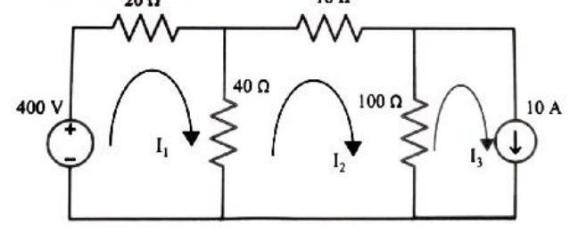
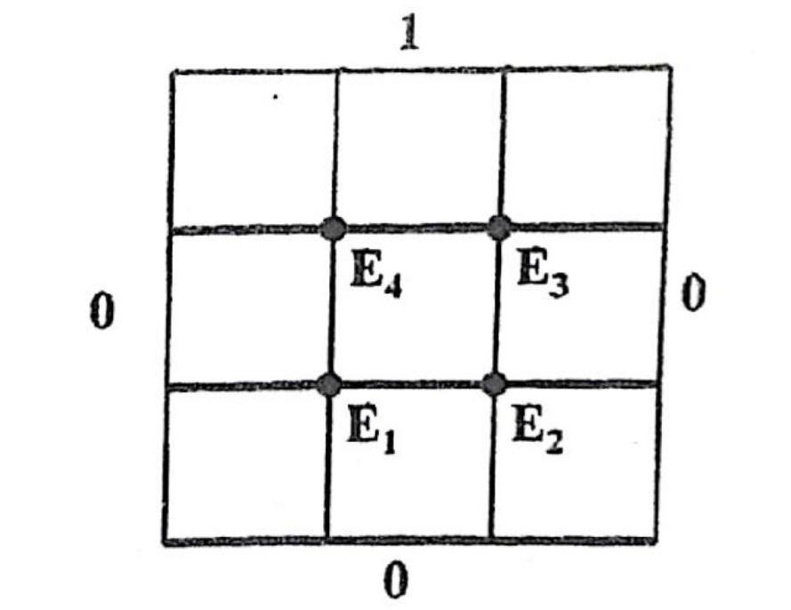

<!-- Page 1 -->

# Rajshahi University of Engineering & Technology
### B.Sc. Engineering 2nd Year Even Semester Examination, 2020
**Department of Electrical & Computer Engineering**  
**Course No:** ECE 2213  
**Course Title:** Numerical Methods  

---

- **Full Marks:** 72  
- **Time:** 03 Hours  
- **N.B.:**  
  - (i) Answer **SIX** questions taking any **THREE** from each section.  
  - (ii) Figures in the margin indicate full marks.  
  - (iii) Use separate answer script for each section.  

---

## SECTION-A

| Question No. | Question Description | Marks |
| :--- | :--- | :---: |
| **Q.1 (a)** | Why are numerical methods for? What are the sources of errors in numerical methods? Discuss them. | **06** |
| **Q.1 (b)** | How are errors represented? Write down their expressions. Obtain their values to approximate a current as $9.05\text{ Amp}$ instead of its true value $10\text{ Amp}$. Justify, which representation is better. | **06** |

---

| Question No. | Question Description | Marks |
| :--- | :--- | :---: |
| **Q.2 (a)** | Define roots of an equation. List the comparisons among bisection, secant, false position and Newton-Raphson methods. | **06** |
| **Q.2 (b)** | An electrical power equation is given as follows: $3I^2 - 4I - 4 = 0$. Calculate 3 iterations of the Newton-Raphson method to obtain the value of current. | **06** |

---

| Question No. | Question Description | Marks |
| :--- | :--- | :---: |
| **Q.3 (a)** | What is the main difference between interpolation and extrapolation? Where are they used? | **03** |
| **Q.3 (b)** | The population of a town in the decennial census was as given below. Estimate the population for the year (i) 1895 and (ii) 1925.<br><br>$$\begin{array}{lccccc} \hline \textbf{Year: } x & 1891 & 1901 & 1911 & 1921 & 1931 \\ \hline \textbf{Population (in thousands): } y & 46 & 66 & 81 & 93 & 101 \\ \hline \end{array}$$ | **04** |
| **Q.3 (c)** | Define curve fitting. Also determine the constants $a$ and $b$ by the method of least squares such that $y = a e^{bx}$ fits the following data.<br><br>$$\begin{array}{cccccc} \hline x & 2 & 4 & 6 & 8 & 10 \\ \hline y & 4.077 & 11.084 & 30.128 & 81.897 & 222.62 \\ \hline \end{array}$$ | **05** |

---

| Question No. | Question Description | Marks |
| :--- | :--- | :---: |
| **Q.4 (a)** | What are the direct methods to solve linear system of equations? Describe any one of them. | **06** |
| **Q.4 (b)** | Solve $I_1, I_2 \text{ and } I_3$ using Gauss-Seidal method.<br>*(Refer to the Circuit Diagram and Detailed Text Representation below)* | **06** |

### Circuit Diagram for Q.4(b)


*Figure 2020_Q4.b — Three-mesh DC resistive circuit with independent voltage and current sources (Source: Page 1, Q.4(b))*

```text
                  20 Ω                       10 Ω
         +-------/\/\/\/\-------+-----------/\/\/\/\----------+-------------------+
         |                      |                             |                   |
         | +                    |                             |                   |
       ( 400 V )              [40 Ω]                        [100 Ω]             ( | 10 A )
         | -                    |                             |                   V
         |      (↻ I₁)          |            (↻ I₂)           |      (↻ I₃)       |
         |                      |                             |                   |
         +----------------------+-----------------------------+-------------------+
```

#### Detailed Textual Explanation of Circuit Diagram (for Non-Vision LLMs / System Modeling)
- **Circuit Layout:** Planar three-mesh resistive network with independent voltage and current sources:
  - **Mesh 1 (Left Loop):**
    - Left branch: Independent ideal DC voltage source of $400\text{ V}$ with positive terminal $(+)$ on top and negative terminal $(-)$ at the bottom.
    - Top branch: Resistor of $20\ \Omega$.
    - Right branch (shared with Mesh 2): Resistor of $40\ \Omega$.
    - Bottom branch: Ideal common return conductor.
    - Assigned clockwise mesh current: $I_1$.
  - **Mesh 2 (Middle Loop):**
    - Left branch (shared with Mesh 1): Resistor of $40\ \Omega$.
    - Top branch: Resistor of $10\ \Omega$.
    - Right branch (shared with Mesh 3): Resistor of $100\ \Omega$.
    - Bottom branch: Ideal conductor.
    - Assigned clockwise mesh current: $I_2$.
  - **Mesh 3 (Right Loop):**
    - Left branch (shared with Mesh 2): Resistor of $100\ \Omega$.
    - Top branch: Ideal connecting wire.
    - Right branch: Independent ideal DC current source of $10\text{ A}$ directed downwards $(\downarrow)$.
    - Bottom branch: Ideal conductor.
    - Assigned clockwise mesh current: $I_3$.
- **Governing Equations (Mesh Analysis):**
  - **From Mesh 3:** Since the right branch contains only the downward $10\text{ A}$ current source aligned with clockwise mesh current $I_3$:
    $$I_3 = 10\text{ A}$$
  - **Mesh 1 (KVL):**
    $$-400 + 20 I_1 + 40(I_1 - I_2) = 0 \implies 60 I_1 - 40 I_2 = 400$$
  - **Mesh 2 (KVL):**
    $$40(I_2 - I_1) + 10 I_2 + 100(I_2 - I_3) = 0 \implies -40 I_1 + 150 I_2 - 100 I_3 = 0$$
  - Substituting $I_3 = 10\text{ A}$ into Mesh 2:
    $$-40 I_1 + 150 I_2 = 1000$$
  - **Linear System for Gauss-Seidel Method:**
    $$\begin{cases} 60 I_1 - 40 I_2 = 400 \\ -40 I_1 + 150 I_2 = 1000 \end{cases}$$

---

## SECTION-B

| Question No. | Question Description | Marks |
| :--- | :--- | :---: |
| **Q.5 (a)** | Deduce the Newton's forward difference interpolating polynomial. | **06** |
| **Q.5 (b)** | Using Newton's divided difference interpolating polynomial estimate the value of signal $s(t)$ at $t = 2.25\text{ sec}$ for the following tabulated values.<br><br>$$\begin{array}{cccccc} \hline t & 0.5 & 0.2 & 1.4 & 2.2 & 3.0 \\ \hline s(t) & -10.25 & -3.768 & 5.976 & 28.972 & 79.0 \\ \hline \end{array}$$ | **06** |

---

| Question No. | Question Description | Marks |
| :--- | :--- | :---: |
| **Q.6 (a)** | Compare Simpson's $1/3\text{rd}$ and $3/8\text{th}$ rules. | **03** |
| **Q.6 (b)** | A circuit is giving following output voltage equation:<br><br>$$v_0 = -\frac{1}{RC} \int_0^t v_i(t) \, dt$$<br>where $R = 10\text{ k}\Omega, \, C = 1\ \mu\text{F}$ and the value of input is tabulated as follows:<br><br>$$\begin{array}{ccccccc} \hline t & 0 & 0.25 & 0.50 & 0.75 & 1.00 & 1.25 \\ \hline v_i(t) & 1 & 0.9793 & 0.9195 & 0.8261 & 0.7081 & 0.6201 \\ \hline \end{array}$$<br><br>Obtain the value of $v_0$ when $t = 1.25$. Use Simpson's $1/3\text{rd}$ rule. | **05** |
| **Q.6 (c)** | The following table gives the angular displacements $\theta$ (radian) at different time intervals of time $t\,(\text{sec})$:<br><br>$$\begin{array}{cccccccc} \hline \theta & 0.052 & 0.105 & 0.168 & 0.242 & 0.327 & 0.408 & 0.489 \\ \hline t & 0 & 0.02 & 0.04 & 0.06 & 0.08 & 0.10 & 0.12 \\ \hline \end{array}$$<br><br>Calculate the angular velocity at the instant $t = 0.06\text{ sec}$. | **04** |

---

<!-- Page 2 -->

| Question No. | Question Description | Marks |
| :--- | :--- | :---: |
| **Q.7 (a)** | Derive modified Euler's method. What is the major limitation of Euler's method? | **04** |
| **Q.7 (b)** | Solve, by Euler's method, the equation<br><br>$$\frac{dy}{dx} = x + y, \quad y(0) = 0$$<br>Choose $h = 0.2$ and compute $y(0.4)$ and $y(0.6)$. | **04** |
| **Q.7 (c)** | Given, $\frac{dy}{dx} = y - x$, where $y(0) = 2$, find $y(0.1)$ and $y(0.2)$ by using Runge-Kutta second order formula. | **04** |

---

| Question No. | Question Description | Marks |
| :--- | :--- | :---: |
| **Q.8 (a)** | Write 4 types of partial differential equations. Discuss briefly the solving process of any of the equations using numerical iterative technique. | **06** |
| **Q.8 (b)** | Solve the equation $\frac{\partial^2 E(x,y)}{\partial x^2} + \frac{\partial^2 E(x,y)}{\partial y^2} = 0$ in the domain of the following figure by Liebmann method. Consider, $\Delta x = \Delta y$.<br>*(Refer to the Grid Diagram and Detailed Text Representation below)* | **06** |

### Grid Diagram for Q.8(b)


*Figure 2020_Q8.b — Square boundary domain with boundary values and interior nodes for Laplace equation (Source: Page 2, Q.8(b))*

```text
                                       1
                              +--------+--------+
                              |        |        |
                              |   E₄   |   E₃   |
                              |        |        |
                         0    +--------+--------+    0
                              |        |        |
                              |   E₁   |   E₂   |
                              |        |        |
                              +--------+--------+
                                       0
```

#### Detailed Textual Explanation of Grid Diagram (for Non-Vision LLMs / System Modeling)
- **Domain:** A uniform $3 \times 3$ square finite-difference mesh with step size $\Delta x = \Delta y = h$.
- **Boundary Potentials:**
  - **Top Boundary:** All grid boundary nodes on the top edge are maintained at $E_{\text{top}} = 1$.
  - **Bottom Boundary:** All grid boundary nodes on the bottom edge are maintained at $E_{\text{bottom}} = 0$.
  - **Left Boundary:** All grid boundary nodes on the left edge are maintained at $E_{\text{left}} = 0$.
  - **Right Boundary:** All grid boundary nodes on the right edge are maintained at $E_{\text{right}} = 0$.
- **Interior Nodes:**
  - Four internal grid intersections:
    - **$E_1$ (lower-left):** adjacent to Left boundary ($0$), Bottom boundary ($0$), Node $E_2$ (right), Node $E_4$ (top).
    - **$E_2$ (lower-right):** adjacent to Node $E_1$ (left), Bottom boundary ($0$), Right boundary ($0$), Node $E_3$ (top).
    - **$E_3$ (upper-right):** adjacent to Node $E_4$ (left), Top boundary ($1$), Right boundary ($0$), Node $E_2$ (bottom).
    - **$E_4$ (upper-left):** adjacent to Left boundary ($0$), Top boundary ($1$), Node $E_3$ (right), Node $E_1$ (bottom).
- **Liebmann (Gauss-Seidel finite-difference) Equations:**
  $$E_{i,j}^{(k+1)} = \frac{1}{4} \left( E_{i-1,j} + E_{i+1,j} + E_{i,j-1} + E_{i,j+1} \right)$$
  - $E_1 = \frac{1}{4}(0 + E_2 + 0 + E_4)$
  - $E_2 = \frac{1}{4}(E_1 + 0 + 0 + E_3)$
  - $E_3 = \frac{1}{4}(E_4 + 0 + E_2 + 1)$
  - $E_4 = \frac{1}{4}(0 + E_3 + E_1 + 1)$
