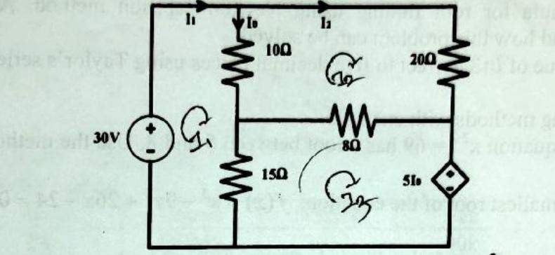

<!-- Page 1 -->

# Rajshahi University of Engineering & Technology
### B.Sc. Engineering 2nd Year Even Semester Examination, 2021
**Department of Electrical & Computer Engineering**  
**Course No:** ECE 2213  
**Course Title:** Numerical Methods  

---

- **Full Marks:** 72  
- **Time:** 03:00 Hours  
- **N.B.:**  
  - (i) Answer **SIX** questions taking any **THREE** from each section.  
  - (ii) Figures in the margin indicate full marks and course learning outcomes (CLOs).  
  - (iii) Use separate answer script for each section.  

---

## SECTION-A

| Question No. | Question Description | Marks | CLO |
| :--- | :--- | :---: | :---: |
| **Q.1 (a)** | Differentiate between numerical methods and analytical methods. Why do ECE engineers require numerical methods? | **04** | **CLO1** |
| **Q.1 (b)** | Derive the formula for root finding using Newton-Raphson method. Also, discuss the problems of it and how this problem can be solved. | **04** | **CLO2** |
| **Q.1 (c)** | Compute the value of $\ln 3$ correct to five decimal places using Taylor's series expansion. | **04** | **CLO2** |

---

| Question No. | Question Description | Marks | CLO |
| :--- | :--- | :---: | :---: |
| **Q.2 (a)** | Define bracketing methods with example. | **02** | **CLO1** |
| **Q.2 (b)** | Given that the equation $x^{2.2} = 69$ has a root between 5 and 8. Use the method of regula-falsi to determine it. | **04** | **CLO3** |
| **Q.2 (c)** | Determine the smallest root of the equation: $f(x) = x^3 - 9x^2 + 26x - 24 = 0$ | **06** | **CLO3** |

---

| Question No. | Question Description | Marks | CLO |
| :--- | :--- | :---: | :---: |
| **Q.3 (a)** | When should we use interpolation instead of curve fitting? | **02** | **CLO2** |
| **Q.3 (b)** | Differentiate between Newton's interpolation and Lagrange's interpolation. | **02** | **CLO2** |
| **Q.3 (c)** | Derive the Newton's forward interpolation formula:<br><br>$$y_n(x) = y_0 + p\Delta y_0 + \frac{p(p-1)}{2!}\Delta^2 y_0 + \frac{p(p-1)(p-2)}{3!}\Delta^3 y_0 + \cdots$$ | **04** | **CLO2** |
| **Q.3 (d)** | Find $y(2)$ from the following data using Lagrange's formula:<br><br>$$\begin{array}{cccccc} \hline x & 0 & 1 & 3 & 4 & 5 \\ \hline y & 0 & 1 & 81 & 256 & 625 \\ \hline \end{array}$$ | **04** | **CLO2** |

---

| Question No. | Question Description | Marks | CLO |
| :--- | :--- | :---: | :---: |
| **Q.4 (a)** | Give a real life example of curve fitting. | **02** | **CLO2** |
| **Q.4 (b)** | From the following table, calculate the value of $e^{1.17}$ using Gauss' forward formula:<br><br>$$\begin{array}{cc} \hline x & e^x \\ \hline 1.00 & 2.7183 \\ \hline 1.05 & 2.8577 \\ \hline 1.10 & 3.0042 \\ \hline 1.15 & 3.1582 \\ \hline 1.20 & 3.3201 \\ \hline 1.25 & 3.4903 \\ \hline 1.30 & 3.6693 \\ \hline \end{array}$$ | **05** | **CLO2** |
| **Q.4 (c)** | You have a gas sensor. It sends a value in 2 seconds. The table of received values:<br><br>$$\begin{array}{cc} \hline t(\text{s}) & \text{Value} \\ \hline 1 & 24 \\ \hline 3 & 120 \\ \hline 5 & 336 \\ \hline 7 & 720 \\ \hline 9 & 1200 \\ \hline \end{array}$$<br>What will be the sensor's reading at 10s? | **05** | **CLO2** |

---

## SECTION-B

| Question No. | Question Description | Marks | CLO |
| :--- | :--- | :---: | :---: |
| **Q.5 (a)** | Define boundary value and initial value problem. | **02** | **CLO2** |
| **Q.5 (b)** | Solve the boundary value problem $\frac{d^2y}{dx^2} - y = 0$ with $y(0) = 0$ and $y(2) = 3.62686$. | **05** | **CLO3** |
| **Q.5 (c)** | A capacitor loses 4% of its remaining charge every second. It is fully charged with 100 Coulomb of charge. What will be the remaining charge after 10 sec. Develop the ODE and also determine the solution. | **05** | **CLO2** |

---

| Question No. | Question Description | Marks | CLO |
| :--- | :--- | :---: | :---: |
| **Q.6 (a)** | Write down a real-life application of numerical differentiation. | **02** | **CLO2** |
| **Q.6 (b)** | Use Newton's method to find the maximum of $f(x) = 2\sin x - \frac{x^2}{10}$ with an initial guess of $x_0 = 2.5$. | **03** | **CLO2** |
| **Q.6 (c)** | Solve the Poisson equation $U_{xx} + U_{yy} = -10(x^2 + y^2 + 10)$ in the domain of the given figure below:<br>*(Refer to the Grid Domain Diagram and Detailed Text Representation below)* | **05** | **CLO2** |

<!-- Page 2 -->

### Grid Domain Diagram for Q.6(c)

![Fig_2021_Q6.c: Square domain 3x3 finite-difference grid for Poisson equation with boundary condition u=0 on all four sides (top, bottom, left, right), domain x in [0, 3], y in [0, 3], and four interior nodes u1, u2, u3, u4](diagrams/2021_p02_fig01.jpg)
*Figure 2021_Q6.c — Square domain finite-difference grid with Dirichlet boundary conditions for Poisson's equation (Source: Page 2, Q.6(c))*

#### Textual & Mathematical Description of Fig_2021_Q6.c (for Visionless LLMs)

```text
                  Y
                  ^
                  |              u = 0 (Top Boundary)
              3 --+---------------------------------------+
                  |             |             |           |
                  |             |             |           |
              2 --+-------------+-------------+-----------+
                  |             |  u3 (1,2)   |  u4 (2,2) |
                  |             |             |           |
          u = 0 --+-------------+-------------+-----------+-- u = 0 (Right Boundary)
        (Left)    |             |  u1 (1,1)   |  u2 (2,1) |
                  |             |             |           |
              1 --+-------------+-------------+-----------+
                  |             |             |           |
                  |             |             |           |
              0 --+-------------+-------------+-----------+-----> X
                  0             1             2           3
                                u = 0 (Bottom Boundary)
```

1. **Domain and Mesh Geometry:**
   - Spatial domain: $0 \le x \le 3$, $0 \le y \le 3$.
   - Mesh step size: uniform grid spacing $h = \Delta x = 1$, $k = \Delta y = 1$.
   - Grid points are at integer coordinates $(x_i, y_j) = (i, j)$ for $i, j \in \{0, 1, 2, 3\}$.

2. **Boundary Conditions (Dirichlet type):**
   - Bottom boundary ($y = 0$): $u(x, 0) = 0$ for $x \in \{0, 1, 2, 3\}$.
   - Top boundary ($y = 3$): $u(x, 3) = 0$ for $x \in \{0, 1, 2, 3\}$.
   - Left boundary ($x = 0$): $u(0, y) = 0$ for $y \in \{0, 1, 2, 3\}$.
   - Right boundary ($x = 3$): $u(3, y) = 0$ for $y \in \{0, 1, 2, 3\}$.

3. **Interior Unknown Grid Nodes:**
   - Node $u_1 = u(1, 1)$ at coordinate $(x, y) = (1, 1)$.
   - Node $u_2 = u(2, 1)$ at coordinate $(x, y) = (2, 1)$.
   - Node $u_3 = u(1, 2)$ at coordinate $(x, y) = (1, 2)$.
   - Node $u_4 = u(2, 2)$ at coordinate $(x, y) = (2, 2)$.

4. **Governing Equation & Discrete Formulation:**
   - PDE: $U_{xx} + U_{yy} = -10(x^2 + y^2 + 10)$
   - Standard 5-point finite difference formula with $h = k = 1$:
     $$u_{i+1, j} + u_{i-1, j} + u_{i, j+1} + u_{i, j-1} - 4u_{i,j} = -10(x_i^2 + y_j^2 + 10)$$
   - At Node $u_1(1, 1)$:
     $$u(2,1) + u(0,1) + u(1,2) + u(1,0) - 4u(1,1) = -10(1^2 + 1^2 + 10) = -120$$
     $$u_2 + 0 + u_3 + 0 - 4u_1 = -120 \implies -4u_1 + u_2 + u_3 = -120$$
   - At Node $u_2(2, 1)$:
     $$u(3,1) + u(1,1) + u(2,2) + u(2,0) - 4u(2,1) = -10(2^2 + 1^2 + 10) = -150$$
     $$0 + u_1 + u_4 + 0 - 4u_2 = -150 \implies u_1 - 4u_2 + u_4 = -150$$
   - At Node $u_3(1, 2)$:
     $$u(2,2) + u(0,2) + u(1,3) + u(1,1) - 4u(1,2) = -10(1^2 + 2^2 + 10) = -150$$
     $$u_4 + 0 + 0 + u_1 - 4u_3 = -150 \implies u_1 - 4u_3 + u_4 = -150$$
   - At Node $u_4(2, 2)$:
     $$u(3,2) + u(1,2) + u(2,3) + u(2,1) - 4u(2,2) = -10(2^2 + 2^2 + 10) = -180$$
     $$0 + u_3 + 0 + u_2 - 4u_4 = -180 \implies u_2 + u_3 - 4u_4 = -180$$

---

| Question No. | Question Description | Marks | CLO |
| :--- | :--- | :---: | :---: |
| **Q.6 (d)** | Differentiate between constrained and unconstrained optimization. | **02** | **CLO2** |

---

| Question No. | Question Description | Marks | CLO |
| :--- | :--- | :---: | :---: |
| **Q.7 (a)** | Why is pivoting important? | **02** | **CLO1** |
| **Q.7 (b)** | Determine the value of $I_0$ in the given circuit using gauss seidel method.<br>*(Refer to the Circuit Diagram and Detailed Text Representation below)* | **06** | **CLO2** |

### Circuit Diagram for Q.7(b)


*Figure 2021_Q7.b — DC circuit with independent 30V source, 4 resistors, and dependent voltage source $5I_0$ (Source: Page 2, Q.7(b))*

#### Textual & Mathematical Description of Fig_2021_Q7.b (for Visionless LLMs)

```text
                  I1 --->                 I2 --->
     (Top Rail)  +----------------+----------------+
                 |                |                |
                 |                |                |
                 |              [10 Ω]           [20 Ω]
                 |             | I0                |
               + |             v                   |
            ( 30 V )              +------/\/\/\----+ (Right Node R)
               - |                |       8 Ω      |
                 |              [15 Ω]             |
                 |                |                |
                 |                |              / + \
                 |                |             < 5I0 >  (Dependent Source)
                 |                |              \ - /
                 |                |                |
  (Bottom Rail)  +----------------+----------------+
```

1. **Circuit Components & Topology:**
   - **Nodes:**
     - **Bottom Rail (Reference Ground, $0\text{V}$):** Connects the negative terminal of the $30\text{V}$ DC source, the bottom terminal of the $15\,\Omega$ resistor, and the negative terminal of the dependent voltage source.
     - **Top Rail:** Connects the positive terminal of the $30\text{V}$ source, the top terminal of the $10\,\Omega$ resistor, and the top terminal of the $20\,\Omega$ resistor. Since it connects directly to the $30\text{V}$ ideal DC source, $V_{\text{Top}} = 30\text{V}$.
     - **Center Node ($C$):** Connects the bottom of the $10\,\Omega$ resistor, the top of the $15\,\Omega$ resistor, and the left terminal of the $8\,\Omega$ resistor.
     - **Right Node ($R$):** Connects the bottom of the $20\,\Omega$ resistor, the right terminal of the $8\,\Omega$ resistor, and the positive terminal of the dependent voltage source diamond ($5I_0$).
   - **Controlled / Dependent Source:**
     - Diamond-shaped Current-Controlled Voltage Source (CCVS) with label $5I_0$. Polarity: positive terminal ($+$) on top at Node $R$, negative terminal ($-$) on bottom at reference ground.
     - The potential at Node $R$ is therefore $V_R = 5I_0$.
   - **Branch Current $I_0$:**
     - Flows downward from the Top Rail through the $10\,\Omega$ resistor to Node $C$:
       $$I_0 = \frac{V_{\text{Top}} - V_C}{10} = \frac{30 - V_C}{10}$$

2. **Nodal Analysis Formulation (Direct & Compact):**
   - Let the bottom rail be reference ground ($0\text{V}$).
   - The Top Rail is connected to the ideal $30\text{V}$ source, so $V_{\text{Top}} = 30\text{V}$.
   - Branch current $I_0$ through $10\,\Omega$:
     $$I_0 = \frac{30 - V_C}{10}$$
   - Dependent source sets potential at Node $R$:
     $$V_R = 5I_0 = 5\left(\frac{30 - V_C}{10}\right) = 15 - 0.5V_C \implies V_C + 2V_R = 30$$
   - Applying KCL at Node $C$:
     $$\frac{V_C - 30}{10} + \frac{V_C - 0}{15} + \frac{V_C - V_R}{8} = 0$$
     Multiplying by 120:
     $$12(V_C - 30) + 8V_C + 15(V_C - V_R) = 0 \implies 35V_C - 15V_R = 360$$
   - Resulting $2 \times 2$ linear system in $(V_C, V_R)$ for Gauss-Seidel iterations:
     $$\begin{cases} 35V_C - 15V_R = 360 \\ V_C + 2V_R = 30 \end{cases}$$

3. **Mesh (Loop) Analysis Formulation:**
   - Let $I_1$ be the clockwise mesh current in Loop 1 (left loop: $30\text{V}$ source, $10\,\Omega$, $15\,\Omega$).
   - Let $I_2$ be the clockwise mesh current in Loop 2 (upper right loop: $10\,\Omega$, $20\,\Omega$, $8\,\Omega$).
   - Let $I_3$ be the clockwise mesh current in Loop 3 (lower right loop: $15\,\Omega$, $8\,\Omega$, dependent source $5I_0$).
   - Branch current $I_0$ through $10\,\Omega$ branch: $I_0 = I_1 - I_2$.
   - **Loop 1 KVL (clockwise):**
     $$30 - 10(I_1 - I_2) - 15(I_1 - I_3) = 0 \implies 25I_1 - 10I_2 - 15I_3 = 30$$
   - **Loop 2 KVL (clockwise):**
     $$-10(I_2 - I_1) - 20I_2 - 8(I_2 + I_3) = 0 \implies -10I_1 + 38I_2 + 8I_3 = 0$$
     *(Note: through the central horizontal $8\,\Omega$ resistor, clockwise loop currents $I_2$ and $I_3$ travel in opposite directions if traversed around each perimeter, or in the same direction depending on loop convention; both nodal and standard mesh representations are solvable by Gauss-Seidel).*

---

| Question No. | Question Description | Marks | CLO |
| :--- | :--- | :---: | :---: |
| **Q.7 (c)** | From the values of $x$ and $y$ in the following table, determine $\frac{dy}{dx}$ and $\frac{d^2y}{dx^2}$ for $x = 1.2$:<br><br>$$\begin{array}{cccc} \hline x & y & x & y \\ \hline 1.0 & 2.7183 & 1.8 & 6.0496 \\ \hline 1.2 & 3.3201 & 2.0 & 7.3891 \\ \hline 1.4 & 4.0552 & 2.2 & 9.0250 \\ \hline 1.6 & 4.9530 & & \\ \hline \end{array}$$ | **05** | **CLO3** |

---

| Question No. | Question Description | Marks | CLO |
| :--- | :--- | :---: | :---: |
| **Q.8 (a)** | Derive the following numerical integration formula:<br><br>$$\int_{x_0}^{x_n} y dx = \frac{h}{2}[y_0 + 2(y_1 + y_2 + \cdots + y_{n-1}) + y_n]$$ | **04** | **CLO1** |
| **Q.8 (b)** | Use Romberg's method to compute: $\int_1^2 \frac{1}{2+x} dx$.<br><br>Consider $h = 0.5, 0.25, 0.125$. | **04** | **CLO2** |
| **Q.8 (c)** | Using Euler's method, determine $\frac{dy}{dx} = \frac{3}{5}x^3 y$; Consider $y(0) = 1$. | **04** | **CLO3** |
