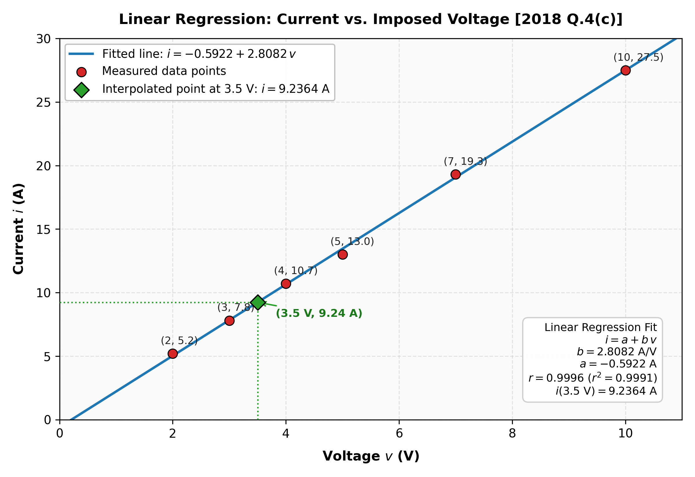

[🏠 Subtopic Index](00_Index.md) | [← Prev: NM-4.1 Concepts](NM-4.1_Concepts.md) | [Next: NM-4.3 Non-Linear Regression →](NM-4.3_Non_Linear_Regression.md)

---

# NM-4.2 · Least-Squares Linear Regression

Every block below is copied from `../answers_exam_style/`, which is the
only place an answer is authored. A number here is the same number, character
for character, as the one it came from.

### [2017 Q.6(b), 2024 Q.3(c)]

**Appeared in:** 2017 Q.6(b), 2024 Q.3(c)

**Question.** Fit a straight line to the $x$ and $y$ values in the first two columns of the following table.

**Solution.**

| $x$ | 1 | 2 | 3 | 4 | 5 | 6 | 7 |
| :---: | :---: | :---: | :---: | :---: | :---: | :---: | :---: |
| $y$ | 0.5 | 2.5 | 2.0 | 4.0 | 3.5 | 6.0 | 5.5 |

**Fit $y = a + bx$.** With $n = 7$:

$$\sum x = 28, \qquad \sum y = 24, \qquad \sum xy = 119.5, \qquad \sum x^2 = 140$$

The $\sum xy$ term is the one that requires care, being the only one that is
not a straight sum of a column. Its seven products are

$$1(0.5) = 0.5, \quad 2(2.5) = 5, \quad 3(2) = 6, \quad 4(4) = 16, \quad 5(3.5) = 17.5, \quad 6(6) = 36, \quad 7(5.5) = 38.5$$

which add to $119.5$.

**The normal equations.** With $a\sum x + b\sum x^2 = \sum xy$ and
$na + b\sum x = \sum y$:

$$28a + 140b = 119.5$$

$$7a + 28b = 24$$

Multiply the second by $4$, giving $28a + 112b = 96$, and subtract it from the
first:

$$28b = 119.5 - 96 = 23.5 \implies b = \frac{23.5}{28} = \frac{47}{56} = 0.839286$$

Substituting back into the second:

$$7a = 24 - 28(0.839286) = 24 - 23.5 = 0.5 \implies a = \frac{0.5}{7} = \frac{1}{14} = 0.071429$$

**The fitted line.**

$$\boxed{y = 0.0714 + 0.8393x}$$

**The residuals.**

| $x$ | $y$ | $0.0714 + 0.8393x$ | $e = y - \hat y$ |
| :--: | :-- | :-- | :-- |
| 1 | 0.5 | 0.9107 | $-0.4107$ |
| 2 | 2.5 | 1.7500 | $+0.7500$ |
| 3 | 2.0 | 2.5893 | $-0.5893$ |
| 4 | 4.0 | 3.4286 | $+0.5714$ |
| 5 | 3.5 | 4.2679 | $-0.7679$ |
| 6 | 6.0 | 5.1071 | $+0.8929$ |
| 7 | 5.5 | 5.9464 | $-0.4464$ |

The residuals sum to zero, as the normal equations guarantee, and the sum of
squared residuals is $2.9911$.

> [!info] Check by the closed-form expression and by the centroid
> The standard formula
> $$b = \frac{n\sum xy - \sum x\sum y}{n\sum x^2 - \left(\sum x\right)^2} = \frac{7(119.5) - (28)(24)}{7(140) - 28^2} = \frac{836.5 - 672}{980 - 784} = \frac{164.5}{196} = 0.839286$$
> reproduces $47/56$, so the two routes agree. The centroid condition then holds:
> $a = \bar y - b\bar x = 3.4286 - 0.839286(4) = 0.0714$, and substituting back
> gives $0.0714 + 0.839286(4) = 3.4286 = \bar y$, as a least-squares line must.
> Substituting $a$ and $b$ into both normal equations reproduces them exactly:
> $28(0.071429) + 140(0.839286) = 2 + 117.5 = 119.5$ ✓ and
> $7(0.071429) + 28(0.839286) = 0.5 + 23.5 = 24$ ✓.

The correlation coefficient is $r = 0.9318$, so $r^2 = 0.8683$, meaning about
$87\%$ of the variation in $y$ is accounted for by the line. The residuals
alternate in sign and are largest toward the middle of the range, which is the
signature of genuine curvature in the data rather than of an arithmetic slip.

---

### [2018 Q.4(c)]

**Question.** The following data was taken from an experiment that measured the current in a wire for various imposed voltages. On the basis of a linier regression of this data, determine current for a voltage of $3.5\text{ V}$. Plot the line to evaluate the fit.

**Solution.**

| $v$ (V) | 2 | 3 | 4 | 5 | 7 | 10 |
| :---: | :---: | :---: | :---: | :---: | :---: | :---: |
| $i$ (A) | 5.2 | 7.8 | 10.7 | 13 | 19.3 | 27.5 |

**Fit the line** $i = a + bv$ by least squares. With $n = 6$:

$$\sum v = 31, \qquad \sum i = 83.5, \qquad \sum v^2 = 203, \qquad \sum vi = 551.7$$

**The normal-equation solution.**

$$b = \frac{n\sum vi - \sum v\sum i}{n\sum v^2 - \left(\sum v\right)^2} = \frac{6(551.7) - (31)(83.5)}{6(203) - 31^2} = \frac{3310.2 - 2588.5}{1218 - 961} = \frac{721.7}{257}$$

$$b = 2.8082\ \text{A/V}$$

$$a = \bar i - b\bar v = \frac{83.5}{6} - 2.8082\left(\frac{31}{6}\right) = 13.9167 - 14.5089 = -0.5922\ \text{A}$$

**The regression line.**

$$\boxed{i = -0.5922 + 2.8082\,v}$$

**The current at $3.5\ \text{V}$.**

$$i(3.5) = -0.5922 + 2.8082(3.5) = -0.5922 + 9.8287 = 9.2364$$

$$\boxed{i(3.5\ \text{V}) = 9.2364\ \text{A}}$$

**Plotting the fit.** The six measured points $(v, i)$ and the fitted line $i = -0.5922 + 2.8082\,v$:

The measured values and residuals against the line are:

| $v$ | measured $i$ | fitted $i$ | residual |
| :--: | :-- | :-- | :-- |
| 2 | 5.2 | $5.0241$ | $+0.1759$ |
| 3 | 7.8 | $7.8323$ | $-0.0323$ |
| 4 | 10.7 | $10.6405$ | $+0.0595$ |
| 5 | 13 | $13.4486$ | $-0.4486$ |
| 7 | 19.3 | $19.0650$ | $+0.2350$ |
| 10 | 27.5 | $27.4895$ | $+0.0105$ |

The residuals are small compared with the values themselves, the largest in
magnitude being $0.4486$ against $13$, so the line describes the data well. A
straight line is a reasonable model for a wire at constant temperature.

> [!info] Check against the centroid and the correlation coefficient
> The centroid of the data is $(\bar v, \bar i) = (5.1667, 13.9167)$, and
> substituting gives $-0.5922 + 2.8082(5.1667) = 13.9167$, so the line passes
> through the centroid as the normal equations require. The correlation
> coefficient is $r = 0.9996$, so $r^2 = 0.9991$, meaning over $99.9\%$ of the
> variation in current is accounted for by the line. As a numerical check, the
> fitted line evaluated at $v = 3$ and $v = 4$ gives $7.8323$ and $10.6405$,
> and interpolating linearly between those at $v = 3.5$ returns $9.2364$, which
> is the value computed above. A straight line, a centroid condition and an
> internal interpolation all agree, so the result is not an artefact of the
> rounding of $a$ and $b$.

---

---

### [2019 Q.4(c)]

**Question.** Deduce the linear regression expression.

**Solution.**

Let the data be $(x_i, y_i)$, $i = 1, \ldots, n$, and let the fitted line be

$$\hat y = a + bx$$

The residual at point $i$ is $r_i = y_i - a - bx_i$. Minimise the sum of squared
residuals:

$$S(a, b) = \sum_{i=1}^{n}\left(y_i - a - bx_i\right)^2$$

At a minimum, both partial derivatives vanish:

$$\frac{\partial S}{\partial a} = -2\sum_{i=1}^{n}\left(y_i - a - bx_i\right) = 0 \implies \sum y_i = na + b\sum x_i$$

$$\frac{\partial S}{\partial b} = -2\sum_{i=1}^{n}x_i\left(y_i - a - bx_i\right) = 0 \implies \sum x_i y_i = a\sum x_i + b\sum x_i^2$$

These are the **normal equations**. Solving the $2 \times 2$ system:

$$na + b\sum x_i = \sum y_i$$

$$a\sum x_i + b\sum x_i^2 = \sum x_i y_i$$

Eliminating $a$ from the first, $a = \bar y - b\bar x$, and substituting into the
second:

$$\sum x_i y_i = (\bar y - b\bar x)\sum x_i + b\sum x_i^2$$

Dividing through and collecting terms in $b$:

$$b = \frac{n\sum x_i y_i - \sum x_i \sum y_i}{n\sum x_i^2 - \left(\sum x_i\right)^2}, \qquad a = \bar y - b\bar x$$

$$\boxed{y = \left(\bar y - b\bar x\right) + bx \quad\text{with}\quad b = \frac{n\sum xy - \sum x \sum y}{n\sum x^2 - \left(\sum x\right)^2}}$$

> [!info] Check against the centroid condition
> The first normal equation rearranged gives $a + b\bar x = \bar y$, so the fitted
> line passes through the point $(\bar x, \bar y)$ whatever the data. The
> intercept formula $a = \bar y - b\bar x$ is exactly this condition solved for
> $a$, so the two forms are the same statement and the deduction is internally
> consistent.

---

---

[🏠 Subtopic Index](00_Index.md) | [← Prev: NM-4.1 Concepts](NM-4.1_Concepts.md) | [Next: NM-4.3 Non-Linear Regression →](NM-4.3_Non_Linear_Regression.md)
