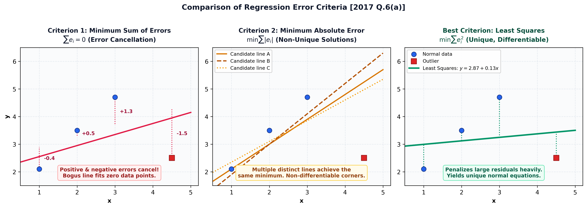

[🏠 Subtopic Index](00_Index.md) | [← Prev: NM-4.3 Non-Linear Regression](NM-4.3_Non_Linear_Regression.md) | [Next: NM-4.5 Linear Interpolation →](NM-4.5_Linear_Interpolation.md)

---

# NM-4.4 · Regression Criteria & Theory

Every block below is copied from `../answers_exam_style/`, which is the
only place an answer is authored. A number here is the same number, character
for character, as the one it came from.

### [2017 Q.6(a)]

**Question.** With necessary figure(s) explain why minimum sum of error, minimum sum of absolute error and minimum error are ill-suited for regression. Which criterion is best suited for regression?

**Solution.**

Take four data points, three of which lie near the line and one of which is a
spuriously displaced measurement.

**Criterion 1: minimum sum of errors, $\sum e_i = 0$.** The positive and
negative errors cancel, so this condition is satisfied by infinitely many
curves, including curves that pass through none of the data. A line far above
three points and far below a fourth can give $\sum e_i = 0$ while fitting
nothing.

**Criterion 2: minimum sum of absolute errors, $\sum|e_i|$.** The cancellation is
removed, so the criterion is a genuine measure of badness. However the
function $\sum|e_i|$ is piecewise linear in the curve's parameters, and its
minimum often lies at a point where the slope is not defined, so no simple
normal equations result. The condition is satisfied by several distinct curves
whenever they share the same total absolute deviation, and it is numerically
awkward.

**Criterion 3: minimum error.** A single error, $\min_i |e_i|$, considers one
point only. Minimising it drives one residual to zero while the others are
ignored entirely.

**The criterion that is best suited.** The **least-squares criterion**,
minimising the sum of squared errors

$$S = \sum e_i^2$$

is best. Its three properties make it the standard:

1. **No cancellation**, since the square is always non-negative.
2. **A unique, smooth minimum**, and the resulting normal equations
   $\partial S/\partial a_j = 0$ are linear in the parameters, so they have a
   closed-form solution.
3. **A probabilistic justification**: if the measurement errors are independent
   and normally distributed with equal variance, the least-squares fit is the
   maximum-likelihood estimate.

$$\boxed{S = \sum_{i=1}^{n}\left(y_i - f(x_i)\right)^2 \text{ is the criterion to minimise}}$$

---

---

**Also asked here.**

- *2019 Q.4(a)* is the same question as [[NM-4.1_Concepts|NM-4.1]], which is written in `NM-4.1`.

---

[🏠 Subtopic Index](00_Index.md) | [← Prev: NM-4.3 Non-Linear Regression](NM-4.3_Non_Linear_Regression.md) | [Next: NM-4.5 Linear Interpolation →](NM-4.5_Linear_Interpolation.md)
