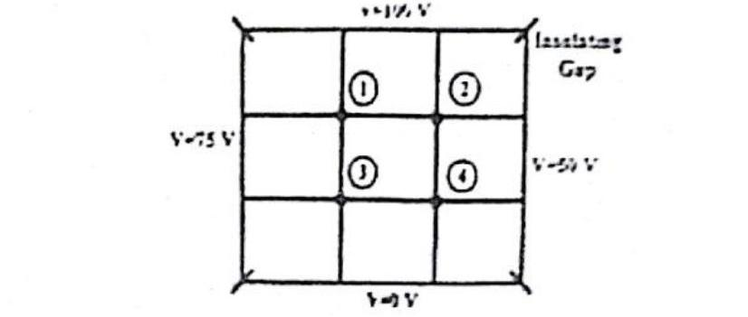
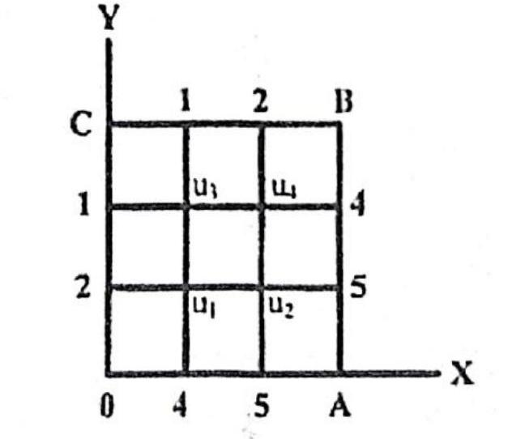

[🏠 Subtopic Index](00_Index.md) | [← Prev: NM-10.1 PDE Classification & Theory](NM-10.1_PDE_Classification_and_Theory.md) | [Next: NM-10.3 Poisson Equation →](NM-10.3_Poisson_Equation.md)

---

# NM-10.2 · Laplace Equation

Every block below is copied from `../answers_explanation/`. The reasoning
is written once, in the year-wise file, and is not restated here.

### [2018 Q.8(a), 2020 Q.8(b)]

**Appeared in:** 2018 Q.8(a), 2020 Q.8(b)

**Question.** Find the potential distribution at the interior nodes using Leibmann's method.

*[Marks: 06]*

**Solution.**

**The mesh.**

**The governing equation.** With no charge or source inside the region, the
potential satisfies Laplace's equation, whose five-point finite-difference form
on a uniform square mesh is

$$u_{i,j} = \frac{1}{4}\left(u_{i+1,j} + u_{i-1,j} + u_{i,j+1} + u_{i,j-1}\right)$$

Four neighbours, four weights, all $1/4$. That symmetry is why this is called
the five-point stencil: the centre plus its four edge neighbours.

**Leibmann's method is Gauss-Seidel on this system.** Update each node from the
most recent values of its neighbours, as soon as those are available, rather
than from the previous sweep.

**The four node equations.** This is where the question is won or lost. Read
each node's four neighbours off the diagram, boundary values included:

$$V_1 = \frac{100 + V_2 + 75 + V_3}{4} = \frac{175 + V_2 + V_3}{4}$$

$$V_2 = \frac{100 + 50 + V_1 + V_4}{4} = \frac{150 + V_1 + V_4}{4}$$

$$V_3 = \frac{75 + V_4 + V_1 + 0}{4} = \frac{75 + V_1 + V_4}{4}$$

$$V_4 = \frac{V_3 + 50 + V_2 + 0}{4} = \frac{50 + V_2 + V_3}{4}$$

As a $4\times4$ system,

$$\begin{bmatrix} 4 & -1 & -1 & 0 \\ -1 & 4 & 0 & -1 \\ -1 & 0 & 4 & -1 \\ 0 & -1 & -1 & 4 \end{bmatrix}\begin{bmatrix} V_1 \\ V_2 \\ V_3 \\ V_4 \end{bmatrix} = \begin{bmatrix} 175 \\ 150 \\ 75 \\ 50 \end{bmatrix}$$

> [!warning] Counting off-diagonal entries catches a wrong neighbour
> Look at the matrix before you look at the answer. Each row of a five-point
> stencil row has one diagonal and **exactly two** off-diagonal entries. Here
> rows 1 to 4 carry $-1$ in columns two and three, two and four, one and four,
> and two and three respectively: two each. If you find three $-1$s in a row,
> you have put a diagonal neighbour in where an off-diagonal one belongs.
>
> A second test is to add all four equations. Every interior neighbour appears
> once with $+1$ and once with $-1$, so the interior terms cancel and what
> remains is $2(V_1+V_2+V_3+V_4) = 175 + 150 + 75 + 50 = 450$, giving
> $V_1+V_2+V_3+V_4 = 225$. The stated answer gives
> $71.875 + 65.625 + 46.875 + 40.625 = 225$ exactly, so the neighbour sets are
> mutually consistent. One line, and it catches a transposed pair of neighbours
> immediately.

**Leibmann iteration.** Starting from $V_1 = V_2 = V_3 = V_4 = 0$, and
updating in the order $1, 2, 3, 4$ so each node uses the freshest neighbours
available:

| Sweep | $V_1$ | $V_2$ | $V_3$ | $V_4$ |
| :--: | :--: | :--: | :--: | :--: |
| 1 | 43.750000 | 48.437500 | 29.687500 | 32.031250 |
| 2 | 63.281250 | 61.328125 | 42.578125 | 38.476562 |
| 3 | 69.726562 | 64.550781 | 45.800781 | 40.087891 |
| 4 | 71.337891 | 65.356445 | 46.606445 | 40.490723 |
| 5 | 71.740723 | 65.557861 | 46.807861 | 40.591431 |
| 6 | 71.841431 | 65.608215 | 46.858215 | 40.616608 |

**The solution.** The iteration converges, and solving the $4\times4$ system
directly gives

$$V_1 = \frac{575}{8} = 71.875, \qquad V_2 = \frac{525}{8} = 65.625$$

$$V_3 = \frac{375}{8} = 46.875, \qquad V_4 = \frac{325}{8} = 40.625$$

$$\boxed{V_1 = 71.875\ \text{V}, \quad V_2 = 65.625\ \text{V}, \quad V_3 = 46.875\ \text{V}, \quad V_4 = 40.625\ \text{V}}$$

> [!info] Checking by substitution, and what the fractions tell you
> Substitute back into the four stencil equations:
> $\dfrac{1}{4}(175 + 65.625 + 46.875) = \dfrac{287.5}{4} = 71.875$;
> $\dfrac{1}{4}(150 + 71.875 + 40.625) = \dfrac{262.5}{4} = 65.625$;
> $\dfrac{1}{4}(75 + 71.875 + 40.625) = \dfrac{187.5}{4} = 46.875$;
> $\dfrac{1}{4}(50 + 65.625 + 46.875) = \dfrac{162.5}{4} = 40.625$. All four hold
> exactly.
>
> The answer coming out as multiples of $\tfrac18$ is itself informative. The
> boundary data are multiples of $25$, and one sweep of the averaging process
> can only produce multiples of $\tfrac14$, so a multiple of $\tfrac18$ at the
> fixed point is a sign that the system is self-consistent. A wrong neighbour
> would leave a residual of order a tenth rather than zero, and the values
> would not settle on tidy fractions.
>
> On the convergence itself: all four nodes approach their limits from below,
> which is what a Gauss-Seidel start at the origin gives when every
> right-hand side is positive. The increments in $V_1$ over the first six sweeps
> are $43.7500$, $19.5313$, $6.4453$, $1.6113$, $0.4028$ and $0.1007$, so after
> the first sweep each increment is a fixed fraction, about one quarter, of the
> one before. That factor of four per sweep is the signature of a spectral
> radius near $0.25$. Six sweeps leave $V_1$ within $0.034$ V of its limit, so
> more sweeps would be needed for four-figure agreement; that is the honest
> reason an exact elimination is reported alongside the iteration.

---

### [2019 Q.8(b)]

**Question.** Solve the Laplace's equation for the square region shown in the following figure, the boundary values being indicated in the figure.

*[Marks: 06]*

**Solution.**

**The mesh.** A uniform $3\times3$ mesh over the square, with four interior nodes
$u_1, u_2, u_3, u_4$ and the boundary values shown.

**The standard Laplace finite-difference stencil.** For a square mesh with uniform
spacing $h$, $\nabla^2 u = 0$ gives

$$\frac{u_{i+1,j} - 2u_{i,j} + u_{i-1,j}}{h^2} + \frac{u_{i,j+1} - 2u_{i,j} + u_{i,j-1}}{h^2} = 0$$

and cancelling $h^2$:

$$u_{i,j} = \frac{1}{4}\left(u_{i+1,j} + u_{i-1,j} + u_{i,j+1} + u_{i,j-1}\right)$$

**The four nodal equations.** Reading the neighbours of each interior node from the
figure, and taking the boundary values in the order left, right, top, bottom:

$$u_1 = \frac{1}{4}\left(u_2 + u_3 + 4 + 2\right)$$

$$4u_1 - u_2 - u_3 = 6$$

$$u_2 = \frac{1}{4}\left(u_1 + u_4 + 5 + 5\right)$$

$$4u_2 - u_1 - u_4 = 10$$

$$u_3 = \frac{1}{4}\left(u_1 + u_4 + 1 + 1\right)$$

$$4u_3 - u_1 - u_4 = 2$$

$$u_4 = \frac{1}{4}\left(u_3 + u_2 + 2 + 4\right)$$

$$4u_4 - u_3 - u_2 = 6$$

> [!warning] This is the step the figure exists for
> Each interior node has **exactly two interior neighbours** and **exactly two
> boundary neighbours**. Writing the equations correctly means identifying which is
> which from the mesh, and the two are easy to swap because the node is diagonally
> opposite to its boundary neighbour.
>
> Two checks catch the swap immediately:
>
> 1. **Count the entries.** Each equation has one diagonal coefficient $4$ and
>    **two** off-diagonal $-1$. A row with three off-diagonal entries is not a
>    five-point stencil equation and cannot be right.
> 2. **Add all four equations.** Every column then sums to $2$, because each node is
>    an interior neighbour of exactly two others. Getting $2(u_1+u_2+u_3+u_4) = 24$
>    confirms the four equations are mutually consistent; a mislabelled neighbour
>    breaks the cancellation immediately.

**Solve the $4\times4$ system.**

$$4u_1 - u_2 - u_3 = 6$$
$$-u_1 + 4u_2 - u_4 = 10$$
$$-u_1 + 4u_3 - u_4 = 2$$
$$-u_3 - u_2 + 4u_4 = 6$$

Writing this as a matrix,

$$\begin{bmatrix} 4 & -1 & -1 & 0 \\ -1 & 4 & 0 & -1 \\ -1 & 0 & 4 & -1 \\ 0 & -1 & -1 & 4 \end{bmatrix} \begin{bmatrix} u_1 \\ u_2 \\ u_3 \\ u_4 \end{bmatrix} = \begin{bmatrix} 6 \\ 10 \\ 2 \\ 6 \end{bmatrix}$$

**Step 1. One relation from subtracting.** Equation 3 minus equation 2 cancels both
$u_1$ and $u_4$:

$$4u_3 - 4u_2 = -8 \implies u_3 = u_2 - 2$$

**Step 2. One relation from adding.** Adding all four, every column sums to $2$:

$$2(u_1 + u_2 + u_3 + u_4) = 24 \implies u_1 + u_2 + u_3 + u_4 = 12$$

**Step 3. Substitute $u_3 = u_2 - 2$** into that sum:

$$u_1 + 2u_2 + u_4 = 14, \quad u_4 = 14 - u_1 - 2u_2$$

**Step 4. Use equation 2.** Substituting that $u_4$ into $-u_1 + 4u_2 - u_4 = 10$:

$$-u_1 + 4u_2 - 14 + u_1 + 2u_2 = 10 \implies 6u_2 = 24 \implies u_2 = 4$$

Here $u_3 = 2$ and $u_4 = 6 - u_1$. Equation 1 then gives
$4u_1 - 4 - 2 = 6$, hence $u_1 = 3$ and $u_4 = 3$.

$$\boxed{u_1 = 3, \qquad u_2 = 4, \qquad u_3 = 2, \qquad u_4 = 3}$$

> [!info] Check against the individual nodal equations
> Substituting into the four nodal equations directly:
> $4(3) - 4 - 2 = 6$ ✓; $-(3) + 4(4) - 3 = 10$ ✓;
> $-(3) + 4(2) - 3 = 2$ ✓; $-(2) - 4 + 4(3) = 6$ ✓. All four hold exactly.
> The values also insert into the difference form consistently,
> $u_1 = \tfrac{1}{4}(2 + 4 + 4 + 2) = 3$ and
> $u_3 = \tfrac{1}{4}(1 + 1 + 3 + 3) = 2$, in each case the mean of the four
> neighbours as the Laplace stencil requires. That the solution is a set of small
> integers when the boundary data are also integers is a property of this
> particular mesh, and it is itself a strong check.

> [!note] Why small integers are the expected answer here, and why that is a check
> With integer boundary data and a small mesh, the exact solution of the
> five-point system is a rational with denominator equal to the determinant of the
> matrix. Here that determinant is $192$, and $\operatorname{adj}(A)b = [576, 768, 384, 576]^T$,
> so dividing by $192$ gives $[3, 4, 2, 3]^T$, making every entry an exact integer.
>
> **So the integrality is a property of this particular mesh and boundary data, not a general structural fact.** It
> is still a useful one, because a wrong neighbour almost never produces integers.
> The same boundary data with one neighbour transposed gives a non-integer vector with denominator $192$,
> which is the visible signature of the error this question is designed to catch.

> [!warning] Where this meets Q.3(c)
> The two-node Gauss-Seidel system there is the same construction two unknowns
> smaller, and the same two checks apply: count the off-diagonal entries per row,
> and check that adding the equations produces the symmetric cancellation.
>
> The one difference is that Q.3(c) used an **iterative** method and this one uses
> direct elimination. The answer script for Q.3(c) shows both, because the question
> asked for two Gauss-Seidel iterations and the exact values are worth having as the
> target they are converging toward. Both routes agree, and saying so is what makes
> the iteration table trustworthy.

---

[🏠 Subtopic Index](00_Index.md) | [← Prev: NM-10.1 PDE Classification & Theory](NM-10.1_PDE_Classification_and_Theory.md) | [Next: NM-10.3 Poisson Equation →](NM-10.3_Poisson_Equation.md)
