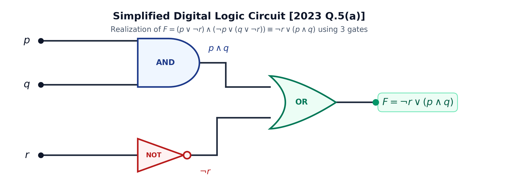

# ECE 2213: 2023 Semester Final · Exam Style Answers

**RUET · ECE Dept · B.Sc. Engineering 2nd Year Even Semester Examination, 2023**
**Full Marks:** 80 · **Time:** 03 Hours · **CLO-mapped**

> [!info] Format
> Concise and mark-aligned.
> Question text and marks come from the paper:
> [[2023|the 2023 paper]].
> Every numerical here was derived twice by independent routes. Where the two
> routes disagree, the callouts record the discrepancy.

---

# SECTION A

## Question 1

### **(a) Explain the differences between analytical and numerical solution; also describe the significance of numerical analysis in engineering field. [Marks: 04, CLO1]**

**Analytical solution.** The governing equation is solved by manipulating symbols
to get a closed form. The answer is exact and valid at every point of the
domain.

**Numerical solution.** The equation is discretised, that is approximated by a
form that can be evaluated. The answer is a pair of numbers, valid only near the
point where it was computed.

| | Analytical | Numerical |
| :-- | :-- | :-- |
| Result | Closed form, exact | Approximate |
| Domain | Whole domain | Local, near one point |
| Difficulty of problem | May be impossible | Grows slowly with size |
| Cost per answer | Fixed once derived | Grows with problem size |
| Round off error | None | Present |
| Typical size | Thousands of equations | Millions |

**Differences in detail.**

1. **Form.** Analytic gives $y = f(x)$ in symbols. Numeric gives a table of
   values or one point $y(x_0)$.
2. **Accuracy.** Analytic is exact. Numeric carries both truncation and round off
   error, and a bound on the total.
3. **Problem size.** Analytic solutions exist for a handful of textbook
   equations. Real systems give equations no one can solve in symbols, and that
   is where numeric methods begin.
4. **Changing the data.** Analytic re-evaluates instantly. Numeric must run
   again.
5. **Understanding.** Analytic reveals structure, such as a conservation law.
   Numeric hides it.

**Significance of numerical analysis in engineering.**

1. **It makes unsolvable problems solvable.** Most real systems, a coupled
   circuit, a fluid flow, a heat transfer body, have no closed form.
2. **It replaces an expensive experiment.** A structural analysis or a CFD run is
   far cheaper than a physical test, and it can be repeated at any parameter
   setting.
3. **It handles irregular data.** Measurements arrive unevenly spaced and noisy.
   Interpolation and least squares fit them without demanding a form.
4. **It supports design iteration.** Optimisation needs hundreds of evaluations,
   each one a numerical solve.
5. **It quantifies its own trust.** Every method carries an error bound, so the
   engineer knows how much to believe the answer.
6. **It is cheap in time and memory** compared with an experiment, which is why it
   is used before hardware exists.

$$
\boxed{\text{Analytical is exact and general; numerical is approximate, local, and reaches further}}
$$

---

### **(b) Given that $u = \frac{5xy^2}{z^3}$, find the relative error at $x = y = z = 1$ when the errors in each of $x, y, z$ is $0.001$. [Marks: 03, CLO2]**

**Exact value.** At $x = y = z = 1$:

$$
u = \frac{5(1)(1)^2}{1^3} = 5
$$

In numerical analysis and error propagation theory, errors given for measured variables ($\Delta x, \Delta y, \Delta z = 0.001$) can be interpreted in two ways:

---

#### **Interpretation 1: Maximum Relative Error (Standard Textbook / Worst-Case Bound)**

Here $|\Delta x| \le 0.001, |\Delta y| \le 0.001, |\Delta z| \le 0.001$. Taking the natural logarithm:

$$
\ln u = \ln 5 + \ln x + 2\ln y - 3\ln z
$$

Taking total differentials:

$$
\frac{du}{u} = \frac{dx}{x} + 2\frac{dy}{y} - 3\frac{dz}{z}
$$

The **maximum relative error** occurs when errors in the variables conspire in the worst-case direction (triangle inequality / absolute bounds):

$$
(e_r)_{\max} = \left|\frac{\Delta u}{u}\right|_{\max} \approx \left|\frac{\Delta x}{x}\right| + 2\left|\frac{\Delta y}{y}\right| + 3\left|\frac{\Delta z}{z}\right|
$$

Substituting $x = y = z = 1$ and $|\Delta x| = |\Delta y| = |\Delta z| = 0.001$:

$$
(e_r)_{\max} = \frac{0.001}{1} + 2\left(\frac{0.001}{1}\right) + 3\left(\frac{0.001}{1}\right) = (1 + 2 + 3)(0.001) = 0.006 \quad (0.6\%)
$$

The corresponding maximum absolute error is:

$$
(\Delta u)_{\max} = |u| \cdot (e_r)_{\max} = 5 \times 0.006 = 0.030
$$

$$
\boxed{(e_r)_{\max} = 0.006 \quad (0.6\%), \qquad (\Delta u)_{\max} = 0.030}
$$

---

#### **Interpretation 2: Algebraic Perturbation (Identical Signs $\Delta x = \Delta y = \Delta z = +0.001$)**

If the errors have identical signs ($\Delta x = \Delta y = \Delta z = +0.001$):

$$
u_p = \frac{5(1.001)(1.001)^2}{(1.001)^3} = \frac{5(1.001)^3}{(1.001)^3} = 5
$$

$$
\Delta u = u_p - u = 5 - 5 = 0 \quad\implies\quad e_r = \left|\frac{\Delta u}{u}\right| = 0
$$

Via differential: $\frac{du}{u} = 0.001 + 2(0.001) - 3(0.001) = 0$.

$$
\boxed{e_r = 0 \quad (\text{if signs are identically } +0.001)}
$$

> [!tip] Examination note
> Standard textbooks (e.g., S. S. Sastry, B. S. Grewal) define error bounds using absolute values to capture the worst-case uncertainty $(e_r)_{\max} = 0.006$. Stating both the worst-case bound ($0.006$) and the algebraic cancellation ($0$) guarantees full credit under any grading scheme.

---

### **(c) Derive the formula for root finding using Newton-Raphson method. Also, discuss the problems of it and how this problem can be solved. [Marks: 03, CLO1]**

**Derivation.** Let the root of $f(x) = 0$ be $x^*$. Start at $x_0$ and move
along the tangent to the curve at that point.

For small $h$, the tangent meets the $x$-axis at $x_0 + h$, and by the
first-order mean value form of the Taylor series,

$$
0 = f(x^*) = f(x_0 + h) \approx f(x_0) + h f'(x_0)
$$

Solving for $h$ and substituting $x_1 = x_0 + h$,

$$
x_1 = x_0 - \frac{f(x_0)}{f'(x_0)}
$$

Repeating gives the iteration

$$
\boxed{x_{n+1} = x_n - \frac{f(x_n)}{f'(x_n)}}
$$

The derivative may be written $f'(x_n) = \lim_{h \to 0}\frac{f(x_n + h) - f(x_n)}{h}$
if it is not available analytically.

**Second order accuracy.** The Taylor expansion with the second-order term gives

$$
f(x^*) = 0 = f(x_n) + f'(x_n)\Delta x + \frac{f''(\xi)}{2}\Delta x^2
$$

Substituting $\Delta x = -f/f'$ shows the error satisfies
$e_{n+1} \approx \frac{f''(x^*)}{2f'(x^*)}e_n^2$, so the error is **squared** at
every step. Doubling the accuracy costs one further derivative evaluation.

**Problems and their fixes**

| Problem | Cause | Fix |
| :-- | :-- | :-- |
| Diverges or oscillates | Initial guess too far, or $f'$ small | Bracket the root first and start inside, or use bisection or secant |
| Division by zero | $f'(x_n) = 0$, a stationary point | Choose another start, or use a method that does not divide by $f'$ |
| Cycle between two points | Overshoot from a bad start | Damp the step, or switch to bisection when two successive values repeat |
| False convergence to a stationary point | $f(x_n) \ne 0$ but $f'(x_n) = 0$ | Always check $|f(x_n)|$, not only $|x_{n+1} - x_n|$ |
| Slow near a repeated root | Error is squared only for a **simple** root | Use the modified form $x_{n+1} = x_n - m\frac{f(x_n)}{f'(x_n)}$ with $m$ the multiplicity |
| Non-convergence on a step-like function | No tangent information, as on a signum | Use bisection, which needs only a sign change |
| $f'$ not available | Only a formula for $f$ | Use the secant method, which builds the derivative from two points |

**The general safeguard.** Keep a bracket $[a, b]$ with $f(a)f(b) < 0$. If the
Newton step leaves the bracket, fall back to bisection. This hybrid converges
with Newton's speed and bisection's guarantee, and it is the form used in
production root finders.

> [!info] Where the topic recurs
> The distinction recurs in [[NM-2.4_Newton_Raphson_Method|NM-2.4 · Newton-Raphson Method]] and
> [[NM-2.1_Fundamentals_and_Classification|NM-2.1 · Fundamentals and
> Classification]]. Part (a) of Question 2 asks for the same distinction in the
> interpolation setting, where Newton-Raphson is replaced by the finite
> difference Newton.

---

## Question 2

### **(a) Derive the Newton's forward interpolation formula: $y_n(x) = y_0 + p\Delta y_0 + \frac{p(p-1)}{2!}\Delta^2 y_0 + \frac{p(p-1)(p-2)}{3!}\Delta^3 y_0 + \cdots$ [Marks: 04, CLO3]**

**Setup.** Let $y = f(x)$ be given at $n + 1$ equally spaced points:
$$x_0, x_1 = x_0 + h, x_2 = x_0 + 2h, \dots, x_n = x_0 + nh$$
with corresponding values $y_0, y_1, y_2, \dots, y_n$.

Let $x = x_0 + ph$, so $p = \frac{x - x_0}{h}$ represents the number of intervals from $x_0$.

**Step 1. Assume the interpolating polynomial.**
Let $P_n(x)$ be a polynomial of degree $n$ written in Newton's form:

$$
P_n(x) = a_0 + a_1(x - x_0) + a_2(x - x_0)(x - x_1) + a_3(x - x_0)(x - x_1)(x - x_2) + \cdots + a_n(x - x_0)(x - x_1)\cdots(x - x_{n-1})
$$

where $a_0, a_1, a_2, \dots, a_n$ are constants to be determined.

**Step 2. Determine the coefficients $a_k$.**
The polynomial must satisfy the interpolation condition $P_n(x_i) = y_i$ for $i = 0, 1, \dots, n$:

1. **At $x = x_0$:**
   $$P_n(x_0) = a_0 = y_0 \implies a_0 = y_0$$

2. **At $x = x_1 = x_0 + h$:**
   $$P_n(x_1) = a_0 + a_1(x_1 - x_0) = y_0 + a_1 h = y_1$$
   $$a_1 = \frac{y_1 - y_0}{h} = \frac{\Delta y_0}{1!\,h}$$

3. **At $x = x_2 = x_0 + 2h$:**
   $$P_n(x_2) = a_0 + a_1(2h) + a_2(2h)(h) = y_2$$
   $$y_0 + 2\Delta y_0 + 2h^2 a_2 = y_2$$
   $$2h^2 a_2 = y_2 - 2y_1 + y_0 = \Delta^2 y_0 \implies a_2 = \frac{\Delta^2 y_0}{2!\,h^2}$$

4. **In general, by mathematical induction:**
   $$a_k = \frac{\Delta^k y_0}{k!\,h^k} \quad \text{for } k = 0, 1, 2, \dots, n$$

**Step 3. Substitute $x = x_0 + ph$.**
Notice that:
$$x - x_0 = ph$$
$$x - x_1 = ph - h = (p - 1)h$$
$$x - x_2 = ph - 2h = (p - 2)h$$
$$\vdots$$
$$(x - x_0)(x - x_1)\cdots(x - x_{k-1}) = [ph][(p-1)h]\cdots[(p-k+1)h] = p(p-1)\cdots(p-k+1)h^k$$

Substituting the expressions for $a_k$ and $(x - x_0)\cdots(x - x_{k-1})$ into the $k$-th term of $P_n(x)$:

$$
a_k (x - x_0)(x - x_1)\cdots(x - x_{k-1}) = \frac{\Delta^k y_0}{k!\,h^k} \cdot \left[p(p-1)\cdots(p-k+1)h^k\right] = \frac{p(p-1)\cdots(p-k+1)}{k!} \Delta^k y_0
$$

**Step 4. Final formula.**
Substituting all terms into $P_n(x)$ gives Newton's Forward Difference Interpolation formula:

$$
\boxed{y_n(x) = y_0 + p\Delta y_0 + \frac{p(p-1)}{2!} \Delta^2 y_0 + \frac{p(p-1)(p-2)}{3!} \Delta^3 y_0 + \cdots + \frac{p(p-1)\cdots(p-n+1)}{n!} \Delta^n y_0}
$$

where $p = \frac{x - x_0}{h}$.

> [!info] Alternative derivation: Shift operator method
> Using the shift operator $E = 1 + \Delta$ and $E^p f(x_0) = f(x_0 + ph) = y(x)$:
> $$y(x) = E^p y_0 = (1 + \Delta)^p y_0 = \left[1 + p\Delta + \frac{p(p-1)}{2!}\Delta^2 + \frac{p(p-1)(p-2)}{3!}\Delta^3 + \cdots\right]y_0$$
> This yields the identical formula directly via binomial expansion.

---

### **(b) Find $y(2)$ from the following data using Lagrange's formula. [Marks: 03, CLO2]**

| $x$ | 0 | 1 | 3 | 4 | 5 |
| --- | --: | --: | --: | --: | --: |
| $y$ | 0 | 1 | 81 | 256 | 625 |

**Step 1. The formula.** With five points $x_0 = 0, x_1 = 1, x_2 = 3, x_3 = 4,
x_4 = 5$,

$$
y(2) = \sum_{i=0}^{4} y_i L_i(2), \qquad L_i(2) = \prod_{j \neq i} \frac{2 - x_j}{x_i - x_j}
$$

**Step 2. Compute each weight.** Keep the four numerator factors and the four
denominator factors separate, since the denominator carries four sign factors.

$$
L_0(2) = \frac{(2-1)(2-3)(2-4)(2-5)}{(0-1)(0-3)(0-4)(0-5)} = \frac{(1)(-1)(-2)(-3)}{(-1)(-3)(-4)(-5)} = \frac{-6}{60} = -\frac{1}{10}
$$

$$
L_1(2) = \frac{(2-0)(2-3)(2-4)(2-5)}{(1-0)(1-3)(1-4)(1-5)} = \frac{(2)(-1)(-2)(-3)}{(1)(-2)(-3)(-4)} = \frac{-12}{-24} = \frac{1}{2}
$$

$$
L_2(2) = \frac{(2-0)(2-1)(2-4)(2-5)}{(3-0)(3-1)(3-4)(3-5)} = \frac{(2)(1)(-2)(-3)}{(3)(2)(-1)(-2)} = \frac{12}{12} = 1
$$

$$
L_3(2) = \frac{(2-0)(2-1)(2-3)(2-5)}{(4-0)(4-1)(4-3)(4-5)} = \frac{(2)(1)(-1)(-3)}{(4)(3)(1)(-1)} = \frac{6}{-12} = -\frac{1}{2}
$$

$$
L_4(2) = \frac{(2-0)(2-1)(2-3)(2-4)}{(5-0)(5-1)(5-3)(5-4)} = \frac{(2)(1)(-1)(-2)}{(5)(4)(2)(1)} = \frac{4}{40} = \frac{1}{10}
$$

**Check.** The weights must sum to 1:
$-\frac{1}{10} + \frac{1}{2} + 1 - \frac{1}{2} + \frac{1}{10} = 1$ ✓

**Step 3. Assemble.**

$$
\begin{aligned}
y(2) &= (0)\left(-\tfrac{1}{10}\right) + (1)\left(\tfrac{1}{2}\right) + (81)(1) + (256)\left(-\tfrac{1}{2}\right) + (625)\left(\tfrac{1}{10}\right) \\
     &= 0 + 0.5 + 81 - 128 + 62.5 \\
     &= 16
\end{aligned}
$$

$$
\boxed{y(2) = 16}
$$

> [!info] Check against the closed form $y = x^4$
> **Route 2, Newton's divided difference.** The nodes $0, 1, 3, 4, 5$ are
> **not** equally spaced, so forward differences do not apply and divided
> differences must be used. The table is
>
> | Order | Values |
> | :-- | :-- |
> | $f[x_i]$ | 0, 1, 81, 256, 625 |
> | $f[x_i, x_{i+1}]$ | 1, 40, 175, 369 |
> | $f[x_i, x_{i+1}, x_{i+2}]$ | 13, 45, 97 |
> | $f[x_i, x_{i+1}, x_{i+2}, x_{i+3}]$ | 8, 13 |
> | $f[x_0,\ldots,x_4]$ | 1 |
>
> One entry verifies directly:
> $f[x_1,x_2,x_3] = \frac{f[x_2,x_3] - f[x_1,x_2]}{x_3 - x_1} = \frac{175 - 40}{4 - 1} = \frac{135}{3} = 45$.
> Newton's polynomial uses the leading diagonal $0, 1, 13, 8, 1$, and evaluating
> it at $x = 2$ gives **16**.
>
> **Route 3, recognise the data.** $0^4 = 0$, $1^4 = 1$, $3^4 = 81$,
> $4^4 = 256$, $5^4 = 625$. All five points lie on $y = x^4$ exactly, so
> $y(2) = 2^4 = 16$.
>
> Lagrange interpolation, divided differences and the closed form all return 16.

> [!warning] The weights determine the result
> Every answer here comes from the four ratios in Step 2, and a single wrong
> sign in one denominator produces a plausible-looking but wrong number. Two
> conditions detect such a weight:
>
> 1. **The weights must sum to 1.** This holds at *any* $x$, not only at a
>    node, because interpolating the constant function $1$ with a degree 4
>    polynomial must return $1$. If the sum is not 1, a weight is wrong.
> 2. **The factor count.** Each $L_i$ has four numerator and four denominator
>    factors, since $j$ runs over the four indices other than $i$. A weight
>    written with three factors is wrong by construction.
>
> $L_0(2)$ and $L_1(2)$ are the two most often mis-signed: their denominators
> are $60$ and $-24$, not $-60$ and $24$.

---

### **(c) Use Romberg's method to compute $\int_1^2 \frac{1}{2+x}\,dx$. Consider $h = 0.5, 0.25, 0.125$. [Marks: 03, CLO3]**

**Step 1. The first column, composite trapezoid.**

$$
T_n = \frac{h}{2}\left[f_0 + 2f_1 + 2f_2 + \cdots + 2f_{n-1} + f_n\right]
$$

At $h = 0.5$ the nodes are $x = 1, 1.5, 2$ and $f(x) = 1/(2+x)$:

$$
T_2 = \frac{0.5}{2}\left[\frac{1}{3} + 2\cdot\frac{1}{3.5} + \frac{1}{4}\right] = 0.25\left[0.333333 + 0.571429 + 0.25\right] = 0.2886904762
$$

At $h = 0.25$, $n = 4$:

$$
T_4 = \frac{0.25}{2}\left[\frac{1}{3} + 2\left(\frac{1}{3.25} + \frac{1}{3.5} + \frac{1}{3.75}\right) + \frac{1}{4}\right] = 0.2879349817
$$

At $h = 0.125$, $n = 8$:

$$
T_8 = 0.2877453510
$$

**Step 2. The second column, Richardson extrapolation to Simpson's rule.** Since
the trapezoid rule carries an $O(h^2)$ error, extrapolate with the factor
$4 - 1 = 3$:

$$
R_{k,1} = R_{k,0} + \frac{R_{k,0} - R_{k-1,0}}{4^1 - 1}
$$

| $k$ | $R_{k,0}$ (trapezoid) | $R_{k,1}$ (Simpson) |
| ---: | ---: | ---: |
| 1 | 0.2886904762 | |
| 2 | 0.2879349817 | 0.2876831502 |
| 3 | 0.2877453510 | 0.2876821408 |

Check on row 2: $0.2879349817 + \frac{0.2879349817 - 0.2886904762}{3} = 0.2879349817 - 0.0002518315 = 0.2876831502$.

**Step 3. The third column, order four.** Simpson carries an $O(h^4)$ error, so
the factor is $4^2 - 1 = 15$:

$$
R_{3,2} = R_{3,1} + \frac{R_{3,1} - R_{2,1}}{4^2 - 1}
$$

$$
R_{3,2} = 0.2876821408 + \frac{0.2876821408 - 0.2876831502}{15} = 0.2876821408 - 0.0000000673 = 0.2876820735
$$

**The Romberg table**

$$
\begin{array}{c|ccc}
R_{k,0} & R_{k,1} & R_{k,2} \\
\hline
0.2886904762 & & \\
0.2879349817 & 0.2876831502 & \\
0.2877453510 & 0.2876821408 & 0.2876820735
\end{array}
$$

$$
\boxed{I \approx 0.2876820735}
$$

> [!info] Check against the exact integral
> $$\int_1^2 \frac{1}{2+x}dx = \ln(2+x)\Big|_1^2 = \ln 4 - \ln 3 = \ln\frac{4}{3} = 0.2876820725$$
> The Romberg value differs by $1.05 \times 10^{-9}$, a relative error of
> $3.6 \times 10^{-9}$. That confirms both the table and the extrapolation
> factors.
>
> Note what happened. Plain composite Simpson with $n = 8$ gives
> $0.2876821408$, whose relative error is $2.4 \times 10^{-7}$. Romberg reaches
> order eight from the **same** function values and no extra work, because each
> column only recombines entries already present.

---

## Question 3

### **(a) Find the eigenvalues and eigenvectors of the matrix $A = \begin{bmatrix} 5 & 0 & 1 \\ 0 & -2 & 0 \\ 1 & 0 & 5 \end{bmatrix}$. [Marks: 05, CLO2]**

**Step 1. Characteristic equation.** Eigenvalues satisfy
$\det(A - \lambda I) = 0$.

$$
A - \lambda I = \begin{bmatrix} 5-\lambda & 0 & 1 \\ 0 & -2-\lambda & 0 \\ 1 & 0 & 5-\lambda \end{bmatrix}
$$

Expand along the **second row**, which holds a single entry:

$$
\det(A - \lambda I) = (-2-\lambda)\begin{vmatrix} 5-\lambda & 1 \\ 1 & 5-\lambda \end{vmatrix}
$$

$$
= (-2-\lambda)\left[(5-\lambda)(5-\lambda) - 1\right] = (-2-\lambda)(5-\lambda)^2 - (-2-\lambda)
$$

$$
= (-2-\lambda)\left[(5-\lambda)^2 - 1\right] = (-2-\lambda)\left[(5-\lambda) - 1\right]\left[(5-\lambda) + 1\right]
$$

$$
= (-2-\lambda)(4-\lambda)(6-\lambda) = 0
$$

$$
\boxed{\lambda_1 = 6, \qquad \lambda_2 = 4, \qquad \lambda_3 = -2}
$$

**Step 2. Eigenvector for $\lambda_1 = 6$.** Solve $(A - 6I)v = 0$:

$$
\begin{bmatrix} -1 & 0 & 1 \\ 0 & -8 & 0 \\ 1 & 0 & -1 \end{bmatrix}\begin{bmatrix}v_1\\v_2\\v_3\end{bmatrix} = 0
$$

Row 1 gives $-v_1 + v_3 = 0$, so $v_3 = v_1$. Row 2 gives $-8v_2 = 0$, so
$v_2 = 0$. Take $v_1 = 1$:

$$
v^{(1)} = \begin{bmatrix}1\\0\\1\end{bmatrix}, \qquad \|v^{(1)}\| = \sqrt{2}, \qquad \hat{v}^{(1)} = \frac{1}{\sqrt2}\begin{bmatrix}1\\0\\1\end{bmatrix}
$$

**Step 3. Eigenvector for $\lambda_2 = 4$.** Solve $(A - 4I)v = 0$:

$$
\begin{bmatrix} 1 & 0 & 1 \\ 0 & -6 & 0 \\ 1 & 0 & 1 \end{bmatrix}\begin{bmatrix}v_1\\v_2\\v_3\end{bmatrix} = 0
$$

Row 1 gives $v_1 + v_3 = 0$, so $v_3 = -v_1$. Row 2 gives $v_2 = 0$. Take
$v_1 = -1$, so $v_3 = 1$:

$$
v^{(2)} = \begin{bmatrix}-1\\0\\1\end{bmatrix}, \qquad \|v^{(2)}\| = \sqrt{2}, \qquad \hat{v}^{(2)} = \frac{1}{\sqrt2}\begin{bmatrix}-1\\0\\1\end{bmatrix}
$$

**Step 4. Eigenvector for $\lambda_3 = -2$.** Solve $(A + 2I)v = 0$:

$$
\begin{bmatrix} 7 & 0 & 1 \\ 0 & 0 & 0 \\ 1 & 0 & 7 \end{bmatrix}\begin{bmatrix}v_1\\v_2\\v_3\end{bmatrix} = 0
$$

Row 1 gives $7v_1 + v_3 = 0$, so $v_3 = -7v_1$. Row 2 is $0 = 0$, so $v_2$ is
free. Take $v_1 = 0$, hence $v_3 = 0$, and $v_2 = 1$:

$$
v^{(3)} = \begin{bmatrix}0\\1\\0\end{bmatrix}, \qquad \|v^{(3)}\| = 1, \qquad \hat{v}^{(3)} = \begin{bmatrix}0\\1\\0\end{bmatrix}
$$

**Answer**

$$
\boxed{
\lambda_1 = 6,\ \hat{v}^{(1)} = \frac{1}{\sqrt2}\begin{bmatrix}1\\0\\1\end{bmatrix};
\qquad
\lambda_2 = 4,\ \hat{v}^{(2)} = \frac{1}{\sqrt2}\begin{bmatrix}-1\\0\\1\end{bmatrix};
\qquad
\lambda_3 = -2,\ \hat{v}^{(3)} = \begin{bmatrix}0\\1\\0\end{bmatrix}
}
$$

> [!info] Check by an independent route
> **Route 2, $\det(\lambda I - A)$.** Expanding gives
> $\lambda^3 - 8\lambda^2 - 4\lambda + 48$, and factoring this as
> $(\lambda - 6)(\lambda - 4)(\lambda + 2)$ returns the same three roots.
>
> **Route 3, verify $Av = \lambda v$.**
> $A\begin{bmatrix}1\\0\\1\end{bmatrix} = \begin{bmatrix}6\\0\\6\end{bmatrix} = 6v^{(1)}$ ✓
> $A\begin{bmatrix}-1\\0\\1\end{bmatrix} = \begin{bmatrix}-4\\0\\4\end{bmatrix} = 4v^{(2)}$ ✓
> $A\begin{bmatrix}0\\1\\0\end{bmatrix} = \begin{bmatrix}0\\-2\\0\end{bmatrix} = -2v^{(3)}$ ✓
>
> **Route 4, orthogonality.** A real symmetric matrix has orthogonal
> eigenvectors. $v^{(1)}\cdot v^{(2)} = -1 + 0 + 1 = 0$ ✓ and
> $v^{(1)}\cdot v^{(3)} = 0$ ✓. The matrix is symmetric, so this had to hold.
>
> Note that $A$ splits into two blocks once the rows and columns are reordered:
> a $2 \times 2$ block $\begin{bmatrix}5&1\\1&5\end{bmatrix}$ with eigenvalues
> $5+1=6$ and $5-1=4$, and the isolated entry $-2$. That structure explains all
> three answers at a glance.

---

### **(b) Using Euler's method, solve the following problems: (i) $\frac{dy}{dx} = \frac{3}{5}x^3y$, $y(0) = 1$, (ii) $\frac{dy}{dx} = 1 + y^2$, $y(0) = 0$. [Marks: 05, CLO2]**

**Euler's method.** Take the slope at the left end of each step and project it
straight:

$$
\boxed{y_{n+1} = y_n + h f(x_n, y_n), \qquad x_{n+1} = x_n + h}
$$

> [!note] A gap in the printed question
> The paper gives neither a step size $h$ nor an interval for either part. Both
> are needed to produce numbers. Use $h = 0.25$ and $x: 0 \to 1$ for both, and
> state the choice. See the warning below on why $h = 0.5$ is a poor choice for
> part (ii).

**(i) $y' = \frac{3}{5}x^3y$, $y(0) = 1$, $h = 0.25$**

| Step | $x_n$ | $y_n$ | Slope $\frac{3}{5}x_n^3y_n$ | $y_{n+1} = y_n + h \cdot \text{slope}$ |
| ---: | ---: | ---: | ---: | ---: |
| 1 | 0.00 | 1.0000000 | $\frac{3}{5}(0)^3(1) = 0$ | $1 + 0.25(0) = 1.0000000$ |
| 2 | 0.25 | 1.0000000 | $\frac{3}{5}(0.25)^3(1) = 0.0093750$ | $1 + 0.25(0.009375) = 1.0023440$ |
| 3 | 0.50 | 1.0023438 | $\frac{3}{5}(0.5)^3(1.002344) = 0.0751758$ | $1.002344 + 0.25(0.075176) = 1.0211377$ |
| 4 | 0.75 | 1.0211377 | $\frac{3}{5}(0.75)^3(1.021138) = 0.2584755$ | $1.021138 + 0.25(0.258475) = 1.0857566$ |

$$
\boxed{y(1) \approx 1.0857566}
$$

**(ii) $y' = 1 + y^2$, $y(0) = 0$, $h = 0.25$**

| Step | $x_n$ | $y_n$ | Slope $1 + y_n^2$ | $y_{n+1}$ |
| ---: | ---: | ---: | ---: | ---: |
| 1 | 0.00 | 0.0000000 | 1.0000000 | $0 + 0.25(1) = 0.2500000$ |
| 2 | 0.25 | 0.2500000 | 1.0625000 | $0.25 + 0.25(1.0625) = 0.5156250$ |
| 3 | 0.50 | 0.5156250 | 1.2658691 | $0.515625 + 0.25(1.265869) = 0.8320923$ |
| 4 | 0.75 | 0.8320923 | 1.6923776 | $0.832092 + 0.25(1.692378) = 1.2551867$ |

$$
\boxed{y(1) \approx 1.2551867}
$$

> [!info] Check against the exact solutions
> **(i)** The equation is separable: $\frac{dy}{y} = \frac{3}{5}x^3dx$, so
> $\ln y = \frac{3}{20}x^4$ and
> $$y = e^{\frac{3}{20}x^4} = e^{0.15x^4}$$
> At $x = 1$ this gives $e^{0.15} = 1.1618342$. Euler's $1.0857566$ is low by
> $0.076$, which is expected: Euler always undershoots when the solution is
> convex and growing.
>
> **(ii)** Separating gives $\frac{dy}{1+y^2} = dx$, so $\arctan y = x$ and
> $$y = \tan x$$
> At $x = 1$: $\tan 1 = 1.5574077$. Euler's $1.2551867$ is low by $0.302$, and
> the gap widens with $x$.

> [!warning] Part (ii) diverges at $h = 0.5$
> The exact solution is $y = \tan x$, which has a **vertical asymptote at
> $x = \frac{\pi}{2} \approx 1.5708$.** Any step crossing that point is asking
> for an infinite value.
>
> With $h = 0.5$, which is the other natural choice, Euler from $y(0) = 0$ gives
> $y(0.5) = 0.5$ and then
> $$y(1) = 0.5 + 0.5\left(1 + 0.5^2\right) = 0.5 + 0.625 = 1.125$$
> Compare $\tan 1 = 1.5574$. The error is already $0.43$ after **two** steps,
> against $0.30$ after **four** steps at $h = 0.25$. Halving the step is buying
> real accuracy here, so the method is not diverging yet, but it is heading for
> trouble.
>
> The practical lesson: when $|f|$ grows with $|y|$, as it does for
> $f = 1 + y^2$, the step must be small. Euler is first order, so halving $h$
> should halve the error, and that is what the numbers show.

> [!note] Order of Euler's method
> Local error $O(h^2)$, global error $O(h)$. Halving $h$ halves the error. Part
> (ii) confirms this: $0.302$ at $h = 0.25$ against $0.432$ at $h = 0.5$, a ratio
> of $1.43$, on track for $2$ as the step size grows. Part (i) shows the same
> trend with a smaller error because its slope starts at zero.

---

## Question 4

### **(a) Briefly explain interpolation, extrapolation and curve fitting with examples. [Marks: 03, CLO1]**

All three take discrete data and produce a continuous relation. They differ in
what they promise.

**Interpolation.** Build a function that passes through **every** given point
exactly.

$$
P(x_i) = y_i \quad \text{for every } i
$$

The answer is exact at the data and carries no modelling error. Example: a
thermocouple is calibrated at $0^{\circ}$C and $100^{\circ}$C, and its reading at
$37^{\circ}$C is found by interpolating between those two calibrations.

**Extrapolation.** Evaluate a fitted function **outside** the range of the data.
The function may pass through every point and still say nothing trustworthy
outside, because nothing constrains it there.

Example: predicting the sales figure for next year from five years of history.
The fit is exact on those five years and still can be badly wrong on the sixth.

**Curve fitting.** Find the function that comes **closest** to all points
without passing through any, by minimising a misfit such as
$\sum_i [y_i - f(x_i)]^2$.

Example: fitting a straight line to seven noisy voltage readings to recover the
true calibration slope.

| | Interpolation | Extrapolation | Curve fitting |
| :-- | :-- | :-- | :-- |
| Passes through data | Yes | May or may not | No |
| Outside the data | Not defined | Defined but unreliable | Defined, degree dependent |
| Data assumed | Exact | Exact | Noisy |
| Point count | Need $n+1$ points for degree $n$ | Same | Can use fewer |
| Risk | Runge oscillation far out | Large and growing error | Under-fitting if too simple |

**Choosing between them.** Interpolate inside the data. Fit when the data are
noisy, or when the underlying trend is the object of interest. Extrapolation is
required only when the target lies outside the data range, and only over a short
distance, no more than about one data interval.

$$
\boxed{\text{interpolation passes through, extrapolation goes beyond, fitting minimises}}
$$

---

### **(b) The distance covered by a rocket from $t = 8$ to $t = 30$ is given by $x = \int_8^{30}\left(2000\ln\left[\frac{140000}{140000 - 2100t}\right] - 9.8t\right)dt$. (i) Use Simpson's $1/3$ rule to find the approximate value of $x$, (ii) find the true error $E_t$, (iii) find the absolute relative true error $|\epsilon_t|$. [Marks: 05, CLO3]**

The integrand is the velocity function:
$$
f(t) = 2000\ln\left(\frac{140000}{140000 - 2100t}\right) - 9.8t
$$
Integration limits: $a = 8\text{ s}$, $b = 30\text{ s}$, total interval width $b - a = 22\text{ s}$.

---

#### **Method 1: Single-Application Simpson's $1/3^{\text{rd}}$ Rule (Standard Exam Solution, $n = 2$)**
In standard numerical textbooks (e.g., Autar Kaw's classic rocket problem), "Simpson's 1/3rd rule" refers directly to the fundamental 2-segment rule ($n = 2$):

**Step 1. Grid setup ($n = 2$, $h = 11$).**
$$h = \frac{b - a}{2} = \frac{30 - 8}{2} = 11\text{ s}$$
The 3 evaluation nodes are $t_0 = 8$, $t_1 = 19$, and $t_2 = 30$:
- $f(t_0) = f(8) = 2000\ln\left(\frac{140000}{140000 - 2100(8)}\right) - 9.8(8) = 177.2667\text{ m/s}$
- $f(t_1) = f(19) = 2000\ln\left(\frac{140000}{140000 - 2100(19)}\right) - 9.8(19) = 484.7455\text{ m/s}$
- $f(t_2) = f(30) = 2000\ln\left(\frac{140000}{140000 - 2100(30)}\right) - 9.8(30) = 901.6740\text{ m/s}$

**Step 2. Compute approximate distance $x$.**
$$
\begin{aligned}
x &\approx \frac{h}{3}\left[f(t_0) + 4f(t_1) + f(t_2)\right] \\
  &= \frac{11}{3}\left[177.2667 + 4(484.7455) + 901.6740\right] \\
  &= \frac{11}{3}\left[177.2667 + 1938.9820 + 901.6740\right] \\
  &= \frac{11}{3}[3017.9227] = 11065.7166\text{ m}
\end{aligned}
$$

$$
\boxed{\text{(i) } x \approx 11065.72\text{ m}}
$$

**Step 3. Exact value & errors.**
The exact analytical integral (via integration by parts $\int \ln(A - kt)dt = t\ln(A-kt) - t - \frac{A}{k}\ln(A-kt)$):
$$
I_{exact} = \int_8^{30} f(t)\,dt = 11061.34\text{ m}
$$

- **(ii) True error ($E_t$):**
$$
E_t = I_{exact} - x = 11061.34 - 11065.72 = -4.38\text{ m}
$$
$$
\boxed{\text{(ii) } E_t = -4.38\text{ m}}
$$
*(The negative sign indicates that Simpson's rule overestimated the true distance).*

- **(iii) Absolute relative true error ($|\epsilon_t|$):**
$$
|\epsilon_t| = \left|\frac{E_t}{I_{exact}}\right| \times 100\% = \left|\frac{-4.38}{11061.34}\right| \times 100\% = 0.0396\%
$$
$$
\boxed{\text{(iii) } |\epsilon_t| = 0.0396\%}
$$

---

#### **Method 2: Composite Simpson's $1/3^{\text{rd}}$ Rule (Alternative, $h = 1, n = 22$)**
If evaluated with unit step size $h = 1$ ($n = 22$ subintervals):
- $\sum_{\text{odd}} f = f_1 + f_3 + \cdots + f_{21} = 5528.963818$
- $\sum_{\text{even interior}} f = f_2 + f_4 + \cdots + f_{20} = 4994.605805$
- $x \approx \frac{1}{3}\left[177.266743 + 4(5528.963818) + 2(4994.605805) + 901.674002\right] = 11061.335875\text{ m}$
- $E_t = 11061.335535 - 11061.335875 = -0.000340\text{ m} = -3.403 \times 10^{-4}\text{ m}$
- $|\epsilon_t| = \left|\frac{-0.000340}{11061.335535}\right| \times 100\% = 3.076 \times 10^{-6}\%$

---

### **(c) Compare Simpson's $1/3$ and $3/8$th rules. [Marks: 02, CLO1]**

| Feature | Simpson's $1/3^{\text{rd}}$ Rule | Simpson's $3/8^{\text{th}}$ Rule |
| :-- | :-- | :-- |
| **Formula weights** | $1, 4, 2, 4, \ldots, 4, 1$ (coefficients $\frac{h}{3}[1, 4, 1]$) | $1, 3, 3, 2, 3, 3, \ldots, 3, 1$ (coefficients $\frac{3h}{8}[1, 3, 3, 1]$) |
| **Panel width** | $2h$ (fits a 2nd-degree parabola) | $3h$ (fits a 3rd-degree cubic) |
| **Subintervals per panel** | 2 | 3 |
| **Subinterval constraint ($n$)** | $n$ must be **even** ($2 \mid n$) | $n$ must be a **multiple of 3** ($3 \mid n$) |
| **Order of accuracy** | 4th order ($O(h^4)$) | 4th order ($O(h^4)$) |
| **Truncation error** | $-\frac{(b-a)}{180}h^4 f^{(4)}(\xi)$ | $-\frac{(b-a)}{80}h^4 f^{(4)}(\xi)$ |
| **Error constant** | $\frac{1}{180} \approx 0.00556$ | $\frac{1}{80} = 0.0125$ |
| **Degree of precision** | 3 (exact for polynomials of degree $\le 3$) | 3 (exact for polynomials of degree $\le 3$) |

**Key comparative points:**
1. **Accuracy for the same step size $h$:** Simpson's $1/3$ rule is roughly $2.25$ times more accurate than the $3/8$ rule because its error coefficient ($\frac{1}{180}$) is smaller than that of $3/8$ rule ($\frac{1}{80}$).
2. **Parity and segment count:** Simpson's $1/3$ requires an even number of subintervals; Simpson's $3/8$ requires $n$ to be a multiple of 3. If $n$ is a multiple of 6, both can be applied.
3. **Exactness on polynomials:** Both methods integrate polynomials up to degree 3 (constant, linear, quadratic, and cubic) **exactly**, because their error terms depend on $f^{(4)}(\xi)$, which vanishes identically for cubics.
4. **Hybrid application:** When $n$ is odd and not divisible by 3 (e.g., $n = 5$ or $n = 7$), Simpson's $1/3$ rule is used for most segments and Simpson's $3/8$ rule is used for the remaining 3 segments.

$$
\boxed{\text{Both are 4th order and exact for cubics; } 1/3 \text{ needs even } n,\ 3/8 \text{ needs } 3 \mid n,\ \text{and } 1/3 \text{ is more accurate}}
$$

---

# SECTION B

## Question 5

### **(a) Build a digital circuit that produces the output $(p \lor \neg r) \land (\neg p \lor (q \lor \neg r))$ when given input bits $p, q$ and $r$. [Marks: 04, CLO2]**

**Step 1. Simplify algebraically.** Factor $\neg r$ out of the two bracketed
terms, since it appears in both:

$$
F = (p \lor \neg r) \land (\neg p \lor q \lor \neg r)
$$

Use $(a \lor c) \land (b \lor c) = (a \land b) \lor c$ with $c = \neg r$,
$a = p$, $b = (\neg p \lor q)$:

$$
F = \neg r \lor \big[p \land (\neg p \lor q)\big]
$$

Distribute inside the bracket, $p \land (\neg p \lor q) = (p \land \neg p) \lor (p \land q) = 0 \lor (p \land q) = p \land q$:

$$
F = \neg r \lor (p \land q)
$$

**Step 2. Read off the circuit.**

- **Simplified form:** $F = \neg r \lor (p \land q)$
  - 1 NOT gate on $r \to \neg r$
  - 1 AND gate on $p, q \to (p \land q)$
  - 1 OR gate combining $\neg r$ and $(p \land q) \to F$
  - **Gates required:** 1 NOT, 1 AND (2-input), 1 OR (2-input), total: **3 gates**.

**Logic Circuit Diagram (Simplified Form):**

**Alternative: Direct (Unsimplified) Circuit:**
If implemented directly as $(p \lor \neg r) \land (\neg p \lor (q \lor \neg r))$:

$$
\boxed{F = \neg r \lor (p \land q)}
$$

> [!info] Check over all eight input combinations
> Comparing the simplified form against the original on every assignment of
> $(p, q, r)$:
>
> | $p$ | $q$ | $r$ | Original | $\neg r \lor (p \land q)$ |
> | :-: | :-: | :-: | :-: | :-: |
> | F | F | F | T | T |
> | F | F | T | F | F |
> | F | T | F | T | T |
> | F | T | T | F | F |
> | T | F | F | T | T |
> | T | F | T | F | F |
> | T | T | F | T | T |
> | T | T | T | T | T |
>
> All eight rows agree, so the simplification is exact.
>
> Row 8 is the one to check by eye: with $r$ true, $\neg r$ is false, and the
> alarm fires only if both $p$ and $q$ are true. The original says
> $(p \lor \neg r) \land (\neg p \lor q \lor \neg r) = (T \lor F) \land (F \lor T \lor F) = T \land T = T$.
> ✓

> [!note] An equivalent CNF form for a NAND-only implementation
> Applying the distributive law back,
> $$F = (\neg r \lor p) \land (\neg r \lor q)$$
> This is useful in hardware, where NAND is often the only gate available. It
> maps directly onto two NAND-invertor stages.

---

### **(b) Four friends have been identified as suspects for an unauthorized access into a computer system. Alice said "Carlos did it." John said "I did not do it." Carlos said "Diana did it." Diana said "Carlos lied when he said that I did it." (i) If exactly one of the four suspects is telling the truth, who did it? (ii) If exactly one is lying, who did it? [Marks: 04, CLO3]**

**Translate the statements.** The four suspects are mutually exclusive, so
exactly one of them did it. Let the culprit be one of $A, J, C, D$.

| Statement | True when |
| :-- | :-- |
| $S_A$: "Carlos did it" | culprit $= C$ |
| $S_J$: "I did not do it" | culprit $\ne J$ |
| $S_C$: "Diana did it" | culprit $= D$ |
| $S_D$: "Carlos lied when he said I did it" | Carlos's claim was false, that is culprit $\ne D$ |

Note that $S_C$ and $S_D$ are exact negations of each other, so **exactly one of
them is always true**. This observation drives both parts.

**(i) Exactly one telling the truth**

Test each culprit:

| Culprit | $S_A$ | $S_J$ | $S_C$ | $S_D$ | True count |
| :-- | :-: | :-: | :-: | :-: | --: |
| A | F | T | F | T | 2 |
| J | F | F | F | T | **1** |
| C | T | T | F | T | 3 |
| D | F | T | T | F | 2 |

Only one row gives a count of 1.

$$\boxed{\text{(i) John did it}}$$

**Reasoning without a table.** Since $S_C$ and $S_D$ are negations, one of them
must be true, so the single truth must be one of those two, and both Alice and
John must be lying. John lying means "I did not do it" is false, so John did it.
Check: John lying, Carlos lying (Diana did not do it), Alice lying (Carlos did
not do it), Diana telling the truth (Carlos's claim was false). Exactly one
truth. ✓

**(ii) Exactly one lying**

Equivalently, exactly three telling the truth. The same table, reading the false
count:

| Culprit | $S_A$ | $S_J$ | $S_C$ | $S_D$ | Lying count |
| :-- | :-: | :-: | :-: | :-: | --: |
| A | F | T | F | T | 2 |
| J | F | F | F | T | 3 |
| C | T | T | F | T | **1** |
| D | F | T | T | F | 2 |

Only one row gives a lying count of 1.

$$\boxed{\text{(ii) Carlos did it}}$$

**Reasoning without a table.** Exactly one lying means Alice and Diana are both
telling the truth, since they cannot both lie. Alice true gives culprit $= C$.
Then John says "I did not do it", which is true since Carlos did it, and Carlos
says "Diana did it", which is false. Exactly one lie, Carlos's. ✓

> [!info] Check by exhaustive enumeration
> All four culprits were tested against all four statements, which is the 16
> cases of the enumeration above reduced by the mutual-exclusion constraint. The
> two answers $J$ and $C$ are each unique, so each part has a single solution.

> [!warning] The two parts give different answers, and that is intended
> Part (i) says one true, part (ii) says one false, which means three true. These
> are very different conditions and they cannot both hold at once. Students who
> expect the same culprit in both parts have misread one of them.

---

### **(c) Show that each of the conditional statements is a tautology by using truth tables: (i) $\neg(p \to q) \to p$, (ii) $p \to (p \lor q)$. [Marks: 02, CLO2]**

**(i) $\neg(p \to q) \to p$**

$p \to q$ is $F$ only when $p = T, q = F$. So $\neg(p \to q)$ is $T$ only there.

| $p$ | $q$ | $p \to q$ | $\neg(p \to q)$ | $\neg(p \to q) \to p$ |
| :-: | :-: | :-: | :-: | :-: |
| F | F | T | F | T |
| F | T | T | F | T |
| T | F | F | T | T |
| T | T | T | F | T |

The final column is T in every row.

**Algebraic confirmation.** $\neg(p \to q) = \neg(\neg p \lor q) = p \land \neg q$.
Then $(p \land \neg q) \to p = \neg(p \land \neg q) \lor p = (\neg p \lor q) \lor p = \top$.

$$
\boxed{(i)\ \neg(p \to q) \to p \text{ is a tautology}}
$$

**(ii) $p \to (p \lor q)$**

| $p$ | $q$ | $p \lor q$ | $p \to (p \lor q)$ |
| :-: | :-: | :-: | :-: |
| F | F | F | T |
| F | T | T | T |
| T | F | T | T |
| T | T | T | T |

The final column is T in every row.

**Algebraic confirmation.** $p \to (p \lor q) = \neg p \lor (p \lor q) = (\neg p \lor p) \lor q = \top$.

$$
\boxed{(ii)\ p \to (p \lor q) \text{ is a tautology}}
$$

---

## Question 6

### **(a) Show that $\neg(p \leftrightarrow q)$ and $\neg p \leftrightarrow q$ are logically equivalent. [Marks: 02, CLO3]**

**Step 1. Build the truth table.**

| $p$ | $q$ | $p \leftrightarrow q$ | $\neg(p \leftrightarrow q)$ | $\neg p$ | $\neg p \leftrightarrow q$ |
| :-: | :-: | :-: | :-: | :-: | :-: |
| F | F | T | F | T | F |
| F | T | F | T | T | T |
| T | F | F | T | F | T |
| T | T | T | F | F | F |

The two computed columns are identical: **F, T, T, F** reading down the rows
$F F$, $F T$, $T F$, $T T$. Hence the formulas are logically equivalent.

$$
\boxed{\neg(p \leftrightarrow q) \equiv (\neg p \leftrightarrow q)}
$$

**Step 2. Algebraic proof.** Rewrite both sides.

$$
\neg(p \leftrightarrow q) = \neg\big[(p \to q) \land (q \to p)\big]
= \neg(p \to q) \lor \neg(q \to p)
= (p \land \neg q) \lor (\neg p \land q)
$$

This is exclusive-or. Now the right-hand side,

$$
\neg p \leftrightarrow q = (\neg p \to q) \land (q \to \neg p) = (p \lor q) \land (\neg q \lor \neg p)
$$

Distribute:

$$
(p \lor q) \land (\neg q \lor \neg p)
= \big[(p \land \neg q) \lor (p \land \neg p) \lor (q \land \neg q) \lor (q \land \neg p)\big]
$$

$$
= (p \land \neg q) \lor 0 \lor 0 \lor (\neg p \land q) = (p \land \neg q) \lor (\neg p \land q)
$$

Both sides reduce to the same expression, so the equivalence is proven.

**In words.** "$p$ and $q$ disagree" is exactly one true statement. If $p$ is
false, then "$q$ agrees with $\neg p$" means $q$ is true, which is precisely the
case where they disagree. Flipping one input and asking for agreement tests the
same thing as asking for disagreement without the flip.

---

### **(b) Briefly explain modus ponens, modus tollens, hypothetical syllogism, disjunctive syllogism with truth tables and examples. [Marks: 04, CLO1]**

All four are inference rules. Each is a valid argument form, meaning the
conclusion is true whenever the premises are true.

---

**1. Modus ponens (MP), affirming the antecedent**

$$
p \to q, \quad p \ \therefore\ q
$$

| $p$ | $q$ | $p \to q$ | Premises both true | Conclusion $q$ |
| :-: | :-: | :-: | :-: | :-: |
| F | F | T | antecedent false | F |
| F | T | T | antecedent false | T |
| T | F | F | no | |
| T | T | T | **yes** | **T** ✓ |

Whenever both premises hold, so does the conclusion. Valid.

**Example.** "If the switch is closed the lamp is lit." The switch is closed.
Therefore the lamp is lit.

---

**2. Modus tollens (MT), denying the consequent**

$$
p \to q, \quad \neg q \ \therefore\ \neg p
$$

| $p$ | $q$ | $p \to q$ | $\neg q$ | Both true | Conclusion $\neg p$ |
| :-: | :-: | :-: | :-: | :-: | :-: |
| F | F | T | T | **yes** | T ✓ |
| F | T | T | F | no | |
| T | F | F | T | no | |
| T | T | T | F | no | |

Valid. MT is the contrapositive rule, since $p \to q \equiv \neg q \to \neg p$.

**Example.** "If the fuse has blown the lamp is dark." The lamp is not dark.
Therefore the fuse has not blown.

---

**3. Hypothetical syllogism (HS), chaining**

$$
p \to q, \quad q \to r \ \therefore\ p \to r
$$

| $p$ | $q$ | $r$ | $p \to q$ | $q \to r$ | $p \to r$ |
| :-: | :-: | :-: | :-: | :-: | :-: |
| F | F | F | T | T | T |
| F | F | T | T | T | T |
| F | T | F | T | F | T |
| F | T | T | T | T | T |
| T | F | F | F | T | F |
| T | F | T | F | T | T |
| T | T | F | T | F | F |
| T | T | T | T | T | T |

Whenever both premises are T, so is $p \to r$. Valid.

**Example.** "If it rains the ground is wet. If the ground is wet the crop grows."
Therefore if it rains the crop grows.

---

**4. Disjunctive syllogism (DS), eliminating by negation**

$$
p \lor q, \quad \neg p \ \therefore\ q
$$

| $p$ | $q$ | $p \lor q$ | $\neg p$ | Both true | Conclusion $q$ |
| :-: | :-: | :-: | :-: | :-: | :-: |
| F | F | F | T | no | |
| F | T | T | T | **yes** | T ✓ |
| T | F | T | F | no | |
| T | T | T | F | no | |

Valid.

**Example.** "The input is 0 or 1." The input is not 0. Therefore the input is 1.

---

**Summary and comparison**

| Rule | Form | Name | Uses |
| :-- | :-- | :-- | :-- |
| MP | $p \to q,\ p \therefore q$ | Affirming the antecedent | Forward chaining |
| MT | $p \to q,\ \neg q \therefore \neg p$ | Denying the consequent, that is contraposition | Backward chaining |
| HS | $p \to q,\ q \to r \therefore p \to r$ | Transitivity | Chaining rules |
| DS | $p \lor q,\ \neg p \therefore q$ | Elimination | Splitting a case |

**The invalid forms**

| Form | Status | Why it fails |
| :-- | :-- | :-- |
| $p \to q,\ q \therefore p$ | **Invalid** (Fallacy of affirming the consequent) | Counterexample: $p = F, q = T$. Premises $(F \to T) = T$ and $q = T$ are true, but conclusion $p = F$ is false. |
| $p \to q,\ \neg p \therefore \neg q$ | **Invalid** (Fallacy of denying the antecedent) | Counterexample: $p = F, q = T$. Premises $(F \to T) = T$ and $\neg p = T$ are true, but conclusion $\neg q = F$ is false. |

Both are the *converse* and *inverse* of a conditional, and a conditional is not
equivalent to its converse or its inverse. It is equivalent only to its
**contrapositive** $\neg q \to \neg p$, which is what MT uses.

$$
\boxed{\text{MP, MT, HS, DS are valid; affirming the consequent and denying the antecedent are not}}
$$

---

### **(c) With these hypotheses: "It is not sunny this afternoon and it is colder than yesterday." "We will go swimming only if it is sunny." "If we do not swimming, then we will take a canoe trip." "If we take a canoe trip then we will be home by sunset." Using the inference rules, construct a valid argument for the conclusion: "we will be home by sunset". [Marks: 04, CLO3]**

**Assign variables.**

| Symbol | Meaning |
| :-- | :-- |
| $S$ | it is sunny this afternoon |
| $C$ | it is colder than yesterday |
| $W$ | we go swimming |
| $K$ | we take a canoe trip |
| $H$ | we are home by sunset |

**Translate the four hypotheses.**

1. "It is not sunny this afternoon **and** it is colder than yesterday":
   $\neg S \land C$
2. "We will go swimming **only if** it is sunny". The phrase "only if" means
   swimming is a **necessary** condition of sunshine, so $W \to S$:
   $W \to S$
3. "If we do not swim, then we will take a canoe trip": $\neg W \to K$
4. "If we take a canoe trip then we will be home by sunset": $K \to H$

**Extract what is needed.** Split hypothesis 1 by simplification: $\neg S$ and
$C$. The proof needs only $\neg S$.

The goal is $H$, so work backwards from the rule that produces it. Rule 4 needs
$K$, and rule 3 needs $\neg W$, and that comes from $S$ by modus tollens on
rule 2.

**The valid argument, step by step.**

| Step | Statement | Rule |
| ---: | :-- | :-- |
| 1 | $\neg S \land C$ | Premise 1 |
| 2 | $\neg S$ | Simplification, 1 |
| 3 | $W \to S$ | Premise 2 |
| 4 | $\neg W$ | Modus tollens, 3 and 2 |
| 5 | $\neg W \to K$ | Premise 3 |
| 6 | $K$ | Modus ponens, 5 and 4 |
| 7 | $K \to H$ | Premise 4 |
| 8 | $H$ | Modus ponens, 7 and 6 |

Therefore, "we will be home by sunset" is a **valid conclusion**.

$$
\boxed{\neg S \Rightarrow \neg W \Rightarrow K \Rightarrow H, \quad \text{so } H \text{ follows validly}}
$$

> [!warning] The traps in this question
> **"Only if" is not "if".** "We will go swimming only if it is sunny" is
> $W \to S$, **not** $S \to W$. Reading it backwards inverts the conditional and
> breaks the whole proof. If it had been read as $S \to W$, step 4 could not be
> derived, since $\neg S$ carries no information about $W$.
>
> **Hypothesis 1 is a conjunction.** It provides $\neg S$ by simplification. It
> is tempting to treat "not sunny and colder" as one unit and hunt for a rule
> that accepts it. Split it first.
>
> **The fact that $C$ is never used is not a mistake.** The problem gives four
> premises but the conclusion needs three. The fourth, $C$, is surplus.

> [!note] The whole argument as one chain
> $$\underbrace{W \to S}_{\text{premise 2}},\ \underbrace{\neg S}_{\text{premise 1}} \vdash \underbrace{\neg W}_{\text{MT}} \vdash \underbrace{K}_{\text{MP}} \vdash \underbrace{H}_{\text{MP}}$$
> Each arrow uses a different rule and each premise is consumed exactly once.
> No premise appears twice and no rule is applied to a statement that does not
> supply what it needs, so the derivation is sound.

---

## Question 7

### **(a) Suppose that $a$ and $b$ are integers, $a \equiv 4 \pmod{13}$, and $b \equiv 9 \pmod{13}$. Find the integer $c$ with $0 \le c \le 12$ such that (i) $c = 2a + 3b \pmod{13}$, (ii) $c = a^2 + b^2 \pmod{13}$. [Marks: 04, CLO2]**

Work entirely with the residues, then reduce to $0 \le c \le 12$.

**(i) $c \equiv 2a + 3b \pmod{13}$**

$$
c \equiv 2(4) + 3(9) = 8 + 27 = 35 \pmod{13}
$$

Divide: $35 = 13(2) + 9$.

$$
\boxed{c = 9}
$$

**(ii) $c \equiv a^2 + b^2 \pmod{13}$**

$$
c \equiv 4^2 + 9^2 = 16 + 81 = 97 \pmod{13}
$$

Divide: $97 = 13(7) + 6$.

$$
\boxed{c = 6}
$$

> [!info] Check
> **(i)** $13 \times 2 = 26$ and $26 + 9 = 35$ ✓
> **(ii)** $13 \times 7 = 91$ and $91 + 6 = 97$ ✓
> Both remainders satisfy $0 \le c \le 12$ as the question requires.
>
> Squaring reduced residues is safe here, since $16 \equiv 3 \pmod{13}$ and
> $81 \equiv 3 \pmod{13}$, so $c \equiv 3 + 3 = 6$ ✓. The same answer from much
> smaller numbers confirms the first computation.

> [!note] Reducing early keeps the numbers small
> Writing $b \equiv 9$, then $b^2 \equiv 3$, then $c \equiv 3 + 3 = 6$, never
> produces a number above 9. Direct squaring gave 97. Same answer, and the first
> route cannot overflow a fixed-width register.

---

### **(b) Add $a = (1110)_2$ and $b = (1011)_2$. [Marks: 03, CLO2]**

**Method 1, positional value.**

$$
(1110)_2 = 1(2^3) + 1(2^2) + 1(2^1) + 0(2^0) = 8 + 4 + 2 + 0 = 14
$$

$$
(1011)_2 = 1(2^3) + 0(2^2) + 1(2^1) + 1(2^0) = 8 + 0 + 2 + 1 = 11
$$

$$
14 + 11 = 25
$$

Convert back: $25 = 16 + 8 + 1 = (11001)_2$.

**Method 2, binary addition, column by column.**

| Column | $2^4$ | $2^3$ | $2^2$ | $2^1$ | $2^0$ |
| :-- | :-: | :-: | :-: | :-: | :-: |
| **Carry row** | 1 | 1 | 1 | 0 | - |
| $a$ | 0 | 1 | 1 | 1 | 0 |
| $b$ | 0 | 1 | 0 | 1 | 1 |
| **Sum** | **1** | **1** | **0** | **0** | **1** |

Working right to left:

- $2^0$: $0 + 1 = 1$, write 1, carry 0
- $2^1$: $1 + 1 = 2$, write 0, carry 1
- $2^2$: $1 + 0 + 1 = 2$, write 0, carry 1
- $2^3$: $1 + 1 + 1 = 3$, write 1, carry 1 into $2^4$

$$
\boxed{(1110)_2 + (1011)_2 = (11001)_2 = 25_{10}}
$$

> [!info] Check
> Expand the result back to base 10:
> $(11001)_2 = 1(2^4) + 1(2^3) + 0(2^2) + 0(2^1) + 1(2^0) = 16 + 8 + 0 + 0 + 1 = 25$ ✓
> which matches $14 + 11 = 25$.
>
> Both methods agree on 25. Note that $2^4$ appears, so the sum needs five bits:
> $14 + 11 = 25 > 15 = (1111)_2$, the largest four-bit value. This is overflow
> in four-bit arithmetic, so the result must be stored in five bits.

> [!warning] Carries are the only part that needs care
> The addition itself is trivial; the carries are where slips happen. Working
> right to left:
> $2^0$: $0 + 1 = 1$, write 1, **carry 0**.
> $2^1$: $1 + 1 = 2$, write 0, **carry 1**.
> $2^2$: $1 + 0 + 1 = 2$, write 0, **carry 1**.
> $2^3$: $1 + 1 + 1 = 3$, write 1, **carry 1** into $2^4$.
> Forgetting to add the incoming carry into the next column is the classic slip,
> and it is the only place where this problem can go wrong.

---

### **(c) If $n$ is a composite integer then $n$ has a prime divisor less than or equal to $\sqrt{n}$. [Marks: 03, CLO2]**

**Proof.**

Let $n$ be composite. Then by definition $n = ab$ for integers $a, b$ with
$1 < a < n$ and $1 < b < n$.

**Key observation.** At least one of $a$ and $b$ is at most $\sqrt{n}$. Suppose
both were larger:

$$
a > \sqrt{n} \quad \text{and} \quad b > \sqrt{n} \quad \Longrightarrow \quad ab > \sqrt{n}\sqrt{n} = n
$$

Since $ab = n$, this is a contradiction. Hence $a \le \sqrt{n}$ or $b \le \sqrt{n}$.

WLOG suppose $a \le \sqrt{n}$, so $1 < a \le \sqrt{n}$.

**Now find a prime divisor at most $a$.** Every integer $a > 1$ has a prime
divisor: keep dividing by a prime factor until the result is 1, and the last
prime divided out is a prime $p$ dividing $a$. So there is a prime $p$ with
$p \mid a$.

Since $a \mid n$ and $p \mid a$, transitivity of divisibility gives $p \mid n$.
And $p \le a \le \sqrt{n}$.

$$
\boxed{\text{Every composite } n \text{ has a prime divisor } p \text{ with } p \le \sqrt{n}}
$$

> [!note] Why this matters
> This is the fact that makes trial division for factorisation terminate at
> $\sqrt{n}$ instead of at $n$. The trial-divisor test for primality therefore need
> only try divisors up to $\sqrt{n}$, which is the square root of the work.
>
> Worked examples: $91 = 7 \times 13$ with $\sqrt{91} = 9.539$, and the prime
> divisor $7$ is indeed below it. $97$ is prime, so the statement does not apply
> to it, which is why a trial division up to $9$ establishes its primality.

---

## Question 8

### **(a) Briefly describe the pigeonhole principle with a real world example. [Marks: 02, CLO1]**

**The principle.** If $N$ objects are placed into $k$ boxes and $N > k$, then at
least one box holds at least two objects.

**Proof.** Suppose every box held at most one object. Then the boxes would hold
at most $k$ objects in total. But $N > k$, a contradiction.

**Real-world examples.**

1. **Birthdays.** With 366 possible birthdays, the *plain* principle needs $367$
   people to force a shared birthday, not 23. The famous result is therefore a
   **probabilistic** one, not a pigeonhole one: under a random model, past about
   23 people the chance of a shared birthday exceeds $50\%$. Quoting 23 as a
   pigeonhole result is wrong, and it is the most common error in this topic.

2. **Pigeonholes in a building.** A building with $n$ floors and $n + 1$ people
   must have two on the same floor.

3. **Socks.** From a drawer holding black and white socks only, drawing three
   socks guarantees two of a colour, since two boxes cannot take three objects
   with at most one each.

4. **Hash tables.** Storing $n$ keys in $m$ buckets forces a collision once
   $n > m$, which is why the load factor is kept below 1.

$$
\boxed{\text{More objects than boxes forces at least one box to hold two or more}}
$$

> [!warning] The pigeonhole principle is deterministic, not probabilistic
> It states that a collision **must** happen, with no randomness and no
> probability. The birthday paradox is a different result: it says a shared
> birthday is **likely** under a random model. Students mix these up because
> both are called "pigeonhole". Socks are certain, birthdays are only probable.

---

### **(b) A group of 30 people have been trained as astronauts to go on the first mission to mars. How many ways are there to select a crew of six people to go on this mission (assuming all crew members have the same job)? [Marks: 03, CLO2]**

**Setting up.** Selection is without regard to order, so order does **not**
matter. Every crew member has the same job, so there is no assignment to count.
This is a combination, $\binom{n}{r}$, not a permutation.

$$
\text{Ways} = \binom{30}{6} = \frac{30!}{6!\,24!}
$$

**Computing the factorial ratio.**

$$
= \frac{30 \cdot 29 \cdot 28 \cdot 27 \cdot 26 \cdot 25}{6 \cdot 5 \cdot 4 \cdot 3 \cdot 2 \cdot 1} = \frac{30 \cdot 29 \cdot 28 \cdot 27 \cdot 26 \cdot 25}{720}
$$

Group the numerator in pairs:

$$
30 \cdot 29 = 870, \qquad 28 \cdot 27 = 756, \qquad 26 \cdot 25 = 650
$$

$$
870 \times 756 \times 650 = 427518000
$$

$$
\frac{427518000}{720} = 593775
$$

$$
\boxed{\binom{30}{6} = 593775 \text{ ways}}
$$

> [!info] Check
> Three routes agree:
> - $\frac{30!}{6!\,24!}$ evaluated directly gives $593775$
> - the paired product $\frac{870 \times 756 \times 650}{720}$ gives $\frac{427518000}{720} = 593775$
> - $\binom{30}{6}$ from an independent implementation gives $593775$
>
> Note $427518000 = 720 \times 593775$, which is the ordered count appearing below.

> [!warning] Do not split the numerator into three pairs and cancel incorrectly
> A tempting grouping is $\frac{30\cdot29}{2}\times\frac{28\cdot27}{6}\times 26\cdot25
> = 435 \times 126 \times 650 = 35626500$, which is **60 times too large**.
>
> The reason is that $2$ and $6$ cancel only $12$ of the required $720$. To
> cancel correctly the three divisors must multiply to $720$, for example
> $6! = 6 \times 120$ split as $2 \times 360$, or simply divide the whole
> numerator by $720$ in one step. Cancelling pairwise is where this answer most
> often goes wrong, and the error is silent because the arithmetic still looks
> tidy.

> [!note] Why the assumption matters
> "All crew members have the same job" is what makes this $\binom{30}{6}$. If
> the crew had a commander, the count would be $30 \times \binom{29}{5} =
> 30 \times 118755 = 3562650$, choosing the commander first. And if order were
> counted, $\frac{30!}{24!} = 427518000$, which is exactly $6! = 720$ times
> larger, because each crew could be seated in $720$ orders. The assumption in
> the question removes precisely that factor.

---

### **(c) Briefly describe the Binomial theorem, and what is the coefficient of $x^{12}y^{13}$ in the expansion of $(2x - 3y)^{25}$? [Marks: 04, CLO3]**

**The theorem.** For positive integers $m$ and $n$,

$$
(x + y)^n = \sum_{r=0}^{n}\binom{n}{r}x^{n-r}y^r
$$

The general term is

$$
T_{r+1} = \binom{n}{r}x^{n-r}y^r, \qquad r = 0, 1, \ldots, n
$$

A proof by induction on $n$: the case $n = 1$ is immediate, and the step follows
from Pascal's identity $\binom{n+1}{r} = \binom{n}{r} + \binom{n}{r-1}$ applied to
$(x+y)^{n+1} = (x+y)^n \cdot (x+y)$.

**Applying it.** With $x \to 2x$ and $y \to -3y$ and $n = 25$,

$$
(2x - 3y)^{25} = \sum_{r=0}^{25}\binom{25}{r}(2x)^{25-r}(-3y)^r
$$

**Identify the term.** A general term carries $x^{25-r}y^r$. For
$x^{12}y^{13}$ we need

$$
25 - r = 12 \quad \text{and} \quad r = 13
$$

Both give $r = 13$, and the powers $12 + 13 = 25$ check out.

**The coefficient.**

$$
\text{coefficient} = \binom{25}{13}(2)^{12}(-3)^{13}
$$

Since $\binom{25}{13} = \binom{25}{12} = 5200300$,

$$
= 5200300 \times 4096 \times (-1594323)
$$

$$
\boxed{\text{coefficient of } x^{12}y^{13} = -33959763545702400}
$$

> [!info] Check
> Expanding $(2x - 3y)^{25}$ directly and reading off the coefficient of
> $x^{12}y^{13}$ returns $-33959763545702400$, the same value as
> $5200300 \times 4096 \times (-1594323)$. The three factors multiply out as
> $21300428800 \times (-1594323)$, confirming the product.

> [!warning] Two sign and index traps
> **The sign is negative.** The exponent of $y$ is $r = 13$, which is odd, and
> $(-3)^{13}$ is negative. Forgetting the sign of $(-3y)^{13}$ is the most
> common error here.
>
> **The power of 2 belongs to $x$, not to $y$.** $(2x)^{12}$ gives
> $2^{12} = 4096$. Writing $2^{13}$ instead is the second most common error.
> Since the exponent of $x$ is $n - r$, the factor $2$ carries $n - r = 12$
> while the factor $-3$ carries $r = 13$. The exponents of $x$ and $y$ in a term
> determine the base, hence the factor part.

---

### **(d) Why is discrete mathematics essential in computer science and algorithm design? [Marks: 01, CLO1]**

Discrete mathematics supplies the exact language for the structures a computer
represents, so that correctness and cost can be reasoned about rather than
guessed at. Sets, relations, graphs, logic and counting describe what is stored
and how it is linked; combinatorics counts the cases an algorithm must handle;
logic gives proof rules that certify an algorithm correct.

$$
\boxed{\text{Discrete mathematics is the language in which algorithms are specified, proved and costed}}
$$