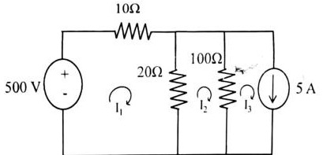

# ECE 2213: 2024 Semester Final · Exam Style Answers

**RUET · ECE Dept · B.Sc. Engineering 2nd Year Even Semester Examination, 2024**
**Full Marks:** 80 · **Time:** 03 Hours · **CO-mapped**

> [!info] Format
> Concise, mark-aligned, written as an answer script.
> Question text and marks come from the paper:
> [[2024|the 2024 paper]].
> Each numerical is derived by two independent routes. A callout records every
> point at which the two routes disagree.

---

# SECTION A

## Question 1

### **(a) Explain the importance of mathematical modeling in engineering problem solving; provide examples of how a real-world engineering problem can be represented using mathematical models. [Marks: 03, CO: 1]**

Engineering problems are too large to test directly. A model is a set of equations
that captures the behaviour that matters and drops the rest.

**Why it matters**

1. A real system cannot be rebuilt or damaged on demand, but its model can be run
   as many times as needed.
2. Trials on the model are cheap. One run costs nothing compared with one
   prototype.
3. The model shows which quantity drives the result, so effort goes where it
   helps.
4. It gives numbers before the hardware exists, which supports a budget.

**How a problem becomes a model**

1. List the quantities of interest and give each a symbol and a unit.
2. Write the physics, or the statistics, that relates them.
3. State the simplifications accepted. A model is wrong somewhere by design.
4. Fix the input data and solve.
5. Compare the answer against a measurement already trusted, then correct the
   model if it is off.

**Worked example.** A reactor's coolant temperature must be known every second,
and the thermocouple is slow. Model the exponential decay of the sensor reading:
store the last reading $T_{n-1}$, then

$$
T_n = T_{n-1} + (T_\infty - T_{n-1})e^{-\Delta t/\tau}
$$

with $\tau$ the sensor time constant. The thermocouple is the real system, and
the first-order lag is the model. For $\Delta t \ll \tau$ this reduces to
$T_n - T_{n-1} \approx (\Delta t/\tau)(T_\infty - T_{n-1})$, which is the linear
formula used in a circuit.

$$\boxed{\text{Model} = \text{physics written as equations, with stated limits}}$$

---

### **(b) Given the function $f(x) = e^x$, derive the third order Taylor series expansion around $x = 0$. Estimate the truncation error if you use this expansion to approximate $f(0.5)$. [Marks: 03, CO: 1]**

The Taylor series of $f$ about $x_0 = 0$ is

$$
f(x) = \sum_{n=0}^{\infty}\frac{f^{(n)}(0)}{n!}x^n
$$

For $f(x) = e^x$ every derivative is $e^x$, so $f^{(n)}(0) = 1$ for all $n$. Hence

$$
e^x = 1 + x + \frac{x^2}{2!} + \frac{x^3}{3!} + \frac{x^4}{4!} + \cdots
$$

**Third order truncation**, keeping terms up to $x^3$:

$$
\boxed{e^x \approx P_3(x) = 1 + x + \frac{x^2}{2} + \frac{x^3}{6}}
$$

**At $x = 0.5$**

$$
P_3(0.5) = 1 + 0.5 + \frac{0.25}{2} + \frac{0.125}{6}
= 1 + 0.5 + 0.125 + 0.0208333
= 1.6458333
$$

**Truncation error, route 1, exact difference against the true value**

$$
e^{0.5} = 1.6487212707
$$

$$
|E_3| = |e^{0.5} - P_3(0.5)| = 1.6487212707 - 1.6458333333 = 0.0028879374
$$

**Truncation error, route 2, Lagrange remainder bound**

The remainder after three terms is

$$
R_3(x) = \frac{f^{(4)}(\xi)}{4!}x^4 = \frac{e^{\xi}}{24}x^4, \qquad 0 < \xi < x
$$

Substituting $x = 0.5$ and $e^{\xi} \le e^{0.5} = 1.6487213$ gives

$$
|R_3| \le \frac{1.6487213}{24}(0.5)^4 = \frac{1.6487213}{24}(0.0625) = 0.0042935
$$

The two routes are consistent: the exact error $0.0028879$ sits inside the bound
$0.0042935$. The first neglected term alone indicates the size of the error,
since the series terms fall fast at $x = 0.5$:

$$
\frac{x^4}{4!} = \frac{0.0625}{24} = 0.0026042
$$

$$
\boxed{P_3(0.5) = 1.6458333, \qquad |E_3| = 0.0028879 \le 0.0042935}
$$

---

### **(c) What are round off and truncation errors? Discuss how each arises in numerical computation. [Marks: 04, CO: 2]**

Both errors make the computed answer differ from the true answer. They come from
different places and cannot be removed the same way.

**Round off error.** The true value cannot be stored exactly in the machine's
finite number of digits. Every number is chopped or rounded to the nearest
representable value. It enters at every single arithmetic operation and it
accumulates, roughly like a random walk.

- **Chopping versus rounding.** Chopping always drops digits and biases the
  result downward. Rounding to nearest is unbiased but costs more work.
- **It grows with the number of operations.** $n$ steps at $10^{-16}$ each give a
  worst case of about $n \times 10^{-16}$.
- **It is amplified by ill conditioning.** A steep function turns a small input
  error into a large output error.

**Truncation error.** The exact mathematics is replaced by a finite formula. The
formula itself is wrong, and no amount of extra digits will fix it.

- **It comes from dropping terms.** A Taylor series cut at $n$ terms, an
  integral replaced by a finite sum, a derivative replaced by a finite
  difference.
- **It shrinks by making the step smaller.** A finite difference error goes as
  $h^2$, a trapezoidal rule error as $h^2$, RK4 as $h^5$.
- **It is a modelling choice, not an accident.** It is accepted on purpose, and
  the error bound gives the price.

**Comparison**

| | Round off | Truncation |
| :-- | :-- | :-- |
| Source | Finite number of digits | Dropping terms of an exact formula |
| Controlled by | More digits, better algorithm order | Smaller step size, more terms |
| Effect of shrinking $h$ | No help, often worse | Decreases |
| Sign | Random, no pattern | Fixed by which terms were dropped |
| Cure | Higher precision, rearranged sums | Refine the formula |

$$
\boxed{\text{Total error} = \text{truncation} + \text{round off} + \text{data error}}
$$

> [!warning] The trade-off in choosing $h$
> Halving the step cuts the truncation error but doubles the number of
> operations, so the round off error grows. Past some point the two curves cross
> and making $h$ smaller makes the answer worse. That crossing is the reason a
> method has an optimal step size rather than an infinitely fine one.

---

## Question 2

### **(a) Given the polynomial $f(x) = x^3 - 6x^2 + 11x - 6$, use the bisection (bracketing) method to find a root in the interval up to two iterations. [Marks: 03, CO: 2]**

> [!note] A gap in the printed question
> The paper does not print an initial interval $[a, b]$. Bisection needs a sign
> change, so the interval must be chosen and stated. The polynomial factors as
> $(x-1)(x-2)(x-3)$, so roots lie at $x = 1, 2, 3$.

**Choose the interval.** Take $[2.5, 3.4]$, which brackets $x = 3$ without
landing on it, so each iteration narrows the bracket.

$$
f(2.5) = 15.625 - 37.5 + 27.5 - 6 = -0.375, \qquad f(3.4) = 39.304 - 69.36 + 37.4 - 6 = +1.344
$$

$f(2.5) \cdot f(3.4) < 0$, so a root lies in $(2.5, 3.4)$.

**Iteration 1.** Midpoint $x_1 = (2.5 + 3.4)/2 = 2.95$

$$
f(2.95) = 25.6724 - 52.2150 + 32.45 - 6 = -0.092625
$$

$f(2.95) < 0$, same sign as $f(2.5)$, so the root is in $(2.95, 3.4)$.

**Iteration 2.** Midpoint $x_2 = (2.95 + 3.4)/2 = 3.175$

$$
f(3.175) = 32.005984 - 60.483750 + 34.925 - 6 = +0.447234
$$

$f(3.175) > 0$, so the root is in $(2.95, 3.175)$.

$$
\boxed{x_2 = 3.175, \qquad \text{root} \in (2.95,\ 3.175), \qquad \text{true root} = 3}
$$

**Interval after $n$ iterations.** Each iteration halves the width, so

$$
\text{width}_n = \frac{b_0 - a_0}{2^n}
$$

The initial width is $b_0 - a_0 = 3.4 - 2.5 = 0.9$. After two iterations the
bracket is $(2.95, 3.175)$, of width $0.225$, which matches
$(b_0 - a_0)/2^2 = 0.9/4 = 0.225$.

The standard maximum error bound for the midpoint after $n$ iterations is
$|x_n - r| \le \frac{b_0 - a_0}{2^n}$. For $n = 2$:

$$
|x_2 - r| \le \frac{0.9}{2^2} = 0.225
$$

Since the true root is $r = 3$, the actual error is $|3.175 - 3| = 0.175$, which
strictly satisfies the theoretical bound:

$$
\text{guaranteed: root} \in (2.95, 3.175), \quad |3.175 - 3| = 0.175 \le 0.225
$$

> [!info] Check against exact factorisation
> The polynomial factors as
> $x^3 - 6x^2 + 11x - 6 = (x-1)(x-2)(x-3)$.
> The three roots are therefore exactly $1, 2, 3$, and the bisection bracket
> $(2.95, 3.175)$ does contain $x = 3$, so the two iterations have bracketed an exact root.

> [!warning] Choosing the interval $[2.5, 3.5]$
> This interval is also valid and is the one the paper's own margin note suggests.
> Its first midpoint is exactly $3.0$, and $f(3.0) = 0$, so the root is found
> in a single step and a second iteration is then unnecessary. That is still a correct
> answer. A midpoint
> landing exactly on the root is a coincidence of this polynomial, not a general
> property.

---

### **(b) Solve $I_1$, $I_2$ and $I_3$ using the Gauss-Seidel method. [Marks: 04, CO: 1]**


*Figure Q2(b): Three-mesh DC resistive circuit with independent voltage and current sources (Source: Page 1, Q.2(b))*

**Mesh equations.** Take all three mesh currents clockwise.

- Mesh 1: the 500 V source opposes the current, the 10 ohm and 20 ohm resistors
  carry $I_1$, and the 20 ohm shares with $I_2$:
  $-500 + 10I_1 + 20(I_1 - I_2) = 0$
- Mesh 2: the 20 ohm and 100 ohm resistors, both shared:
  $20(I_2 - I_1) + 100(I_2 - I_3) = 0$
- Mesh 3: the right branch holds only the 5 A source, aligned with $I_3$:
  $I_3 = 5$

$$
\begin{cases}
30I_1 - 20I_2 = 500 \\
-20I_1 + 120I_2 - 100I_3 = 0 \\
I_3 = 5
\end{cases}
$$

**Rearrange for iteration**

$$
I_1 = \frac{500 + 20I_2}{30}, \qquad
I_2 = \frac{20I_1 + 100I_3}{120}, \qquad
I_3 = 5
$$

**Gauss-Seidel rule.** The value just computed for $I_1$ is used in the equation
for $I_2$, and the value just computed for $I_2$ in the equation for $I_1$. The
previous iteration's values are not used. The start is
$I_1^{(0)} = I_2^{(0)} = I_3^{(0)} = 0$.

$I_3 = 5$ is not iterated. It is fixed by the current source, so it is 5 in every
row including row 0, and it is the value used from the first sweep onward.

| Iteration | $I_1$ | $I_2$ | $I_3$ |
| ---: | ---: | ---: | ---: |
| 0 | 0 | 0 | 5.000000 |
| 1 | 16.666667 | 6.944444 | 5.000000 |
| 2 | 21.296296 | 7.716049 | 5.000000 |
| 3 | 21.810700 | 7.801783 | 5.000000 |
| 4 | 21.867856 | 7.811309 | 5.000000 |
| 5 | 21.874206 | 7.812368 | 5.000000 |
| 6 | 21.874912 | 7.812485 | 5.000000 |

Iteration 1 shown in full:

$$
I_1^{(1)} = \frac{500 + 20(0)}{30} = \frac{50}{3} = 16.666667
$$

$$
I_2^{(1)} = \frac{20(16.666667) + 100(5)}{120} = \frac{333.33334 + 500}{120} = \frac{125}{18} = 6.944444
$$

The increments shrink by roughly a factor of 4 each pass, so the sequence has
settled by iteration 6.

> [!warning] Why $I_3$ is 5 in row 0 and not 0
> $I_3$ is not an unknown to be iterated. Mesh 3 is bounded on the right by an
> ideal $5$ A source and on the left by the $100\ \Omega$ resistor shared with
> mesh 2, so the branch current is fixed at $5$ A and the clockwise mesh current
> must equal it. Starting the table at $I_3 = 0$ contradicts the mesh equation it
> was derived from, and it corrupts the first sweep of $I_2$, which carries
> $100I_3$ in its numerator. With $I_3 = 0$ the first sweep would give
> $I_2^{(1)} = 2.777778$; the converged values are the same, since the iteration
> still has the same fixed point.

$$
\boxed{I_1 \approx 21.875 \text{ A}, \quad I_2 \approx 7.8125 \text{ A}, \quad I_3 = 5 \text{ A}}
$$

> [!info] Check by direct elimination
> Solve the reduced two-equation system directly, substituting $I_3 = 5$:
> $30I_1 - 20I_2 = 500$ and $-20I_1 + 120I_2 = 500$.
> Eliminating $I_1$ gives $160I_1 = 3500$, so $I_1 = 175/8 = 21.875$. Back
> substitution gives $I_2 = 125/16 = 7.8125$. Both values reproduce the iterated result.

> [!note] Convergence
> Gauss-Seidel converges for this system but not always. It is guaranteed when
> the matrix is strictly diagonally dominant, that is when the magnitude of each
> diagonal entry exceeds the sum of the off-diagonal entries in its own row. Here
> row 2 has $|120|$ against $|{-20}| + |{-100}| = 120$, where the diagonal
> entry equals the off-diagonal sum rather than exceeding it, and convergence
> comes from the structure of the two coupled equations instead.

---

### **(c) Describe the Lagrange interpolation method. What are its advantages and disadvantages? [Marks: 03, CO: 1]**

**Idea.** With $n+1$ points $(x_0, y_0), \ldots, (x_n, y_n)$ there is exactly one
polynomial of degree at most $n$ passing through all of them. Lagrange writes
that polynomial directly, as a sum where each term is arranged to be correct at
one point and zero at all the others.

**The formula**

$$
P_n(x) = \sum_{i=0}^{n} y_i L_i(x), \qquad
L_i(x) = \prod_{\substack{j=0 \\ j \neq i}}^{n} \frac{x - x_j}{x_i - x_j}
$$

**Why $L_i$ behaves as it must.** At $x = x_k$ every factor with $k \neq i$ has a
numerator of $x_k - x_k = 0$, so $L_i(x_k) = 0$. At $x = x_i$ every ratio is
$(x_i - x_j)/(x_i - x_j) = 1$, so $L_i(x_i) = 1$. Each term therefore contributes
$y_i$ at its own point and nothing at the others.

**Advantages**

1. No need to solve any equation. The coefficients are written down directly.
2. Unequal spacing is handled with no change to the formula.
3. A new point can be added by adding one term, without rebuilding the rest.
4. It gives an exact fit for any data type, including unevenly spaced samples.

**Disadvantages**

1. Evaluating $P_n$ costs $O(n^2)$ operations, which grows fast.
2. Round off error grows with $n$ and with the distance from the data points.
3. It is unstable for extrapolation. Runge's phenomenon shows large oscillation
   outside the data range.
4. Adding a point changes nothing about the fit quality elsewhere, so it gives no measure
   of whether the model is adequate.

$$
\boxed{P_n(x) = \sum_{i=0}^{n} y_i \prod_{j \neq i} \frac{x - x_j}{x_i - x_j}}
$$

---

## Question 3

### **(a) Discuss the operation of curve fitting and interpolation. [Marks: 02, CO: 1]**

Both take discrete data and produce a smooth relation, but they answer different
questions.

**Interpolation.** Find a function that passes through **every** given point
exactly. The result reproduces the data by construction.

$$
P(x_i) = y_i \quad \text{for all } i
$$

Interpolation applies when the data are accurate and values are needed between
them. Example: reading a voltage between two calibration points.

**Extrapolation.** The same formula evaluated **outside** the range of the data.
The result is an unconstrained estimate with no accuracy guarantee. Example:
predicting next year's population from five decades of census figures.

**Curve fitting.** Find the function that comes **closest** to all the points
without passing through any of them, by minimising a chosen measure of
misfit, usually

$$
\sum_{i=1}^{n} \left[y_i - f(x_i)\right]^2
$$

which is least squares. Use it when the data carry noise, or when a simpler form
than degree $n$ is wanted. Example: fitting a straight line through seven noisy
measurements.

| | Interpolation | Curve fitting |
| :-- | :-- | :-- |
| Passes through the data | Yes | No |
| Data assumed | Exact | Noisy |
| Degree | Up to $n$ for $n+1$ points | Chosen, often lower |
| Answers | What is between the points | What is the underlying trend |

$$
\boxed{\text{Interpolation reproduces data; curve fitting explains it}}
$$

---

### **(b) The population of a town in decennial census were as in the following table in thousand units. Estimate the population for the year 1995. [Marks: 04, CO: 1]**

| Year | 1921 | 1931 | 1941 | 1951 | 1961 |
| :-- | --: | --: | --: | --: | --: |
| Population (thousands) | 46 | 66 | 81 | 93 | 101 |

**Step 1. Build the difference table.** Take $h = 10$ years and put the years in
steps from 1921, so $u = (x - 1921)/10$ gives $u = 0, 1, 2, 3, 4$.

| $u$ | 0 | 1 | 2 | 3 | 4 |
| --- | ---: | ---: | ---: | ---: | ---: |
| $y$ | 46 | 66 | 81 | 93 | 101 |
| $\Delta y$ | 20 | 15 | 12 | 8 | |
| $\Delta^2 y$ | $-5$ | $-3$ | $-4$ | | |
| $\Delta^3 y$ | 2 | $-1$ | | | |
| $\Delta^4 y$ | $-3$ | | | | |

**Step 2. Newton backward differences at the last point.** The target 1995 lies
**beyond** the table, so work backwards from 1961. The backward differences at
$u = 4$ are the last entry of each row:

$$
\nabla y = 8, \quad \nabla^2 y = -4, \quad \nabla^3 y = -1, \quad \nabla^4 y = -3
$$

**Step 3. Argument.** With $p$ measured in steps of $h$ past the last point,

$$
p = \frac{1995 - 1961}{10} = 3.4
$$

**Step 4. Apply the formula**

$$
y = y_n + p\nabla y_n + \frac{p(p+1)}{2!}\nabla^2 y_n + \frac{p(p+1)(p+2)}{3!}\nabla^3 y_n + \frac{p(p+1)(p+2)(p+3)}{4!}\nabla^4 y_n
$$

| Term | Working | Value |
| :-- | :-- | --: |
| $y_n$ | | 101 |
| $p\nabla y_n$ | $3.4(8)$ | 27.2 |
| $\frac{p(p+1)}{2}\nabla^2 y_n$ | $\frac{3.4(4.4)}{2}(-4)$ | $-29.92$ |
| $\frac{p(p+1)(p+2)}{6}\nabla^3 y_n$ | $\frac{3.4(4.4)(5.4)}{6}(-1)$ | $-13.464$ |
| $\frac{p(p+1)(p+2)(p+3)}{24}\nabla^4 y_n$ | $\frac{3.4(4.4)(5.4)(6.4)}{24}(-3)$ | $-64.6272$ |

$$
101 + 27.2 - 29.92 - 13.464 - 64.6272 = 20.1888
$$

$$
\boxed{P(1995) = 20.1888 \text{ thousand (Newton backward difference, all 5 points)}}
$$

> [!info] Check by two independent routes
> **Newton divided difference.** Building the divided difference table from
> $x = 1921, \ldots, 1961$ and evaluating the resulting polynomial at $x = 1995$
> gives $20.1888000000$.
> **Lagrange interpolation.** The sum
> $\sum y_i \prod_{j \neq i} \frac{1995 - x_j}{x_i - x_j}$ over the five points
> gives $20.1887999999$.
> Both match the backward-difference value to nine figures, so the value does
> not depend on the route taken.

> [!warning] Why the extrapolated estimate is not usable
> The formula was applied correctly. The problem is that $p = 3.4$ is far outside
> the data, and the fourth-difference term is large and negative, so it cancels
> most of everything above it. The result predicts a population of 20 thousand in
> 1995, down from 101 thousand in 1961. The data plainly do not say that.
>
> Dropping the highest term shows how unstable it is:
>
> | Terms kept | Result |
> | :-- | --: |
> | $y_n + p\nabla y_n$ | 128.2 |
> | plus $\nabla^2 y$ | 98.28 |
> | plus $\nabla^3 y$ | 84.816 |
> | plus $\nabla^4 y$ | 20.1888 |
>
> Three plausible answers and one implausible one, from the same five data points.
> **Extrapolation more than about one interval past the data is not usable.**
> For a defensible estimate, fit a straight line instead, which is the
> least squares fit in part (c) of the same question.

---

### **(c) Fit a straight line to the $x$ and $y$ values in the following table. [Marks: 04, CO: 1]**

| $x$ | 1 | 2 | 3 | 4 | 5 | 6 | 7 |
| --- | --: | --: | --: | --: | --: | --: | --: |
| $y$ | 0.5 | 2.5 | 2 | 4 | 3.5 | 6 | 5.5 |

The model is $y = a + bx$. Choose $a, b$ to minimise
$S = \sum (y_i - a - bx_i)^2$.

**Step 1. Sums.** With $n = 7$:

| $\sum x$ | $\sum y$ | $\sum x^2$ | $\sum xy$ |
| ---: | ---: | ---: | ---: |
| 28 | 24 | 140 | 119.5 |

**Step 2. Normal equations.** Differentiating $S$ with respect to $a$ and $b$
and setting both to zero gives

$$
na + b\sum x = \sum y, \qquad a\sum x + b\sum x^2 = \sum xy
$$

$$
\begin{cases}
7a + 28b = 24 \\
28a + 140b = 119.5
\end{cases}
$$

**Step 3. Solve.** Eliminating $a$ by multiplying the first equation by 4 and
subtracting it from the second:

$$
28a + 140b - (28a + 112b) = 119.5 - 96
$$

$$
28b = 23.5 \quad \Rightarrow \quad b = \frac{23.5}{28} = \frac{47}{56} = 0.839286
$$

$$
a = \frac{24 - 28b}{7} = \frac{24 - 23.5}{7} = \frac{0.5}{7} = \frac{1}{14} = 0.071429
$$

$$
\boxed{y = 0.0714 + 0.8393x}
$$

**Check.** Both normal equations are satisfied exactly:
$7(0.071429) + 28(0.839286) = 0.5 + 23.5 = 24$ and
$28(0.071429) + 140(0.839286) = 2 + 117.5 = 119.5$.

> [!info] Check by an independent route
> Using the compact formulas,
> $$b = \frac{n\sum xy - \sum x \sum y}{n\sum x^2 - (\sum x)^2} = \frac{7(119.5) - 28(24)}{7(140) - 28^2} = \frac{164.5}{196} = \frac{47}{56}$$
> and
> $$a = \bar{y} - b\bar{x} = \frac{24}{7} - \frac{47}{56}(4) = \frac{1}{14}$$
> Both match the elimination result above, and both are exact fractions, so the
> values do not depend on rounding.

---

## Question 4

### **(a) Describe the general approach for solving boundary value problems numerically. How does it differ from solving initial value problems? [Marks: 03, CO: 1]**

**The shared starting point.** Both replace derivatives by finite differences and
solve the resulting algebraic system. The difference is which equations end up in
that system.

**Initial value problem.** One condition is given at one end of the domain, for
example $y(0) = 1$. Marching step by step from there, each new row uses only the
row just computed.

$$
y_{i+1} = f(x_i, y_i) h + O(h^2)
$$

This works because the system is **lower triangular in the unknowns**. It is
simple, needs no iteration, and each step is cheap.

**Boundary value problem.** Conditions are given at **both** ends, for example
$y(0) = 0$ and $y(1) = 1$. No starting value is known, so the grid cannot be
filled row by row.

**The general approach.**

1. Discretise the domain into a grid of $n + 1$ points.
2. Replace every derivative by a finite difference, usually the centred one
   $y''(x_i) \approx \frac{y_{i+1} - 2y_i + y_{i-1}}{h^2}$.
3. Apply the boundary conditions as algebraic equations replacing the
   unavailable end rows.
4. Solve the full linear system for all unknowns at once.

$$
\begin{cases}
y_0 = 0 \\
-\dfrac{y_{i-1} - 2y_i + y_{i+1}}{h^2} = f_i, \quad 1 \le i \le n-1 \\
y_n = 1
\end{cases}
$$

The interior equations couple neighbours, so the system is **tridiagonal**. The
standard efficient methods are the Thomas algorithm, or an iterative sweep such
as Gauss-Seidel, which works because the system is diagonally dominant.

**Key differences**

| | Initial value problem | Boundary value problem |
| :-- | :-- | :-- |
| Conditions | Given at one end | Given at both ends |
| Direction | Marches forward from the start | Whole domain solved at once |
| System structure | Lower triangular | Tridiagonal |
| Cost per step | Very low | Full linear solve |
| Sensitivity | Local, errors stay near the start | Global, a change anywhere moves the whole solution |
| Shooting method | Not applicable | Reduces a BVP to an IVP by adjusting the unknown start value until the far end matches |

> [!note] Where this exam meets the topic again
> The Gauss-Seidel iteration in part (b) of Question 2 is the same algorithm used
> on the tridiagonal system here. See
> [[NM-3.5_Gauss_Seidel_Iteration|NM-3.5 · Gauss-Seidel Iteration]] and [[NM-3.8_Circuit_Applications|NM-3.8 · Circuit Applications]].

---

### **(b) Use the fourth-order Runge-Kutta method (RK4) to solve $\frac{dy}{dx} = x + y$ with initial condition $y(0) = 1$ over the interval $x = 0$ to $x = 0.2$ with a step size $h = 0.1$. Show intermediate calculations. [Marks: 05, CO: 1]**

**The method.** With $f(x, y) = x + y$ and $h = 0.1$:

$$
k_1 = h f(x_i, y_i)
$$

$$
k_2 = h f\left(x_i + \frac{h}{2},\ y_i + \frac{k_1}{2}\right)
$$

$$
k_3 = h f\left(x_i + \frac{h}{2},\ y_i + \frac{k_2}{2}\right)
$$

$$
k_4 = h f\left(x_i + h,\ y_i + k_3\right)
$$

$$
y_{i+1} = y_i + \frac{1}{6}\left(k_1 + 2k_2 + 2k_3 + k_4\right)
$$

Each $k$ is a slope over a different point of the interval, and $y_3$ and $y_4$ are
staged estimates that get corrected by later stages. This is why RK4 needs four
function evaluations where Euler needs one.

**Step 1. From $x_0 = 0$ to $x_1 = 0.1$**, with $x_0 = 0$, $y_0 = 1$:

$$
k_1 = 0.1(0 + 1) = 0.1
$$

$$
k_2 = 0.1\left(0.05 + 1 + \frac{0.1}{2}\right) = 0.1(1.1) = 0.11
$$

$$
k_3 = 0.1\left(0.05 + 1 + \frac{0.11}{2}\right) = 0.1(1.105) = 0.1105
$$

$$
k_4 = 0.1\left(0.1 + 1 + 0.1105\right) = 0.1(1.2105) = 0.12105
$$

$$
y_1 = 1 + \frac{1}{6}\left(0.1 + 2(0.11) + 2(0.1105) + 0.12105\right)
= 1 + \frac{0.66205}{6}
= 1.1103417
$$

**Step 2. From $x_1 = 0.1$ to $x_2 = 0.2$**, with $x_1 = 0.1$, $y_1 = 1.1103417$:

$$
k_1 = 0.1(0.1 + 1.1103417) = 0.1210342
$$

$$
k_2 = 0.1\left(0.15 + 1.1103417 + \frac{0.1210342}{2}\right) = 0.1(1.3208588) = 0.1320859
$$

$$
k_3 = 0.1\left(0.15 + 1.1103417 + \frac{0.1320859}{2}\right) = 0.1(1.3263846) = 0.1326385
$$

$$
k_4 = 0.1\left(0.2 + 1.1103417 + 0.1326385\right) = 0.1(1.4429802) = 0.1442980
$$

$$
y_2 = 1.1103417 + \frac{1}{6}\left(0.1210342 + 2(0.1320859) + 2(0.1326385) + 0.1442980\right)
$$

$$
= 1.1103417 + \frac{0.7947810}{6} = 1.1103417 + 0.1324635 = 1.2428051
$$

$$
\boxed{y(0.2) = 1.2428051}
$$

> [!info] Check against the exact solution
> $y' - y = x$ is linear. The homogeneous solution is $Ce^x$ and a particular
> solution is $y_p = -x - 1$, so $y = Ce^x - x - 1$. Applying $y(0) = 1$ gives
> $C = 2$, hence
> $$y = 2e^x - x - 1$$
> $$y(0.2) = 2(1.2214028) - 0.2 - 1 = 1.2428055$$
> The RK4 answer $1.2428051$ differs by $3.7 \times 10^{-7}$. For a fourth-order
> method with $h = 0.1$ over two steps this difference is the expected size,
> which supports the RK4 result.

> [!note] Order of accuracy
> RK4 carries a local truncation error of $O(h^5)$ per step. Halving $h$ cuts
> the global error by about $16$. The cost is four function evaluations per step,
> so halving $h$ doubles the work.

---

### **(c) State the importance of boundary conditions in solving PDEs numerically. [Marks: 02, CO: 1]**

**Why they decide the answer.** A partial differential equation gives the
behaviour **inside** a region. Boundary conditions say what happens at the edges.
Together with the PDE they form a complete problem; without them the problem is
under-determined and the numerical solution is not unique.

**What breaks without them.**

1. **Non-uniqueness.** Second-order equations need two conditions. Supply one and
   the solution is still not fixed.
2. **Unstable growth.** An error at a boundary, or any small error at all,
   grows as it is carried across the grid, so a badly posed problem produces a
   wrong answer that grows with the grid size.
3. **Solvability.** The linear system from part (a) is singular without boundary
   equations, so standard solvers fail or return nonsense.

**Their role in practice.**

1. They supply the missing end rows when the interior difference equations leave
   the two outermost rows undefined.
2. They are enforced **exactly**, not approximately. Imposing $y(0) = 0$ to four
   significant figures injects that same error into every computed value.
3. Corner points, where two boundary curves meet, must satisfy **both**
   conditions. If they disagree at the corner the problem has no solution, and
   this is a common cause of a solver reporting a singular matrix.
4. The type of condition matters. For a diffusion problem, prescribing $u$
   (Dirichlet) is stable, while prescribing its derivative (Neumann) requires a
   compatibility check on the corner data.

$$\boxed{\text{PDE} + \text{boundary conditions} = \text{a problem with one unique numerical solution}}$$

---

# SECTION B

## Question 5

### **(a) Define propositional logic and explain the difference between a proposition and propositional variable. [Marks: 02, CO: 2]**

**Propositional logic** is the study of statements that are either true or false,
together with the connectives that build larger statements from them. It ignores
the internal structure of a statement and cares only about its truth value.

**Proposition.** A declarative sentence that is unambiguously either true or
false, and has exactly one truth value.

| | Example | Proposition? |
| :-- | :-- | :-- |
| a | The transistor conducts | Yes, true or false |
| b | $2 + 2 = 4$ | Yes |
| c | Close the window | No, it is a command |
| d | $x + 1 > 0$ | No, $x$ is unknown |
| e | The sky is blue today | Yes |
| f | Is the door open | No, it is a question |

**Propositional variable**, written $p, q, r, s$, is a single letter standing for
one whole proposition. The letter has no meaning of its own. It is simply a
placeholder.

**The difference in one line.** A proposition is the actual sentence. A
propositional variable is the name given to it so that logical connectives can be
written on paper.

$$
\text{Statement: "The system is in multiuser state"} \quad \Rightarrow \quad p
$$

Both are needed. The prose gives the physics, the letter gives the algebra.

---

### **(b) Given the propositional formula $(p \to q) \land (q \to r)$, determine whether the formula is valid, satisfiable or unsatisfiable. [Marks: 04, CO: 2]**

The three words are tested separately.

- **Valid (a tautology):** true for every assignment of $p, q, r$.
- **Satisfiable:** true for at least one assignment.
- **Unsatisfiable (a contradiction):** false for every assignment.

**Step 1. Expand the implications.**

$$
(p \to q) \land (q \to r) = (\neg p \lor q) \land (\neg q \lor r)
$$

**Step 2. Full truth table.**

| $p$ | $q$ | $r$ | $p \to q$ | $q \to r$ | $(p \to q) \land (q \to r)$ |
| :-: | :-: | :-: | :-: | :-: | :-: |
| F | F | F | T | T | **T** |
| F | F | T | T | T | **T** |
| F | T | F | T | F | F |
| F | T | T | T | T | **T** |
| T | F | F | F | T | F |
| T | F | T | F | T | F |
| T | T | F | T | F | F |
| T | T | T | T | T | **T** |

**Step 3. The verdict.** The column holds T in four rows and F in four rows.

- Not true in every row, so **not valid**.
- True in rows 1, 2, 4 and 8, so **satisfiable**.

$$
\boxed{\text{Satisfiable but not valid}}
$$

> [!note] Why it is not valid
> Any row with $p = T, q = F$ falsifies $p \to q$ and hence the whole
> formula, whatever $r$ is. Rows 5 and 6 are exactly that.

> [!info] What the formula means
> It is the transitivity rule. If the three rows of the truth table describe
> states that really occur, then "if $p$ then $q$" together with "if $q$ then $r$"
> forces "if $p$ then $r$". The table shows the rule does not hold in general, so
> it needs an extra premise to become a tautology.

---

### **(c) Are these system specifications consistent? [Marks: 04, CO: 2]**

> The system is in multiuser state if and only if it is operating normally, the
> kernel is functioning. The kernel is not functioning or the system is in
> interrupt mode. If the system is not in multiuser state, then it is in
> interrupt mode. The system is not in interrupt mode.

**Assign variables**

| Symbol | Meaning |
| :-- | :-- |
| $p$ | system is in multiuser state |
| $q$ | kernel is functioning |
| $r$ | system is in interrupt mode |

**Translate each sentence.**

1. "in multiuser state if and only if it is operating normally, the kernel is
   functioning":
   $p \leftrightarrow q$
2. "The kernel is not functioning or the system is in interrupt mode":
   $\neg q \lor r$
3. "If the system is not in multiuser state, then it is in interrupt mode":
   $\neg p \to r$, which is $p \lor r$
4. "The system is not in interrupt mode":
   $\neg r$

**Test all eight assignments.**

| $p$ | $q$ | $r$ | (1) $p \leftrightarrow q$ | (2) $\neg q \lor r$ | (3) $p \lor r$ | (4) $\neg r$ | all four |
| :-: | :-: | :-: | :-: | :-: | :-: | :-: | :-: |
| F | F | F | T | T | F | T | **F** |
| F | F | T | T | T | T | F | F |
| F | T | F | F | F | F | T | F |
| F | T | T | F | T | T | F | F |
| T | F | F | F | T | T | T | **F** |
| T | F | T | F | T | T | F | F |
| T | T | F | T | F | T | T | F |
| T | T | T | T | T | T | F | F |

No row satisfies all four.

**Reason without a table.** Specification 4 forces $r = F$. Specification 2 then
forces $\neg q$, so $q = F$. Specification 1 forces $p = F$. Specification 3 then reads
$p \lor r = F \lor F = F$, a contradiction.

$$
\boxed{\text{The specifications are INCONSISTENT: no assignment satisfies all four}}
$$

> [!warning] Where the contradiction comes from
> Sentence 4 says the system is **never** in interrupt mode. Sentence 2 then
> forces the kernel to be broken. Sentence 1 ties multiuser state to a
> working kernel, so the system cannot be in multiuser state either. Sentence 3
> says a system that is not in multiuser state must be in interrupt mode, which
> sentence 4 has already ruled out. The set describes a machine that cannot
> exist. In practice this means one of the four requirements is a typo, usually
> sentence 4.

---

## Question 6

### **(a) Explain the concepts of tautology, contradiction and contingency in propositional logic. Explain their characteristics with example. [Marks: 04, CO: 2]**

Every propositional formula falls into exactly one of three classes, decided by
its truth value across all assignments.

**1. Tautology.** True for **every** assignment of its variables. It is also called a
valid formula. It states a fact that cannot fail.

- Characteristic: the final column of the truth table is T throughout.
- Example: $p \lor \neg p$. One of $p$ and $\neg p$ must hold, so the disjunction
  is always true. No values needed.

**2. Contradiction.** False for **every** assignment. It is also called an unsatisfiable
formula, or an inconsistent set of conditions.

- Characteristic: the final column is F throughout. The negation is a tautology.
- Example: $p \land \neg p$. A proposition cannot be true and false at once.

**3. Contingency.** True for **some** assignments and false for **others**. It is also
called a satisfiable formula, or a non-tautology.

- Characteristic: the final column holds both T and F. It is the only class that
  depends on the input.
- Example: $p \lor q$. True unless both $p$ and $q$ are false.

**Comparison**

| | Tautology | Contradiction | Contingency |
| :-- | :-- | :-- | :-- |
| True for | All assignments | None | Some |
| False for | None | All assignments | Some |
| Negation | Contradiction | Tautology | Contingency |
| Truth table last column | All T | All F | Mixed |

**Worked example, classifying $A \to (B \lor \neg A)$**

| $A$ | $B$ | $\neg A$ | $B \lor \neg A$ | $A \to (B \lor \neg A)$ |
| :-: | :-: | :-: | :-: | :-: |
| F | F | T | T | T |
| F | T | T | T | T |
| T | F | F | F | F |
| T | T | F | T | T |

The last column holds T, T, F, T, so the formula is a **contingency**.

$$
\boxed{\text{tautology (always T), contradiction (always F), contingency (mixed)}}
$$

---

### **(b) A security system triggers an alarm if (a) motion is detected and the window is open, or (b) the door sensor is active but the security code is not entered. (i) Assign propositional variables, (ii) express the alarm condition as a single proposition, (iii) convert it into both CNF and DNF, describing each transformation step. [Marks: 06, CO: 2]**

**(i) Variables**

| Symbol | Meaning |
| :-- | :-- |
| $m$ | motion is detected |
| $w$ | window is open |
| $d$ | door sensor is active |
| $s$ | security code **is** entered |
| $A$ | the alarm triggers |

**(ii) The condition as one proposition.** Branch (a) is $m \land w$. Branch (b)
is $d \land \neg s$, because "the code is not entered" is $\neg s$. The two
branches are alternatives, so they are joined by $\lor$:

$$
A = (m \land w) \lor (d \land \neg s)
$$

**(iii-a) To DNF.** By definition, a proposition is in Disjunctive Normal Form (DNF)
if it is a disjunction of conjunctions of literals. The formulated condition:

$$
A = (m \land w) \lor (d \land \neg s)
$$

is already in DNF (minimal DNF), consisting of two clauses: $(m \land w)$ and $(d \land \neg s)$.

If the **full canonical DNF** (sum of minterms where every clause contains all 4 variables)
is required, expand each term using the identity $X \equiv X \land (Y \lor \neg Y)$:

$$
\begin{aligned}
m \land w &\equiv (m \land w) \land (d \lor \neg d) \land (s \lor \neg s) \\
&= (m \land w \land d \land s) \lor (m \land w \land d \land \neg s) \lor (m \land w \land \neg d \land s) \lor (m \land w \land \neg d \land \neg s)
\end{aligned}
$$

$$
\begin{aligned}
d \land \neg s &\equiv (m \lor \neg m) \land (w \lor \neg w) \land (d \land \neg s) \\
&= (m \land w \land d \land \neg s) \lor (m \land \neg w \land d \land \neg s) \lor (\neg m \land w \land d \land \neg s) \lor (\neg m \land \neg w \land d \land \neg s)
\end{aligned}
$$

Combining by disjunction and eliminating the duplicate minterm $(m \land w \land d \land \neg s)$:

$$
\begin{aligned}
A_{\text{canonical DNF}} = &(m \land w \land d \land s) \lor (m \land w \land d \land \neg s) \lor (m \land w \land \neg d \land s) \lor (m \land w \land \neg d \land \neg s) \\
&\lor (m \land \neg w \land d \land \neg s) \lor (\neg m \land w \land d \land \neg s) \lor (\neg m \land \neg w \land d \land \neg s)
\end{aligned}
$$

**(iii-b) To CNF.** A conjunction of disjunctions (product of sums).
Apply the distributive law $P \lor (Q \land R) \equiv (P \lor Q) \land (P \lor R)$:

$$
\begin{aligned}
A &= (m \land w) \lor (d \land \neg s) \\
  &= \big[(m \land w) \lor d\big] \land \big[(m \land w) \lor \neg s\big]
    && \text{distribute over } (d \land \neg s)\\
  &= \big[(m \lor d) \land (w \lor d)\big] \land \big[(m \lor \neg s) \land (w \lor \neg s)\big]
    && \text{distribute } d \text{ and } \neg s\\
  &= (m \lor d) \land (w \lor d) \land (m \lor \neg s) \land (w \lor \neg s)
    && \text{remove grouping brackets}\\
  &= (m \lor d) \land (m \lor \neg s) \land (w \lor d) \land (w \lor \neg s)
    && \text{reorder clauses}
\end{aligned}
$$

$$
\boxed{\text{CNF: } (m \lor d)\land(m \lor \neg s)\land(w \lor d)\land(w \lor \neg s)}
$$

> [!info] Check by exhaustive evaluation
> All three forms, the original $(m \land w)\lor(d \land \neg s)$, the DNF and the
> CNF, evaluate identically on all $2^4 = 16$ assignments of $m, w, d, s$. An
> algebra mistake in either conversion would show up as a row where the three
> disagree.

> [!note] Which form to use
> **CNF** suits resolution and automated theorem provers, which read conjunctions
> of disjunctions directly. **DNF** suits fast evaluation and hardware
> implementation, because each product can be tested in isolation and the first
> one that succeeds ends the computation. The CNF here also reads as four
> independent failure conditions: for no alarm, motion must be absent or the
> door inactive, the door must be active or no motion seen, the window must be
> shut or the door inactive, and the window must be shut or the code entered.

---

## Question 7

### **(a) A delivery company uses a computer system to manage customer orders. Sort all delivery addresses based on distance from the warehouse. Search for a customer's order by name or ID. Use a greedy approach to assign delivery vans to the nearest unserved address. Evaluate the time complexity of each algorithm used. [Marks: 06, CO: 2]**

**(i) Sorting the addresses by distance**

**Algorithm chosen: merge sort.**

The addresses are sorted by one key, the distance from the warehouse. Merge sort
splits the list in half, sorts each half recursively, then merges the two sorted
halves in linear time.

- Average time complexity: $O(n \log n)$
- Best case: $O(n \log n)$
- Worst case: $O(n \log n)$
- Space: $O(n)$

Merge sort is chosen over quicksort because the worst case is guaranteed, and
because the merges are stable, so two addresses at the same distance keep their
original order.

> [!note] Why not the others
> Bubble sort is $O(n^2)$, which fails at tens of thousands of addresses.
> Quicksort is $O(n \log n)$ on average but $O(n^2)$ if the list is already
> sorted, which is close to what a distance list looks like. Heapsort is
> $O(n \log n)$ in all cases but is not stable. Counting or radix sort would be
> faster still, at $O(n + k)$, but only if the distances are integers in a known
> range, which floating-point distances are not.

**(ii) Searching for a customer's order**

**Algorithm chosen: binary search**, since the question says the address list is
already sorted.

**Pseudocode**

```
function BINARY-SEARCH(A, key):
    low  ← 0
    high ← length(A) - 1
    while low ≤ high:
        mid ← floor((low + high) / 2)
        if A[mid].id = key:
            return mid
        else if A[mid].id < key:
            low ← mid + 1
        else:
            high ← mid - 1
    return NOT-FOUND
```

- Average time complexity: $O(\log n)$
- Best case: $O(1)$, when the key sits at the first midpoint tried
- Worst case: $O(\log n)$
- Space: $O(1)$, it iterates rather than recursing

Binary search halves the search interval at every step, so $n$ items take at most
$\lceil \log_2 n \rceil$ comparisons. For $n = 10^6$ that is 20 comparisons.

> [!warning] Binary search has one requirement
> The list must be sorted on the **same key** that is searched. Sorted by
> distance does **not** mean sorted by customer ID. Searching for a customer
> therefore needs a second list sorted by ID, kept in step with the first.
> Searching an unsorted list with this pseudocode returns a wrong answer silently,
> not an error. Linear search would be $O(n)$ but would at least be correct.

**(iii) Assigning vans to the nearest unserved address**

**Greedy algorithm: nearest-first assignment.**

At each step take the unassigned van that is closest to the warehouse and give it
the unassigned address that is closest to that van. This is the locally optimal
choice repeated.

```
function ASSIGN-VANS(vans, addresses):
    for each address in addresses, in ascending order of distance:
        best ← NONE
        for each free van v:
            if best = NONE or DISTANCE(v, address) < DISTANCE(best, address):
                best ← v
        assign address to best
        mark best as used
    return schedule
```

- Time complexity: $O(n \log n + nm)$, where $n$ addresses and $m$ vans. Sorting
  costs $O(n \log n)$ and the matching loop costs $O(nm)$.
- Space: $O(n + m)$

**Why greedy is defensible here.** Every delivery costs distance and there is no
interaction between vans, so the total distance is a sum of independent terms and
minimising each term separately minimises the total. That is the case where greedy
is exactly right.

**Where greedy would fail.** If a van had a capacity of 3 and one address needed a
truck, taking the nearest address for the van could block a heavier address that
only the truck can serve. Then the locally nearest choice is not safe, and a
matching algorithm is needed instead.

$$
\boxed{\text{Sort } O(n \log n), \quad \text{search } O(\log n), \quad \text{assign } O(n \log n + nm)}
$$

---

### **(b) Determine whether the biconditionals are true or false. [Marks: 04, CO: 2]**

The biconditional $P \leftrightarrow Q$ is true when $P$ and $q$ have the **same**
truth value, that is when both are true or both are false. It is false when they
disagree.

$$P \leftrightarrow Q \equiv (P \to Q)\land(Q \to P)$$

**(i) $2 + 2 = 4$ if and only if $1 + 1 = 2$**

$2 + 2 = 4$ is true. $1 + 1 = 2$ is true. Same value, so the biconditional holds.

$$\boxed{\text{(i) TRUE}}$$

**(ii) $1 + 1 = 2$ if and only if $2 + 3 = 4$**

$1 + 1 = 2$ is true. $2 + 3 = 5$, not $4$, so $2 + 3 = 4$ is false. The values
disagree.

$$\boxed{\text{(ii) FALSE}}$$

**(iii) $1 + 1 = 3$ if and only if monkeys can fly**

$1 + 1 = 3$ is false. Monkeys cannot fly, so that is false. Both false, so they
match.

$$\boxed{\text{(iii) TRUE}}$$

**(iv) $0 > 1$ if and only if $2 > 1$**

$0 > 1$ is false. $2 > 1$ is true. The values disagree.

$$\boxed{\text{(iv) FALSE}}$$

> [!warning] Why two false statements give a **true** biconditional
> Two false statements make a **true** biconditional. It asserts that the two
> sides have the same truth value, not that either is true. The tempting
> conclusion "false, because $1+1 \neq 3$" is therefore wrong.
>
> In mathematics a biconditional is a statement of equivalence, so
> it is either true or false with no third case. In ordinary English "if and only
> if" is often used loosely, but the mathematical reading is strict.

---

## Question 8

### **(a) Suppose that $a$ and $b$ are integers, $a \equiv 11 \pmod{19}$ and $b \equiv 3 \pmod{19}$. Find the integer $c$ with $0 \le c \le 18$ such that (i) $c \equiv 7a + 3b \pmod{19}$, (ii) $c \equiv a^3 + 4b^3 \pmod{19}$. [Marks: 04, CO: 2]**

Since $a$ and $b$ are known only modulo 19, compute the expression modulo 19 and
then reduce to $0 \le c \le 18$. Congruence arithmetic lets the actual integers
be replaced by their residues.

**(i) $c \equiv 7a + 3b \pmod{19}$**

$$
c \equiv 7(11) + 3(3) = 77 + 9 = 86 \pmod{19}
$$

Divide: $86 = 19(4) + 10$.

$$
\boxed{c = 10}
$$

**(ii) $c \equiv a^3 + 4b^3 \pmod{19}$**

Work entirely with residues to keep the numbers small.

$$
a^2 \equiv 11^2 = 121 = 19(6) + 7 \equiv 7 \pmod{19}
$$

$$
a^3 \equiv 7 \times 11 = 77 = 19(4) + 1 \equiv 1 \pmod{19}
$$

$$
b^3 \equiv 3^3 = 27 = 19(1) + 8 \equiv 8 \pmod{19}
$$

$$
c \equiv 1 + 4(8) = 1 + 32 = 33 = 19(1) + 14 \pmod{19}
$$

$$
\boxed{c = 14}
$$

> [!info] Check by an independent route
> **Direct substitution.** $11^3 + 4 \cdot 3^3 = 1331 + 108 = 1439$, and
> $1439 = 19(75) + 14$, giving $c = 14$, matching the residue route in (ii).
> **Part (i) direct.** $86 = 19(4) + 10$, giving $c = 10$, matching the residue route in (i).
> The residue route in part (ii) never leaves the range $0$ to $18$ after
> reduction, so it cannot pick the wrong representative.

> [!note] Why 19 is convenient
> $19$ is prime, so every nonzero residue has a multiplicative inverse and Fermat's
> little theorem gives $a^{18} \equiv 1 \pmod{19}$. That makes exponents reducible
> modulo 18, which is the usual shortcut on these problems.

---

### **(b) Solve $3^{644} \bmod 645$ using a well-known algorithm. [Marks: 04, CO: 2]**

The well-known algorithm is **repeated squaring**, also called square-and-multiply.
It replaces 644 multiplications by about $\log_2 644 \approx 10$.

**Step 1. Split the exponent in binary.**

$$
644 = 512 + 128 + 4 = (1010000100)_2
$$

**Step 2. Build the table of squares, reducing modulo 645 at every step.**

$$
3^1 = 3
$$

$$
3^2 = 9
$$

$$
3^4 = 9^2 = 81
$$

$$
3^8 = 81^2 = 6561 = 645(10) + 111 \equiv 111
$$

$$
3^{16} = 111^2 = 12321 = 645(19) + 66 \equiv 66
$$

$$
3^{32} = 66^2 = 4356 = 645(6) + 486 \equiv 486
$$

$$
3^{64} = 486^2 = 236196 = 645(366) + 126 \equiv 126
$$

$$
3^{128} = 126^2 = 15876 = 645(24) + 396 \equiv 396
$$

$$
3^{256} = 396^2 = 156816 = 645(243) + 81 \equiv 81
$$

$$
3^{512} = 81^2 = 6561 \equiv 111
$$

**Step 3. Multiply the powers named by the set bits**, which are $2^9 = 512$,
$2^7 = 128$ and $2^2 = 4$:

$$
3^{644} \equiv 3^{512} \cdot 3^{128} \cdot 3^4
$$

$$
= 111 \times 396 \times 81
$$

$$
111 \times 396 = 43956 = 645(68) + 96 \equiv 96
$$

$$
96 \times 81 = 7776 = 645(12) + 36 \equiv 36
$$

$$
\boxed{3^{644} \bmod 645 = 36}
$$

> [!info] Check by an independent route
> Factor $645 = 3 \times 5 \times 43$ and apply the Chinese remainder theorem.
>
> | Modulus | Result | Working |
> | :-- | --: | :-- |
> | $3$ | 0 | $3^{644}$ is a multiple of 3 |
> | $5$ | 1 | $3^4 \equiv 1$, and $644 = 4(161)$ |
> | $43$ | 36 | $\phi(43) = 42$, $644 = 42(15) + 14$, so $3^{644} \equiv 3^{14}$; $3^{14} = 3^8 \cdot 3^4 \cdot 3^2 \equiv 25 \times 38 \times 9 \equiv 36$ |
>
> Now check $36$: $36 \bmod 3 = 0$ ✓, $36 \bmod 5 = 1$ ✓, $36 \bmod 43 = 36$ ✓.
> The three residues match, so the CRT returns $36$.

> [!note] Why repeated squaring is the standard method
> Squaring $n$ times computes every power $2^k$ in $n$ multiplications. Combining
> the ones the exponent needs costs at most $n$ more. Hence the total is $O(\log n)$
> against $O(n)$ for direct repeated multiplication, and the saving grows
> without bound. Reducing modulo $645$ at every step keeps the intermediate
> numbers small enough to stay exact in fixed-precision arithmetic.

---

### **(c) Give a real-world example of the generalized pigeonhole principle. [Marks: 02, CO: 2]**

**The principle.** If $N$ objects are placed into $k$ boxes and $N > k$, then at
least one box holds at least two objects. More generally, if $N > mk$, then some
box holds at least $m + 1$.

**Real-world example.** A company runs a help desk. Across $365$ days the
recorded weather is one of $20$ conditions: clear, rain, snow, fog and so on. In
any year with more than $20 \times 4 = 80$ days of observations, at least one
condition was recorded on at least $5$ days.

A second example. Among any group of $50$ students, since there are $12$ months
in a year, the generalized pigeonhole principle guarantees that at least
$\lceil 50/12 \rceil = \lceil 4.17 \rceil = 5$ students share a birth month.
Similarly, since there are $7$ days in a week, at least $\lceil 50/7 \rceil = \lceil 7.14 \rceil = 8$
students were born on the same day of the week.

$$
\boxed{\text{More objects than box capacity forces at least one crowded box}}
$$

> [!note] Where it bites in engineering
> The principle is a counting argument, so it needs no assumption about
> randomness. Two practical uses: **hash tables**, where $n$ keys placed in $m$
> buckets force at least one collision once $n > m$, which is why the load factor
> is kept near 0.75; and **testing**, where several small sub-tests pointed at the
> same module guarantee that some module is not covered, because if coverage were
> complete the sub-tests would need more bins than exist.