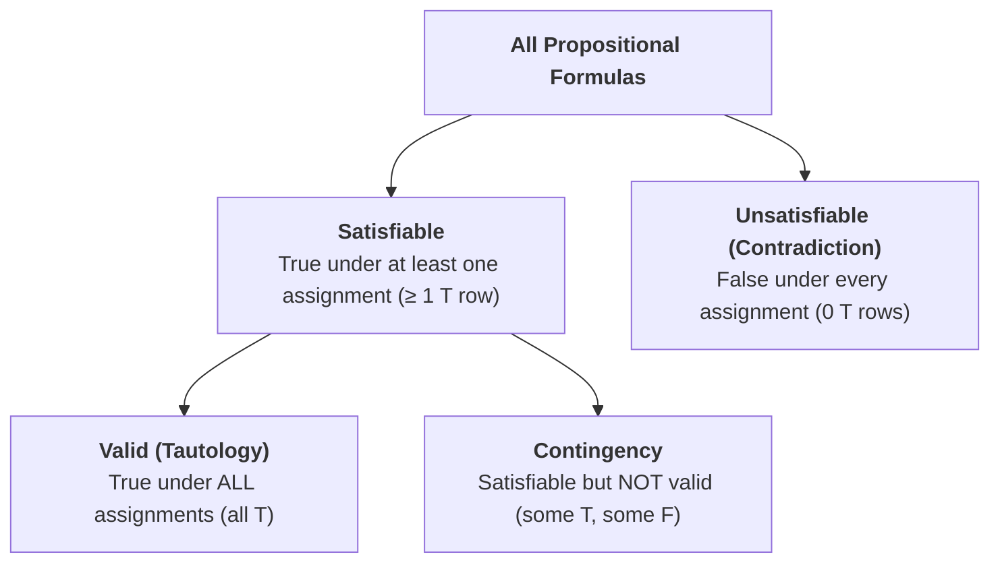

[← Previous: DM-3.3 Tautology and Contradiction](DM-3.3_Tautology_and_Contradiction.md) | [📂 Topic Overview](_Topic_Overview.md) | [🏠 Master Index](../00_Index.md) | [Next: DM-3.5 Logical Equivalence →](DM-3.5_Logical_Equivalence.md)

---

# DM-3.4: Validity and Satisfiability

> 🟠 **Priority:** Secondary | **Tested:** 2024 Q.5(b), CT-04 | **Typical marks:** 3 to 4

## What This Is (and Why It Matters)

This topic tests your ability to answer a very practical question: "Can this logical formula ever be true?" 

In computer science and digital system design, this is called the Boolean Satisfiability problem (SAT). When an examiner asks you whether a formula is valid, satisfiable, or unsatisfiable, they are checking if you understand the hierarchy between these three terms. A tautology is automatically satisfiable, but a satisfiable formula is not necessarily valid. In 2024 Q.5(b), this was tested directly on the transitivity formula $(p \to q) \land (q \to r)$.

---

## 📝 Key Definitions

> **Satisfiable:** "A compound proposition is satisfiable if there is an assignment of truth values to its variables that makes it true. When no such assignments exists, that is, when the compound proposition is false for all assignments of truth values to its variables, the compound proposition is unsatisfiable." -- Rosen, §1.3, Propositional Satisfiability (p. 32)
>
> **In simple words:** A formula is satisfiable if you can find at least one combination of inputs that makes it true. It is unsatisfiable if no input combination can ever make it true.

> **Unsatisfiable:** "When no such assignments exists, that is, when the compound proposition is false for all assignments of truth values to its variables, the compound proposition is unsatisfiable." -- Rosen, §1.3 (p. 32)
>
> **In simple words:** A formula that evaluates to false in every single row. It is another name for a contradiction.

> **Valid:** "A compound proposition that is always true is called a tautology; one that is always false is called a contradiction. A compound proposition that is sometimes true and sometimes false is called a contingency. A compound proposition is satisfiable if there is an assignment of truth values to its variables that makes it true." -- Rosen, §1.3, Key Terms (p. 33)
>
> **In simple words:** A formula that is true under every possible assignment of truth values. "Valid" is the formal logic synonym for a tautology.

---

## The Three Terms and Their Exact Relationship

When you inspect the final column of an $n$-variable truth table with $2^n$ rows, count how many $\text{T}$ entries you find:

| Count of $\text{T}$ in the Final Column | Verdict | Relationship to Other Terms |
|:---|:---|:---|
| Every single row ($2^n$ rows) | **Valid** | Automatically satisfiable (since it has at least one $\text{T}$). Synonym for tautology. |
| At least one row, but not all rows | **Satisfiable but not valid** | It can be satisfied, but it is not universally guaranteed. Synonym for contingency. |
| Zero rows (0 rows) | **Unsatisfiable** | Cannot be satisfied by any assignment. Synonym for contradiction. |

> [!WARNING] "Valid" is Stronger Than "Satisfiable"
> Notice that "valid" and "satisfiable" are not mutually exclusive opposites. Every valid formula is automatically satisfiable.
> When an exam question asks: "Determine whether the formula is valid, satisfiable, or unsatisfiable", do not just write "satisfiable" if it is actually a tautology. The complete and precise verdict is either:
> 1. "Valid (and therefore satisfiable)"
> 2. "Satisfiable but not valid"
> 3. "Unsatisfiable"

---

## What the Exam Expects You to Show

| Wording in Exam Paper | What You Must Show to Get Full Marks |
|:---|:---|
| "Is it a tautology / valid?" | Show that all $2^n$ rows evaluate to $\text{T}$. |
| "Is it satisfiable?" | Provide at least one specific assignment of truth values that yields $\text{T}$. |
| "Is it unsatisfiable?" | Show that all rows evaluate to $\text{F}$, or provide an algebraic proof deriving a contradiction. |
| "Valid, satisfiable, or unsatisfiable?" | Provide the complete truth table, state the exact row count of $\text{T}$ vs $\text{F}$, and state the explicit verdict. |

### Proving Unsatisfiability Without a Truth Table
Rosen points out that building a truth table with 10 variables requires $2^{10} = 1024$ rows. 

Instead of drawing huge tables, you can force truth values one literal at a time:
1. Assume the formula is true.
2. If it is a conjunction $A \land B$, both $A$ and $B$ must be true.
3. Chase the implied truth values through the remaining variables.
4. If this chain forces a variable to be both true and false at the same time ($p = \text{T}$ and $p = \text{F}$), you have reached a contradiction. That proves the formula is unsatisfiable.

---

## 🔧 Worked Example

> **From:** 2024 Q.5(b) -- [Marks: 03]

**The question:** Given the propositional formula $(p \to q) \land (q \to r)$, determine whether the formula is valid, satisfiable or unsatisfiable.

**Let's solve this step by step:**

The formula contains 3 propositional variables ($p, q, r$), so its truth table has $2^3 = 8$ rows.

**Step 1: Expand the conditional connectives**
Recall that $A \to B \equiv \neg A \lor B$.
$$
(p \to q) \land (q \to r) \equiv (\neg p \lor q) \land (\neg q \lor r)
$$

**Step 2: Construct the complete 8-row truth table**

| $p$ | $q$ | $r$ | $p \to q$ | $q \to r$ | $(p \to q) \land (q \to r)$ |
|:---:|:---:|:---:|:---:|:---:|:---:|
| $\text{F}$ | $\text{F}$ | $\text{F}$ | $\text{T}$ | $\text{T}$ | **T** |
| $\text{F}$ | $\text{F}$ | $\text{T}$ | $\text{T}$ | $\text{T}$ | **T** |
| $\text{F}$ | $\text{T}$ | $\text{F}$ | $\text{T}$ | $\text{F}$ | $\text{F}$ |
| $\text{F}$ | $\text{T}$ | $\text{T}$ | $\text{T}$ | $\text{T}$ | **T** |
| $\text{T}$ | $\text{F}$ | $\text{F}$ | $\text{F}$ | $\text{T}$ | $\text{F}$ |
| $\text{T}$ | $\text{F}$ | $\text{T}$ | $\text{F}$ | $\text{T}$ | $\text{F}$ |
| $\text{T}$ | $\text{T}$ | $\text{F}$ | $\text{T}$ | $\text{F}$ | $\text{F}$ |
| $\text{T}$ | $\text{T}$ | $\text{T}$ | $\text{T}$ | $\text{T}$ | **T** |

**Step 3: Analyze the final column**
- Rows 1, 2, 4, and 8 evaluate to $\text{T}$ (4 rows).
- Rows 3, 5, 6, and 7 evaluate to $\text{F}$ (4 rows).

Since there is at least one truth assignment making the formula true (e.g., $p = \text{F}, q = \text{F}, r = \text{F}$), the formula is **satisfiable**.
Since it is not true in all rows (e.g., false when $p = \text{T}, q = \text{F}$), the formula is **not valid**.

$$
\boxed{\text{Satisfiable but not valid}}
$$

---

## 🏆 Past Exam Questions

### 2024 Q.5(b): Classification of $(p \to q) \land (q \to r)$ -- [03 marks]

**Question:** Given the propositional formula $(p \to q) \land (q \to r)$, determine whether the formula is valid, satisfiable or unsatisfiable.

**Answer:**
We evaluate the truth table for the 3 propositional variables:

| $p$ | $q$ | $r$ | $p \to q$ | $q \to r$ | $(p \to q) \land (q \to r)$ |
|:---:|:---:|:---:|:---:|:---:|:---:|
| $\text{F}$ | $\text{F}$ | $\text{F}$ | $\text{T}$ | $\text{T}$ | **T** |
| $\text{F}$ | $\text{F}$ | $\text{T}$ | $\text{T}$ | $\text{T}$ | **T** |
| $\text{F}$ | $\text{T}$ | $\text{F}$ | $\text{T}$ | $\text{F}$ | $\text{F}$ |
| $\text{F}$ | $\text{T}$ | $\text{T}$ | $\text{T}$ | $\text{T}$ | **T** |
| $\text{T}$ | $\text{F}$ | $\text{F}$ | $\text{F}$ | $\text{T}$ | $\text{F}$ |
| $\text{T}$ | $\text{F}$ | $\text{T}$ | $\text{F}$ | $\text{T}$ | $\text{F}$ |
| $\text{T}$ | $\text{T}$ | $\text{F}$ | $\text{T}$ | $\text{F}$ | $\text{F}$ |
| $\text{T}$ | $\text{T}$ | $\text{T}$ | $\text{T}$ | $\text{T}$ | **T** |

**Evaluation:**
1. The formula evaluates to $\text{T}$ in four assignments: $(F,F,F)$, $(F,F,T)$, $(F,T,T)$, and $(T,T,T)$. Hence, it is **satisfiable**.
2. The formula evaluates to $\text{F}$ in the remaining four assignments (such as $p = T, q = F, r = T$). Hence, it is **not valid**.

$$
\boxed{\text{Satisfiable but not valid}}
$$

> [!NOTE] Why is this formula not valid on its own?
> The formula $(p \to q) \land (q \to r)$ represents the two premises of hypothetical syllogism. It states two separate conditions. It only becomes a valid tautology when it implies the conclusion $(p \to r)$:
> $$
> [(p \to q) \land (q \to r)] \to (p \to r)
> $$
> Without the conclusion arrow, the premise conjunction is simply contingent (satisfiable but not valid).

---

## ⚡ Quick Review

**The rule in one sentence:** Count the $\text{T}$ entries in the truth table: all rows $\text{T}$ means valid, at least one $\text{T}$ means satisfiable, and zero $\text{T}$ entries means unsatisfiable.

**The key distinction:** Every valid formula is satisfiable, but a satisfiable formula is only valid if all rows are true.

**The most common exam mistake:** Stating only "satisfiable" without clarifying "not valid". Always state both parts of the verdict clearly.

**Time estimate in exam:** 4 to 5 minutes to build the 8-row table and state the classification.

---

## 🔗 Connected Topics

- [← Previous: DM-3.3 Tautology and Contradiction](DM-3.3_Tautology_and_Contradiction.md) -- Review the definitions of tautology, contradiction, and contingency.
- [→ Next: DM-3.5 Logical Equivalence](DM-3.5_Logical_Equivalence.md) -- See how to prove two formulas are identical in all truth rows.
- [DM-3.7: System Specification](DM-3.7_System_Specification.md) -- See how satisfiability tests determine whether a system specification is consistent.

---

[← Previous: DM-3.3 Tautology and Contradiction](DM-3.3_Tautology_and_Contradiction.md) | [📂 Topic Overview](_Topic_Overview.md) | [🏠 Master Index](../00_Index.md) | [Next: DM-3.5 Logical Equivalence →](DM-3.5_Logical_Equivalence.md)
