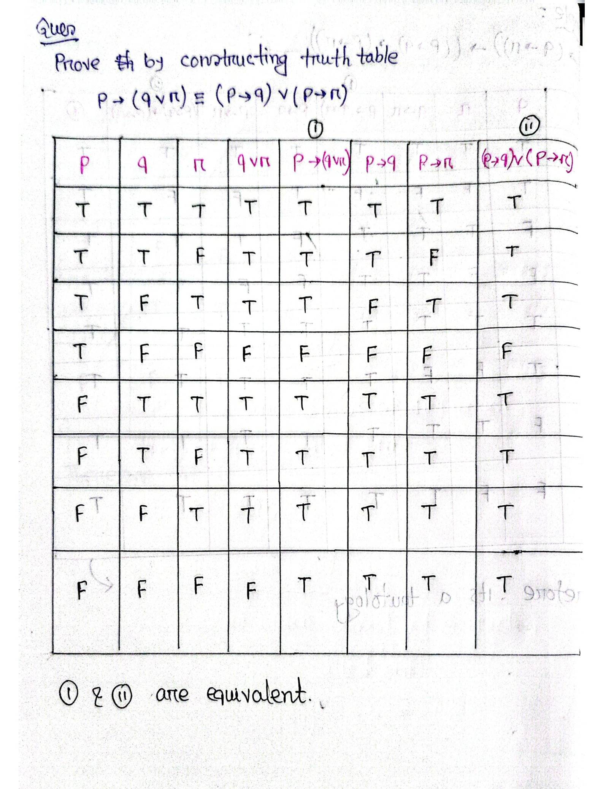

[← Previous: DM-3.7 System Specification](DM-3.7_System_Specification.md) | [📂 Topic Overview](_Topic_Overview.md) | [🏠 Master Index](../00_Index.md) | [Next: DM-3.9 Rules of Inference →](DM-3.9_Rules_of_Inference.md)

---

# DM-3.8: Normal Forms

> 🔴 **Priority:** Critical | **Tested:** 3/4 DM sources (2022, 2024, CT-04) | **Typical marks:** 4 to 6

## What This Is (and Why It Matters)

In natural language and informal math, you can write the same logical statement in hundreds of different ways. That makes automated verification and hardware synthesis extremely difficult. A normal form is a standard, canonical template into which any logical formula can be converted without changing what it means.

There are two major normal forms:
1. **Disjunctive Normal Form (DNF):** An OR of ANDs (Sum of Products). Think of it as a list of alternative scenarios that trigger an outcome.
2. **Conjunctive Normal Form (CNF):** An AND of ORs (Product of Sums). Think of it as a checklist of safety constraints that must all be satisfied.

This topic also covers **functional completeness**: identifying the bare minimum set of logical gates required to build an entire digital computer. Both concepts appeared in 2022 Q.5(c) and 2024 Q.6(b) for 6 marks.

---

## 📝 Key Definitions

> **Disjunctive Normal Form (DNF):** "A statement form that consists of a disjunction of conjunctions (a sum of products) is called Disjunctive Normal Form (DNF): $\bigvee_i \left( \bigwedge_j l_{ij} \right)$ where each $l_{ij}$ is a literal (a variable $p$ or its negation $\sim p$)." -- Shishir Notes, §7.2 (p. 54)
>
> **In simple words:** A formula built by taking groups of AND terms and joining them together with ORs. Example: $(p \land q) \lor (\neg p \land r)$.

> **Conjunctive Normal Form (CNF):** "A statement form that consists of a conjunction of disjunctions (a product of sums) is called Conjunctive Normal Form (CNF): $\bigwedge_i \left( \bigvee_j l_{ij} \right)$ where each clause is a disjunction of literals." -- Shishir Notes, §7.2 (p. 54)
>
> **In simple words:** A formula built by taking groups of OR terms (called clauses) and joining them together with ANDs. Example: $(p \lor q) \land (\neg p \lor r)$.

> **Functionally Complete:** "A collection of operators is functionally complete if every other Boolean operator can be expressed using only those operators." -- Rosen, §1.3 (p. 35)
>
> **In simple words:** A small toolbox of logical operators that is powerful enough to construct every possible truth table without needing any other operators.

> **Literal:** "A literal is a propositional variable or its negation." -- Rosen, §1.3 (p. 28)
>
> **In simple words:** A single variable in its positive form ($p$) or inverted form ($\neg p$).

---

## DNF vs CNF at a Glance

| Feature | Disjunctive Normal Form (DNF) | Conjunctive Normal Form (CNF) |
|:---|:---|:---|
| **Structure** | Disjunction of Conjunctions: $(A \land B) \lor (C \land D)$ | Conjunction of Disjunctions: $(A \lor B) \land (C \lor D)$ |
| **Algebraic Name** | Sum of Products (SOP) | Product of Sums (POS) |
| **Inner Connective** | Conjunction ($\land$, AND) | Disjunction ($\lor$, OR) |
| **Outer Connective** | Disjunction ($\lor$, OR) | Conjunction ($\land$, AND) |
| **Canonical Clauses** | Minterms (one per $\text{T}$ row of the truth table) | Maxterms (one per $\text{F}$ row of the truth table) |
| **Primary Use** | Fast hardware evaluation, PLA programming | Automated theorem provers, SAT solvers, resolution proofs |

---

## Building Canonical Normal Forms from a Truth Table

The truth table method is mechanical, foolproof, and guaranteed to yield full marks.

### 1. The Canonical DNF Recipe (Focus on $\text{T}$ Rows)
1. Find every row in the truth table where the output is **T**.
2. For each such row, write a **minterm** (conjunction) containing all variables:
   - If the variable is **T**, write it plain ($p$).
   - If the variable is **F**, write it negated ($\neg p$).
3. Join all the minterms together with **$\lor$**.

### 2. The Canonical CNF Recipe (Focus on $\text{F}$ Rows)
1. Find every row in the truth table where the output is **F**.
2. For each such row, write a **maxterm** (disjunction) containing all variables:
   - If the variable is **T**, write it negated ($\neg p$).
   - If the variable is **F**, write it plain ($p$).
   *(Notice that this rule is the exact opposite of the minterm rule!)*
3. Join all the maxterms together with **$\land$**.

---

### Step-by-Step Truth Table Illustration

Let's find the canonical DNF and canonical CNF for $(p \lor \neg q) \to (p \land q)$:

| Row | $p$ | $q$ | $\neg q$ | $p \lor \neg q$ | $p \land q$ | Output $F$ | Minterm (for $\text{T}$) | Maxterm (for $\text{F}$) |
|:---:|:---:|:---:|:---:|:---:|:---:|:---:|:---:|:---:|
| 1 | $\text{T}$ | $\text{T}$ | $\text{F}$ | $\text{T}$ | $\text{T}$ | **T** | $p \land q$ | -- |
| 2 | $\text{T}$ | $\text{F}$ | $\text{T}$ | $\text{T}$ | $\text{F}$ | **F** | -- | $\neg p \lor q$ |
| 3 | $\text{F}$ | $\text{T}$ | $\text{F}$ | $\text{F}$ | $\text{F}$ | **T** | $\neg p \land q$ | -- |
| 4 | $\text{F}$ | $\text{F}$ | $\text{T}$ | $\text{T}$ | $\text{F}$ | **F** | -- | $p \lor q$ |

- **Canonical DNF (Rows 1 and 3):**
$$
F_{\text{canonical DNF}} = (p \land q) \lor (\neg p \land q)
$$
*(Notice this simplifies to $(p \lor \neg p) \land q \equiv \mathbf{T} \land q \equiv q$)*

- **Canonical CNF (Rows 2 and 4):**
$$
F_{\text{canonical CNF}} = (\neg p \lor q) \land (p \lor q)
$$

---

## Converting to Normal Forms Algebraically

When you do not want to construct a large truth table, use algebraic equivalence laws:
1. Eliminate all arrows ($\to$ and $\leftrightarrow$) using $A \to B \equiv \neg A \lor B$.
2. Push negations inward until they apply only to single variables using De Morgan's Laws and Double Negation.
3. Apply the Distributive Laws repeatedly:
   - For CNF: Distribute $\lor$ over $\land$ using $A \lor (B \land C) \equiv (A \lor B) \land (A \lor C)$.
   - For DNF: Distribute $\land$ over $\lor$ using $A \land (B \lor C) \equiv (A \land B) \lor (A \land C)$.

---

## Functional Completeness

A set of logical operators is functionally complete if every possible truth function can be expressed using only those operators.

Since any truth table can be written in canonical DNF, the set $\{\neg, \land, \lor\}$ is universally expressive. If we can show that a smaller set can simulate all three of these primitives, that smaller set is also functionally complete.

### Proving that $\{\neg, \land\}$ is Functionally Complete

To prove that $\{\neg, \land\}$ is functionally complete, we must express $\lor$ and $\to$ using only $\neg$ and $\land$:

1. **Expressing Disjunction ($\lor$):**
   By De Morgan's Law:
$$
\neg(p \land q) \equiv \neg p \lor \neg q
$$
   Replacing $p$ with $\neg p$ and $q$ with $\neg q$:
$$
\neg(\neg p \land \neg q) \equiv \neg(\neg p) \lor \neg(\neg q) \equiv p \lor q
$$
   Therefore:
$$
p \lor q \equiv \neg(\neg p \land \neg q)
$$

2. **Expressing Implication ($\to$):**
   We know $p \to q \equiv \neg p \lor q$. Substituting our formula for disjunction:
$$
p \to q \equiv \neg(\neg(\neg p) \land \neg q)
$$

3. **Verification via Truth Table:**

| $p$ | $q$ | $\neg p$ | $\neg q$ | $p \lor q$ | $\neg(\neg p \land \neg q)$ | $p \to q$ | $\neg(\neg(\neg p) \land \neg q)$ |
|:---:|:---:|:---:|:---:|:---:|:---:|:---:|:---:|
| $\text{F}$ | $\text{F}$ | $\text{T}$ | $\text{T}$ | **F** | $\neg(\text{T} \land \text{T}) = \mathbf{F}$ | **T** | $\neg(\text{F} \land \text{T}) = \mathbf{T}$ |
| $\text{F}$ | $\text{T}$ | $\text{T}$ | $\text{F}$ | **T** | $\neg(\text{T} \land \text{F}) = \mathbf{T}$ | **T** | $\neg(\text{F} \land \text{F}) = \mathbf{T}$ |
| $\text{T}$ | $\text{F}$ | $\text{F}$ | $\text{T}$ | **T** | $\neg(\text{F} \land \text{T}) = \mathbf{T}$ | **F** | $\neg(\text{T} \land \text{T}) = \mathbf{F}$ |
| $\text{T}$ | $\text{T}$ | $\text{F}$ | $\text{F}$ | **T** | $\neg(\text{F} \land \text{F}) = \mathbf{T}$ | **T** | $\neg(\text{T} \land \text{F}) = \mathbf{T}$ |

Every constructed column matches the target column in all 4 rows.
Therefore, $\{\neg, \land\}$ is functionally complete.

$$
\boxed{p \lor q = \neg(\neg p \land \neg q), \qquad p \to q = \neg(\neg(\neg p) \land \neg q)}
$$

### Minimal Functionally Complete Sets
- Two-operator sets: $\{\neg, \land\}$ and $\{\neg, \lor\}$.
- Single-operator sets (Universal Gates):
  - **NAND Gate ($\mid$):** $p \mid q \equiv \neg(p \land q)$.
    $\neg p \equiv p \mid p$, and $p \land q \equiv (p \mid q) \mid (p \mid q)$.
  - **NOR Gate ($\downarrow$):** $p \downarrow q \equiv \neg(p \lor q)$.
    $\neg p \equiv p \downarrow p$, and $p \lor q \equiv (p \downarrow q) \downarrow (p \downarrow q)$.

---

## 🔧 Worked Example

> **From:** 2024 Q.6(b) -- [Marks: 06]

**The question:** A security system triggers an alarm if:
(a) motion is detected and the window is open, or
(b) the door sensor is active but the security code is not entered.
(i) Assign propositional variables.
(ii) Express the alarm condition as a single proposition.
(iii) Convert it into both CNF and DNF, describing each transformation step.

**Let's solve this step by step:**

### Step (i): Assign Propositional Variables
- $m$: Motion is detected
- $w$: Window is open
- $d$: Door sensor is active
- $s$: Security code is entered
- $A$: Alarm triggers

### Step (ii): Formulate the Alarm Proposition
- Condition (a): "motion is detected and window is open" $\implies m \land w$
- Condition (b): "door sensor active but security code not entered" $\implies d \land \neg s$
- The alarm triggers if either condition (a) OR condition (b) holds:
$$
A = (m \land w) \lor (d \land \neg s)
$$

---

### Step (iii-a): Convert to DNF
By definition, DNF is a disjunction of conjunctions of literals:
$$
A = (m \land w) \lor (d \land \neg s)
$$
The formulated expression is **already in minimal DNF** because it consists of two conjunctive terms joined by an $\lor$ operator.

If canonical DNF is required, expand each clause to include all 4 variables using $X \equiv X \land (Y \lor \neg Y)$:
$$
m \land w \equiv (m \land w \land d \land s) \lor (m \land w \land d \land \neg s) \lor (m \land w \land \neg d \land s) \lor (m \land w \land \neg d \land \neg s)
$$
$$
d \land \neg s \equiv (m \land w \land d \land \neg s) \lor (m \land \neg w \land d \land \neg s) \lor (\neg m \land w \land d \land \neg s) \lor (\neg m \land \neg w \land d \land \neg s)
$$
Combine and drop the duplicate term $(m \land w \land d \land \neg s)$ to obtain the 7-minterm canonical DNF.

---

### Step (iii-b): Convert to CNF
We want a conjunction of disjunctions (product of sums).
We apply the Distributive Law $X \lor (Y \land Z) \equiv (X \lor Y) \land (X \lor Z)$:

1. **Step 1 (Distribute the entire term $(m \land w)$ over $(d \land \neg s)$):**
$$
A = \big[(m \land w) \lor d\big] \land \big[(m \land w) \lor \neg s\big]
$$
2. **Step 2 (Distribute $d$ and $\neg s$ inside each bracket):**
   - First bracket: $(m \land w) \lor d \equiv (m \lor d) \land (w \lor d)$
   - Second bracket: $(m \land w) \lor \neg s \equiv (m \lor \neg s) \land (w \lor \neg s)$
3. **Step 3 (Assemble all four disjunctive clauses):**
$$
A = (m \lor d) \land (w \lor d) \land (m \lor \neg s) \land (w \lor \neg s)
$$
4. **Step 4 (Group symmetrically):**
$$
\boxed{\text{CNF: } (m \lor d)\land(m \lor \neg s)\land(w \lor d)\land(w \lor \neg s)}
$$

---

## 🏆 Past Exam Questions

### 2022 Q.5(c): Functional Completeness of $\{\neg, \land\}$ -- [02 marks]

**Question:** Show that $\neg$ and $\land$ form a functionally complete collection of logical operators.

**Answer:**
A set of operators is functionally complete if all Boolean truth functions can be expressed using only those operators. Since $\{\neg, \land, \lor\}$ is complete (any truth table can be written in DNF), we only need to express $\lor$ and $\to$ using $\neg$ and $\land$:

1. **Disjunction:** Using De Morgan's Law $\neg(p \land q) \equiv \neg p \lor \neg q$:
$$
p \lor q = \neg(\neg p \land \neg q)
$$
2. **Conditional:** Using $p \to q \equiv \neg p \lor q$:
$$
p \to q = \neg(\neg(\neg p) \land \neg q)
$$

Both constructions evaluate to the target truth values in all 4 rows of their truth tables. Therefore, $\{\neg, \land\}$ is functionally complete.

$$
\boxed{p \lor q = \neg(\neg p \land \neg q), \qquad p \to q = \neg(\neg(\neg p) \land \neg q)}
$$

---

### CT-04 Q.2(b): Rewriting Biconditional Using $\{\neg, \lor, \land\}$

**Question:** Rewrite the examination access requirement $r \leftrightarrow (p \land q)$ using only $\neg$, $\lor$, and $\land$.

**Answer:**
We expand the biconditional into two implications:
$$
r \leftrightarrow (p \land q) \equiv \big[(p \land q) \to r\big] \land \big[r \to (p \land q)\big]
$$
Apply the implication equivalence $A \to B \equiv \neg A \lor B$ to both brackets:
$$
\equiv \big[\neg(p \land q) \lor r\big] \land \big[\neg r \lor (p \land q)\big]
$$
Apply De Morgan's Law $\neg(p \land q) \equiv \neg p \lor \neg q$ to the first term:
$$
\boxed{\big[(\neg p \lor \neg q) \lor r\big] \land \big[\neg r \lor (p \land q)\big]}
$$
Removing inner grouping brackets by associativity:
$$
\boxed{\equiv (\neg p \lor \neg q \lor r) \land (\neg r \lor p \land q)}
$$

---

## ⚡ Quick Review

**DNF vs CNF in one sentence:** DNF is an OR of ANDs (built from the $\text{T}$ rows), while CNF is an AND of ORs (built from the $\text{F}$ rows).

**Minterm vs Maxterm rule:**
- Minterms: $p$ is positive for $\text{T}$, negated for $\text{F}$.
- Maxterms: $p$ is negated for $\text{T}$, positive for $\text{F}$.

**The functional completeness test:** To prove a set of operators is complete, show you can build $\neg$ and either $\land$ or $\lor$.

**Time estimate in exam:** 5 to 7 minutes for algebraic conversion to DNF/CNF with steps.

---

## 🔗 Connected Topics

- [← Previous: DM-3.7 System Specification](DM-3.7_System_Specification.md) -- Review how system requirements are translated into initial logic formulas.
- [→ Next: DM-3.9 Rules of Inference](DM-3.9_Rules_of_Inference.md) -- See how Resolution uses CNF clauses as the core of automated theorem proving.
- [DM-3.11: Logic Gates](DM-3.11_Logic_Gates.md) -- See how DNF maps directly onto AND-OR digital gate circuits.

---

[← Previous: DM-3.7 System Specification](DM-3.7_System_Specification.md) | [📂 Topic Overview](_Topic_Overview.md) | [🏠 Master Index](../00_Index.md) | [Next: DM-3.9 Rules of Inference →](DM-3.9_Rules_of_Inference.md)
