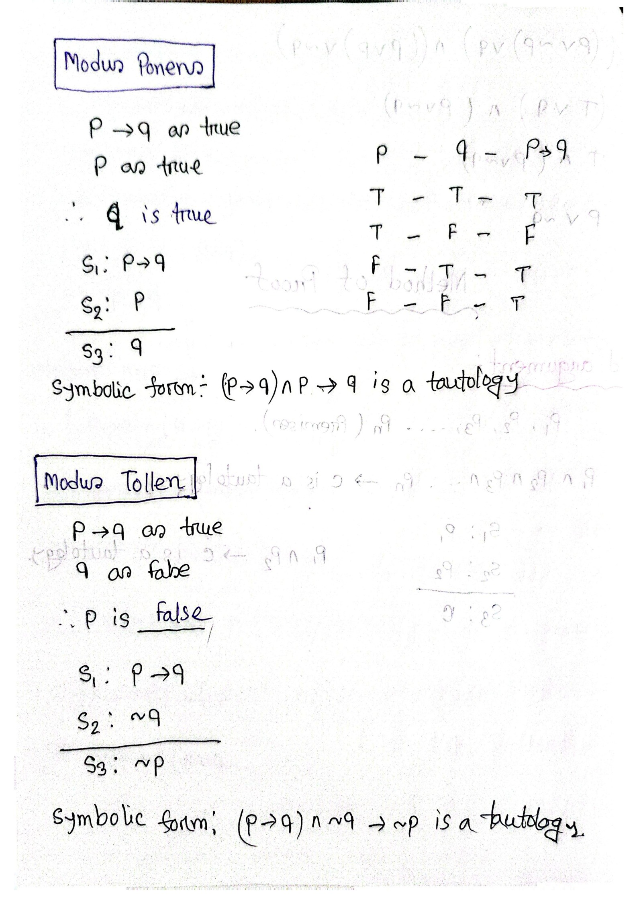

[← Previous: DM-3.8 Normal Forms](DM-3.8_Normal_Forms.md) | [📂 Topic Overview](_Topic_Overview.md) | [🏠 Master Index](../00_Index.md) | [Next: DM-3.10 Logic Puzzles →](DM-3.10_Logic_Puzzles.md)

---

# DM-3.9: Rules of Inference

> 🔴 **Priority:** Critical | **Tested:** 2/3 DM papers (2022, 2023) | **Typical marks:** 4 to 8

## What This Is (and Why It Matters)

This is the ultimate payoff of propositional logic. Why did we spend all that time building truth tables and identifying tautologies? Because every tautology in logic can be transformed into a **Rule of Inference**, and rules of inference are how we prove mathematical theorems and write automated verification algorithms.

If you have a problem with 10 variables, an exhaustive truth table would require $2^{10} = 1024$ rows. Nobody does that by hand. Instead, you use short, valid deduction steps to hop from your given premises to your desired conclusion in 6 or 8 lines. In 2023, Question 6 devoted 8 full marks to this topic: 4 marks explaining the four classical rules with truth tables, and 4 marks constructing a formal deduction proof. Master the table of rules below and you can solve these problems mechanically.

---

## 📝 Key Definitions

> **Argument:** "An argument in propositional logic is a sequence of propositions. All but the final proposition in the argument are called premises and the final proposition is called the conclusion. An argument is valid if the truth of all its premises implies that the conclusion is true." -- Rosen, §1.6, Definition 1 (p. 47)
>
> **In simple words:** A list of statements leading to a final punchline. The starting statements are called premises (givens); the final punchline is the conclusion.

> **Argument Form:** "An argument form in propositional logic is a sequence of compound propositions involving propositional variables. An argument form is valid if no matter which particular propositions are substituted for the propositional variables in its premises, the conclusion is true if the premises are all true." -- Rosen, §1.6, Definition 1 (p. 47)
>
> **In simple words:** The abstract mathematical pattern of an argument. It does not care whether you are talking about circuit voltages or weather forecasts; if the logical skeleton is valid, the conclusion is guaranteed.

> **Valid Argument Criterion:** "From the definition of a valid argument form we see that the argument form with premises $p_1, p_2, \dots, p_n$ and conclusion $q$ is valid, when $(p_1 \wedge p_2 \wedge \dots \wedge p_n) \to q$ is a tautology." -- Rosen, §1.6 (p. 47)
>
> **In simple words:** An argument is valid if whenever all premises are true, the conclusion is forced to be true. Its conditional formula is a tautology.

> **Modus Ponens:** "The tautology $(p \wedge (p \to q)) \to q$ is the basis of the rule of inference called modus ponens, or the law of detachment. (Modus ponens is Latin for mode that affirms.)" -- Rosen, §1.6 (p. 47)
>
> **In simple words:** The most fundamental deduction rule: If you know "$p$" is true, and you know "if $p$, then $q$" is true, you can immediately detach and conclude that "$q$" is true.

---

## Validity vs Truth: The Golden Distinction

> [!WARNING] A Valid Argument Does NOT Mean the Conclusion is Factually True
> Validity is strictly about the **logical connection**, not the physical facts.
> Consider this argument:
> - Premise 1: "All fish can fly." (False fact)
> - Premise 2: "A goldfish is a fish." (True fact)
> - Conclusion: "Therefore, a goldfish can fly." (False fact)
>
> This argument is **100% logically valid**! The conclusion follows properly from the premises via Modus Ponens. It is just not *sound* because Premise 1 is factually false in our universe.
> In your exam answers, always write: "The conclusion **follows validly** from the premises", rather than "the conclusion is true".

---

## Master Table of Rules of Inference

Here are the 8 fundamental inference rules. Every single one is built on a mathematical tautology:

| Rule Name | Standard Schema | Underlying Tautology | Intuitive Meaning |
|:---|:---:|:---:|:---|
| **Modus Ponens (MP)** | $\begin{array}{l} p \to q \\ p \\ \hline \therefore q \end{array}$ | $(p \land (p \to q)) \to q$ | Affirming the antecedent: if condition holds, result follows. |
| **Modus Tollens (MT)** | $\begin{array}{l} p \to q \\ \neg q \\ \hline \therefore \neg p \end{array}$ | $(\neg q \land (p \to q)) \to \neg p$ | Denying the consequent: if result failed, condition was not met. |
| **Hypothetical Syllogism (HS)** | $\begin{array}{l} p \to q \\ q \to r \\ \hline \therefore p \to r \end{array}$ | $((p \to q) \land (q \to r)) \to (p \to r)$ | Chaining / Transitivity of implication. |
| **Disjunctive Syllogism (DS)** | $\begin{array}{l} p \lor q \\ \neg p \\ \hline \therefore q \end{array}$ | $((p \lor q) \land \neg p) \to q$ | Process of elimination: one must hold; if not $p$, then $q$. |
| **Addition (Add)** | $\begin{array}{l} p \\ \hline \therefore p \lor q \end{array}$ | $p \to (p \lor q)$ | You can always weaken a known fact with an OR. |
| **Simplification (Simp)** | $\begin{array}{l} p \land q \\ \hline \therefore p \end{array}$ | $(p \land q) \to p$ | If both hold, you can pull out either one individually. |
| **Conjunction (Conj)** | $\begin{array}{l} p \\ q \\ \hline \therefore p \land q \end{array}$ | $(p \land q) \to (p \land q)$ | If you have two separate facts, you can join them with AND. |
| **Resolution (Res)** | $\begin{array}{l} p \lor q \\ \neg p \lor r \\ \hline \therefore q \lor r \end{array}$ | $((p \lor q) \land (\neg p \lor r)) \to (q \lor r)$ | The engine of automated provers: eliminates literal $p$. |

---

## The Four Classical Rules in Detail

### 1. Modus Ponens (Affirming the Antecedent)
- **Form:** $p \to q, \ p \ \therefore q$
- **Truth Table Proof:**
  Looking at the rows where both premises $p$ and $p \to q$ are true:

| $p$ | $q$ | $p \to q$ | Premises Both True? | Conclusion $q$ |
|:---:|:---:|:---:|:---:|:---:|
| $\text{F}$ | $\text{F}$ | $\text{T}$ | No ($p$ is false) | $\text{F}$ |
| $\text{F}$ | $\text{T}$ | $\text{T}$ | No ($p$ is false) | $\text{T}$ |
| $\text{T}$ | $\text{F}$ | $\text{F}$ | No ($p \to q$ is false) | $\text{F}$ |
| $\text{T}$ | $\text{T}$ | $\text{T}$ | **Yes** (Row 4) | **T** |

In the only row where both premises are true (Row 4), the conclusion $q$ is also true. Thus, the rule is valid.
- **Example:** "If the temperature exceeds $80^\circ\text{C}$, the cooling fan turns on. The temperature exceeds $80^\circ\text{C}$. Therefore, the cooling fan turns on."

---

### 2. Modus Tollens (Denying the Consequent)
- **Form:** $p \to q, \ \neg q \ \therefore \neg p$
- **Truth Table Proof:**
  Looking for rows where both premises $p \to q$ and $\neg q$ are true:

| $p$ | $q$ | $p \to q$ | $\neg q$ | Premises Both True? | Conclusion $\neg p$ |
|:---:|:---:|:---:|:---:|:---:|:---:|
| $\text{F}$ | $\text{F}$ | $\text{T}$ | $\text{T}$ | **Yes** (Row 1) | **T** |
| $\text{F}$ | $\text{T}$ | $\text{T}$ | $\text{F}$ | No | $\text{T}$ |
| $\text{T}$ | $\text{F}$ | $\text{F}$ | $\text{T}$ | No | $\text{F}$ |
| $\text{T}$ | $\text{T}$ | $\text{T}$ | $\text{F}$ | No | $\text{F}$ |

In Row 1, both premises are true, and the conclusion $\neg p$ is also true. Thus, the rule is valid.
- **Example:** "If the fuse has blown, the indicator light is off. The indicator light is not off. Therefore, the fuse has not blown."

---

### 3. Hypothetical Syllogism (Chaining)
- **Form:** $p \to q, \ q \to r \ \therefore p \to r$
- **Why it works:** It connects two links of a chain that share the common middle term $q$. Whenever $p \to q$ and $q \to r$ are both true, if $p$ is true, it forces $q$ to be true, which in turn forces $r$ to be true. Thus $p \to r$ holds.
- **Example:** "If it rains, the transmission line gets wet. If the transmission line gets wet, leakage current increases. Therefore, if it rains, leakage current increases."

---

### 4. Disjunctive Syllogism (Elimination)
- **Form:** $p \lor q, \ \neg p \ \therefore q$
- **Truth Table Proof:**

| $p$ | $q$ | $p \lor q$ | $\neg p$ | Premises Both True? | Conclusion $q$ |
|:---:|:---:|:---:|:---:|:---:|:---:|
| $\text{F}$ | $\text{F}$ | $\text{F}$ | $\text{T}$ | No | $\text{F}$ |
| $\text{F}$ | $\text{T}$ | $\text{T}$ | $\text{T}$ | **Yes** (Row 2) | **T** |
| $\text{T}$ | $\text{F}$ | $\text{T}$ | $\text{F}$ | No | $\text{F}$ |
| $\text{T}$ | $\text{T}$ | $\text{T}$ | $\text{F}$ | No | $\text{T}$ |

In Row 2, both premises are true, and conclusion $q$ is also true. Valid.
- **Example:** "The circuit breaker tripped due to overcurrent or an earth fault. It did not trip due to overcurrent. Therefore, it tripped due to an earth fault."

---

## Logical Fallacies (Invalid Forms to Avoid)

Two common argument patterns look tempting but are mathematically invalid:

| Fallacy Name | Symbolic Schema | Why It Fails (Counterexample) |
|:---|:---:|:---|
| **Fallacy of Affirming the Consequent** | $\begin{array}{l} p \to q \\ q \\ \hline \therefore p \end{array}$ | Take $p = \text{F}, q = \text{T}$. Premise $p \to q$ is true ($\text{F} \to \text{T} \equiv \text{T}$) and $q$ is true, but conclusion $p$ is false! |
| **Fallacy of Denying the Antecedent** | $\begin{array}{l} p \to q \\ \neg p \\ \hline \therefore \neg q \end{array}$ | Take $p = \text{F}, q = \text{T}$. Premise $p \to q$ is true and $\neg p$ is true ($\text{T}$), but conclusion $\neg q$ is false! |

$$
\boxed{\text{MP, MT, HS, DS are valid; affirming the consequent and denying the antecedent are not}}
$$

---

## How to Construct a Multi-Premise Formal Proof

When given a word problem asking you to prove a conclusion from several premises, follow these steps:
1. **Assign variables:** Create a dedicated table of symbols for every proposition.
2. **Translate every premise:** Watch out for "only if" ($A \to B$) and "unless" ($\neg B \to A$).
3. **Split conjunctions immediately:** If a premise is $A \land B$, use Simplification to extract $A$ and $B$ as separate working tools.
4. **Work backward from the goal:** Look at your final target letter. Ask: "Which rule can produce this letter?" Work backward to see what ingredients are needed.
5. **Write a clean 3-column derivation table:**
   - Column 1: Step number
   - Column 2: Mathematical proposition derived
   - Column 3: Rule of inference used and premise numbers cited

---

## 🔧 Worked Example

> **From:** 2023 Q.6(c) -- [Marks: 04]

**The question:** With these hypotheses:
1. "It is not sunny this afternoon and it is colder than yesterday."
2. "We will go swimming only if it is sunny."
3. "If we do not go swimming, then we will take a canoe trip."
4. "If we take a canoe trip, then we will be home by sunset."
Using the inference rules, construct a valid argument for the conclusion: "we will be home by sunset".

**Let's solve this step by step:**

### Step 1: Assign Propositional Variables
- $S$: It is sunny this afternoon
- $C$: It is colder than yesterday
- $W$: We will go swimming
- $K$: We will take a canoe trip
- $H$: We will be home by sunset

### Step 2: Translate Hypotheses
- Hypothesis 1: "not sunny and colder" $\implies \neg S \land C$
- Hypothesis 2: "swimming only if sunny" $\implies W \to S$ (Remember: arrow points toward "only if"!)
- Hypothesis 3: "if not swimming, canoe trip" $\implies \neg W \to K$
- Hypothesis 4: "if canoe trip, home by sunset" $\implies K \to H$
- Goal: Derive $H$.

### Step 3: Formal Deduction Table

| Step | Proposition | Rule Applied | Source Steps |
|:---:|:---:|:---|:---|
| 1 | $\neg S \land C$ | Premise 1 | Given |
| 2 | $\neg S$ | Simplification | Step 1 |
| 3 | $W \to S$ | Premise 2 | Given |
| 4 | $\neg W$ | Modus Tollens (MT) | Steps 3 and 2 |
| 5 | $\neg W \to K$ | Premise 3 | Given |
| 6 | $K$ | Modus Ponens (MP) | Steps 5 and 4 |
| 7 | $K \to H$ | Premise 4 | Given |
| 8 | $H$ | Modus Ponens (MP) | Steps 7 and 6 |

Therefore, the conclusion "we will be home by sunset" follows validly.

$$
\boxed{\neg S \Rightarrow \neg W \Rightarrow K \Rightarrow H, \quad \text{so } H \text{ follows validly}}
$$

> [!NOTE] Notice the Surplus Premise
> Notice that the variable $C$ ("it is colder than yesterday") was never used in the proof. That is completely normal! In engineering problems, extra background data is often supplied that is not needed for the target derivation. Do not force unnecessary variables into your proof.

---

## 🏆 Past Exam Questions

### 2023 Q.6(b): Four Classical Rules of Inference -- [04 marks]

**Question:** Briefly explain modus ponens, modus tollens, hypothetical syllogism, disjunctive syllogism with truth tables and examples.

**Answer:**
All four are elementary valid argument forms in propositional logic:

1. **Modus Ponens (MP):**
   - Schema: $p \to q, \ p \ \therefore q$
   - Form: If premise $p$ is true and implication $p \to q$ is true, conclusion $q$ follows.
   - Example: If the voltage is $220\text{V}$, the heater runs. Voltage is $220\text{V}$. Therefore, heater runs.

2. **Modus Tollens (MT):**
   - Schema: $p \to q, \ \neg q \ \therefore \neg p$
   - Form: If implication $p \to q$ is true and conclusion $q$ is false, hypothesis $p$ must be false.
   - Example: If the circuit is shorted, the fuse melts. The fuse has not melted. Therefore, the circuit is not shorted.

3. **Hypothetical Syllogism (HS):**
   - Schema: $p \to q, \ q \to r \ \therefore p \to r$
   - Form: Chains two conditional statements sharing a common middle term.
   - Example: If power fails, battery kicks in. If battery kicks in, inverter operates. Therefore, if power fails, inverter operates.

4. **Disjunctive Syllogism (DS):**
   - Schema: $p \lor q, \ \neg p \ \therefore q$
   - Form: If an alternative holds and one option is eliminated, the remaining option must hold.
   - Example: The fault is in node A or node B. It is not in node A. Therefore, it is in node B.

$$
\boxed{\text{MP, MT, HS, DS are valid; affirming the consequent and denying the antecedent are not}}
$$

---

## ⚡ Quick Review

**The deduction chain in one sentence:** Extract your known facts with Simplification, push through implications using Modus Ponens and Modus Tollens, and chain results together until you reach your goal.

**The most common exam mistake:** Reversing the arrow on "only if". "A only if B" is $A \to B$. If you write $B \to A$, your derivation breaks down at step 4.

**Time estimate in exam:** 5 to 7 minutes to write out an 8-step deduction table.

---

## 🔗 Connected Topics

- [← Previous: DM-3.8 Normal Forms](DM-3.8_Normal_Forms.md) -- Review how Resolution uses CNF clauses to perform automated deductions.
- [→ Next: DM-3.10 Logic Puzzles](DM-3.10_Logic_Puzzles.md) -- See how rules of inference solve Knights, Knaves, Spies puzzles and Lewis Carroll syllogisms.
- [DM-4.1: Formal Proofs](../DM-4_Proof_Techniques/DM-4.1_Formal_Proofs.md) -- Extend propositional deduction into formal mathematical proof methods.

---

[← Previous: DM-3.8 Normal Forms](DM-3.8_Normal_Forms.md) | [📂 Topic Overview](_Topic_Overview.md) | [🏠 Master Index](../00_Index.md) | [Next: DM-3.10 Logic Puzzles →](DM-3.10_Logic_Puzzles.md)
