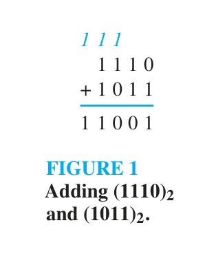

[← Previous: DM-5.7 Chinese Remainder Theorem](DM-5.7_Chinese_Remainder_Theorem.md) | [📂 Topic Overview](_Topic_Overview.md) | [🏠 Master Index](../00_Index.md) | [Next: DM-5.9 Number Proofs →](DM-5.9_Number_Proofs.md)

---

# DM-5.8: Number Bases & Binary Arithmetic

> 🟡 **Priority:** Light Review | **Tested:** 1/3 papers (2023 Q.7(b)) | **Typical marks:** 3

## What This Is (and Why It Matters)

Humans count in base 10 (decimal) because we have ten fingers. But electronic circuits count in base 2 (binary) because transistors operate most reliably in two discrete physical states: ON (logic 1, high voltage) or OFF (logic 0, low voltage).

To design digital arithmetic circuits, microprocessors, and ALUs, engineers must understand positional numeral systems and binary arithmetic inside out.

In 2023 Q.7(b), RUET asked students to add two 4-bit binary numbers: $a = (1110)_2$ and $b = (1011)_2$. This problem came directly from Rosen's textbook (Figure 1 in §4.2). The exam question tests whether you understand both the decimal positional values and the mechanical column addition with carry propagation.

---

## 📝 Key Definitions

> **Base $b$ Representation:** "Let $b$ be an integer greater than 1. Then if $n$ is a positive integer, it can be expressed uniquely in the form $n = a_k b^k + a_{k-1} b^{k-1} + \dots + a_1 b + a_0$, where $k$ is a nonnegative integer, $a_0, a_1, \dots, a_k$ are nonnegative integers less than $b$, and $a_k \neq 0$." -- Rosen, §4.2, Theorem 1
>
> **In simple words:** Any positive whole number can be written uniquely in base $b$ as a polynomial of powers of $b$, where every digit is strictly between $0$ and $b - 1$.

> **Binary Representation:** "In binary notation each digit is either a 0 or a 1. In other words, the binary expansion of an integer is just a bit string. Binary expansions are used by computers to represent and do arithmetic with integers." -- Rosen, §4.2
>
> **In simple words:** A base-2 number consisting entirely of 0s and 1s, where each position to the left doubles in weight ($1, 2, 4, 8, 16, \dots$).

> **Binary Addition Algorithm:** "where $s_0$ is the rightmost bit in the binary expansion of $a + b$ and $c_0$ is the carry, which is either 0 or 1. Then add the next pair of bits and the carry... At the last stage, add $a_{n-1}, b_{n-1},$ and $c_{n-2}$ to obtain $c_{n-1} \cdot 2 + s_{n-1}$. The leading bit of the sum is $s_n = c_{n-1}$." -- Rosen, §4.2, Algorithm 2
>
> **In simple words:** Add bits column by column from right to left. If a column sum reaches 2 or 3, write down the unit bit and carry 1 to the next column on the left.

---

## The Core Idea

### Positional Value Formula

In any base $b$, a numeral $(a_k a_{k-1} \dots a_1 a_0)_b$ represents the weighted sum:

$$
(a_k a_{k-1} \dots a_1 a_0)_b = a_k b^k + a_{k-1} b^{k-1} + \dots + a_1 b^1 + a_0 b^0
$$

#### Example: Binary to Decimal
Take the 10-bit binary number $(1\ 0101\ 1111)_2$:

$$
(1\ 0101\ 1111)_2 = 2^9 + 2^6 + 2^4 + 2^3 + 2^2 + 2^1 + 2^0
$$

$$
= 512 + 64 + 16 + 8 + 4 + 2 + 1 = 607_{10}
$$

#### Example: Decimal to Binary (Repeated Division by 2)
To convert decimal $19$ to binary, divide by 2 repeatedly and record the remainders:

| Step | Division | Quotient | Remainder ($n \bmod 2$) |
| :--: | :-- | :--: | :--: |
| 1 | $19 \div 2$ | 9 | **1** (LSB, $2^0$) |
| 2 | $9 \div 2$ | 4 | **1** ($2^1$) |
| 3 | $4 \div 2$ | 2 | **0** ($2^2$) |
| 4 | $2 \div 2$ | 1 | **0** ($2^3$) |
| 5 | $1 \div 2$ | 0 | **1** (MSB, $2^4$) |

Reading the remainders from the bottom to the top gives: $19_{10} = (10011)_2$.

---

### Column-by-Column Binary Addition with Carries

Adding two binary numbers is simple, but the **carries** require discipline:

At each column, you add the two operand bits plus any incoming carry from the previous column:

$$
\text{Total} = \text{bit}_a + \text{bit}_b + \text{carry}_{\text{in}}
$$

$$
\text{Sum bit to write} = \text{Total} \bmod 2
$$

$$
\text{Carry out to next column} = \lfloor \text{Total} / 2 \rfloor
$$

| Total sum ($a + b + \text{carry}_{\text{in}}$) | Sum bit written | Carry out | Meaning |
| :--: | :--: | :--: | :-- |
| 0 | **0** | **0** | $0 = 0 \times 2 + 0$ |
| 1 | **1** | **0** | $1 = 0 \times 2 + 1$ |
| 2 | **0** | **1** | $2 = 1 \times 2 + 0$ ($10_2$) |
| 3 | **1** | **1** | $3 = 1 \times 2 + 1$ ($11_2$) |

### The Concept of Register Overflow

Notice what happens when you add two 4-bit numbers:
- Largest 4-bit unsigned number: $(1111)_2 = 15$.
- When you add $14 + 11 = 25$, the answer exceeds $15$.
- Therefore, the sum cannot fit inside a 4-bit register. It generates a carry out into the $2^4$ bit, requiring a **5-bit register** to store $(11001)_2$.
- In digital hardware, if this 5th bit is discarded, it causes arithmetic **overflow**.

---

## 🔧 Worked Example

> **From:** 2023 Q.7(b) -- [Marks: 03]

**Question.** Add $a = (1110)_2$ and $b = (1011)_2$.

**Solution.**

**Method 1, positional value.**

$$
(1110)_2 = 1(2^3) + 1(2^2) + 1(2^1) + 0(2^0) = 8 + 4 + 2 + 0 = 14
$$

$$
(1011)_2 = 1(2^3) + 0(2^2) + 1(2^1) + 1(2^0) = 8 + 0 + 2 + 1 = 11
$$

$$
14 + 11 = 25
$$

Convert back: $25 = 16 + 8 + 1 = (11001)_2$.

**Method 2, binary addition, column by column.**

| Column | $2^4$ | $2^3$ | $2^2$ | $2^1$ | $2^0$ |
| :-- | :-: | :-: | :-: | :-: | :-: |
| **Carry row** | 1 | 1 | 1 | 0 | - |
| $a$ | 0 | 1 | 1 | 1 | 0 |
| $b$ | 0 | 1 | 0 | 1 | 1 |
| **Sum** | **1** | **1** | **0** | **0** | **1** |

Working right to left:

- $2^0$: $0 + 1 = 1$, write 1, carry 0
- $2^1$: $1 + 1 = 2$, write 0, carry 1
- $2^2$: $1 + 0 + 1 = 2$, write 0, carry 1
- $2^3$: $1 + 1 + 1 = 3$, write 1, carry 1 into $2^4$

$$
\boxed{(1110)_2 + (1011)_2 = (11001)_2 = 25_{10}}
$$

> [!NOTE] Check via decimal expansion
> $(11001)_2 = 1(2^4) + 1(2^3) + 0(2^2) + 0(2^1) + 1(2^0) = 16 + 8 + 0 + 0 + 1 = 25$ ✓  
> Both methods agree on 25. Note that $2^4$ appears, so the sum requires five bits ($14 + 11 = 25 > 15$).

---

## ⚡ Common Traps & Exam Tips

> [!WARNING] Common Trap: Forgetting the Carry Row
> The arithmetic is simple, but missing an incoming carry ruins the entire answer. Always draw the carry row explicitly above the operands, exactly as shown in the table.

> [!TIP] Show Both Methods
> To guarantee full marks on a 3-mark question, always present **Method 1 (Decimal positional values)** and **Method 2 (Column binary addition)**. Showing both proves conceptual understanding and numerical accuracy.

---

[← Previous: DM-5.7 Chinese Remainder Theorem](DM-5.7_Chinese_Remainder_Theorem.md) | [📂 Topic Overview](_Topic_Overview.md) | [🏠 Master Index](../00_Index.md) | [Next: DM-5.9 Number Proofs →](DM-5.9_Number_Proofs.md)
