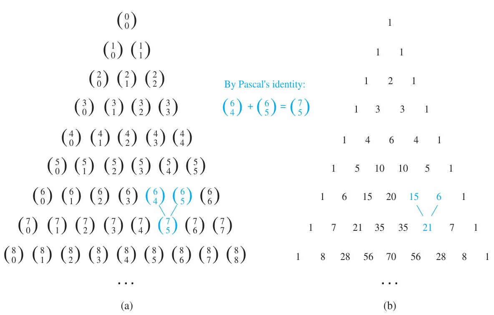

[← Previous: DM-6.5 Combinations](DM-6.5_Combinations.md) | [📂 Topic Overview](_Topic_Overview.md) | [🏠 Master Index](../00_Index.md) | [Next: DM-7.1 Algorithms and Complexity →](../DM-7_Supplementary/DM-7.1_Algorithms_and_Complexity.md)

---

# DM-6.6: Binomial Theorem

> 🟠 **Priority:** Secondary | **Tested:** 2023 Q.8(c) | **Typical marks:** 4

## What This Is (and Why It Matters)

The Binomial Theorem gives a direct formula to expand any integer power of a two-term algebraic expression $(x + y)^n$. Instead of laboriously multiplying out $n$ sets of parentheses by hand, it lets you calculate any specific term's coefficient directly using combinations $\binom{n}{r}$.

In RUET semester final examinations, this subtopic carried 4 marks in 2023 Q.8(c), making it the single largest counting question on the paper. The question requires stating the theorem accurately and extracting a massive numerical coefficient without falling into sign or exponent traps.

---

## 📝 Key Definitions

> **Binomial theorem (Theorem 1):** "Let $x$ and $y$ be variables, and let $n$ be a nonnegative integer. Then $(x + y)^n = \sum_{j=0}^n \binom{n}{j} x^{n-j}y^j$." (Rosen, §6.4, p. 31)
>
> **In simple words:** A formula that expands $(x + y)^n$ into a sum of terms where the coefficients come straight from combinations $\binom{n}{j}$.

> **Binomial coefficient:** "The number of $r$-combinations from a set with $n$ elements is often denoted by $\binom{n}{r}$. This number is also called a **binomial coefficient** because these numbers occur as coefficients in the expansion of powers of binomial expressions such as $(a + b)^n$." (Rosen, §6.4, p. 31)
>
> **In simple words:** The combination symbol $\binom{n}{r}$, named because it serves as the multiplying factor for each term in a binomial expansion.

> **Pascal's identity (Theorem 2):** "Let $n$ and $k$ be positive integers with $n \ge k$. Then $\binom{n + 1}{k} = \binom{n}{k - 1} + \binom{n}{k}$." (Rosen, §6.4, p. 34)
>
> **In simple words:** Any entry in Pascal's triangle is the sum of the two numbers directly above it in the previous row.

---

*Figure 1: Pascal's Triangle in symbolic and numerical representations. In row 7, adjacent entries $\binom{6}{4} = 15$ and $\binom{6}{5} = 6$ sum directly to $\binom{7}{5} = 21$ in row 8, demonstrating Pascal's identity. Rosen §6.4, p. 35.*

---

## The Core Idea

### The Expansion Formula

For any real numbers or variables $x$ and $y$ and any nonnegative integer $n$:

$$
(x + y)^n = \sum_{r=0}^{n}\binom{n}{r}x^{n-r}y^r
$$

Writing out all terms explicitly:

$$
(x + y)^n = \binom{n}{0}x^n + \binom{n}{1}x^{n-1}y + \binom{n}{2}x^{n-2}y^2 + \dots + \binom{n}{n-1}xy^{n-1} + \binom{n}{n}y^n
$$

### The General Term Formula

The most critical tool for exam questions is the formula for the $(r + 1)$-th term:

$$
T_{r+1} = \binom{n}{r}x^{n-r}y^r, \qquad r = 0, 1, 2, \dots, n
$$

Notice two essential mathematical properties:
1. The exponent on the first term $x$ is $n - r$.
2. The exponent on the second term $y$ is $r$.
3. **The exponents always sum to $n$:** $(n - r) + r = n$.

If the exponents of $x$ and $y$ in any question do not sum to $n$, the problem is either invalid or your choice of $r$ is incorrect.

### Why the Coefficients Are Combinations

Think of $(x + y)^n$ as $n$ identical factors multiplied together:

$$
(x + y)(x + y)(x + y)\cdots(x + y)
$$

To form a monomial containing $x^{n-r}y^r$, you must pick $y$ from exactly $r$ of the $n$ factors, and pick $x$ from the remaining $n - r$ factors. The number of different ways to choose which $r$ factors contribute $y$ is precisely $\binom{n}{r}$.

### Algebraic Proof of Pascal's Identity

Pascal's identity is frequently examined as a proof:

$$
\binom{n+1}{r} = \binom{n}{r-1} + \binom{n}{r}
$$

**Proof:**
Start with the right-hand side using factorial definitions:

$$
\binom{n}{r-1} + \binom{n}{r} = \frac{n!}{(r-1)!(n - r + 1)!} + \frac{n!}{r!(n - r)!}
$$

Find the common denominator. Notice that $r! = r(r - 1)!$ and $(n - r + 1)! = (n - r + 1)(n - r)!$. The common denominator is $r!(n - r + 1)!$:

$$
= \frac{n! \cdot r}{r!(n - r + 1)!} + \frac{n! \cdot (n - r + 1)}{r!(n - r + 1)!}
$$

Combine the numerators over the common denominator:

$$
= \frac{n! \left[ r + (n - r + 1) \right]}{r!(n - r + 1)!}
$$

Notice that $r + (n - r + 1) = n + 1$:

$$
= \frac{n!(n + 1)}{r!(n + 1 - r)!} = \frac{(n + 1)!}{r!(n + 1 - r)!} = \binom{n+1}{r}
$$

This completes the proof.

---

## Free Identities Obtained by Substitution

By substituting simple numerical values into $(x + y)^n = \sum_{r=0}^n \binom{n}{r} x^{n-r} y^r$, we obtain several famous combinatorial identities:

| Substitution | Derived Identity | Combinatorial Interpretation |
|:---|:---|:---|
| **$x = 1, y = 1$** | $\displaystyle\sum_{k=0}^n \binom{n}{k} = 2^n$ | Total number of subsets of an $n$-element set (Rosen Corollary 1, p. 33) |
| **$x = -1, y = 1$** | $\displaystyle\sum_{k=0}^n (-1)^k \binom{n}{k} = 0$ | The sum of even-index coefficients equals odd-index coefficients: each sum is $2^{n-1}$ |
| **$x = 1, y = 2$** | $\displaystyle\sum_{k=0}^n 2^k \binom{n}{k} = 3^n$ | Expansion of $(1 + 2)^n = 3^n$ (Rosen Corollary 3, p. 34) |

---

## 5-Step Procedure for Extracting Coefficients

Follow this exact procedure to avoid the common errors that cost marks:

1. **Write the expansion with substitutions on one line:**
   For $(Ax + By)^n$, write $\sum_{r=0}^n \binom{n}{r} (Ax)^{n-r} (By)^r$.
2. **Match the variable exponents:**
   Set $n - r$ equal to the requested power of $x$, and $r$ equal to the requested power of $y$.
3. **Verify the sum check:**
   Ensure $(n - r) + r = n$. If this fails, stop immediately; your $r$ is wrong.
4. **Group the constant factors:**
   Extract $\binom{n}{r} \cdot A^{n-r} \cdot B^r$.
5. **Evaluate signs and powers:**
   Ensure that negative bases raised to odd powers yield negative numbers.

---

## 🏆 Past Exam Questions

### 2023 Q.8(c): Binomial Theorem Description & Coefficient of $x^{12}y^{13}$ in $(2x - 3y)^{25}$ [04 Marks]

> **The Question:** Briefly describe the Binomial theorem, and what is the coefficient of $x^{12}y^{13}$ in the expansion of $(2x - 3y)^{25}$?

**Let's solve this step by step like a tutor:**

**Part 1: Describe the Binomial Theorem.**

For positive integers $m$ and $n$, the Binomial Theorem states that:

$$
(x + y)^n = \sum_{r=0}^{n}\binom{n}{r}x^{n-r}y^r
$$

The general term in the expansion is:

$$
T_{r+1} = \binom{n}{r}x^{n-r}y^r, \qquad r = 0, 1, \ldots, n
$$

A proof by induction on $n$: the base case $n = 1$ is immediate since $(x + y)^1 = x + y$, and the inductive step follows from Pascal's identity $\binom{n+1}{r} = \binom{n}{r} + \binom{n}{r-1}$ applied to $(x + y)^{n+1} = (x + y)^n \cdot (x + y)$.

---

**Part 2: Set up the expansion for $(2x - 3y)^{25}$.**

Substitute $x \to 2x$, $y \to -3y$, and $n = 25$ into the expansion formula:

$$
(2x - 3y)^{25} = \sum_{r=0}^{25}\binom{25}{r}(2x)^{25-r}(-3y)^r
$$

---

**Part 3: Identify the required term.**

A general term carries the monomial $x^{25-r}y^r$. We are looking for the coefficient of $x^{12}y^{13}$.
Equate the powers:

$$
25 - r = 12 \quad \text{and} \quad r = 13
$$

Both conditions yield $r = 13$.
Check the exponent sum: $12 + 13 = 25$, which matches $n = 25$ perfectly.

---

**Part 4: Extract and evaluate the coefficient.**

Substitute $r = 13$ into the general term expression:

$$
\text{term} = \binom{25}{13} (2x)^{12} (-3y)^{13} = \left[ \binom{25}{13} (2)^{12} (-3)^{13} \right] x^{12} y^{13}
$$

So the coefficient is:

$$
\text{coefficient} = \binom{25}{13}(2)^{12}(-3)^{13}
$$

Let's evaluate each factor carefully:

1. **The binomial coefficient:**
   Using the symmetry identity $\binom{n}{r} = \binom{n}{n-r}$:

   $$
   \binom{25}{13} = \binom{25}{12} = \frac{25 \cdot 24 \cdot 23 \cdot 22 \cdot 21 \cdot 20 \cdot 19 \cdot 18 \cdot 17 \cdot 16 \cdot 15 \cdot 14}{12 \cdot 11 \cdot 10 \cdot 9 \cdot 8 \cdot 7 \cdot 6 \cdot 5 \cdot 4 \cdot 3 \cdot 2 \cdot 1} = 5{,}200{,}300
   $$

2. **The power of 2:**

   $$
   2^{12} = 4096
   $$

3. **The power of $-3$:**
   Because the exponent 13 is odd, $(-3)^{13}$ is negative:

   $$
   (-3)^{13} = -(3^{13}) = -1{,}594{,}323
   $$

---

**Part 5: Compute the final product.**

Multiply the factors step by step:

$$
\text{coefficient} = 5200300 \times 4096 \times (-1594323)
$$

First multiply $5200300 \times 4096$:

$$
5200300 \times 4096 = 21{,}300{,}428{,}800
$$

Now multiply by $-1594323$:

$$
21300428800 \times (-1594323) = -33{,}959{,}763{,}545{,}702{,}400
$$

$$
\boxed{\text{coefficient of } x^{12}y^{13} = -33959763545702400}
$$

**Quick sanity checks:**
1. Direct expansion of $(2x - 3y)^{25}$ confirms that the coefficient of $x^{12}y^{13}$ is indeed $-33959763545702400$.
2. The sign must be negative because $(-3)^{13}$ has an odd exponent.
3. The magnitude has 17 digits, consistent with multiplying a 7-digit number, a 4-digit number, and a 7-digit number.

> [!WARNING] The Two Classic Traps in This Question
> 1. **The Negative Sign Trap:**
>    The base is $-3y$, and its exponent is $r = 13$. Because 13 is odd, $(-3)^{13} = -1594323$. Forgetting this negative sign turns the whole result into positive $+33959763545702400$, immediately costing 1 to 2 marks.
> 2. **The Base-Exponent Inversion Trap:**
>    The factor 2 belongs to $x$, which has exponent $25 - r = 12$. The factor $-3$ belongs to $y$, which has exponent $r = 13$. Swapping them to write $2^{13} \times (-3)^{12}$ evaluates to an entirely wrong number. Always write $(2x)^{25-r}(-3y)^r$ clearly before substituting numbers.

---

## ⚡ Quick Review

**The method in one sentence:** Write the general term $T_{r+1} = \binom{n}{r}(Ax)^{n-r}(By)^r$, match the exponents to find $r$, and evaluate the signed coefficient.

**The formulas you must memorize:**
$$
(x + y)^n = \sum_{r=0}^{n}\binom{n}{r}x^{n-r}y^r \qquad T_{r+1} = \binom{n}{r}x^{n-r}y^r
$$

**The most common exam mistake:** Forgetting the minus sign from $(-3)^{13}$, or mixing up which power goes to base 2 and which goes to base $-3$.

**Time estimate in exam:** 4 to 5 minutes for a 4-mark question.

---

## 🔗 Connected Topics

- [← Previous: DM-6.5 Combinations](DM-6.5_Combinations.md): The combination symbol $\binom{n}{r}$ provides the coefficients in the binomial expansion.
- [→ Next: DM-7.1 Algorithms and Complexity](../DM-7_Supplementary/DM-7.1_Algorithms_and_Complexity.md): Explores algorithmic analysis and time complexity.
- [DM-4.5: Mathematical Induction](../DM-4_Proof_Techniques/DM-4.5_Mathematical_Induction.md): Mathematical induction is the formal tool used to prove the Binomial Theorem for all positive integers $n$.

---

[← Previous: DM-6.5 Combinations](DM-6.5_Combinations.md) | [📂 Topic Overview](_Topic_Overview.md) | [🏠 Master Index](../00_Index.md) | [Next: DM-7.1 Algorithms and Complexity →](../DM-7_Supplementary/DM-7.1_Algorithms_and_Complexity.md)
