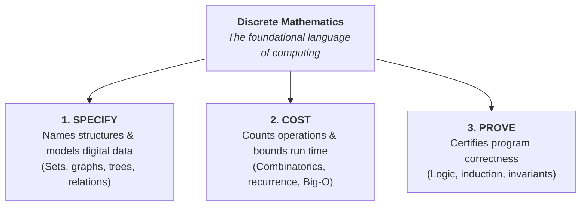

[← Previous: DM-7.1 Algorithms and Complexity](DM-7.1_Algorithms_and_Complexity.md) | [📂 Topic Overview](_Topic_Overview.md) | [🏠 Master Index](../00_Index.md) | [Next: Master Formula Sheet →](../99_Master_Formula_Sheet.md)

---

# DM-7.2: Relevance of Discrete Mathematics

> 🟡 **Priority:** Secondary | **Tested:** 1/3 DM papers (2023 Q.8(d)) | **Typical marks:** 1

## What This Is (and Why It Matters)

Students often ask: *"Why are we studying truth tables, set relations, and prime numbers in an engineering course?"*

The 2023 final examination asked this exact question in Question 8(d) for 1 mark: *"Why is discrete mathematics essential in computer science and algorithm design?"*

This is the very last question on the examination paper. It is an easy mark, but students often lose time by writing two pages of rambling essays. All you need is one tight, structured paragraph that hits the three core pillars of computing: describing data structures, proving code correctness, and calculating running costs.

---

## 📝 Key Definitions

> **Discrete Mathematics:** "Discrete mathematics is the part of mathematics devoted to the study of discrete objects." -- Rosen, §1.1 (p. 1)
>
> **In simple words:** The branch of mathematics that deals with distinct, separated items like integers, bits, graphs, and logic statements, rather than smooth continuous curves.

> **System Specification:** "Formal specifications are precise descriptions of what a system should do, written in a formal language." -- Rosen, §1.2 (p. 14)
>
> **In simple words:** Writing down software rules and hardware requirements using mathematical logic so there is zero ambiguity or confusion about what the system must do.

> **Program Correctness:** "A program is said to be correct if it produces the correct output for every possible input. A proof of program correctness consists of two parts: showing that the program terminates, and showing that the program produces the correct answer." -- Rosen, §5.5 (p. 376)
>
> **In simple words:** A rigorous mathematical demonstration showing that a piece of software will never freeze in an infinite loop and will always calculate the exact right answer for any valid input.

---

## The Core Idea

### The Essence in One Sentence

If you only remember one sentence for this topic, make it this one:

**Discrete mathematics is the language in which algorithms are specified, proved and costed.**

This single sentence summarizes the three fundamental roles discrete mathematics plays in computer science and engineering:

### The Three Core Jobs

#### 1. It Names and Models Structures
Computers store information in discrete chunks of memory. Discrete mathematics gives us the exact mathematical objects to model these structures:
- A **relational database (SQL)** is a collection of mathematical relations and sets.
- A **computer network** is a graph of nodes (routers) and edges (transmission lines).
- A **hierarchical file system** is a tree structure.
- A **digital microprocessor** is a finite state machine.

Without discrete mathematics, software engineers would have to guess how to structure data. With it, we have formal definitions with known mathematical properties.

#### 2. It Counts and Bounds Algorithmic Cost
How do you know if an algorithm is efficient? You count how many steps it takes.
- **Combinatorics** counts the possible cases, loop passes, and permutations an algorithm must handle. This turns vague intuitions like "this seems fast" into concrete bounds like $O(n \log n)$.
- **Number theory** provides the mathematical rules for modular exponentiation and prime generation, which underpin all modern cryptography (like RSA).
- The **pigeonhole principle** proves that hash table collisions are mathematically guaranteed when items exceed available slots.

#### 3. It Proves Correctness
Testing software on a few sample inputs does not prove that it will never fail.
- **Formal logic and inference rules** allow engineers to write mathematical proofs that a critical system (like flight control software or medical devices) meets its exact specifications.
- **Mathematical induction** proves that loops terminate and recursive algorithms calculate the correct output for every possible input.

Without a mathematical proof, saying code works is just an empirical claim. With a proof, it is a mathematical theorem.

### Discrete Structures in Computing

| Discrete Structure | Where It Does Real Work in Engineering |
| :-- | :-- |
| **Propositional Logic** | Digital logic circuits, Boolean gate design, hardware verification |
| **Sets and Relations** | Relational databases, equivalence partitioning, type systems |
| **Number Theory** | Cryptographic key exchange, RSA encryption, hashing functions |
| **Combinatorics & Counting** | Algorithm complexity analysis, searching, network bandwidth bounds |
| **Graph Theory & Trees** | Routing protocols, compiler syntax trees, circuit board wiring |

### Why the Word "Discrete" Matters

Digital computers do not run on real-valued continuous mathematics. They run on binary bits: $\{0, 1\}$. 

A standard integer register in computer hardware has a fixed width of 32 or 64 bits. Arithmetic on a 32-bit register is arithmetic in the finite ring $\mathbb{Z}_{2^{32}}$. Integer overflow is not a mysterious software glitch; it is an exact theorem of modular arithmetic. Calculus cannot explain bit flips or register overflow, but discrete mathematics explains them completely.

---

## 🔧 Worked Example & 🏆 Past Exam Questions

### 2023 Q.8(d): The Essential Nature of Discrete Mathematics [01 mark]

> **The Question:**  
> Why is discrete mathematics essential in computer science and algorithm design?

#### Let's solve this step by step.

This is a 1-mark question at the very end of the examination. You do not need multiple pages of examples. You need a concise, clear paragraph of three connected points: modeling structures, counting costs, and proving correctness.

#### Solution:

Discrete mathematics supplies the exact language for the structures a computer represents, so that correctness and cost can be reasoned about rather than guessed at. 

Sets, relations, graphs, logic and counting describe what is stored and how it is linked. Combinatorics counts the cases an algorithm must handle, which is what converts "this is fast" into a bound. Logic gives proof rules that certify an algorithm correct, so correctness is demonstrated rather than asserted. And the binary system is itself discrete: arithmetic on a fixed number of bits is arithmetic in a finite structure, with overflow as one of its theorems.

$$
\boxed{\text{Discrete mathematics is the language in which algorithms are specified, proved and costed}}
$$

> [!NOTE] Keep 1-Mark Answers Tight
> Do not spend more than two minutes on a 1-mark question. A single tight paragraph of three connected sentences gets full credit. Writing pages of examples wastes valuable exam time.

---

## 📊 Exam Variants at a Glance

| Year | What They Asked | Marks | Key Answer |
| :-- | :-- | :--: | :-- |
| **2023 Q.8(d)** | Why is discrete mathematics essential in computer science and algorithm design? | 01 | $\boxed{\text{Discrete mathematics is the language in which algorithms are specified, proved and costed}}$ |

---

## ⚡ Quick Review

**The topic in one sentence:** Discrete mathematics provides the theoretical foundation of computing by giving formal models for data structures, counting tools for algorithm complexity, and logic rules for correctness proofs.

**The three keywords to memorize:**
1. **Specified:** Describing data structures and system requirements formally.
2. **Proved:** Demonstrating mathematical correctness with logic and induction.
3. **Costed:** Calculating operation counts and Big-O efficiency with combinatorics.

**The most common exam mistake:** Over-writing. Spending five minutes writing a page of essays for a 1-mark question when three clear sentences earn 100% of the marks.

**Time estimate in exam:** 2 minutes.

---

## 🔗 Connected Topics

- [← DM-7.1: Algorithms and Complexity](DM-7.1_Algorithms_and_Complexity.md) -- puts these principles into action with sorting, binary search, and greedy scheduling.
- [DM-1.1: Set Operations](../DM-1_Set_Theory/DM-1.1_Set_Operations.md) -- the foundational language for data collections.
- [DM-3.9: Rules of Inference](../DM-3_Propositional_Logic/DM-3.9_Rules_of_Inference.md) -- formal logic tools used to construct correctness proofs.
- [DM-5.4: Modular Arithmetic](../DM-5_Number_Theory/DM-5.4_Modular_Arithmetic.md) -- explains how finite-width digital registers handle arithmetic and overflow.
- [DM-6.3: Pigeonhole Principle](../DM-6_Counting/DM-6.3_Pigeonhole_Principle.md) -- proves collision bounds in hash tables.
- [→ 99: Master Formula Sheet](../99_Master_Formula_Sheet.md) -- quick reference for all formulas and definitions in the course.

---

[← Previous: DM-7.1 Algorithms and Complexity](DM-7.1_Algorithms_and_Complexity.md) | [📂 Topic Overview](_Topic_Overview.md) | [🏠 Master Index](../00_Index.md) | [Next: Master Formula Sheet →](../99_Master_Formula_Sheet.md)
