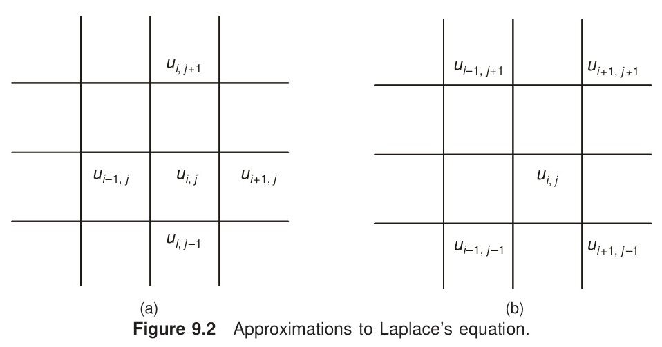

[← Previous: NM-10.1 Classification](NM-10.1_Classification.md) | [📂 Topic Overview](_Topic_Overview.md) | [🏠 Master Index](../00_Index.md) | [Next: NM-10.3 Poisson Equation →](NM-10.3_Poisson_Equation.md)

---

# NM-10.2: Laplace Equation and the Five-Point Stencil

> 🔴 **Priority:** Critical | **Tested:** 3/8 years (2018, 2019, 2020) | **Typical marks:** 6 to 8

## What This Is (and Why It Matters)

Laplace's equation, $\nabla^2 u = 0$, is the fundamental equation of physical equilibrium. It describes what happens when a system has reached steady state with no internal sources: steady heat distribution across an insulated plate, electrostatic voltage distribution in empty space, or laminar fluid flow.

When you discretize Laplace's equation on a square grid using finite differences, something beautiful happens: **every interior node is simply the exact arithmetic average of its four surrounding neighbors (left, right, top, bottom)**. 

In RUET exams, Laplace questions follow an almost identical script: you are handed a square plate with fixed boundary values on its four edges and asked to find the values at four interior nodes. If you know how to read neighbors off a grid and set up the resulting $4 \times 4$ system, this is an easy 6 to 8 marks.

---

## 📝 Key Definitions

> **Laplace's Equation:** "The equation defined by $\frac{\partial^2 u}{\partial x^2} + \frac{\partial^2 u}{\partial y^2} = 0$ is called Laplace's equation. It occurs in all problems involving potential functions and is of elliptic type." -- Jain, §9.2 (p. 344), Eq. (9.10)
>
> **In simple words:** It is the mathematical statement of perfect balance in two dimensions. It says the curvature in $x$ exactly cancels the curvature in $y$, meaning there are no local peaks or valleys inside the domain; maximums and minimums only occur on the boundaries.

> **Standard Five-Point Stencil:** "Replacing the second-order partial derivatives by their central finite-difference approximations on a square mesh of spacing $h$, Laplace's equation becomes $u_{i+1,j} + u_{i-1,j} + u_{i,j+1} + u_{i,j-1} - 4u_{i,j} = 0$, or $u_{i,j} = \frac{1}{4}(u_{i+1,j} + u_{i-1,j} + u_{i,j+1} + u_{i,j-1})$." -- Jain, §9.3 (p. 347), Eq. (9.25)
>
> **In simple words:** A cross-shaped stencil where the temperature or potential at any point is simply the average of its four immediate neighbors: East, West, North, and South.

> **Dirichlet Boundary Problem:** "Given a continuous function $f$ on the boundary $C$ of a region $R$, it is required to find a function $u(x, y)$ satisfying the Laplace equation in $R$ such that $u_{xx} + u_{yy} = 0$ in $R$, and $u = f$ on $C$." -- Jain, §9.1 (p. 343), Eq. (9.6)
>
> **In simple words:** The boundary values (voltages or temperatures) are fixed and known all along the perimeter of the plate. Your job is to calculate what happens at the points inside.

---

## The Core Idea

### Deriving the Five-Point Formula

Consider a 2D domain covered by a uniform mesh with grid spacing $\Delta x = \Delta y = h$.
Using central difference approximations for the second derivatives at an interior node $(i, j)$:

$$
\frac{\partial^2 u}{\partial x^2} \approx \frac{u_{i+1,j} - 2u_{i,j} + u_{i-1,j}}{h^2}
$$

$$
\frac{\partial^2 u}{\partial y^2} \approx \frac{u_{i,j+1} - 2u_{i,j} + u_{i,j-1}}{h^2}
$$

Substitute these into Laplace's equation $\frac{\partial^2 u}{\partial x^2} + \frac{\partial^2 u}{\partial y^2} = 0$:

$$
\frac{u_{i+1,j} - 2u_{i,j} + u_{i-1,j}}{h^2} + \frac{u_{i,j+1} - 2u_{i,j} + u_{i,j-1}}{h^2} = 0
$$

Since $h^2 \ne 0$, multiply through by $h^2$:

$$
u_{i+1,j} + u_{i-1,j} + u_{i,j+1} + u_{i,j-1} - 4u_{i,j} = 0
$$

Solving for the center node $u_{i,j}$ gives the fundamental averaging rule:

$$
u_{i,j} = \frac{1}{4}\left(u_{i+1,j} + u_{i-1,j} + u_{i,j+1} + u_{i,j-1}\right)
$$



### The Structure of the $4 \times 4$ Linear System

In RUET exams, the standard mesh has $3 \times 3$ grid squares, which leaves **4 interior nodes** arranged in a $2 \times 2$ grid:

```text
       Top Edge Boundary Values
      +----------+----------+
      |          |          |
      |   u₃     |    u₄    |   Right Edge
      |          |          |   Boundary Values
Left  +----------+----------+
Edge  |          |          |
      |   u₁     |    u₂    |
      |          |          |
      +----------+----------+
      Bottom Edge Boundary Values
```

Notice a key property of this geometry:
- Every interior node touches **two interior neighbors** and **two boundary points**.
- For example, $u_1$ has interior neighbors $u_2$ (right) and $u_3$ (top), and boundary neighbors on the left and bottom.

When you write the stencil equation $4u_{i,j} - \sum(\text{interior neighbors}) = \sum(\text{boundary neighbors})$, the resulting system of equations looks like this:

$$
\begin{bmatrix}
 4 & -1 & -1 &  0 \\
-1 &  4 &  0 & -1 \\
-1 &  0 &  4 & -1 \\
 0 & -1 & -1 &  4
\end{bmatrix}
\begin{bmatrix}
u_1 \\ u_2 \\ u_3 \\ u_4
\end{bmatrix}
=
\begin{bmatrix}
b_1 \\ b_2 \\ b_3 \\ b_4
\end{bmatrix}
$$

### Three Vital Sanity Checks That Catch Mistakes

1. **The Row Entry Check:** Each row in the matrix must have a diagonal of $+4$ and **exactly two** off-diagonal entries equal to $-1$. A zero appears only for the diagonally opposite node. If you see three $-1$s in a row, you accidentally counted a diagonal neighbor as an edge neighbor!
2. **The Global Sum Check:** Summing all four equations causes all interior couplings to cancel out symmetrically:
   $$
   2(u_1 + u_2 + u_3 + u_4) = b_1 + b_2 + b_3 + b_4
   $$
   This single equation confirms whether your right-hand side vector is consistent.
3. **Strict Diagonal Dominance:** In each row, the diagonal magnitude is $|4|$, and the sum of the absolute off-diagonal entries is $|-1| + |-1| = 2$. Since $4 > 2$, the matrix is **strictly diagonally dominant**. This guarantees that Gaussian elimination is numerically stable and iterative methods (Gauss-Seidel / Liebmann) are guaranteed to converge from any starting guess.

---

## 🔧 Worked Example (PYQ 2019)

### 2019 Q.8(b): Laplace on a Square Mesh -- [08 marks]

**The question:** Solve the Laplace's equation for the square region shown in the following figure, the boundary values being indicated in the figure.

```text
                 Y
                 |       1       2       B
              C  +-------+-------+-------+
                 |       |       |       |
                 |       |  u₃   |  u₄   |
                 |       |       |       |
              1  +-------+-------+-------+  4
                 |       |       |       |
                 |       |  u₁   |  u₂   |
                 |       |       |       |
              2  +-------+-------+-------+  5
                 |       |       |       |
                 |       |       |       |
                 +-------+-------+-------+---------> X
                 0       4       5       A
```

**Let's solve this step by step.**

#### Step 1: Write the Four Nodal Stencil Equations
For each interior node, read its four neighbors from the diagram in order (Left, Right, Top, Bottom):

At Node 1 ($u_1$):
- Left neighbor = $2$, Right neighbor = $u_2$, Top neighbor = $u_3$, Bottom neighbor = $4$.
$$
u_1 = \frac{1}{4}(2 + u_2 + u_3 + 4) = \frac{1}{4}(u_2 + u_3 + 6)
$$
$$
4u_1 - u_2 - u_3 = 6 \tag{1}
$$

At Node 2 ($u_2$):
- Left neighbor = $u_1$, Right neighbor = $5$, Top neighbor = $u_4$, Bottom neighbor = $5$.
$$
u_2 = \frac{1}{4}(u_1 + 5 + u_4 + 5) = \frac{1}{4}(u_1 + u_4 + 10)
$$
$$
-u_1 + 4u_2 - u_4 = 10 \tag{2}
$$

At Node 3 ($u_3$):
- Left neighbor = $1$, Right neighbor = $u_4$, Top neighbor = $1$, Bottom neighbor = $u_1$.
$$
u_3 = \frac{1}{4}(1 + u_4 + 1 + u_1) = \frac{1}{4}(u_1 + u_4 + 2)
$$
$$
-u_1 + 4u_3 - u_4 = 2 \tag{3}
$$

At Node 4 ($u_4$):
- Left neighbor = $u_3$, Right neighbor = $4$, Top neighbor = $2$, Bottom neighbor = $u_2$.
$$
u_4 = \frac{1}{4}(u_3 + 4 + 2 + u_2) = \frac{1}{4}(u_2 + u_3 + 6)
$$
$$
-u_2 - u_3 + 4u_4 = 6 \tag{4}
$$

Notice immediately from equations (1) and (4) that $4u_1 = u_2 + u_3 + 6$ and $4u_4 = u_2 + u_3 + 6$. Therefore, by symmetry, $u_1 = u_4$!

#### Step 2: Form the Matrix System

$$
\begin{bmatrix}
 4 & -1 & -1 &  0 \\
-1 &  4 &  0 & -1 \\
-1 &  0 &  4 & -1 \\
 0 & -1 & -1 &  4
\end{bmatrix}
\begin{bmatrix}
u_1 \\ u_2 \\ u_3 \\ u_4
\end{bmatrix}
=
\begin{bmatrix}
6 \\ 10 \\ 2 \\ 6
\end{bmatrix}
$$

#### Step 3: Solve by Algebraic Elimination
Let us solve this cleanly by hand:
1. **Subtract Eq (2) from Eq (3):**
   $$
   (-u_1 + 4u_3 - u_4) - (-u_1 + 4u_2 - u_4) = 2 - 10
   $$
   $$
   4u_3 - 4u_2 = -8 \implies u_3 = u_2 - 2
   $$

2. **Add all four equations together:**
   $$
   2(u_1 + u_2 + u_3 + u_4) = 6 + 10 + 2 + 6 = 24
   $$
   $$
   u_1 + u_2 + u_3 + u_4 = 12
   $$

3. **Substitute $u_4 = u_1$ and $u_3 = u_2 - 2$ into the sum:**
   $$
   u_1 + u_2 + (u_2 - 2) + u_1 = 12
   $$
   $$
   2u_1 + 2u_2 - 2 = 12 \implies 2u_1 + 2u_2 = 14 \implies u_1 + u_2 = 7 \implies u_1 = 7 - u_2
   $$

4. **Plug $u_1 = 7 - u_2$, $u_4 = u_1 = 7 - u_2$ into Eq (2):**
   $$
   -(7 - u_2) + 4u_2 - (7 - u_2) = 10
   $$
   $$
   -14 + 6u_2 = 10 \implies 6u_2 = 24 \implies u_2 = 4
   $$

5. **Back-substitute to find the remaining values:**
   - $u_3 = u_2 - 2 = 4 - 2 = 2$
   - $u_1 = 7 - u_2 = 7 - 4 = 3$
   - $u_4 = u_1 = 3$

$$
\boxed{u_1 = 3, \qquad u_2 = 4, \qquad u_3 = 2, \qquad u_4 = 3}
$$

#### Step 4: Quick Sanity Check
Check the stencil at each point:
- At $u_1$: $\frac{1}{4}(2 + 4 + 2 + 4) = \frac{12}{4} = 3$ (Matches!).
- At $u_2$: $\frac{1}{4}(3 + 5 + 3 + 5) = \frac{16}{4} = 4$ (Matches!).
- At $u_3$: $\frac{1}{4}(1 + 3 + 1 + 3) = \frac{8}{4} = 2$ (Matches!).
- At $u_4$: $\frac{1}{4}(2 + 4 + 2 + 4) = \frac{12}{4} = 3$ (Matches!).

---

## 🏆 Past Exam Questions

### 2018 Q.8(a): Potential Distribution by Liebmann's Method -- [06 marks]

**Question:** Find the potential distribution at the interior nodes using Leibmann's method.

The mesh is a $3 \times 3$ grid over a square region with uniform spacing $h$, four interior nodes $1$ to $4$, and Dirichlet boundaries:
- Top edge: $V = 100\text{ V}$
- Bottom edge: $V = 0\text{ V}$
- Left edge: $V = 75\text{ V}$
- Right edge: $V = 50\text{ V}$

```text
              Insulating Gap            V = 100 V           Insulating Gap
                            \                                /
                   (0,3)   +-----------+-----------+-------+   (3,3)
                           |           |           |       |
                           |    ①     |     ②     |       |
                   (0,2)   +-----------+-----------+-------+   (3,2)
                           |  (Node 1) | (Node 2)  |       |
             V = 75 V      |           |           |       |   V = 50 V
                   (0,1)   +-----------+-----------+-------+   (3,1)
                           |    ③     |     ④     |       |
                           |  (Node 3) | (Node 4)  |       |
                   (0,0)   +-----------+-----------+-------+   (3,0)
                            /                                \
              Insulating Gap             V = 0 V             Insulating Gap
```

**Let's solve this step by step.**

#### Step 1: Write the Stencil Equations
Reading the four neighbors for each interior node:

$$
V_1 = \frac{1}{4}(75 + V_2 + 100 + V_3) = \frac{175 + V_2 + V_3}{4}
$$

$$
V_2 = \frac{1}{4}(V_1 + 50 + 100 + V_4) = \frac{150 + V_1 + V_4}{4}
$$

$$
V_3 = \frac{1}{4}(75 + V_4 + V_1 + 0) = \frac{75 + V_1 + V_4}{4}
$$

$$
V_4 = \frac{1}{4}(V_3 + 50 + V_2 + 0) = \frac{50 + V_2 + V_3}{4}
$$

Expressed as a linear system:

$$
\begin{bmatrix}
 4 & -1 & -1 &  0 \\
-1 &  4 &  0 & -1 \\
-1 &  0 &  4 & -1 \\
 0 & -1 & -1 &  4
\end{bmatrix}
\begin{bmatrix}
V_1 \\ V_2 \\ V_3 \\ V_4
\end{bmatrix}
=
\begin{bmatrix}
175 \\ 150 \\ 75 \\ 50
\end{bmatrix}
$$

#### Step 2: Perform Liebmann Iterations (Gauss-Seidel)
We start with initial guesses $V_1^{(0)} = V_2^{(0)} = V_3^{(0)} = V_4^{(0)} = 0$.
In Liebmann's method, as soon as a new value is computed, we plug it into the next equation immediately:

**Sweep 1:**
- $V_1^{(1)} = \frac{175 + 0 + 0}{4} = 43.750000$
- $V_2^{(1)} = \frac{150 + 43.750000 + 0}{4} = 48.437500$
- $V_3^{(1)} = \frac{75 + 43.750000 + 0}{4} = 29.687500$
- $V_4^{(1)} = \frac{50 + 48.437500 + 29.687500}{4} = 32.031250$

Continuing this systematic sweep gives the iteration progress:

| Sweep | $V_1$ | $V_2$ | $V_3$ | $V_4$ |
| :--: | :-- | :-- | :-- | :-- |
| 1 | 43.750000 | 48.437500 | 29.687500 | 32.031250 |
| 2 | 63.281250 | 61.328125 | 42.578125 | 38.476563 |
| 3 | 69.726563 | 64.550781 | 45.800781 | 40.087891 |
| 4 | 71.337891 | 65.356445 | 46.606445 | 40.490723 |
| 5 | 71.740723 | 65.557861 | 46.807861 | 40.591431 |
| 6 | 71.841431 | 65.608215 | 46.858215 | 40.616608 |

#### Step 3: Exact Solution of the System
Solving the system directly by Gaussian elimination yields exact rational values:

$$
V_1 = \frac{575}{8} = 71.875, \qquad V_2 = \frac{525}{8} = 65.625
$$

$$
V_3 = \frac{375}{8} = 46.875, \qquad V_4 = \frac{325}{8} = 40.625
$$

$$
\boxed{V_1 = 71.875\ \text{V}, \quad V_2 = 65.625\ \text{V}, \quad V_3 = 46.875\ \text{V}, \quad V_4 = 40.625\ \text{V}}
$$

Notice that all values are exact eighths ($0.125, 0.625, 0.875$). This occurs because the boundary conditions are multiples of 25, and dividing by powers of 4 repeatedly preserves tidy binary denominators.

---

### 2020 Q.8(b): Laplace Potential on Grid with Top Boundary 1 -- [06 marks]

**Question:** Solve the equation $\frac{\partial^2 E(x,y)}{\partial x^2} + \frac{\partial^2 E(x,y)}{\partial y^2} = 0$ in the domain of the following figure by Liebmann method. Consider, $\Delta x = \Delta y$.


```text
             1        1        1
        +--------+--------+--------+
        |        |        |        |
     0  |   E4   |   E3   |        |  0
        |        |        |        |
        +--------+--------+--------+
        |        |        |        |
     0  |   E1   |   E2   |        |  0
        |        |        |        |
        +--------+--------+--------+
             0        0        0
```

> [!WARNING] The Critical Exam Trap: Node Labelling
> In the printed exam figure for 2020 Q.8(b), notice where the nodes sit!
> - $E_4$ and $E_3$ are on the **upper row** (touching the top boundary with value 1).
> - $E_1$ and $E_2$ are on the **lower row** (touching the bottom boundary with value 0).
> If you reflexively label $E_1, E_2$ at the top, you will put the boundary $+1$ into the wrong equations and lose almost all marks!

**Let's solve this step by step.**

#### Step 1: Write the Stencil Equations
Reading neighbors from the figure:
- Node $E_1$: neighbors are $0$ (left), $E_2$ (right), $E_4$ (top), $0$ (bottom).
  $$
  E_1 = \frac{E_2 + E_4}{4}
  $$
- Node $E_2$: neighbors are $E_1$ (left), $0$ (right), $E_3$ (top), $0$ (bottom).
  $$
  E_2 = \frac{E_1 + E_3}{4}
  $$
- Node $E_3$: neighbors are $E_4$ (left), $0$ (right), $1$ (top), $E_2$ (bottom).
  $$
  E_3 = \frac{E_4 + E_2 + 1}{4}
  $$
- Node $E_4$: neighbors are $0$ (left), $E_3$ (right), $1$ (top), $E_1$ (bottom).
  $$
  E_4 = \frac{E_3 + E_1 + 1}{4}
  $$

#### Step 2: Liebmann Iteration Table
Updating in the order $E_1 \to E_2 \to E_3 \to E_4$ from an initial zero state:

| $k$ | $E_1$ | $E_2$ | $E_3$ | $E_4$ |
| --: | --: | --: | --: | --: |
| 0 | 0.000000 | 0.000000 | 0.000000 | 0.000000 |
| 1 | 0.000000 | 0.000000 | 0.250000 | 0.312500 |
| 2 | 0.078125 | 0.082031 | 0.348633 | 0.356689 |
| 3 | 0.109680 | 0.114578 | 0.367817 | 0.369374 |
| 4 | 0.120988 | 0.122201 | 0.372894 | 0.373471 |
| 5 | 0.123918 | 0.124203 | 0.374418 | 0.374584 |
| 6 | 0.124697 | 0.124779 | 0.374841 | 0.374884 |
| 7 | 0.124916 | 0.124939 | 0.374956 | 0.374968 |
| 8 | 0.124977 | 0.124983 | 0.374988 | 0.374991 |
| 9 | 0.124994 | 0.124995 | 0.374997 | 0.374998 |
| 10 | 0.124998 | 0.124999 | 0.374999 | 0.374999 |

By iteration 8, four decimal places have converged. By iteration 10, the numbers settle precisely on the exact analytical fractions:

$$
E_1 = \frac{1}{8} = 0.125, \quad E_2 = \frac{1}{8} = 0.125, \quad E_3 = \frac{3}{8} = 0.375, \quad E_4 = \frac{3}{8} = 0.375
$$

$$
\boxed{E_1 = 0.125, \qquad E_2 = 0.125, \qquad E_3 = 0.375, \qquad E_4 = 0.375}
$$

#### Physical Symmetry Check
The boundary condition on the top row is symmetric ($1$ across the entire top edge), and the left, right, and bottom edges are all $0$.
Therefore, the physical system possesses left-right reflection symmetry:
- $E_1$ must equal $E_2$. Both equal $0.125$.
- $E_4$ must equal $E_3$. Both equal $0.375$.
Also, the upper row sits directly adjacent to the high-voltage ($1\text{ V}$) edge, so $E_3, E_4 > E_1, E_2$. The physics matches the math completely.

---

### Exam Variants at a Glance

| Year | What They Asked | Mesh Specifics | Key Answer |
| :--- | :--- | :--- | :--- |
| **2018 Q.8(a)** | Potential by Liebmann | Top 100 V, Bottom 0 V, Left 75 V, Right 50 V | $\boxed{V_1 = 71.875\ \text{V}, \quad V_2 = 65.625\ \text{V}, \quad V_3 = 46.875\ \text{V}, \quad V_4 = 40.625\ \text{V}}$ |
| **2019 Q.8(b)** | Laplace on square mesh | Integer boundaries (1, 2, 4, 5) | $\boxed{u_1 = 3, \qquad u_2 = 4, \qquad u_3 = 2, \qquad u_4 = 3}$ |
| **2020 Q.8(b)** | Laplace potential by Liebmann | Top edge 1, other edges 0 | $\boxed{E_1 = 0.125, \qquad E_2 = 0.125, \qquad E_3 = 0.375, \qquad E_4 = 0.375}$ |

---

## ⚡ Quick Review

**The method in one sentence:** Every interior node in a Laplace grid is replaced by the arithmetic mean of its four nearest neighbors.

**The formula you must memorize:**
$$
u_{i,j} = \frac{1}{4}\left(u_{i+1,j} + u_{i-1,j} + u_{i,j+1} + u_{i,j-1}\right)
$$

**The most common exam mistakes:**
1. Swapping node indices (especially in 2020 where $E_4, E_3$ are at the top).
2. Forgetting that each equation has only **two** interior neighbors and **two** boundary neighbors.
3. Adding diagonal nodes into the stencil (only North, South, East, West enter the five-point stencil).

**Time estimate in exam:** 12 to 15 minutes for complete equation setup and solving.

---

## 🔗 Connected Topics

- [← NM-10.1: Classification](NM-10.1_Classification.md) -- Laplace equation is the prototypical elliptic PDE.
- [→ NM-10.3: Poisson Equation](NM-10.3_Poisson_Equation.md) -- Laplace equation with internal heat generation or charge sources.
- [NM-10.4: Liebmann's Method](NM-10.4_Liebmanns_Method.md) -- detailed theory of Gauss-Seidel sweeps and convergence rates on PDE grids.
- [NM-3.5: Gauss-Seidel Iteration](../NM-3_Linear_Systems/NM-3.5_Gauss_Seidel.md) -- the algebraic foundation of Liebmann's method.

---

[← Previous: NM-10.1 Classification](NM-10.1_Classification.md) | [📂 Topic Overview](_Topic_Overview.md) | [🏠 Master Index](../00_Index.md) | [Next: NM-10.3 Poisson Equation →](NM-10.3_Poisson_Equation.md)
