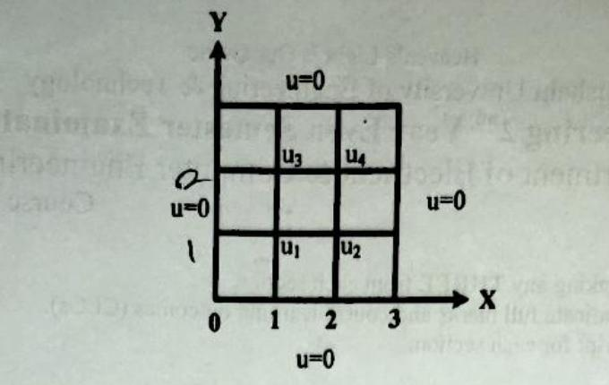

[← Previous: NM-10.2 Laplace Equation](NM-10.2_Laplace_Equation.md) | [📂 Topic Overview](_Topic_Overview.md) | [🏠 Master Index](../00_Index.md) | [Next: NM-10.4 Liebmann's Method →](NM-10.4_Liebmanns_Method.md)

---

# NM-10.3: Poisson Equation

> 🟠 **Priority:** Secondary | **Tested:** 2021 Q.6(c) | **Typical marks:** 6

## What This Is (and Why It Matters)

In the previous subtopic, we studied Laplace's equation ($\nabla^2 u = 0$), where the physical domain has no internal sources. But what happens if heat is continuously generated inside a material (like Joule heating in a resistive wire), or if electrical charge is distributed throughout space (like free electron clouds inside a diode)?

That brings us to **Poisson's equation**:

$$
\nabla^2 u = -f(x,y) \quad \text{or} \quad \frac{\partial^2 u}{\partial x^2} + \frac{\partial^2 u}{\partial y^2} = g(x,y)
$$

The mathematical machinery is almost identical to Laplace's equation. You still draw a square mesh, you still use the central difference five-point stencil, and the interior coupling matrix still has the same shape. The only difference is that the right-hand side is no longer zero: it absorbs the source evaluated at each node multiplied by $h^2$.

---

## 📝 Key Definitions

> **Poisson's Equation:** "The inhomogeneous elliptic partial differential equation $\nabla^2 u = \frac{\partial^2 u}{\partial x^2} + \frac{\partial^2 u}{\partial y^2} = -f(x,y)$ is called Poisson's equation. When $f(x,y) = 0$, it reduces to Laplace's equation." -- Jain, §9.1 & §9.4 (p. 343, 354)
>
> **In simple words:** It is Laplace's equation with an active source inside the region, such as internal heat generation or electric charge density.

> **Source Term in Discretization:** "In finite-difference form on a mesh with spacing $h$, the Poisson equation $u_{xx} + u_{yy} = g(x,y)$ becomes $u_{i+1,j} + u_{i-1,j} + u_{i,j+1} + u_{i,j-1} - 4u_{i,j} = h^2 g(x_i, y_j)$." -- Jain, §9.4 (p. 354)
>
> **In simple words:** The sum of the four neighbors minus four times the center node does not equal zero anymore; it equals the mesh area factor $h^2$ times the strength of the source at that specific point.

---

## The Core Idea

### The Discretized Poisson Stencil

Starting from the 2D Poisson equation:

$$
\frac{\partial^2 u}{\partial x^2} + \frac{\partial^2 u}{\partial y^2} = g(x,y)
$$

Replace both second-order derivatives with central differences on a square mesh with $\Delta x = \Delta y = h$:

$$
\frac{u_{i+1,j} - 2u_{i,j} + u_{i-1,j}}{h^2} + \frac{u_{i,j+1} - 2u_{i,j} + u_{i,j-1}}{h^2} = g(x_i, y_j)
$$

Multiply both sides by $h^2$:

$$
u_{i+1,j} + u_{i-1,j} + u_{i,j+1} + u_{i,j-1} - 4u_{i,j} = h^2 g(x_i, y_j)
$$

### The Two Ways to Write the Matrix

Depending on how you prefer to set up your linear system, you can arrange this equation in two ways:

1. **Keeping the stencil on the left (Negative Diagonal Form):**
   $$
   -4u_{i,j} + u_{i+1,j} + u_{i-1,j} + u_{i,j+1} + u_{i,j-1} = h^2 g(x_i, y_j) - \sum(\text{known boundary neighbors})
   $$
   Here the matrix diagonal is $-4$, the off-diagonals are $+1$, and the right-hand side keeps the exact sign of $h^2 g(x_i, y_j)$. This is the form standardly printed in RUET exam solutions.

2. **Moving neighbors to the right (Averaging Form):**
   $$
   u_{i,j} = \frac{1}{4}\left[u_{i+1,j} + u_{i-1,j} + u_{i,j+1} + u_{i,j-1} - h^2 g(x_i, y_j)\right]
   $$
   This is the form you use if you are running iterative sweeps (Liebmann's method).

### Physical Intuition on Signs

When the source term on the right-hand side is negative, such as $g(x,y) = -10(x^2 + y^2 + 10)$, and the boundary conditions are zero ($u = 0$), what sign should the solution values have?
- Think of a stretched rubber sheet tied down to zero on the edges.
- A negative source term acting as a downward load causes the function $u$ to bulge upward into positive values (because $\nabla^2 u < 0$ means negative second derivative, which corresponds to concave downward curvature like a hill).
- Therefore, the solution inside must be **positive everywhere**. If you get negative numbers, you dropped a minus sign!

---

## 🔧 Worked Example (PYQ 2021)

### 2021 Q.6(c): Poisson Equation on a Square Domain -- [06 marks]

**The question:** Solve the Poisson equation $U_{xx} + U_{yy} = -10(x^2 + y^2 + 10)$ in the domain of the given figure.

**Let's solve this step by step.**

#### Step 1: Identify Grid Dimensions and Interior Nodes
From the figure:
- Domain: $0 \le x \le 3$, $0 \le y \le 3$.
- Step sizes: $h = k = 1$.
- Boundary conditions: $u = 0$ on all four sides ($x = 0$, $x = 3$, $y = 0$, $y = 3$).
- The four interior nodes are:
  - $u_1$ at $(x, y) = (1, 1)$
  - $u_2$ at $(x, y) = (2, 1)$
  - $u_3$ at $(x, y) = (1, 2)$
  - $u_4$ at $(x, y) = (2, 2)$

#### Step 2: Evaluate the Source Function at Each Node
The governing equation has $h = 1$ and source $g(x,y) = -10(x^2 + y^2 + 10)$:

- At node $u_1(1, 1)$:
  $$
  g(1, 1) = -10(1^2 + 1^2 + 10) = -10(12) = -120
  $$

- At node $u_2(2, 1)$:
  $$
  g(2, 1) = -10(2^2 + 1^2 + 10) = -10(15) = -150
  $$

- At node $u_3(1, 2)$:
  $$
  g(1, 2) = -10(1^2 + 2^2 + 10) = -10(15) = -150
  $$

- At node $u_4(2, 2)$:
  $$
  g(2, 2) = -10(2^2 + 2^2 + 10) = -10(18) = -180
  $$

#### Step 3: Write the Five-Point Equation at Each Interior Node
All boundary values are zero, so any neighbor touching the boundary contributes $0$:

- **At node $u_1(1, 1)$:**
  Neighbors are $u_2$ (right), $0$ (left), $u_3$ (top), $0$ (bottom).
  $$
  u_2 + 0 + u_3 + 0 - 4u_1 = -120 \implies -4u_1 + u_2 + u_3 = -120 \tag{1}
  $$

- **At node $u_2(2, 1)$:**
  Neighbors are $0$ (right), $u_1$ (left), $u_4$ (top), $0$ (bottom).
  $$
  0 + u_1 + u_4 + 0 - 4u_2 = -150 \implies u_1 - 4u_2 + u_4 = -150 \tag{2}
  $$

- **At node $u_3(1, 2)$:**
  Neighbors are $u_4$ (right), $0$ (left), $0$ (top), $u_1$ (bottom).
  $$
  u_4 + 0 + 0 + u_1 - 4u_3 = -150 \implies u_1 - 4u_3 + u_4 = -150 \tag{3}
  $$

- **At node $u_4(2, 2)$:**
  Neighbors are $0$ (right), $u_3$ (left), $0$ (top), $u_2$ (bottom).
  $$
  0 + u_3 + 0 + u_2 - 4u_4 = -180 \implies u_2 + u_3 - 4u_4 = -180 \tag{4}
  $$

#### Step 4: The Resulting $4 \times 4$ Linear System

$$
\begin{bmatrix}
-4 &  1 &  1 &  0 \\
 1 & -4 &  0 &  1 \\
 1 &  0 & -4 &  1 \\
 0 &  1 &  1 & -4
\end{bmatrix}
\begin{bmatrix}
u_1 \\ u_2 \\ u_3 \\ u_4
\end{bmatrix}
=
\begin{bmatrix}
-120 \\
-150 \\
-150 \\
-180
\end{bmatrix}
$$

#### Step 5: Exploit Diagonal Symmetry to Solve Cleanly
Look at equations (2) and (3):
$$
u_1 - 4u_2 + u_4 = -150
$$
$$
u_1 - 4u_3 + u_4 = -150
$$
Subtracting them gives $-4u_2 + 4u_3 = 0 \implies u_2 = u_3$.
This makes complete physical sense: the domain is symmetric about the diagonal $y = x$, and the source $-10(x^2 + y^2 + 10)$ is unchanged if you swap $x$ and $y$.

Let $u_2 = u_3 = w$. Our four equations collapse to three:

$$
\begin{cases}
-4u_1 + 2w = -120 & \implies 4u_1 = 2w + 120 \implies u_1 = \frac{w}{2} + 30 \\
2w - 4u_4 = -180 & \implies 4u_4 = 2w + 180 \implies u_4 = \frac{w}{2} + 45 \\
u_1 - 4w + u_4 = -150
\end{cases}
$$

Now substitute $u_1$ and $u_4$ into the middle equation:

$$
\left(\frac{w}{2} + 30\right) - 4w + \left(\frac{w}{2} + 45\right) = -150
$$

Combine like terms:

$$
w - 4w + 75 = -150
$$
$$
-3w = -150 - 75 = -225
$$
$$
w = \frac{225}{3} = 75
$$

Since $w = 75$, we immediately get:
- $u_2 = 75$
- $u_3 = 75$
- $u_1 = \frac{75}{2} + 30 = 37.5 + 30 = 67.5$
- $u_4 = \frac{75}{2} + 45 = 37.5 + 45 = 82.5$

$$
\boxed{u_1 = 67.5, \quad u_2 = 75, \quad u_3 = 75, \quad u_4 = 82.5}
$$

#### Step 6: Verify Against All Four Equations
Plug the numbers back into each equation:
1. $-4(67.5) + 75 + 75 = -270 + 150 = -120$ (Holds!).
2. $67.5 - 4(75) + 82.5 = 150 - 300 = -150$ (Holds!).
3. $67.5 - 4(75) + 82.5 = 150 - 300 = -150$ (Holds!).
4. $75 + 75 - 4(82.5) = 150 - 330 = -180$ (Holds!).

All four residuals are exactly zero.

---

## ⚡ Quick Review

**The method in one sentence:** Poisson's equation uses the exact same five-point stencil as Laplace, but adds the source value $-h^2 f(x_i, y_j)$ to the right-hand side of each node equation.

**The formula you must memorize:**
$$
u_{i+1,j} + u_{i-1,j} + u_{i,j+1} + u_{i,j-1} - 4u_{i,j} = h^2 g(x_i, y_j)
$$

**The most common exam mistakes:**
1. Forgetting to multiply the source $g(x_i, y_j)$ by $h^2$ when $h \ne 1$.
2. Dropping minus signs between the LHS diagonal ($-4$) and the RHS source.
3. Not spotting symmetry ($u_2 = u_3$), which turns a tedious $4 \times 4$ elimination into a 2-minute 3-variable solve.

**Time estimate in exam:** 10 to 12 minutes.

---

## 🔗 Connected Topics

- [← NM-10.2: Laplace Equation](NM-10.2_Laplace_Equation.md) -- Laplace is Poisson with source term $f(x,y) = 0$.
- [→ NM-10.4: Liebmann's Method](NM-10.4_Liebmanns_Method.md) -- solving the Poisson grid equations iteratively using Gauss-Seidel sweeps.
- [NM-3.1: Gauss Elimination](../NM-3_Linear_Systems/NM-3.1_Gauss_Elimination.md) -- direct solution of the $4 \times 4$ Poisson matrix.

---

[← Previous: NM-10.2 Laplace Equation](NM-10.2_Laplace_Equation.md) | [📂 Topic Overview](_Topic_Overview.md) | [🏠 Master Index](../00_Index.md) | [Next: NM-10.4 Liebmann's Method →](NM-10.4_Liebmanns_Method.md)
