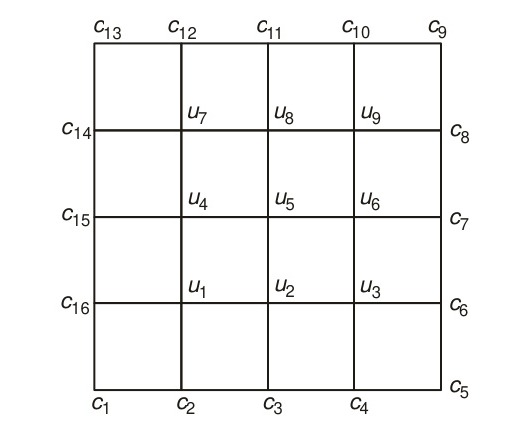

[← Previous: NM-10.3 Poisson Equation](NM-10.3_Poisson_Equation.md) | [📂 Topic Overview](_Topic_Overview.md) | [🏠 Master Index](../00_Index.md) | [Next: NM-10.5 Boundary Conditions →](NM-10.5_Boundary_Conditions.md)

---

# NM-10.4: Liebmann's Iterative Method

> 🟠 **Priority:** Secondary | **Tested:** 2 appearances (2018 Q.8(a), 2020 Q.8(b)) | **Typical marks:** 6

## What This Is (and Why It Matters)

When you discretize a 2D partial differential equation like Laplace's or Poisson's equation, you end up with a system of linear algebraic equations. For a tiny $2 \times 2$ grid (4 interior nodes), you can easily solve it on paper using pencil-and-paper Gaussian elimination.

But in real engineering, grids are not $2 \times 2$. A modest $100 \times 100$ spatial mesh has $10{,}000$ unknown nodes. Storing a $10{,}000 \times 10{,}000$ matrix in computer memory takes hundreds of megabytes, and solving it by direct Gaussian elimination takes $O(N^3) \approx 10^{12}$ floating-point operations!

This is why numerical PDE solvers rely on **Liebmann's method**. 

Liebmann's method is nothing other than **Gauss-Seidel iteration applied to a spatial grid**. You never build the giant matrix. Instead, you walk through the grid points one by one, replacing each node with the arithmetic average of its four neighbors, always plugging in the freshest available numbers.

---

## 📝 Key Definitions

> **Point Jacobi Method for PDEs:** "Let $u_{i, j}^{(n)}$ denote the $n$th iterative value of $u_{i, j}$. An iterative procedure to solve the five-point formula is $u_{i, j}^{(n+1)} = \frac{1}{4} [u_{i-1, j}^{(n)} + u_{i+1, j}^{(n)} + u_{i, j-1}^{(n)} + u_{i, j+1}^{(n)}]$ for the interior mesh points. This is called the point Jacobi method." -- Jain, §9.4.1 (p. 349), Eq. (9.31)
>
> **In simple words:** You calculate the new value of every node using strictly the old values from the previous round. No node gets updated until the entire grid has been scanned.

> **Liebmann's Method (Gauss-Seidel for PDEs):** "The method uses the latest iterative values available and scans the mesh points systematically from left to right along successive rows. The iterative formula is $u_{i, j}^{(n+1)} = \frac{1}{4} [u_{i-1, j}^{(n+1)} + u_{i+1, j}^{(n)} + u_{i, j-1}^{(n+1)} + u_{i, j+1}^{(n)}]$. It can be shown that the Gauss-Seidel scheme converges twice as fast as the Jacobi scheme. This method is also referred to as Liebmann's method." -- Jain, §9.4.2 (p. 349), Eq. (9.32)
>
> **In simple words:** The moment you compute a new temperature or voltage at a node, you immediately use that new value to update its neighbors in the same sweep. It cuts computation time in half.

> **Successive Over-Relaxation (SOR) for PDEs:** "In the SOR method, a larger change is given to $u_{i, j}^{(n)}$, and the iteration formula is written as $u_{i, j}^{(n+1)} = (1 - \omega) u_{i, j}^{(n)} + \frac{\omega}{4} [u_{i-1, j}^{(n+1)} + u_{i+1, j}^{(n)} + u_{i, j-1}^{(n+1)} + u_{i, j+1}^{(n)}]$, where $\omega$ is called the accelerating factor and lies between 1 and 2." -- Jain, §9.4.3 (p. 350), Eq. (9.33)
>
> **In simple words:** You take the correction step suggested by Liebmann's method and amplify it by a factor $\omega$ (often around 1.8 to 1.9) to make the numbers reach their final values up to 40 times faster.

---

## The Core Idea

### How Liebmann Iteration Works on a Grid

Imagine scanning a 2D grid from the bottom-left corner to the top-right corner, moving row by row:

When you arrive at node $(i, j)$:
- Its **West neighbor** $(i-1, j)$ and its **South neighbor** $(i, j-1)$ have already been visited in the current sweep, so their values are at iteration level $(k+1)$.
- Its **East neighbor** $(i+1, j)$ and its **North neighbor** $(i, j+1)$ have not been visited yet, so they still hold values from iteration level $(k)$.
- Any neighbor on the outer perimeter is a fixed boundary value $c_m$ and never changes.

Therefore, the update formula for Laplace's equation is:

$$
u_{i,j}^{(k+1)} = \frac{1}{4}\left(u_{i-1,j}^{(k+1)} + u_{i+1,j}^{(k)} + u_{i,j-1}^{(k+1)} + u_{i,j+1}^{(k)}\right)
$$

For Poisson's equation with source $g(x_i, y_j)$, we simply subtract the source contribution:

$$
u_{i,j}^{(k+1)} = \frac{1}{4}\left(u_{i-1,j}^{(k+1)} + u_{i+1,j}^{(k)} + u_{i,j-1}^{(k+1)} + u_{i,j+1}^{(k)} - h^2 g(x_i, y_j)\right)
$$

### Why Does Liebmann's Method Always Converge?

In [NM-3.5: Gauss-Seidel Iteration](../NM-3_Linear_Systems/NM-3.5_Gauss_Seidel.md), we proved that Gauss-Seidel is guaranteed to converge if the coefficient matrix is **strictly diagonally dominant**.

Look at the five-point stencil equation at any interior node:

$$
4 u_{i,j} - u_{i-1,j} - u_{i+1,j} - u_{i,j-1} - u_{i,j+1} = 0
$$

- Diagonal element: $a_{ii} = 4$.
- Sum of off-diagonal interior couplings: at most $|-1| + |-1| + |-1| + |-1| = 4$.
- At nodes touching a boundary, boundary values move to the right-hand side, leaving only 2 or 3 unknown interior neighbors. For those rows, the off-diagonal sum is only 2 or 3, so $|a_{ii}| = 4 > \sum |a_{ij}|$.

Because the system is irreducibly diagonally dominant, **Liebmann iteration is mathematically guaranteed to converge from any initial guess**, including starting from all zeros!

### Convergence Speed: Jacobi vs. Liebmann vs. SOR

The rate of convergence of an iterative method depends on its spectral radius $\rho$:
- For a square grid with $N \times N$ interior nodes, the spectral radius of the Jacobi iteration matrix is:
  $$
  \rho_{\text{Jacobi}} \approx \cos\left(\frac{\pi}{N+1}\right) \approx 1 - \frac{\pi^2}{2(N+1)^2}
  $$
- The spectral radius of the Gauss-Seidel (Liebmann) matrix is the square of Jacobi:
  $$
  \rho_{\text{Liebmann}} = (\rho_{\text{Jacobi}})^2 \approx 1 - \frac{\pi^2}{(N+1)^2}
  $$
- Because the error decreases by $\rho$ each sweep, Liebmann's method reduces the error **twice as fast as Jacobi per iteration**.
- With SOR and optimal relaxation factor $\omega_{\text{opt}} = \frac{2}{1 + \sqrt{1 - \rho_{\text{Jacobi}}^2}}$, the spectral radius drops dramatically to $\omega_{\text{opt}} - 1 \approx 1 - \frac{2\pi}{N+1}$, reducing the required number of sweeps by an order of magnitude.

---

## 🔍 Deep Dive: Examining Liebmann Sweeps in Real Exam Problems

Let us look at what actually happens during the sweeps on the two exam problems tested in RUET papers.

### Case 1: The 2018 Q.8(a) Potential Grid
In 2018 Q.8(a), the boundary values are large voltages: $100\text{ V}$ (top), $75\text{ V}$ (left), $50\text{ V}$ (right), $0\text{ V}$ (bottom).
Starting from all zeros ($V_1 = V_2 = V_3 = V_4 = 0$):

- **Sweep 1:** 
  $V_1$ feels the $75\text{ V}$ left edge and $100\text{ V}$ top edge immediately:
  $$
  V_1^{(1)} = \frac{175 + 0 + 0}{4} = 43.75\text{ V}
  $$
  Then $V_2$ immediately uses this fresh $43.75\text{ V}$:
  $$
  V_2^{(1)} = \frac{150 + 43.75 + 0}{4} = 48.4375\text{ V}
  $$
- Look at how the errors decay across sweeps:
  - Sweep 1: $V_1 = 43.7500$ (change: $+43.7500$)
  - Sweep 2: $V_1 = 63.2813$ (change: $+19.5313$)
  - Sweep 3: $V_1 = 69.7266$ (change: $+6.4453$)
  - Sweep 4: $V_1 = 71.3379$ (change: $+1.6113$)
  - Sweep 5: $V_1 = 71.7407$ (change: $+0.4028$)
  - Sweep 6: $V_1 = 71.8414$ (change: $+0.1007$)
- **Notice the ratio of changes:**
  $$
  \frac{19.53}{43.75} \approx 0.44, \quad \frac{6.45}{19.53} \approx 0.33, \quad \frac{1.61}{6.45} \approx 0.25, \quad \frac{0.40}{1.61} \approx 0.25, \quad \frac{0.10}{0.40} \approx 0.25
  $$
  After the initial transient, each sweep shrinks the error by a factor of exactly **4** (a ratio of 0.25). That factor of 4 per sweep is the unmistakable mathematical fingerprint of a spectral radius near $0.25$!

### Case 2: The 2020 Q.8(b) Zero-and-One Grid
In 2020 Q.8(b), the boundary values are $1$ on the top edge and $0$ everywhere else.
Because nodes $E_1$ and $E_2$ sit on the lower row, they do not touch the top edge:
- In Sweep 1: $E_1^{(1)} = 0$ and $E_2^{(1)} = 0$ because all their available neighbors are still zero!
- $E_3$ sits on the top row, so it catches the top boundary: $E_3^{(1)} = \frac{0 + 0 + 1 + 0}{4} = 0.25$.
- $E_4$ then immediately uses $E_3$'s fresh $0.25$: $E_4^{(1)} = \frac{0.25 + 0 + 1 + 0}{4} = 0.3125$.
- In Sweep 2, this heat finally diffuses down to the lower row: $E_1^{(2)} = \frac{0 + 0.3125}{4} = 0.078125$.
- By Sweep 8, all values are accurate to four decimal places, converging steadily to $(0.125, 0.125, 0.375, 0.375)$.

---

## ⚡ Direct Elimination vs. Liebmann Iteration: When to Use Which?

| Scenario | Direct Elimination (Gauss) | Liebmann Iteration (Gauss-Seidel) |
| :--- | :--- | :--- |
| **$2 \times 2$ Grid (4 nodes)** | **Fastest on paper.** Takes ~2 minutes, yields exact integers or fractions ($3, 4, 2, 3$). | Requires 6 to 10 sweeps with many decimal places. Only do this if the question explicitly asks for Liebmann. |
| **$100 \times 100$ Grid ($10^4$ nodes)** | **Impossible.** Matrix has $10^8$ entries; requires $10^{12}$ operations; destroys sparsity. | **Standard choice.** Requires only $O(N)$ storage; updates nodes directly in memory in seconds. |
| **Exam Strategy** | If the question says "Solve the Laplace equation", use elimination or symmetry. | If the question says "Solve using Liebmann method", build the sweep table! |

> [!TIP] The Smart Exam Shortcut
> If an exam question demands Liebmann iteration on a 4-node grid, first solve the system quickly on scratch paper using Gaussian elimination (or symmetry) to find the exact targets (e.g. $71.875, 65.625$). 
> Then, as you compute your iteration table, you can instantly see if your sweeps are converging toward the correct numbers! If your sweep values drift away, you caught a arithmetic error immediately.

---

## ⚡ Quick Review

**The method in one sentence:** Liebmann's method updates every interior node on a PDE grid using the average of its four neighbors, instantly replacing old values with newly calculated ones.

**The update formula:**
$$
u_{i,j}^{(k+1)} = \frac{1}{4}\left(u_{i-1,j}^{(k+1)} + u_{i+1,j}^{(k)} + u_{i,j-1}^{(k+1)} + u_{i,j+1}^{(k)}\right)
$$

**The SOR acceleration formula:**
$$
u_{i,j}^{(k+1)} = (1 - \omega) u_{i,j}^{(k)} + \frac{\omega}{4}\sum(\text{neighbors})
$$

**The most common exam mistake:** Forgetting to update nodes using the freshest values in the *same* sweep (which accidentally turns Liebmann into the slower Jacobi method).

---

## 🔗 Connected Topics

- [← NM-10.3: Poisson Equation](NM-10.3_Poisson_Equation.md) -- applying Liebmann iteration to Poisson grids with source terms.
- [→ NM-10.5: Boundary Conditions](NM-10.5_Boundary_Conditions.md) -- how boundary nodes feed fixed values into Liebmann sweeps.
- [NM-3.5: Gauss-Seidel Iteration](../NM-3_Linear_Systems/NM-3.5_Gauss_Seidel.md) -- the matrix theory behind successive displacement iterations.
- [NM-3.6: Relaxation](../NM-3_Linear_Systems/NM-3.6_Relaxation.md) -- theory of the relaxation factor $\omega$ in Successive Over-Relaxation (SOR).

---

[← Previous: NM-10.3 Poisson Equation](NM-10.3_Poisson_Equation.md) | [📂 Topic Overview](_Topic_Overview.md) | [🏠 Master Index](../00_Index.md) | [Next: NM-10.5 Boundary Conditions →](NM-10.5_Boundary_Conditions.md)
