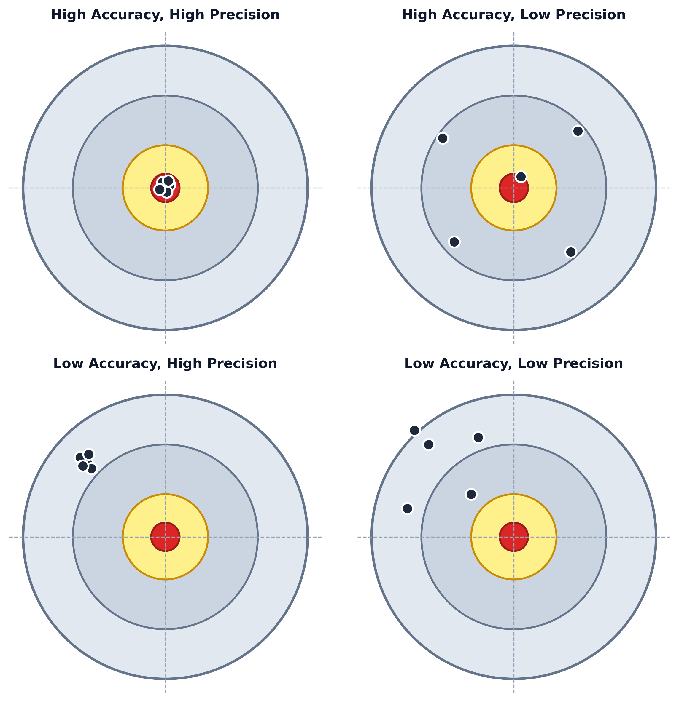

[← Previous: NM-1.2 Mathematical Modeling](NM-1.2_Mathematical_Modeling.md) | [📂 Topic Overview](_Topic_Overview.md) | [🏠 Master Index](../00_Index.md) | [Next: NM-1.4 Error Types →](NM-1.4_Error_Types.md)

---

# NM-1.3: Accuracy, Precision and Significant Digits

> 🟠 **Priority:** Secondary | **Tested:** 2017 Q.1(b), 2017 Q.3(a) | **Typical marks:** 3–4

## What This Is (and Why It Matters)

In casual conversation, people use "accurate" and "precise" as if they mean the exact same thing. In engineering and numerical methods, they are completely different concepts. Confusing them in an exam question will lose you marks immediately.

**Accuracy** is about how close you are to the truth (the bullseye). **Precision** is about how close your measurements or computations are to each other (how tightly grouped your shots are). 

Along with these, this subtopic covers **significant figures** and the formal textbook rules for adding approximate numbers. In 2017 Q.3(a), students were asked to sum a list of numbers where "all given digits are correct". If you just punch them into a calculator, you get partial credit. If you follow Jain's 4-step rounding procedure, you get full marks.

---

## 📝 Key Definitions

> **Significant digits:** "The digits that are used to express a number are called significant digits or significant figures." -- Jain, §1.3 (p. 7)
> 
> **In simple words:** The digits in a number that actually carry meaningful physical measurement information, starting from the first non-zero digit on the left.

> **Accuracy:** Closeness of a computed or measured value to the true value of the quantity. Quantitatively: $\text{Accuracy} = 1 - |\text{relative error}|$.
> 
> **In simple words:** How close your arrow landed to the center of the target.

> **Precision:** Closeness of repeated measurements of the same quantity to one another, reflecting the degree of repeatability or mutual agreement.
> 
> **In simple words:** How tightly clustered your arrows are, even if they all missed the center by two inches.

> **Rounding off:** "To round-off a number to $n$ significant digits, discard all digits to the right of the $n$th digit, and if this discarded number is (a) less than half a unit in the $n$th place, leave the $n$th digit unaltered; (b) greater than half a unit in the $n$th place, increase the $n$th digit by unity; (c) exactly half a unit in the $n$th place, increase the $n$th digit by unity if it is odd; otherwise, leave it unchanged." -- Jain, §1.3 (p. 7)
> 
> **In simple words:** The standard way to shorten a number. If the dropped digit is below 5, drop it. If above 5, round up. If it is exactly 5, round to the nearest even number so you avoid statistical drift.

---

## The Core Idea

### The Dartboard Analogy (Accuracy vs. Precision)

Picture four different archers shooting five arrows at a target:

1. **High accuracy, high precision:** All five arrows form a tight cluster right inside the yellow bullseye. Perfect calibration, zero spread.
2. **High accuracy, low precision:** Arrows are scattered all over the target, but their average center of mass is right on the bullseye. (Averaging repeated readings helps here!)
3. **Low accuracy, high precision:** All five arrows are grouped so tightly they touch each other, but they are all stuck in the top-right corner. The instrument is consistent, but has a bad systematic bias. (Averaging does **not** help here!)
4. **Low accuracy, low precision:** Arrows are scattered everywhere and completely off-center. Worst case.

### The Rules of Significant Digits

Examiners love giving numbers with leading or trailing zeros to test your rules:

- **Non-zero digits always count:** $3.1416$, $0.66667$, and $4.0687$ each have **5** significant digits.
- **Leading zeros NEVER count:** $0.00023$ has only **2** significant digits ($2$ and $3$). The leading zeros only locate the decimal point.
- **Zeros between non-zeros count:** $10.05$ has **4** significant digits.
- **Trailing zeros after a decimal point count:** $4.500$ has **4** significant digits (they indicate precision down to the thousandths place).
- **Trailing zeros without a decimal point are ambiguous:** For $25,600$, you cannot tell if there are 3, 4, or 5 significant figures. Jain explicitly advises using scientific notation:
  * $2.56 \times 10^4$ has 3 significant digits.
  * $2.560 \times 10^4$ has 4 significant digits.
  * $2.5600 \times 10^4$ has 5 significant digits.

### The Round-to-Even Rule (Unbiased Rounding)

When the discarded part is **exactly half a unit** (a trailing 5 with no digits after it):
- If the preceding digit is **odd**, round **up** to make it even: $1.75 \to 1.8$.
- If the preceding digit is **even**, leave it **alone**: $1.65 \to 1.6$.

Why? If you always rounded 5 up, long financial or numerical calculations would steadily drift upward. Rounding to even makes half the ties round up and half round down, canceling out systematic bias.

---

## 🔧 Procedure for Adding Numbers of Different Accuracies

When you add numbers derived from different measuring instruments, your result cannot be more accurate than your sloppiest measurement. Jain §1.3 (p. 8-9) defines the exact 4-step algorithm:

1. **Isolate** the number with the greatest absolute error (the one with the fewest decimal places).
2. **Round off** all other numbers to retain **one digit more** than the isolated number.
3. **Add up** these rounded numbers.
4. **Round off the sum** by discarding that extra digit.

---

## 🏆 Past Exam Questions

### 2017 Q.1(b): Definitions with Examples [04 marks]

**The question:** Define the following terms with example:  
(i) Accuracy (ii) Precision (iii) truncation error (iv) round off error

**How to answer like a top student:**
For each term, give a 1-sentence definition followed by a concrete numerical example.

**Solution:**

**(i) Accuracy:**
The closeness of a computed or measured value to the true physical value. Quantitatively:
$$
\text{Accuracy} = 1 - |\text{relative error}| = 1 - \left|\frac{\text{approximate} - \text{true}}{\text{true}}\right|
$$
*Example:* A regulated power supply provides a true $10.0\text{ V}$. A multimeter reads $9.8\text{ V}$. The relative error is $\frac{9.8 - 10.0}{10.0} = -0.02$. The accuracy is $1 - |-0.02| = 0.98$ or $98\%$.

**(ii) Precision:**
The degree of mutual agreement or repeatability among independent measurements of the same quantity under identical conditions. It quantifies spread or variance, irrespective of whether the cluster is near the true value.
*Example:* Taking five successive voltage measurements gives $9.8\text{ V}, 9.9\text{ V}, 9.8\text{ V}, 9.9\text{ V}, 9.8\text{ V}$. The spread is only $0.1\text{ V}$ across $9.8\text{ V}$ ($\approx 1\%$), so the readings are $99\%$ precise. However, because of calibration error, they are still only $98\%$ accurate.

**(iii) Truncation error:**
The error caused by cutting short an infinite mathematical process and approximating it by a finite formula (such as truncating a Taylor series, approximating an integral by a finite sum, or replacing a derivative by a difference quotient).
*Example:* Approximating $\sin x$ by the first two Taylor terms $x - \frac{x^3}{6}$. Discarding the remaining terms ($+\frac{x^5}{120} - \dots$) leaves a truncation error equal to the discarded remainder.

**(iv) Round-off error:**
The error caused by the finite precision of digital computers or human storage, where numbers with infinite or long decimal expansions must be chopped or rounded to a fixed number of significant digits.
*Example:* Storing $1/3$ on a 6-digit calculator as $0.333333$. Multiplying it back by 3 gives $0.999999$ instead of $1.0$. The shortfall of $10^{-6}$ is round-off error.

---

### 2017 Q.3(a): Sum of Correct-Digit Numbers [03 marks]

**The question:** Sum all the numbers of provided list: $0.1532, 15.45, 0.000354, 305.4, 8.12, 143.3$ where in each of which all the given digits are correct.

**How to answer like a top student:**
Examiners are testing whether you know both the direct sum and the formal textbook approximation procedure (Jain §1.3). Provide both approaches to guarantee full marks.

**Solution:**

**Approach 1: Direct exact arithmetic sum.**
Adding the raw numbers directly:
$$
\begin{aligned}
S &= 0.1532 + 15.45 + 0.000354 + 305.4 + 8.12 + 143.3 \\
&= 472.423554
\end{aligned}
$$

$$
\boxed{472.423554}
$$

**Approach 2: Standard textbook procedure for approximate numbers (Jain §1.3 / Sastry).**
The statement "all given digits are correct" implies each number is an approximate physical measurement rounded to its stated decimal places. The absolute error in any number rounded to $m$ decimal places is bounded by $E_A \le 0.5 \times 10^{-m}$.

**Step 1: Isolate the numbers with the greatest absolute error.**
The numbers with the fewest decimal places (1 decimal place) are $305.4$ and $143.3$. Each has an error bound of $E_A \le 0.05$.

**Step 2: Round all other numbers to retain one extra decimal place (2 decimal places):**
- $0.1532 \to 0.15$
- $15.45 \to 15.45$ (already at 2 decimal places)
- $0.000354 \to 0.00$
- $8.12 \to 8.12$ (already at 2 decimal places)

**Step 3: Add up the modified numbers:**
$$
\begin{aligned}
S &= 305.4 + 143.3 + 0.15 + 15.45 + 0.00 + 8.12 \\
&= 472.42
\end{aligned}
$$

**Step 4: Round off by discarding the extra digit:**
Discarding the last decimal place gives:
$$
S \approx 472.4
$$

**Error bound verification:**
The accumulated absolute error bound is:
$$
E_A = 2(0.05) + 4(0.005) = 0.10 + 0.02 = 0.12
$$
Adding the rounding adjustment error ($\approx 0.01$) gives a maximum error of $\pm 0.13$. Therefore, the sum is rigorously stated as:
$$
S = 472.42 \pm 0.13
$$

---

### Exam Variants at a Glance

| Year | What They Asked | Key Boxed Takeaway |
| :--- | :--- | :--- |
| **2017 Q.1(b)** | Define Accuracy, Precision, Truncation, Round-off | Accuracy = closeness to truth; Precision = repeatability |
| **2017 Q.3(a)** | Sum approximate numbers where all digits are correct | $\boxed{472.423554}$ (and $472.4$ via Jain procedure) |

---

## ⚡ Quick Review

**The method in one sentence:** Accuracy is how close you are to the truth, while precision is how repeatable your measurements are; when adding approximate numbers, the result is limited by the number with the fewest decimal places.

**The formula you must memorize:**
$$
\text{Accuracy} = 1 - |\text{relative error}|
$$
$$
E_A \le \frac{1}{2} \times 10^{-m} \quad (\text{for a number correct to } m \text{ decimal places})
$$

**The most common exam mistake:** Thinking high precision means high accuracy. If your instrument is miscalibrated, your readings can be $99.9\%$ repeatable while being completely wrong!

**Time estimate in exam:** 5–7 minutes for a 3–4 mark question.

---

## 🔗 Connected Topics

- [← NM-1.2: Mathematical Modeling](NM-1.2_Mathematical_Modeling.md) -- models rely on accurate and precise parameter estimates
- [→ NM-1.4: Error Types](NM-1.4_Error_Types.md) -- deep dive into truncation and round-off error behaviors
- [→ NM-1.5: Error Propagation](NM-1.5_Error_Propagation.md) -- how absolute and relative errors combine across formulas

---

[← Previous: NM-1.2 Mathematical Modeling](NM-1.2_Mathematical_Modeling.md) | [📂 Topic Overview](_Topic_Overview.md) | [🏠 Master Index](../00_Index.md) | [Next: NM-1.4 Error Types →](NM-1.4_Error_Types.md)
