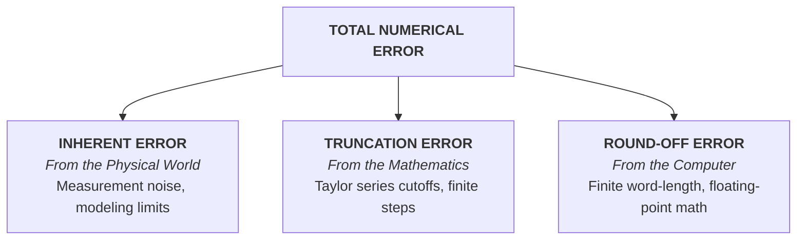
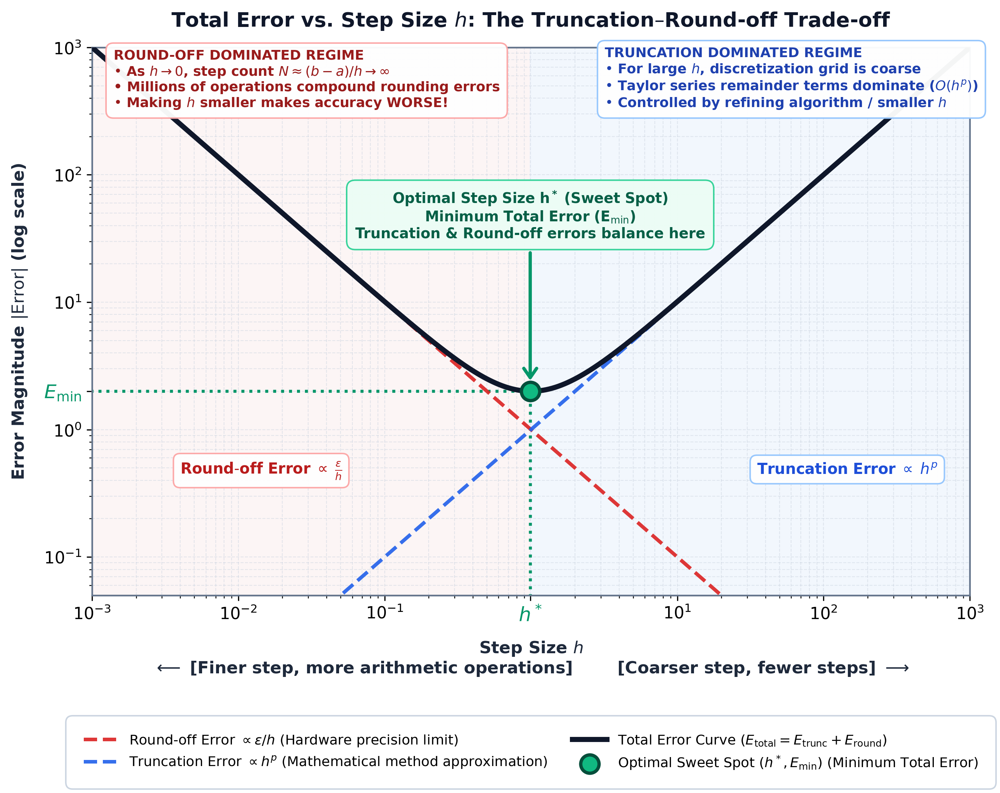

[← Previous: NM-1.3 Accuracy & Precision](NM-1.3_Accuracy_and_Precision.md) | [📂 Topic Overview](_Topic_Overview.md) | [🏠 Master Index](../00_Index.md) | [Next: NM-1.5 Error Propagation →](NM-1.5_Error_Propagation.md)

---

# NM-1.4: Error Types and Sources

> 🔴 **Priority:** Critical | **Tested:** 6/8 years | **Typical marks:** 4–6

## What This Is (and Why It Matters)

Whenever you solve an engineering problem numerically, your final number will differ from the true answer. That difference is your **error**. 

In this subtopic, the exam asks you to classify where that error came from. Did it come from the real world before you even started calculating? Did it come from cutting off a formula? Or did it come from the fact that your computer has finite memory?

Examiners love this topic because it is pure, clean theory worth 4 to 6 marks. Almost every other year, Question 1 asks you to define round-off error and truncation error, compare them, and explain how errors enter a computation.

---

## 📝 Key Definitions

> **Inherent error:** The error already present in the physical problem statement before any calculation begins. It includes data error (from noisy meters), conversion error (from physical constants), and modeling error (from simplifying assumptions).
> 
> **In simple words:** The error baked in from the start because your measurements are imperfect and your model ignores real-world friction.

> **Truncation error:** "Truncation error is caused by using approximate formulae in computations, such as the one that arises when a truncated infinite series is used." -- Jain, §1.3 (p. 8)
> 
> **In simple words:** The error you create on purpose by cutting off an infinite mathematical formula (like stopping a Taylor series after three terms or taking a finite step $h$ in calculus).

> **Round-off error:** The error caused by the computer storing numbers with a finite number of digits.
> 
> **In simple words:** The error created because a computer cannot store $\frac{1}{3}$ or $\pi$ with infinite decimal places, so it chops or rounds the trailing digits.

> **Absolute error:** "Absolute error is the numerical difference between the true value of a quantity and its approximate value. Thus, if $X$ is the true value of a quantity and $X_1$ is its approximate value, then the absolute error $E_A$ is given by $E_A = X - X_1$." -- Jain, §1.3 (p. 8)
> 
> **In simple words:** True value minus approximate value, measured in the exact same physical units (Volts, Amperes, meters).

> **Relative error:** "The relative error $E_R$ is defined by $E_R = \frac{E_A}{X} = \frac{\delta X}{X}$." -- Jain, §1.3 (p. 8)
> 
> **In simple words:** The absolute error divided by the true value. It tells you what fraction or percentage of the true value you missed by.

---

## The Core Idea: The Three Families of Error

Every error in numerical computation belongs to one of three families:

### 1. Inherent Error (Before you touch a calculator)
Inherent errors exist before you write a single line of code. They subdivide into:
- **Data error:** Your voltmeter has a $\pm 1\%$ tolerance. The resistance read off the meter as $4.7\ \Omega$ is already uncertain.
- **Conversion error:** Constants like $\pi$, $e$, or $\sqrt{2}$ cannot be written in finite decimal form.
- **Modeling error:** You used $V = IR$, assuming the wire temperature stays constant, but the circuit actually heats up.

> [!NOTE] Crucial Point
> No computer program, regardless of how many billions of digits of precision it uses, can fix inherent error. The only fix is better sensors or a more detailed physical model.

### 2. Truncation Error (From the mathematics)
Computers can only do finite operations. Whenever continuous calculus involves an infinite limit or infinite sum, we must cut it short:
- An infinite Taylor series is truncated after $n$ terms.
- A continuous derivative $\frac{df}{dx}$ is approximated by a finite difference $\frac{f(x+h) - f(x)}{h}$.
- An integral is approximated by a finite sum of trapezoids.

For a central difference:
$$
\frac{f(x+h)-f(x-h)}{2h} = f'(x) + \frac{h^2}{6}f'''(\xi)
$$
The discarded part is the truncation error, here proportional to $h^2$. If you cut $h$ in half, your truncation error drops by a factor of 4!

### 3. Round-off Error (From machine hardware)
A digital processor stores numbers in binary registers (typically 32-bit single precision or 64-bit double precision). 
- **Representation error:** $1/10$ in binary is an infinite repeating fraction ($0.000110011..._2$), just like $1/3$ in decimal ($0.3333...$). It cannot be stored exactly.
- **Arithmetic rounding:** When two numbers are multiplied or divided, the trailing bits are discarded.
- **Accumulation:** Over millions of calculation steps, tiny rounding errors compound like compound interest.

---

## The Central Battle: Truncation vs. Round-off

This is one of the most famous concepts in numerical methods, and examiners test it frequently.

Notice what happens when you change the step size $h$:
- As step size $h \to 0$, **truncation error drops** to zero ($\text{Error} \propto h^p$).
- But as $h \to 0$, you need more steps ($N \propto 1/h$) to cover the domain. More steps mean more arithmetic operations, so **round-off error explodes** ($\text{Error} \propto \frac{\epsilon}{h}$).

If you plot total error against step size $h$, you get a U-shaped curve:

> [!WARNING] The Shrinking Step Trap
> Students often assume: *"To get a more accurate answer, just make $h$ as tiny as possible."* That is false! If you make $h$ too small, round-off error will completely destroy your calculation. The best step size $h^*$ is where the two error curves cross.

$$
\boxed{\text{Total error} = \text{truncation} + \text{round off} + \text{data error}}
$$

---

## How Errors Enter an Engineering Computation (5 Stages)

When an exam question asks *"How do errors enter into the process?"*, list these 5 clear stages:

1. **Formulate the physics:** You simplify reality to write down differential equations. **Modeling error** enters here.
2. **Measure data:** You collect physical parameters with meters and sensors. **Data error** enters here.
3. **Choose the algorithm:** You replace infinite calculus with finite formulas. **Truncation error** enters here.
4. **Execute on computer:** The machine carries out finite-precision floating-point arithmetic. **Round-off error** enters at every single machine cycle.
5. **Report the final result:** The output displays all errors from stages 1 to 4 combined and propagated.

---

## 🏆 Past Exam Questions

### 2018 Q.1(b): What are the algorithmic errors that may occur in numerical calculation? [04 marks]

**How to answer like a top student:**
Algorithmic errors are errors produced by the algorithm itself (distinct from input data errors). Group them into truncation, round-off, and propagation.

**Solution:**
Algorithmic errors arise directly during computational processing and comprise three primary sources:

1. **Truncation error:** Originates when an infinite mathematical process is replaced by a finite computational approximation. Examples include cutting off an infinite series after $n$ terms, stepping an ODE with finite step size $h$, or evaluating an integral with a finite grid. This error decreases systematically as the approximation is refined (as $h \to 0$ or $n \to \infty$).
2. **Round-off error:** Originates from representing continuous real numbers within fixed-width computer registers (finite bit-length). Every basic arithmetic step rounds or chops the result, creating small discrepancies that accumulate over lengthy calculation loops.
3. **Error propagation and numerical instability:** An algorithm is unstable if errors introduced in early steps grow exponentially in later iterations. In well-conditioned algorithms, errors are damped.

**Opposing behavior with step size $h$:**
For an algorithm with step size $h$, truncation error scales as $O(h^p)$ (shrinking as $h$ decreases), while accumulated round-off error scales roughly as $O(\epsilon/h)$ (increasing as $h$ decreases). Total error achieves a minimum at an optimal step size $h^*$. Refining $h$ beyond this optimal threshold worsens the overall result.

---

### 2019 Q.1(b): What are the errors involved in numerical methods? How do they enter into the process? Give an example. [04 marks]

**Solution:**
The errors involved in numerical methods are **inherent error**, **truncation error**, and **round-off error**.

1. **Inherent error:** Present in the problem data prior to computation (subdivided into measurement data error, constant conversion error, and physical modeling error).
2. **Truncation error:** Mathematical discrepancy resulting from truncating an infinite process into a finite algorithm.
3. **Round-off error:** Digital storage limitation resulting from finite-precision representation.

**How they enter the process (5 stages):**
1. Physical formulation $\to$ Modeling error enters.
2. Data collection $\to$ Measurement/data error enters.
3. Discretization/formula selection $\to$ Truncation error enters.
4. Machine execution $\to$ Round-off error enters at each arithmetic operation.
5. Final display $\to$ The sum of all errors appears in the reported output.

**Concrete Engineering Example:**
Consider calculating the current flowing through a resistor using Ohm's law $I = V/R$, where true values are $V = 10\text{ V}$ and $R = 220\ \Omega$.
The true current is:
$$
I_{\text{true}} = \frac{10}{220} = 0.0454545...\text{ A}
$$
If an ammeter with a 3-digit display reads this current as $I_{\text{approx}} = 0.045\text{ A}$:
- **Absolute error:**
$$
E_{\text{abs}} = 0.045 - 0.0454545 = -0.0004545\text{ A}
$$
- **Relative error:**
$$
E_{\text{rel}} = \frac{-0.0004545}{0.0454545} = -0.01 = -1\%
$$
This $-1\%$ error combines the display's finite-digit round-off with the physical resistor's component tolerance (inherent data error).

---

### 2020 Q.1(a): Why are numerical methods needed? What are sources of error? Discuss them. [06 marks]

**Solution:**
**Why numerical methods are needed:**
1. **Absence of closed-form solutions:** Real nonlinear systems (transistor equations, Navier-Stokes fluid flow) have no analytical solution.
2. **High problem dimensionality:** Discretized PDE field equations generate millions of coupled equations that impossible to solve by hand algebra.
3. **Discrete empirical data:** Real sensor data arrive as discrete tabulated samples.
4. **Computational cost vs. physical cost:** Numerical simulation allows parameter exploration at negligible cost compared to fabricating prototypes.
5. **Iterative engineering design:** Engineering optimization routines require automated iterative solvers.

$$
\boxed{\text{No closed form exists, the data are irregular, and design needs many repeated solves}}
$$

**Sources of error in numerical methods:**

| Error Source | Physical Origin | Mitigation Strategy |
| :-- | :-- | :-- |
| **Truncation Error** | Truncating infinite series, approximating derivatives with finite difference quotients | Use higher-order algorithms or smaller step sizes |
| **Round-off Error** | Finite floating-point registers; loss of precision in repeated arithmetic | Use 64-bit double precision; restructure equations to prevent cancellation |
| **Inherent Data Error** | Sensor tolerance, physical noise, environmental fluctuations | Use higher-grade instruments and statistical averaging |

---

### 2024 Q.1(c): Round-off vs. Truncation error, and how each arises [04 marks]

**Solution:**
Both errors cause the computed result to deviate from the true mathematical solution, but their origins and remedies are fundamentally different.

**Round-off error:**
- **Origin:** Arises because computers represent real numbers using a finite number of binary bits. Non-terminating fractions are rounded or chopped to the nearest representable floating-point number.
- **Characteristics:** Enters at every addition, multiplication, or division; accumulates steadily with the number of operations; worsens when subtracting nearly equal numbers (catastrophic cancellation).

**Truncation error:**
- **Origin:** Arises from the mathematical approximation used in the algorithm itself, independent of computer hardware.
- **Characteristics:** Created when an infinite series is cut off after $n$ terms, or when continuous derivatives are approximated by finite steps $h$; decreases systematically as $h \to 0$.

**Direct Comparison Table:**

| Feature | Round-off Error | Truncation Error |
| :-- | :-- | :-- |
| **Source** | Hardware register bit-width limit | Mathematical formula approximation |
| **Controlled by** | Increasing floating-point precision | Reducing step size $h$, retaining more terms |
| **Effect of shrinking $h$** | **Increases** (more operations required) | **Decreases** (better approximation) |
| **Nature** | Often quasi-random in sign | Deterministic (governed by remainder formula) |
| **Remedy** | Double precision, reordering sums | Higher-order numerical schemes |

$$
\boxed{\text{Total error} = \text{truncation} + \text{round off} + \text{data error}}
$$

---

### CT-01 Q.1(b): Identify at least three sources of numerical error in software and explain their effects [Class Test]

**Solution:**
In a digital reactor monitoring program executing on a microcontroller with 5-digit decimal precision:

1. **Taylor series truncation error:** Approximating $e^z \approx 1 + z + \frac{z^2}{2} + \frac{z^3}{6}$ discards the higher-order remainder $\frac{z^4 e^\xi}{24}$. This creates a systematic, deterministic error that causes temperature estimates to consistently drift low.
2. **5-digit register round-off error:** The processor stores only 5 significant figures. Intermediate products and quotients are continuously rounded, leading to random-walk error accumulation over long multi-hour operational cycles.
3. **Catastrophic subtraction cancellation:** When $z$ is small, $e^z \approx 1$. Computing terms like $(e^z - 1)$ subtracts two numbers that are nearly identical in their leading digits, wiping out 3 to 4 digits of precision in a single operation.
4. **Time-stepping discretization error:** Using Euler's method or RK2 to step the thermal ODE introduces an $O(h^p)$ truncation error at each time step $\Delta t$.
5. **Sensor calibration uncertainty:** The thermocouple voltage has input measurement errors that propagate through the differential equation solver.

---

### Exam Variants at a Glance

| Year | What They Asked | Key Boxed Takeaway |
| :--- | :--- | :--- |
| **2018 Q.1(b)** | Algorithmic errors & opposing behavior with $h$ | Truncation shrinks with $h$, round-off grows with $1/h$ |
| **2019 Q.1(b)** | Error types, 5 stages, resistor current example | $E_{\text{abs}} = -0.0004545\text{ A}, E_{\text{rel}} = -1\%$ |
| **2020 Q.1(a)** | Why numerical methods & error sources (6 marks) | $\boxed{\text{No closed form exists, the data are irregular, and design needs many repeated solves}}$ |
| **2024 Q.1(c)** | Round-off vs Truncation comparison | $\boxed{\text{Total error} = \text{truncation} + \text{round off} + \text{data error}}$ |
| **CT-01 Q.1(b)** | Software error sources (5-digit microcontroller) | Truncation, 5-digit rounding, catastrophic cancellation |

---

## ⚡ Quick Review

**The method in one sentence:** Inherent error comes from the physical world, truncation error comes from cutting mathematical formulas, and round-off error comes from finite computer memory.

**The formula you must memorize:**
$$
\text{Total Error} = \text{Truncation Error} + \text{Round-off Error} + \text{Inherent Error}
$$

**The most common exam mistake:** Saying that both truncation and round-off errors decrease when you make the step size $h$ smaller. Truncation decreases, but round-off **increases**!

**Time estimate in exam:** 6–8 minutes for a 4–6 mark question.

---

## 🔗 Connected Topics

- [← NM-1.3: Accuracy and Precision](NM-1.3_Accuracy_and_Precision.md) -- how errors reflect in measurement repeatability and truth
- [→ NM-1.5: Error Propagation](NM-1.5_Error_Propagation.md) -- how these errors grow when plugged into multi-variable equations
- [→ NM-1.6: Taylor Series](NM-1.6_Taylor_Series.md) -- where truncation error is calculated analytically using Taylor polynomials

---

[← Previous: NM-1.3 Accuracy & Precision](NM-1.3_Accuracy_and_Precision.md) | [📂 Topic Overview](_Topic_Overview.md) | [🏠 Master Index](../00_Index.md) | [Next: NM-1.5 Error Propagation →](NM-1.5_Error_Propagation.md)
