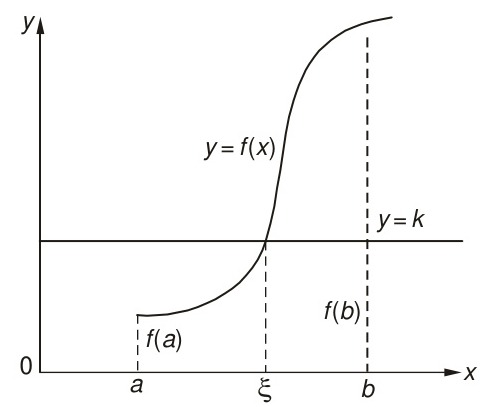

[← Previous: NM-2.1 Fundamentals](NM-2.1_Fundamentals.md) | [📂 Topic Overview](_Topic_Overview.md) | [🏠 Master Index](../00_Index.md) | [Next: NM-2.3 False Position →](NM-2.3_False_Position.md)

---

# NM-2.2: Bisection Method

> 🔴 **Priority:** Critical | **Tested:** 5/8 years | **Typical marks:** 3–6

## What This Is (and Why It Matters)

The bisection method is the most dependable root finder ever invented. It is the mathematical equivalent of playing twenty questions: you trap the root inside an interval where the function changes sign, chop that interval in half, test which half still contains the sign change, and throw the other half away.

Because the interval shrinks by exactly 50% on every single step, this method cannot fail or blow up. That absolute guarantee is why bisection serves as the ultimate safety net inside industrial numerical software. In your semester final, examiners frequently ask you to write out its step-by-step algorithm (often demanding a test for relative accuracy) or run two iterations by hand on a cubic polynomial.

---

## 📝 Key Definitions

> **Bisection principle:** "if a function $f(x)$ is continuous between $a$ and $b$, and $f(a)$ and $f(b)$ are of opposite signs, then there exists at least one root between $a$ and $b$." -- Jain, §2.2 (p. 23)
> 
> **In simple words:** If a continuous curve starts below the axis and ends above it, it has to cut through the axis somewhere in the middle. Bisection finds that crossing point by repeatedly cutting the interval in half.

> **Relative percentage error test:** "A convenient criterion is to compute the percentage error $\varepsilon_r$ defined by $\varepsilon_r = \left|\frac{x_r' - x_r}{x_r'}\right| \times 100\%$ where $x_r'$ is the new value of $x_r$." -- Jain, §2.2 (p. 24)
> 
> **In simple words:** Checking how much your midpoint shifted compared to its new value. When this shift becomes tiny, you stop iterating.

> **Bisection method:** A bracketing algorithm that repeatedly computes the midpoint $c = \frac{a+b}{2}$ of an interval $[a, b]$ exhibiting $f(a)f(b) < 0$, replacing either $a$ or $b$ to keep the root trapped in an interval of halved width.
> 
> **In simple words:** The half-interval search. Test the midpoint, see which half has opposite signs at its ends, keep that half, and repeat.

---

## The Core Idea

Here is how the method works visually. You start with two points $a$ and $b$ where $f(a)$ and $f(b)$ have opposite signs.

*Figure 2.1: The Intermediate Value Theorem guarantees that a continuous curve crossing from below the axis to above it must cross zero at some root $\xi$.*

*Figure 2.2: Bisection cuts the interval in half at $x_0$, checks the sign of $f(x_0)$, and selects the sub-interval that maintains opposite signs.*

### The Formula and Interval Halving

On every step, you take the arithmetic mean:
$$
c = \frac{a + b}{2}
$$

After $n$ iterations, the original interval $[a_0, b_0]$ has been halved $n$ times. The width of the interval is:
$$
\text{Width}_n = \frac{b_0 - a_0}{2^n}
$$

Because the true root $r$ is trapped somewhere inside this interval, the maximum possible distance between your midpoint estimate $c_n$ and the true root $r$ is at most half the interval width:
$$
|c_n - r| \le \frac{b_0 - a_0}{2^{n+1}}
$$

### How Many Iterations? You Know in Advance!

This is the killer feature of bisection: you can calculate the exact number of iterations needed to hit an error tolerance $\varepsilon$ before performing a single calculation.

Setting $\frac{b_0 - a_0}{2^n} \le \varepsilon$ and solving for $n$:
$$
2^n \ge \frac{b_0 - a_0}{\varepsilon} \implies n \ge \frac{\ln\left(\frac{b_0 - a_0}{\varepsilon}\right)}{\ln 2} = \log_2\left(\frac{b_0 - a_0}{\varepsilon}\right)
$$
In integer form:
$$
n = \left\lceil \log_2\left(\frac{b_0 - a_0}{\varepsilon}\right) \right\rceil
$$

*Example:* If you start on $[1, 2]$ (width = $1$) and need accuracy $\varepsilon = 0.001$:
$$
n \ge \log_2(1000) \approx 9.97 \implies n = 10 \text{ iterations}
$$

### Step-by-Step Algorithm (with Relative Accuracy Test)

Examiners specifically asked for this algorithm in 2017 Q.3(c) and 2018 Q.2(a):

1. **Input:** Accept the function $f(x)$, initial bracket limits $a$ and $b$, relative tolerance $\varepsilon_r$, and maximum iteration limit $N$.
2. **Initial bracket check:** Calculate $f(a)$ and $f(b)$. If $f(a) \cdot f(b) > 0$, display an error ("No sign change detected; bracket invalid") and terminate.
3. **Midpoint calculation:** Compute the new approximation:
$$
c = \frac{a + b}{2}
$$
4. **Evaluate function at midpoint:** Compute $f(c)$.
5. **Check termination criteria:**
   - If this is iteration 2 or higher, calculate the approximate relative percentage error:
$$
|e_a| = \left|\frac{c - c_{\text{old}}}{c}\right| \times 100\%
$$
   - If $|e_a| < \varepsilon_r$, or if $|f(c)| < \varepsilon$, or if $|b - a| < \varepsilon$, accept $c$ as the root and stop.
6. **Update the bracket:**
   - If $f(a) \cdot f(c) < 0$, the root is in the left half: set $b = c$.
   - Otherwise, the root is in the right half: set $a = c$.
   - Store $c_{\text{old}} = c$.
7. **Iteration limit check:** Increment counter. If counter exceeds $N$, report that the method reached maximum iterations without meeting tolerance; otherwise, loop back to Step 3.

### Merits and Demerits (2018 Q.2(a))

**Merits:**
1. **Guaranteed convergence:** If $f(x)$ is continuous and $f(a)f(b) < 0$, it will always converge to a root.
2. **Predictable workload:** The required number of iterations is known before you even begin.
3. **Low computational cost per step:** Only one new function evaluation $f(c)$ is required per iteration.
4. **No derivatives:** Works on jagged or non-differentiable continuous functions where Newton-Raphson fails.

**Demerits:**
1. **Slow speed:** Linear convergence ($p = 1$). It halves the interval regardless of whether $f(c)$ is close to zero or far from it.
2. **Cannot find even-multiplicity roots:** Fails if the curve touches the axis without crossing ($f(x) = (x-2)^2$).
3. **Requires an initial bracket:** Finding two starting points that sandwich a sign change can be difficult for complex functions.

---

## 🔧 Worked Example

> **Question:** Find a root of $f(x) = x^3 - x - 2 = 0$ on the interval $[1, 2]$ using the bisection method. Carry out iterations until the bracket width is smaller than 0.05.

**Let's solve this step by step.**

**Step 1. Check the initial bracket.**
$$
f(1) = 1^3 - 1 - 2 = -2 < 0
$$
$$
f(2) = 2^3 - 2 - 2 = 4 > 0
$$
Since $f(1) \cdot f(2) = -8 < 0$, there is a real root between $1$ and $2$.

**Step 2. Carry out the iterations.**
- **Iteration 1:** $c_1 = \frac{1 + 2}{2} = 1.5$.
  $f(1.5) = (1.5)^3 - 1.5 - 2 = 3.375 - 3.5 = -0.125 < 0$.
  Since $f(1.5)$ is negative, the root lies in $[1.5, 2]$. So set $a = 1.5$.
- **Iteration 2:** $c_2 = \frac{1.5 + 2}{2} = 1.75$.
  $f(1.75) = (1.75)^3 - 1.75 - 2 = 5.359375 - 3.75 = +1.6094 > 0$.
  Since $f(1.75)$ is positive, the root lies in $[1.5, 1.75]$. So set $b = 1.75$.
- **Iteration 3:** $c_3 = \frac{1.5 + 1.75}{2} = 1.625$.
  $f(1.625) = (1.625)^3 - 1.625 - 2 = 4.2910 - 3.625 = +0.6660 > 0$.
  Root is in $[1.5, 1.625]$. Set $b = 1.625$.
- **Iteration 4:** $c_4 = \frac{1.5 + 1.625}{2} = 1.5625$.
  $f(1.5625) = +0.2522 > 0$.
  Root is in $[1.5, 1.5625]$. Set $b = 1.5625$.
- **Iteration 5:** $c_5 = \frac{1.5 + 1.5625}{2} = 1.53125$.
  $f(1.53125) = +0.0591 > 0$.
  Root is in $[1.5, 1.53125]$. Set $b = 1.53125$.
- **Iteration 6:** $c_6 = \frac{1.5 + 1.53125}{2} = 1.515625$.
  $f(1.515625) = -0.0341 < 0$.
  Root is in $[1.515625, 1.53125]$.

**Iteration summary table:**

| Iteration | $a$ | $b$ | Midpoint $c$ | $f(c)$ | Bracket Width $(b - a)$ |
| :--: | :--: | :--: | :--: | :--: | :--: |
| 1 | 1.000000 | 2.000000 | 1.500000 | $-0.1250$ | 1.000000 |
| 2 | 1.500000 | 2.000000 | 1.750000 | $+1.6094$ | 0.500000 |
| 3 | 1.500000 | 1.750000 | 1.625000 | $+0.6660$ | 0.250000 |
| 4 | 1.500000 | 1.625000 | 1.562500 | $+0.2522$ | 0.125000 |
| 5 | 1.500000 | 1.562500 | 1.531250 | $+0.0591$ | 0.062500 |
| 6 | 1.500000 | 1.531250 | 1.515625 | $-0.0341$ | 0.031250 |

After 6 iterations, the interval width is $0.03125 < 0.05$. The true root is $x \approx 1.5214$, which lies comfortably inside $(1.515625, 1.531250)$.

---

## 🏆 Past Exam Questions

### 2024 Q.2(a): Given the polynomial $f(x) = x^3 - 6x^2 + 11x - 6$, use the bisection (bracketing) method to find a root in the interval up to two iterations. [03 marks, CO: 2]

**How to answer like a top student:**
Notice that the question does not specify the initial interval. First, factor the cubic on scratch paper to discover the true roots. Then state and justify a valid bracketing interval with a clear sign change test, and perform the two iterations cleanly.

**Solution:**

**Step 1. Analyze the polynomial:**
Factoring the cubic:
$$
f(x) = x^3 - 6x^2 + 11x - 6 = (x - 1)(x - 2)(x - 3)
$$
The exact roots of the polynomial are $x = 1, 2, 3$.

**Step 2. Select and verify the initial bracketing interval:**
We choose the interval $[2.5, 3.4]$ to isolate the root at $x = 3$:
$$
f(2.5) = (2.5)^3 - 6(2.5)^2 + 11(2.5) - 6 = 15.625 - 37.5 + 27.5 - 6 = -0.375
$$
$$
f(3.4) = (3.4)^3 - 6(3.4)^2 + 11(3.4) - 6 = 39.304 - 69.36 + 37.4 - 6 = +1.344
$$
Since $f(2.5) \cdot f(3.4) = (-0.375)(1.344) = -0.504 < 0$, the Intermediate Value Theorem confirms that a root lies within $(2.5, 3.4)$.

**Step 3. Iteration 1:**
Compute the first midpoint:
$$
x_1 = \frac{2.5 + 3.4}{2} = 2.95
$$
Evaluate the function at $x_1$:
$$
f(2.95) = (2.95)^3 - 6(2.95)^2 + 11(2.95) - 6 = 25.6724 - 52.2150 + 32.45 - 6 = -0.092625
$$
Since $f(2.95) < 0$ and $f(3.4) > 0$, the sign change occurs in $(2.95, 3.4)$. Thus, the new bracket is $[2.95, 3.4]$.

**Step 4. Iteration 2:**
Compute the second midpoint:
$$
x_2 = \frac{2.95 + 3.4}{2} = 3.175
$$
Evaluate the function at $x_2$:
$$
f(3.175) = (3.175)^3 - 6(3.175)^2 + 11(3.175) - 6 = 32.005984 - 60.483750 + 34.925 - 6 = +0.447234
$$
Since $f(3.175) > 0$ and $f(2.95) < 0$, the root is now bracketed in $(2.95, 3.175)$.

**Summary of the two iterations:**
- Initial interval width: $b_0 - a_0 = 3.4 - 2.5 = 0.9$
- Width after 2 iterations: $\frac{0.9}{2^2} = 0.225$, matching $3.175 - 2.95 = 0.225$.
- Maximum theoretical error bound: $|x_2 - r| \le \frac{0.9}{2^2} = 0.225$.
- True root: $r = 3$. Actual error: $|3.175 - 3| = 0.175 \le 0.225$.

$$
\boxed{x_2 = 3.175, \qquad \text{root} \in (2.95,\ 3.175), \qquad \text{true root} = 3}
$$

---

### 2017 Q.3(c): Explain the bisection method for finding a real root of the equation $f(x) = 0$ and write an algorithm for its implementation with a test for relative accuracy. [06 marks]

**How to answer like a top student:**
Provide the theoretical basis, write the complete algorithm highlighting the relative accuracy formula, and discuss convergence behavior.

**Solution:**

**1. Explanation of the Method:**
The bisection method is a bracketing method based on the Intermediate Value Theorem. If a continuous function $f(x)$ has values of opposite signs at the endpoints of an interval $[a, b]$, such that $f(a) \cdot f(b) < 0$, at least one real root exists between $a$ and $b$. The method evaluates the midpoint $c = \frac{a+b}{2}$. If $f(c) = 0$, $c$ is the exact root. Otherwise, the sign of $f(c)$ is compared with $f(a)$:
- If $f(a) \cdot f(c) < 0$, the root lies in $[a, c]$, so set $b = c$.
- If $f(a) \cdot f(c) > 0$, the root lies in $[c, b]$, so set $a = c$.

This process halves the search interval at each step, ensuring monotonic convergence.

**2. Algorithm with Relative Accuracy Test:**
1. **Input:** Define $f(x)$, read bracket endpoints $a, b$, relative error tolerance $\varepsilon_r$, and maximum iterations $N$.
2. **Bracket verification:** Compute $f(a)$ and $f(b)$. If $f(a)f(b) \ge 0$, display "Initial interval does not bracket a root" and stop.
3. **Initialize:** Set iteration counter $k = 1$.
4. **Compute midpoint:**
$$
c = \frac{a + b}{2}
$$
5. **Relative accuracy check:**
   - If $k > 1$, calculate:
$$
|e_a| = \left|\frac{c - c_{\text{old}}}{c}\right| \times 100\%
$$
   - If $|e_a| < \varepsilon_r$ or $|f(c)| < \varepsilon$, accept $c$ as the approximate root and terminate.
6. **Update bounds:**
   - If $f(a) \cdot f(c) < 0$, set $b = c$.
   - Else, set $a = c$.
   - Set $c_{\text{old}} = c$.
7. **Loop control:** Increment $k = k + 1$. If $k > N$, print "Maximum iterations exceeded" and stop; otherwise, go to Step 4.

**3. Error and Convergence Analysis:**
Because the interval halves on each iteration, the error bound after $n$ iterations is:
$$
|c_n - r| \le \frac{b - a}{2^{n+1}}
$$
The number of iterations required to guarantee absolute error less than $\varepsilon$ is computable in advance:
$$
n = \left\lceil \log_2\left(\frac{b - a}{\varepsilon}\right) \right\rceil
$$

---

### 2018 Q.2(a): Develop an algorithm to calculate the root of any non-linear equation by bisection method. [04 marks]

**How to answer like a top student:**
Write the standard 7-step algorithm, state the formula for the number of required iterations, and provide the merits and demerits.

**Solution:**

**Bisection Algorithm:**
1. **Input:** Function $f(x)$, endpoints $a$ and $b$, tolerance $\varepsilon$, and maximum iterations $N$.
2. **Check bracket:** Compute $f(a)$ and $f(b)$. If $f(a) \cdot f(b) > 0$, stop with error.
3. **Midpoint:** Calculate $c = \frac{a + b}{2}$ and evaluate $f(c)$.
4. **Convergence check:** If $|f(c)| < \varepsilon$ or $|b - a| < \varepsilon$, output $c$ and stop.
5. **Update interval:**
   - If $f(a) \cdot f(c) < 0$, set $b = c$.
   - If $f(a) \cdot f(c) > 0$, set $a = c$.
6. **Iteration limit:** If iteration counter exceeds $N$, stop with non-convergence message.
7. **Repeat:** Return to Step 3.

**Theoretical Iteration Count:**
$$
n = \left\lceil \log_2\left(\frac{b - a}{\varepsilon}\right) \right\rceil
$$

**Merits:**
- Convergence is guaranteed for any continuous function.
- Error bound is known before running the algorithm.
- Requires only one function evaluation per step.

**Demerits:**
- Slow rate of convergence ($p = 1$).
- Cannot find roots where the curve touches zero without crossing (even multiplicity).

---

### Exam Variants at a Glance

| Year | What They Asked | Key Answer / Formula |
|:---|:---|:---|
| 2017 Q.3(c) | Explain bisection and provide algorithm with relative accuracy test (06 marks) | $|e_a| = \left|\frac{c - c_{\text{old}}}{c}\right| \times 100\%$, $n = \lceil \log_2\frac{b-a}{\varepsilon} \rceil$ |
| 2018 Q.2(a) | Develop algorithm for bisection, merits and demerits (04 marks) | Algorithm steps, guaranteed convergence, slow linear rate |
| 2024 Q.2(a) | Find root of $x^3 - 6x^2 + 11x - 6$ up to 2 iterations (03 marks) | $\boxed{x_2 = 3.175, \qquad \text{root} \in (2.95,\ 3.175), \qquad \text{true root} = 3}$ |

---

## ⚡ Quick Review

**The method in one sentence:** Bisection repeatedly evaluates the midpoint $c = \frac{a+b}{2}$ and keeps whichever half preserves opposite signs at its boundaries.

**The formula you must memorize:**
$$
n = \left\lceil \log_2\left(\frac{b - a}{\varepsilon}\right) \right\rceil
$$

**The most common exam mistake:** Updating both $a$ and $b$ during the same iteration. Only ONE boundary moves per step!

**Time estimate in exam:** 8–10 minutes for an algorithm question; 6–8 minutes for a 2-iteration numerical problem.

---

## 🔗 Connected Topics

- [← NM-2.1: Fundamentals and Classification](NM-2.1_Fundamentals.md) -- why bracketing methods guarantee convergence.
- [→ NM-2.3: False Position and Regula Falsi](NM-2.3_False_Position.md) -- uses the same bracket but replaces the blind midpoint with a straight chord.
- [NM-2.4: Newton-Raphson Method](NM-2.4_Newton_Raphson.md) -- the fast open method that falls back to bisection when it diverges.
- [NM-2.6: Method Comparison and Convergence](NM-2.6_Method_Comparison.md) -- comparing bisection's predictable linear speed against other methods.

---

[← Previous: NM-2.1 Fundamentals](NM-2.1_Fundamentals.md) | [📂 Topic Overview](_Topic_Overview.md) | [🏠 Master Index](../00_Index.md) | [Next: NM-2.3 False Position →](NM-2.3_False_Position.md)
