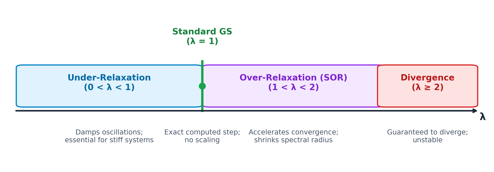

[← Previous: NM-3.5 Gauss-Seidel](NM-3.5_Gauss_Seidel.md) | [📂 Topic Overview](_Topic_Overview.md) | [🏠 Master Index](../00_Index.md) | [Next: NM-3.7 Ill-Conditioned Systems →](NM-3.7_Ill_Conditioned_Systems.md)

---

# NM-3.6: Relaxation

> 🟠 **Priority:** Secondary | **Tested:** 2 appearances | **Typical marks:** 3–5

## What This Is (and Why It Matters)

Standard Gauss-Seidel is great, but what happens when it converges too slowly? For massive grids (like thermal flow or electromagnetic fields), standard Gauss-Seidel can take thousands of sweeps to crawl toward the solution. On the flip side, what if a system oscillates back and forth wildly because it barely satisfies diagonal dominance?

**Relaxation** is the gas pedal and brake system for Gauss-Seidel iteration.

Instead of taking the standard Gauss-Seidel step, you multiply the change by a tuning parameter called the **relaxation factor** ($\lambda$ or $\omega$):
- If convergence is sluggish, you **over-relax** ($1 < \lambda < 2$): you push the iterate further in the direction of correction. This is called **Successive Over-Relaxation (SOR)**.
- If the iteration is oscillating or threatening to diverge, you **under-relax** ($0 < \lambda < 1$): you take a more cautious, damped step to keep things stable.

In RUET examinations, this appears either as a 3-mark theory question ("Define over-relaxation and under-relaxation", 2018 Q.4(a)) or as a 5-mark numerical problem (running Gauss-Seidel with relaxation factor $\lambda = 0.95$, 2017 Q.4(c)).

---

## 📝 Key Definitions

> **Relaxation Factor ($\lambda$ or $\omega$):** A weighting parameter applied to the Gauss-Seidel update to modify the step size taken toward the solution:
> $$
> x_i^{(k+1)} = (1 - \lambda)x_i^{(k)} + \lambda \hat x_i^{(k+1)}
> $$
> where $\hat x_i^{(k+1)}$ is the raw, unrelaxed Gauss-Seidel iterate.
> 
> **In simple words:** A slider from $0$ to $2$ that controls how aggressively you move from your old answer toward your new calculation.

> **Under-Relaxation ($0 < \lambda < 1$):** Choosing a parameter strictly between $0$ and $1$ to take a shorter, more cautious step.
> 
> **In simple words:** Hitting the brakes. You blend mostly your old guess with a small fraction of the new calculation to damp out wild swings.

> **Over-Relaxation ($1 < \lambda < 2$):** Choosing a parameter strictly between $1$ and $2$ to take a larger step in the correction direction (Successive Over-Relaxation or SOR).
> 
> **In simple words:** Stepping on the gas. You intentionally overshoot the standard calculation to sprint toward the target faster.

---

## The Core Idea

### The Two-Step Relaxation Formula
Whenever you perform a relaxed iteration, you break each variable's update into two clean mental steps:

1. **Step 1: Compute the raw Gauss-Seidel predictor $\hat{x}_i^{(k+1)}$:**  
   Calculate the normal Gauss-Seidel value using the freshest available numbers:
   $$
   \hat{x}_i^{(k+1)} = \frac{1}{a_{ii}}\left(b_i - \sum_{j=1}^{i-1} a_{ij} x_j^{(k+1)} - \sum_{j=i+1}^n a_{ij} x_j^{(k)}\right)
   $$

2. **Step 2: Apply the relaxation blend:**  
   Weighted-average the old value $x_i^{(k)}$ and the raw new value $\hat{x}_i^{(k+1)}$:
   $$
   x_i^{(k+1)} = (1 - \lambda)x_i^{(k)} + \lambda \hat{x}_i^{(k+1)}
   $$

Notice what this formula is really doing:
$$
x_i^{(k+1)} = x_i^{(k)} + \lambda \left(\hat{x}_i^{(k+1)} - x_i^{(k)}\right)
$$
The bracket $(\hat{x}_i^{(k+1)} - x_i^{(k)})$ is the **change** (or step). The parameter $\lambda$ simply scales how much of that change you actually take!

### The Four Regimes of $\lambda$

1. **$\lambda = 1$ (Standard Gauss-Seidel):**  
   The formula simplifies to $x_i^{(k+1)} = \hat{x}_i^{(k+1)}$. You take exactly 100% of the computed change.

2. **$0 < \lambda < 1$ (Under-Relaxation):**  
   You take less than 100% of the change. This is essential when the equations are not strictly diagonally dominant or when nonlinear coupling causes successive iterates to bounce wildly back and forth.

3. **$1 < \lambda < 2$ (Over-Relaxation / SOR):**  
   You take more than 100% of the change. By picking an optimal parameter $\lambda_{\text{opt}} \in (1, 2)$, you dramatically shrink the spectral radius of the iteration matrix, often reducing the required iteration count by 70% to 90%!

4. **$\lambda \ge 2$ (The Danger Zone):**  
   The method is mathematically guaranteed to diverge. Never pick $\lambda \ge 2$.

---

## 🔧 Worked Example (PYQ 2017 Q.4(c))

> **The question:** Use the Gauss Seidel method with relaxation $(\lambda = 0.95)$ to solve the following system. If necessary rearrange the equations to achieve convergence (use 3 iterations only).
> $$
> \begin{aligned}
> -3x_1 + x_2 + 12x_3 &= 50 \\
> 6x_1 - x_2 - x_3 &= 3 \\
> 6x_1 + 9x_2 + x_3 &= 40
> \end{aligned}
> $$
> 
> *(Source: 2017 Q.4(c) [Marks: 05])*

**Let's solve this step by step.**

### Step 1: Check for Diagonal Dominance in Printed Order
Let's inspect the diagonal coefficients as printed:
- **Row 1:** $|{-3}| = 3$. Off-diagonal sum is $|1| + |12| = 13$.  
  $3 < 13$ (Fails completely! Row 1 is dominant in $x_3$, not $x_1$).
- **Row 2:** $|{-1}| = 1$. Off-diagonal sum is $|6| + |{-1}| = 7$.  
  $1 < 7$ (Fails completely! Row 2 is dominant in $x_1$, not $x_2$).
- **Row 3:** $|9| = 9$. Off-diagonal sum is $|6| + |1| = 7$.  
  $9 > 7$ (Dominant in $x_2$).

If you run Gauss-Seidel on this system as printed, the iterations will diverge to infinity!

### Step 2: Rearrange Equations for Strict Diagonal Dominance
We must pair each equation with its strongest variable:
1. **Equation 2 has the largest $x_1$ coefficient ($6$):** Make this **Row 1**:
   $$
   6x_1 - x_2 - x_3 = 3 \quad (|6| > |-1| + |-1| = 2 \quad \checkmark)
   $$
2. **Equation 3 has the largest $x_2$ coefficient ($9$):** Make this **Row 2**:
   $$
   6x_1 + 9x_2 + x_3 = 40 \quad (|9| > |6| + |1| = 7 \quad \checkmark)
   $$
3. **Equation 1 has the largest $x_3$ coefficient ($12$):** Make this **Row 3**:
   $$
   -3x_1 + x_2 + 12x_3 = 50 \quad (|12| > |-3| + |1| = 4 \quad \checkmark)
   $$

The rearranged system is strictly diagonally dominant:
$$
\begin{aligned}
6x_1 - x_2 - x_3 &= 3 \\
6x_1 + 9x_2 + x_3 &= 40 \\
-3x_1 + x_2 + 12x_3 &= 50
\end{aligned}
$$

### Step 3: Set Up Iteration Formulas with $\lambda = 0.95$
With $\lambda = 0.95$, the blending formula is:
$$
x_i^{(k+1)} = (1 - 0.95)x_i^{(k)} + 0.95\,\hat{x}_i^{(k+1)} = 0.05\,x_i^{(k)} + 0.95\,\hat{x}_i^{(k+1)}
$$

Raw Gauss-Seidel predictors:
$$
\hat{x}_1^{(k+1)} = \frac{3 + x_2^{(k)} + x_3^{(k)}}{6}
$$
$$
\hat{x}_2^{(k+1)} = \frac{40 - 6x_1^{(k+1)} - x_3^{(k)}}{9}
$$
$$
\hat{x}_3^{(k+1)} = \frac{50 + 3x_1^{(k+1)} - x_2^{(k+1)}}{12}
$$

### Step 4: Perform 3 Iterations from $(0, 0, 0)$

#### Iteration 1:
- For $x_1$:
  $$
  \hat{x}_1^{(1)} = \frac{3 + 0 + 0}{6} = 0.500000
  $$
  $$
  x_1^{(1)} = 0.05(0) + 0.95(0.500000) = 0.475000
  $$
- For $x_2$:
  $$
  \hat{x}_2^{(1)} = \frac{40 - 6(0.475000) - 0}{9} = \frac{40 - 2.85}{9} = \frac{37.15}{9} \approx 4.127778
  $$
  $$
  x_2^{(1)} = 0.05(0) + 0.95(4.127778) = 3.921389
  $$
- For $x_3$:
  $$
  \hat{x}_3^{(1)} = \frac{50 + 3(0.475000) - 3.921389}{12} = \frac{50 + 1.425 - 3.921389}{12} = \frac{47.503611}{12} \approx 3.958634
  $$
  $$
  x_3^{(1)} = 0.05(0) + 0.95(3.958634) = 3.760703
  $$

#### Iteration 2:
- For $x_1$:
  $$
  \hat{x}_1^{(2)} = \frac{3 + 3.921389 + 3.760703}{6} = \frac{10.682092}{6} \approx 1.780349
  $$
  $$
  x_1^{(2)} = 0.05(0.475000) + 0.95(1.780349) = 0.023750 + 1.691331 = 1.715081
  $$
- For $x_2$:
  $$
  \hat{x}_2^{(2)} = \frac{40 - 6(1.715081) - 3.760703}{9} = \frac{40 - 10.290486 - 3.760703}{9} = \frac{25.948811}{9} \approx 2.883201
  $$
  $$
  x_2^{(2)} = 0.05(3.921389) + 0.95(2.883201) = 0.196069 + 2.739041 = 2.935111
  $$
- For $x_3$:
  $$
  \hat{x}_3^{(2)} = \frac{50 + 3(1.715081) - 2.935111}{12} = \frac{50 + 5.145243 - 2.935111}{12} = \frac{52.210132}{12} \approx 4.350844
  $$
  $$
  x_3^{(2)} = 0.05(3.760703) + 0.95(4.350844) = 0.188035 + 4.133302 = 4.321337
  $$

#### Iteration 3:
- For $x_1$:
  $$
  \hat{x}_1^{(3)} = \frac{3 + 2.935111 + 4.321337}{6} = \frac{10.256448}{6} \approx 1.709408
  $$
  $$
  x_1^{(3)} = 0.05(1.715081) + 0.95(1.709408) = 0.085754 + 1.623938 = 1.709692
  $$
- For $x_2$:
  $$
  \hat{x}_2^{(3)} = \frac{40 - 6(1.709692) - 4.321337}{9} = \frac{40 - 10.258152 - 4.321337}{9} = \frac{25.420511}{9} \approx 2.824501
  $$
  $$
  x_2^{(3)} = 0.05(2.935111) + 0.95(2.824501) = 0.146756 + 2.683276 = 2.830032
  $$
- For $x_3$:
  $$
  \hat{x}_3^{(3)} = \frac{50 + 3(1.709692) - 2.830032}{12} = \frac{50 + 5.129076 - 2.830032}{12} = \frac{52.299044}{12} \approx 4.358254
  $$
  $$
  x_3^{(3)} = 0.05(4.321337) + 0.95(4.358254) = 0.216067 + 4.140341 = 4.356408
  $$

### Complete 3-Iteration Table

| Iteration | $x_1$ | $x_2$ | $x_3$ |
| :--: | :-- | :-- | :-- |
| **0** | $0.000000$ | $0.000000$ | $0.000000$ |
| **1** | $0.475000$ | $3.921389$ | $3.760703$ |
| **2** | $1.715081$ | $2.935111$ | $4.321337$ |
| **3** | $1.709692$ | $2.830032$ | $4.356408$ |

$$
\boxed{x_1 \approx 1.7097, \qquad x_2 \approx 2.8300, \qquad x_3 \approx 4.3564}
$$

---

## 🏆 Past Exam Questions

### 2018 Q.4(a): What Is Meant by Over-Relaxation and Under-Relaxation? -- [03 marks]

**The question:** What is meant by over-relaxation and under-relaxation?

**Tutor explanation & structured answer:**

Both terms describe a modification of the Gauss-Seidel iteration in which a **relaxation parameter** $\omega$ (or $\lambda$) is introduced to control the step size.

**Relaxed Gauss-Seidel Formula:**
$$
x_i^{(k+1)} = (1 - \omega)x_i^{(k)} + \omega\,\hat{x}_i^{(k+1)}
$$
where $\hat{x}_i^{(k+1)}$ is the raw value computed from the standard Gauss-Seidel recursion.

**1. Under-Relaxation ($0 < \omega < 1$):**  
Each new iterate is a weighted blend of the previous value and the computed update, so the sequence moves toward the solution by only a fraction of the full step.  
- *Purpose:* Damps out numerical oscillations and stabilizes iterative schemes that would otherwise diverge (such as non-diagonally dominant systems).

**2. Over-Relaxation ($1 < \omega < 2$):**  
Each new iterate intentionally overshoots the ordinary Gauss-Seidel value, accelerating movement toward the solution.  
- *Purpose:* Drastically reduces the total iteration count for slow-converging systems. This technique is known as **Successive Over-Relaxation (SOR)**.

**The Boundary at $\omega = 1$:**  
At $\omega = 1$, the formula reduces to standard Gauss-Seidel. Values above $1$ accelerate convergence; values below $1$ stabilize oscillations. Any value $\omega \ge 2$ causes divergence.

---

### Exam Variants at a Glance

| Year | What They Asked | Key Result / Concept |
|:---|:---|:---|
| **2017 Q.4(c)** | Rearrange & solve with $\lambda = 0.95$ for 3 iterations (05 marks) | $\boxed{x_1 \approx 1.7097, \qquad x_2 \approx 2.8300, \qquad x_3 \approx 4.3564}$ |
| **2018 Q.4(a)** | Define over-relaxation and under-relaxation (03 marks) | Regimes separated by $\lambda = 1$: acceleration vs damping |

---

## ⚡ Quick Review

**The method in one sentence:** Scale the Gauss-Seidel step by $\lambda$ to either accelerate slow progress ($\lambda > 1$) or calm down wild oscillations ($\lambda < 1$).

**The master formula:**
$$
x_i^{(k+1)} = (1 - \lambda)x_i^{(k)} + \lambda \hat{x}_i^{(k+1)}
$$

**The range of $\lambda$ to memorize:**
- $0 < \lambda < 1$: Under-relaxation (damps oscillations)
- $\lambda = 1$: Standard Gauss-Seidel
- $1 < \lambda < 2$: Over-relaxation / SOR (accelerates convergence)
- $\lambda \ge 2$: Diverges!

**Time estimate in exam:** ~8 to 10 minutes for rearranging equations and carrying out 3 complete relaxation sweeps.

---

## 🔗 Connected Topics

- [← NM-3.5: Gauss-Seidel](NM-3.5_Gauss_Seidel.md) -- the base iteration scheme that relaxation builds on.
- [→ NM-3.7: Ill-Conditioned Systems](NM-3.7_Ill_Conditioned_Systems.md) -- why some systems cannot be rescued even with under-relaxation.
- [NM-10: Partial Differential Equations](../NM-10_PDE/_Topic_Overview.md) -- using SOR in Liebmann's method to solve 2D heat and electrostatic PDE grids.

---

[← Previous: NM-3.5 Gauss-Seidel](NM-3.5_Gauss_Seidel.md) | [📂 Topic Overview](_Topic_Overview.md) | [🏠 Master Index](../00_Index.md) | [Next: NM-3.7 Ill-Conditioned Systems →](NM-3.7_Ill_Conditioned_Systems.md)
