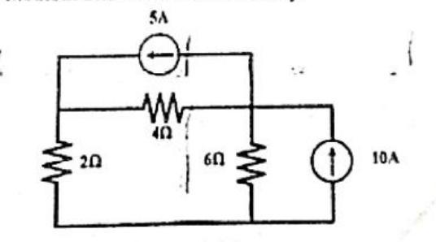

[← Previous: NM-3.7 Ill-Conditioned Systems](NM-3.7_Ill_Conditioned_Systems.md) | [📂 Topic Overview](_Topic_Overview.md) | [🏠 Master Index](../00_Index.md) | [Next: NM-4 Curve Fitting Overview →](../NM-4_Curve_Fitting/_Topic_Overview.md)

---

# NM-3.8: Circuit Applications

> 🔴 **Priority:** Critical | **Tested:** 5/8 years | **Typical marks:** 4–6

## What This Is (and Why It Matters)

In ECE 2213, linear equations rarely appear as sterile matrix blocks like $[A\mid \mathbf{b}]$. Instead, the examiner hands you a **schematic circuit diagram** of resistors, independent voltage sources, current sources, and dependent sources.

Your job as an electrical engineer is twofold:
1. **Formulate the physics:** Translate the circuit into clean linear equations using Kirchhoff's Voltage Law (KVL) around loops or Kirchhoff's Current Law (KCL) at nodes.
2. **Setup for numerical solution:** Arrange the resulting equations so they satisfy strict diagonal dominance, and execute Gauss-Seidel iterations.

In the taxonomy, the numerical solution sweeps belong to [NM-3.5](NM-3.5_Gauss_Seidel.md), but the **formulation craft** belongs here in NM-3.8. Once you master the boundary current source rule and the dependent source substitution trick, you can transform any exam circuit into an easy 6-mark victory in under 3 minutes.

---

## 📝 Key Definitions

> **Mesh Analysis (Loop Analysis):** A systematic circuit analysis technique based on Kirchhoff's Voltage Law (KVL) around closed planar loops, yielding a linear system $R\mathbf{I} = \mathbf{V}$ where $R$ is the loop resistance matrix and $\mathbf{I}$ is the vector of clockwise mesh currents.
> 
> **In simple words:** Walking clockwise around each window-pane loop of a circuit, summing all the voltage drops across resistors, and setting them equal to the driving voltage sources.

> **Nodal Analysis:** A systematic circuit analysis technique based on Kirchhoff's Current Law (KCL) at non-reference junctions, yielding a linear system $G\mathbf{V} = \mathbf{I}_{\text{net}}$ where $G$ is the node conductance matrix and $\mathbf{V}$ is the vector of node voltages with respect to reference ground.
> 
> **In simple words:** Picking a bottom wire as $0\text{ V}$ ground, and writing "sum of currents leaving = sum of currents entering" at every other junction using Ohm's law ($I = \Delta V / R$).

> **The Boundary Current Source Constraint Rule:** When an ideal independent current source of value $I_s$ sits on an exterior boundary branch of mesh $k$, it directly fixes that mesh current: $I_k = \pm I_s$.
> 
> **In simple words:** A current source on an outside wire dictates the current in that loop completely. You never write a loop equation for it; you treat it as an already-known constant!

---

## The Core Idea

### 1. Formulating Mesh Equations (KVL)
For a planar resistive circuit, assign clockwise loop currents $I_1, I_2, \dots, I_m$ to every mesh.

Along loop $k$, KVL states that the algebraic sum of voltage drops across resistors equals the sum of driving voltage rises:
$$
\sum V_{\text{drops}} = \sum V_{\text{rises}}
$$

In matrix form $R\mathbf{I} = \mathbf{V}$:
- **Diagonal entry $R_{kk}$:** The sum of all resistances around mesh $k$ (always positive).
- **Off-diagonal entry $R_{kj}$ ($j \ne k$):** The negative of the resistance shared between mesh $k$ and mesh $j$.
- **Right-hand side $V_k$:** The net voltage rise from independent voltage sources driving in the direction of $I_k$.

#### The Boundary Current Source Rule
If an ideal current source of value $I_{\text{source}}$ sits on an exterior branch of mesh $k$:
$$
I_k = I_{\text{source}} \quad (\text{or } -I_{\text{source}} \text{ if opposing})
$$
Never write a KVL equation around mesh $k$! An ideal current source has an unknown voltage across its terminals. Writing KVL would introduce a brand-new unknown voltage. Instead, simply write down $I_k = \text{constant}$ immediately and substitute it into the adjacent mesh equations.

### 2. Formulating Nodal Equations (KCL)
Pick a convenient common rail as reference ground ($0\text{ V}$). Label the potentials of all remaining independent nodes as $V_1, V_2, \dots, V_n$.

At each non-reference node $k$, KCL states:
$$
\sum I_{\text{leaving}} = \sum I_{\text{entering}}
$$

In matrix form $G\mathbf{V} = \mathbf{I}_{\text{net}}$:
- **Diagonal entry $G_{kk}$:** The sum of all conductances ($\sum \frac{1}{R}$) connected directly to node $k$.
- **Off-diagonal entry $G_{kj}$ ($j \ne k$):** The negative of the conductance ($\frac{-1}{R_{kj}}$) directly connecting node $k$ and node $j$.
- **Right-hand side:** The net current entering node $k$ from independent current sources.

### 3. Handling Dependent Sources (The Substitution Trick)
When a circuit contains a dependent source (like a current-controlled voltage source $k I_0$):
1. **Identify the controlling variable:** Express $I_0$ in terms of node voltages using Ohm's law:
   $$
   I_0 = \frac{V_A - V_B}{R}
   $$
2. **Relate the dependent source to the circuit equation:**
   If a dependent voltage source drives node $R$, then $V_R = k I_0 = k\left(\frac{V_A - V_B}{R}\right)$.
3. **Rearrange into standard linear form:**
   Gather all voltage terms on the left side: $c_A V_A + c_B V_B + c_R V_R = \text{constant}$.
4. **Substitute before building the system:**
   Never treat $I_0$ as a separate unknown in your iteration matrix! Eliminate it right at the start.

### 4. Why Passive Resistor Networks Love Gauss-Seidel
Passive resistor networks possess natural **diagonal dominance**:
- In mesh analysis, self-resistance $R_{kk} = \sum R_{\text{branches}}$ strictly exceeds any shared mutual resistance $R_{kj}$ as long as mesh $k$ has at least one unshared resistor.
- In nodal analysis, self-conductance $G_{kk} = \sum \frac{1}{R}$ strictly exceeds mutual conductances as long as a grounded resistor connects to node $k$.

Because passive circuits are naturally diagonally dominant, Gauss-Seidel iteration will **always converge** as long as you match each equation with its proper diagonal variable!

---

## 🔧 Worked Example: Nodal Analysis (PYQ 2019 Q.3(c))

> **The question:** Obtain the nodal equations from the circuit below. Hence solve for the unknowns using the Gauss-Seidel iterative method. Show two iterations only.
> 
> 
> 
> *(Source: 2019 Q.3(c) [Marks: 04])*

**Let's solve this step by step.**

### Step 1: Identify Nodes and Reference
- Choose the bottom wire as reference ground ($0\text{ V}$).
- Two non-reference nodes exist:
  - Node 1 with potential $V_1$.
  - Node 2 with potential $V_2$.

### Step 2: KCL at Node 1
Sum all currents leaving Node 1:
- Current downward through $2\,\Omega$ to ground: $\frac{V_1}{2}$
- Current rightward through $4\,\Omega$ to Node 2: $\frac{V_1 - V_2}{4}$
- Current from top branch: An independent $5\text{ A}$ current source enters Node 1, so its leaving contribution is $-5\text{ A}$.

$$
\frac{V_1}{2} + \frac{V_1 - V_2}{4} - 5 = 0
$$

Multiply through by 4:
$$
2V_1 + (V_1 - V_2) - 20 = 0 \implies \boxed{3V_1 - V_2 = 20}
$$

### Step 3: KCL at Node 2
Sum all currents leaving Node 2:
- Current downward through $6\,\Omega$ to ground: $\frac{V_2}{6}$
- Current leftward through $4\,\Omega$ to Node 1: $\frac{V_2 - V_1}{4}$
- Current through top branch: The $5\text{ A}$ source leaves Node 2, contributing $+5\text{ A}$.
- Current from right branch: An independent $10\text{ A}$ source enters Node 2, contributing $-10\text{ A}$.

$$
\frac{V_2}{6} + \frac{V_2 - V_1}{4} + 5 = 10 \implies \frac{V_2}{6} + \frac{V_2 - V_1}{4} = 5
$$

Multiply through by 12:
$$
2V_2 + 3(V_2 - V_1) = 60 \implies \boxed{-3V_1 + 5V_2 = 60}
$$

### Step 4: Check Diagonal Dominance and Form Iteration Formulas
Our matrix equation is:
$$
\begin{bmatrix}
3 & -1 \\
-3 & 5
\end{bmatrix}
\begin{bmatrix} V_1 \\ V_2 \end{bmatrix}
=
\begin{bmatrix} 20 \\ 60 \end{bmatrix}
$$

- Row 1: $|3| > |-1| = 1$ (Strictly dominant in $V_1$ $\checkmark$)
- Row 2: $|5| > |-3| = 3$ (Strictly dominant in $V_2$ $\checkmark$)

Update formulas:
$$
V_1^{(k+1)} = \frac{20 + V_2^{(k)}}{3}, \qquad V_2^{(k+1)} = \frac{60 + 3V_1^{(k+1)}}{5}
$$

### Step 5: Perform Two Iterations from $(V_1^{(0)} = 0, V_2^{(0)} = 0)$

- **Iteration 1:**
$$
V_1^{(1)} = \frac{20 + 0}{3} = \frac{20}{3} \approx 6.666667\text{ V}
$$
$$
V_2^{(1)} = \frac{60 + 3(6.666667)}{5} = \frac{60 + 20}{5} = \frac{80}{5} = 16.000000\text{ V}
$$

- **Iteration 2:**
$$
V_1^{(2)} = \frac{20 + 16.000000}{3} = \frac{36}{3} = 12.000000\text{ V}
$$
$$
V_2^{(2)} = \frac{60 + 3(12.000000)}{5} = \frac{60 + 36}{5} = \frac{96}{5} = 19.200000\text{ V}
$$

Exact solution for reference:
$$
4V_2 = 80 \implies V_2 = 20\text{ V}, \qquad 3V_1 = 40 \implies V_1 = 13.3333\text{ V}
$$

$$
\boxed{V_1 = 13.3333\ \text{V}, \qquad V_2 = 20\ \text{V}}
$$

---

## 🏆 Exam Circuit Gallery: The 5 Classic Topologies

Every circuit problem across 8 years of RUET semester finals fits into one of these five topologies:

### Topology 1: Three-Mesh Network with 400 V and 10 A Sources (2020 Q.4(b))

- **Outer branch constraint:** $I_3 = 10\text{ A}$ (fixed).
- **Mesh 1 KVL:** $-400 + 20I_1 + 40(I_1 - I_2) = 0 \implies 60I_1 - 40I_2 = 400$
- **Mesh 2 KVL:** $40(I_2 - I_1) + 10I_2 + 100(I_2 - 10) = 0 \implies -40I_1 + 150I_2 = 1000$
- **Result:**
$$
\boxed{I_1 = 13.5135 \text{ A}, \qquad I_2 = 10.2703 \text{ A}, \qquad I_3 = 10.0000 \text{ A}}
$$

---

### Topology 2: Three-Mesh Network with 500 V and 5 A Sources (2024 Q.2(b))

- **Outer branch constraint:** $I_3 = 5\text{ A}$ (fixed).
- **Mesh 1 KVL:** $-500 + 10I_1 + 20(I_1 - I_2) = 0 \implies 30I_1 - 20I_2 = 500$
- **Mesh 2 KVL:** $20(I_2 - I_1) + 100(I_2 - 5) = 0 \implies -20I_1 + 120I_2 = 500$
- **Result:**
$$
\boxed{I_1 \approx 21.875 \text{ A}, \quad I_2 \approx 7.8125 \text{ A}, \quad I_3 = 5 \text{ A}}
$$

---

### Topology 3: Four-Mesh DC Circuit with 10 A Source (2018 Q.4(b))

- **Outer branch constraint:** Mesh 2 top branch holds a leftward $10\text{ A}$ source $\implies I_2 = -10\text{ A}$ (fixed).
- **Mesh equations:**
  - Mesh 1: $55I_1 - 25I_4 = -200$
  - Mesh 3: $37I_3 - 4I_4 = -250$
  - Mesh 4: $-25I_1 - 4I_3 + 29I_4 = 100$
- **Result:**
$$
\boxed{I_1 = -4.1103\ \text{A}, \quad I_2 = -10\ \text{A}, \quad I_3 = -6.8695\ \text{A}, \quad I_4 = -1.0426\ \text{A}}
$$

---

### Topology 4: Network with Dependent Source $5I_0$ (2021 Q.7(b))

- **Dependent source relation:** $I_0 = \frac{30 - V_C}{10} \implies V_R = 5I_0 = 15 - 0.5V_C \implies V_C + 2V_R = 30$
- **KCL at centre node $V_C$:** $35V_C - 15V_R = 360$
- **Result:**
$$
\boxed{I_0 = 1.6235 \text{ A}, \quad V_C = 13.7648 \text{ V}, \quad V_R = 8.1176 \text{ V}}
$$

---

### Exam Circuit Comparison Table

| Year | Circuit Topology | Sources Present | Unknowns to Iterate | Converged Result |
| :-- | :-- | :-- | :-- | :-- |
| **2018 Q.4(b)** | Planar 4-mesh ($2 \times 2$) | $100\text{ V}$ voltage, $10\text{ A}$ current | $I_1, I_3, I_4$ ($I_2 = -10\text{ A}$) | $\boxed{I_1 = -4.1103\ \text{A}, \quad I_2 = -10\ \text{A}, \quad I_3 = -6.8695\ \text{A}, \quad I_4 = -1.0426\ \text{A}}$ |
| **2019 Q.3(c)** | 2 non-reference nodes | $5\text{ A}$ and $10\text{ A}$ current sources | $V_1, V_2$ | $\boxed{V_1 = 13.3333\ \text{V}, \qquad V_2 = 20\ \text{V}}$ |
| **2020 Q.4(b)** | Planar 3-mesh | $400\text{ V}$ voltage, $10\text{ A}$ current | $I_1, I_2$ ($I_3 = 10\text{ A}$) | $\boxed{I_1 = 13.5135 \text{ A}, \qquad I_2 = 10.2703 \text{ A}, \qquad I_3 = 10.0000 \text{ A}}$ |
| **2021 Q.7(b)** | 2 non-reference nodes | $30\text{ V}$ voltage, $5I_0$ dependent voltage | $V_C, V_R$ (then $I_0$) | $\boxed{I_0 = 1.6235 \text{ A}, \quad V_C = 13.7648 \text{ V}, \quad V_R = 8.1176 \text{ V}}$ |
| **2024 Q.2(b)** | Planar 3-mesh | $500\text{ V}$ voltage, $5\text{ A}$ current | $I_1, I_2$ ($I_3 = 5\text{ A}$) | $\boxed{I_1 \approx 21.875 \text{ A}, \quad I_2 \approx 7.8125 \text{ A}, \quad I_3 = 5 \text{ A}}$ |

---

## ⚡ Quick Review

**The method in one sentence:** Write KVL around meshes or KCL at nodes, eliminate outer current sources and dependent variables right away, and order equations to ensure diagonal dominance before starting Gauss-Seidel.

**The three circuit rules to remember:**
1. Outer current source $\implies$ sets mesh current directly ($I_k = \pm I_s$). Never write KVL across it!
2. Dependent source $\implies$ write controlling current in terms of node voltages first ($I_0 = \Delta V / R$), substitute before building matrix.
3. Natural diagonal dominance $\implies$ assign each row to solve for its self-resistance/self-conductance variable.

**Time estimate in exam:** ~3 minutes to write KVL/KCL equations, ~8 minutes to execute Gauss-Seidel iterations.

---

## 🔗 Connected Topics

- [← NM-3.7: Ill-Conditioned Systems](NM-3.7_Ill_Conditioned_Systems.md) -- why passive resistor circuits are well-conditioned and never singular.
- [→ NM-4: Curve Fitting](../NM-4_Curve_Fitting/_Topic_Overview.md) -- fitting empirical data from circuit and semiconductor measurements.
- [NM-3.5: Gauss-Seidel](NM-3.5_Gauss_Seidel.md) -- full numerical execution and iteration tables for these circuit systems.

---

[← Previous: NM-3.7 Ill-Conditioned Systems](NM-3.7_Ill_Conditioned_Systems.md) | [📂 Topic Overview](_Topic_Overview.md) | [🏠 Master Index](../00_Index.md) | [Next: NM-4 Curve Fitting Overview →](../NM-4_Curve_Fitting/_Topic_Overview.md)
