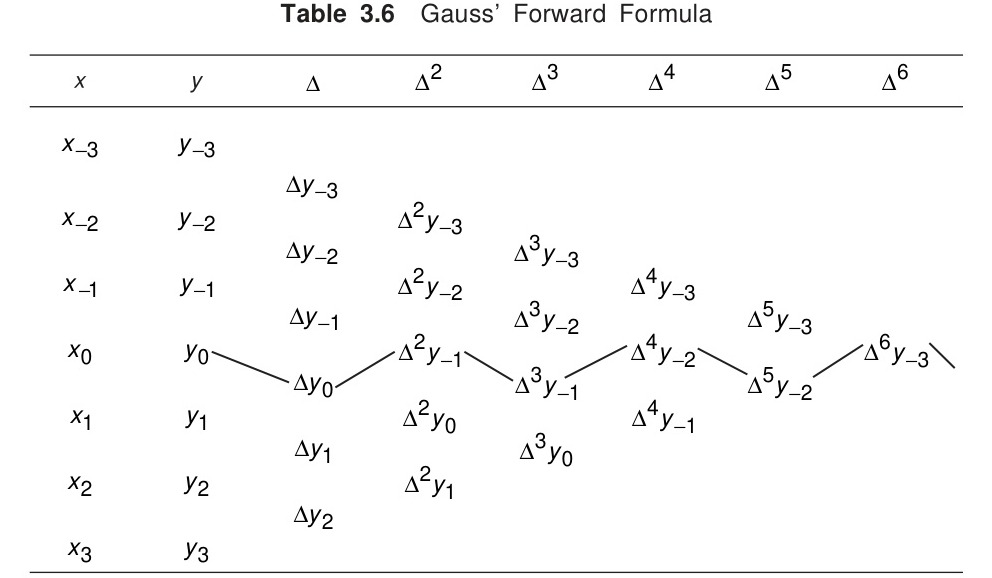
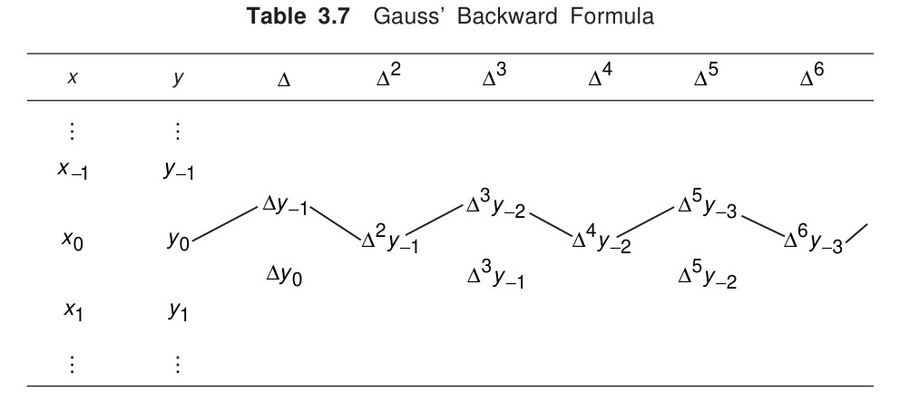

[← Previous: NM-4.9 Divided Difference](NM-4.9_Divided_Difference.md) | [📂 Topic Overview](_Topic_Overview.md) | [🏠 Master Index](../00_Index.md) | [Next: NM-4.11 Difference Tables →](NM-4.11_Difference_Tables.md)

---

# NM-4.10: Central Difference Formulas (Gauss & Stirling)

> 🟡 ⚠️ **Priority:** Light (Surprise Exam Topic) | **Tested:** 1 appearance (2021 Q.4(b)) | **Typical marks:** 5

## What This Is (and Why It Matters)

Students often ignore central difference formulas because lecture notes labeled them "off the Class Test." But the instructor left a written warning: *"Can appear in the Semester Final."* And that is exactly what happened in 2021, when a full 5-mark question demanded calculating $e^{1.17}$ using Gauss' forward formula.

When you interpolate near the middle of a large table, Newton's forward and backward formulas are mathematically lopsided: they pull points entirely from one side of your target. Central difference formulas keep your points balanced symmetrically around the center. This keeps your step variable small ($-0.5 \le p \le +0.5$), which makes the factorial multipliers shrink to near zero almost immediately and delivers accuracy down to five decimal places.

---

## 📝 Key Definitions

> **Gauss' Forward Formula:**
>
> $$
> y_p = y_0 + p\Delta y_0 + \frac{p(p-1)}{2!}\Delta^2 y_{-1} + \frac{(p+1)p(p-1)}{3!}\Delta^3 y_{-1} + \frac{(p+1)p(p-1)(p-2)}{4!}\Delta^4 y_{-2} + \cdots
> $$
>
> where the differences lie on the zig-zag path shown in Table 3.6. -- Jain, §3.7.1 (p. 91)
>
> **In simple words:** An interpolation formula for the middle of a table that follows a zigzag path: starting at the center row, taking one step down, then one step up, then down, then up.

> **Gauss' Backward Formula:**
>
> $$
> y_p = y_0 + p\Delta y_{-1} + \frac{p(p+1)}{2!}\Delta^2 y_{-1} + \frac{(p+1)p(p-1)}{3!}\Delta^3 y_{-2} + \frac{(p+2)(p+1)p(p-1)}{4!}\Delta^4 y_{-2} + \cdots
> $$
>
> where the differences lie on the zig-zag path shown in Table 3.7. -- Jain, §3.7.1 (p. 92–93)
>
> **In simple words:** The mirror image of the forward formula. It starts at the center row and steps up first, then down, then up, then down.

> **Stirling's Formula:** "Taking the mean of Gauss' forward and backward formulae, we obtain:
>
> $$
> y_p = y_0 + p \frac{\Delta y_{-1} + \Delta y_0}{2} + \frac{p^2}{2} \Delta^2 y_{-1} + \frac{p(p^2 - 1)}{3!} \frac{\Delta^3 y_{-1} + \Delta^3 y_{-2}}{2} + \frac{p^2(p^2 - 1)}{4!} \Delta^4 y_{-2} + \cdots
> $$
>
> -- Jain, §3.7.2 (p. 94)
>
> **In simple words:** The mathematical average of Gauss' forward and backward formulas. It averages the odd-order differences and uses squared terms $p^2(p^2-1)$ that converge even faster.

---

## The Core Idea: Tracing the Zig-Zag Path

Central difference formulas index their rows with zero in the middle: $\dots, -2, -1, 0, +1, +2, \dots$

### 1. Gauss' Forward Difference Path

To evaluate a target with $0 \le p \le 0.5$, follow the forward zig-zag trajectory:
1. Start at center entry $y_0$.
2. Step **down** to first difference $\Delta y_0$.
3. Step **up** to second difference $\Delta^2 y_{-1}$.
4. Step **down** to third difference $\Delta^3 y_{-1}$.
5. Step **up** to fourth difference $\Delta^4 y_{-2}$.

### 2. Gauss' Backward Difference Path

To evaluate a target with $-0.5 \le p \le 0$, follow the backward zig-zag trajectory:
1. Start at center entry $y_0$.
2. Step **up** to first difference $\Delta y_{-1}$.
3. Step **down** to second difference $\Delta^2 y_{-1}$.
4. Step **up** to third difference $\Delta^3 y_{-2}$.
5. Step **down** to fourth difference $\Delta^4 y_{-2}$.

### Why Central Formulas Are Superior in the Center

In Newton's formulas, terms contain $(p-1)(p-2)(p-3)$. If you pick a point near the middle, $p \approx 3$, so those factors grow into large numbers like $(3)(2)(1) = 6$. Any rounding error in higher differences gets magnified.

In central formulas, the factors interleave plus and minus signs: $(p+1)p(p-1)$. Because $|p| \le 0.5$, look at the size of the product:

$$
(1.4)(0.4)(-0.6) = -0.336
$$

Dividing by $3! = 6$ makes the multiplier $-0.056$. The terms shrink to zero very rapidly, ensuring clean, high-precision convergence.

---

## 🔧 Worked Example

> **From:** 2021 Q.4(b) -- [Marks: 05]

**The question:** From the following table, calculate the value of $e^{1.17}$ using Gauss' forward formula:

| $x$ | 1.00 | 1.05 | 1.10 | 1.15 | 1.20 | 1.25 | 1.30 |
| :---: | :---: | :---: | :---: | :---: | :---: | :---: | :---: |
| $e^x$ | 2.7183 | 2.8577 | 3.0042 | 3.1582 | 3.3201 | 3.4903 | 3.6693 |

**Let's solve this step by step like a tutor.**

**Step 1: Choose the center node $x_0$ and calculate $p$**
Step size is $h = 0.05$. Our target is $x = 1.17$.
Choose the node closest to and just below $1.17$:
Choose $x_0 = 1.15$.

$$
p = \frac{x - x_0}{h} = \frac{1.17 - 1.15}{0.05} = \frac{0.02}{0.05} = 0.4
$$

Notice that $0 \le p \le 0.5$, which satisfies the condition for Gauss' forward formula.

**Step 2: Construct the difference table**

| Index $i$ | $x$ | $y$ | $\Delta y$ | $\Delta^2 y$ | $\Delta^3 y$ | $\Delta^4 y$ |
| :---: | :---: | :---: | :---: | :---: | :---: | :---: |
| $-3$ | 1.00 | 2.7183 | 0.1394 | 0.0071 | 0.0004 | 0.0000 |
| $-2$ | 1.05 | 2.8577 | 0.1465 | 0.0075 | 0.0004 | 0.0000 |
| $-1$ | 1.10 | 3.0042 | 0.1540 | 0.0079 | 0.0004 | 0.0001 |
| **0** | **1.15** | **3.1582** | **0.1619** | 0.0083 | 0.0005 | -- |
| $+1$ | 1.20 | 3.3201 | 0.1702 | 0.0088 | -- | -- |
| $+2$ | 1.25 | 3.4903 | 0.1790 | -- | -- | -- |
| $+3$ | 1.30 | 3.6693 | -- | -- | -- | -- |

**Step 3: Read differences along the Gauss forward zig-zag path**
Start at row $0$ and zigzag:
- $y_0 = 3.1582$ (center row)
- $\Delta y_0 = 0.1619$ (step down)
- $\Delta^2 y_{-1} = 0.0079$ (step up)
- $\Delta^3 y_{-1} = 0.0004$ (step down)
- $\Delta^4 y_{-2} = 0.0000$ (step up)

**Step 4: Evaluate Gauss' forward formula ($p = 0.4$)**

$$
y_p = y_0 + p\Delta y_0 + \frac{p(p-1)}{2!}\Delta^2 y_{-1} + \frac{(p+1)p(p-1)}{3!}\Delta^3 y_{-1} + \frac{(p+1)p(p-1)(p-2)}{4!}\Delta^4 y_{-2}
$$

Compute the terms:
- **Term 0:** $3.1582$
- **Term 1:** $0.4(0.1619) = +0.06476$
- **Term 2:** $\frac{0.4(0.4 - 1)}{2}(0.0079) = \frac{0.4(-0.6)}{2}(0.0079) = -0.12(0.0079) = -0.000948$
- **Term 3:** $\frac{(1.4)(0.4)(-0.6)}{6}(0.0004) = \frac{-0.336}{6}(0.0004) = -0.056(0.0004) = -0.0000224$
- **Term 4:** $0$

**Step 5: Sum all terms**

$$
e^{1.17} \approx 3.1582 + 0.06476 - 0.000948 - 0.0000224 = 3.2219896 \approx 3.22199
$$

$$
\boxed{e^{1.17} \approx 3.22199}
$$

**Check against true mathematical value:**
$e^{1.17} = 3.221993$.
The computed result matches the exact value to 5 decimal places.

---

## ⚡ Quick Review

**The method in one sentence:** For a target near the middle of an equidistant table, choose the nearest base node $x_0$ so that $0 \le p \le 0.5$, and trace the alternating down-up zigzag path through the central differences.

**The formula to memorize:**
$$
y_p = y_0 + p\Delta y_0 + \frac{p(p-1)}{2}\Delta^2 y_{-1} + \frac{(p+1)p(p-1)}{6}\Delta^3 y_{-1} + \dots
$$

**The most common exam mistake:** Mixing up the subscripts on the zigzag path. Remember: start at $y_0$, step DOWN to $\Delta y_0$, step UP to $\Delta^2 y_{-1}$, step DOWN to $\Delta^3 y_{-1}$.

**Time estimate in exam:** ~7 minutes to build the central table and evaluate the terms.

---

## 🔗 Connected Topics

- [← NM-4.9: Divided Difference](NM-4.9_Divided_Difference.md) -- when data points are not equally spaced.
- [→ NM-4.11: Difference Tables](NM-4.11_Difference_Tables.md) -- standard forward and backward difference tables.
- [NM-4.7: Newton Forward Difference](NM-4.7_Newton_Forward_Difference.md) -- comparison of forward versus central difference trajectories.

---

[← Previous: NM-4.9 Divided Difference](NM-4.9_Divided_Difference.md) | [📂 Topic Overview](_Topic_Overview.md) | [🏠 Master Index](../00_Index.md) | [Next: NM-4.11 Difference Tables →](NM-4.11_Difference_Tables.md)
