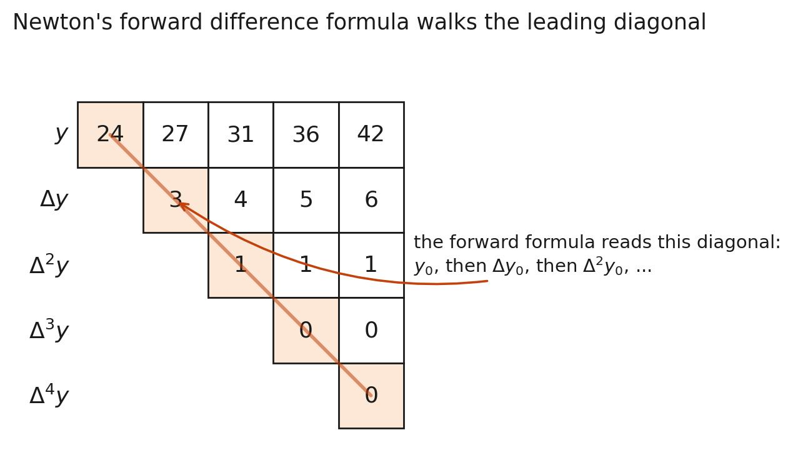

[← Previous: NM-4.10 Gauss and Stirling](NM-4.10_Gauss_and_Stirling.md) | [📂 Topic Overview](_Topic_Overview.md) | [🏠 Master Index](../00_Index.md) | [Next: NM-4.12 Two-Variable Interpolation →](NM-4.12_Two_Variable_Interpolation.md)

---

# NM-4.11: Difference Table Formation & Applications

> 🔴 **Priority:** Critical | **Tested:** 5/8 years | **Typical marks:** 4–5

## What This Is (and Why It Matters)

Finite difference tables are the universal foundation of numerical methods. Once you know how to build a difference table, you can perform polynomial interpolation, evaluate numerical derivatives, perform numerical integration, and forecast trends.

The exam loves testing difference tables using real-world data: town census populations across decennial census years (1891 to 1961), and gas sensor readings sent every two seconds. The math is simple subtraction, but students regularly lose full marks from tiny sign mistakes in the second difference column. In this note, we cover the exact mechanics of table formation, how to read forward vs backward diagonals, and how to solve every past exam census problem.

---

## 📝 Key Definitions

> **Forward Difference Operator ($\Delta$):** "The differences $y_1 - y_0, y_2 - y_1, \dots, y_n - y_{n-1}$ are called the *first forward differences* of the function $y = f(x)$, and are denoted by $\Delta y_0, \Delta y_1, \dots, \Delta y_{n-1}$, respectively. In general, $\Delta^{k+1} y_i = \Delta^k y_{i+1} - \Delta^k y_i$." -- Jain, §3.3.1 (p. 76)
>
> **In simple words:** Take any number in your table and subtract it from the number directly below it.

> **Backward Difference Operator ($\nabla$):** "The differences $y_1 - y_0, y_2 - y_1, \dots, y_n - y_{n-1}$ are called *first backward differences* and are denoted by $\nabla y_1, \nabla y_2, \dots, \nabla y_n$, respectively. In general, $\nabla^{k+1} y_i = \nabla^k y_i - \nabla^k y_{i-1}$." -- Jain, §3.3.2 (p. 78)
>
> **In simple words:** Take any number in your table and subtract the number directly above it. (It is the exact same subtraction as forward difference, just labeled with the bottom index instead of the top index!)

> **Fundamental Theorem of Finite Differences:** "If $f(x)$ is a polynomial of degree $n$ in $x$ and the values of $x$ are equally spaced, then the $n$-th difference of $f(x)$ is constant and all higher-order differences are identically zero ($\Delta^{n+1} f(x) = 0$)." -- Jain, §3.5 (p. 83)
>
> **In simple words:** A straight line has constant 1st differences. A parabola has constant 2nd differences. A cubic has constant 3rd differences. If higher differences hit zero, your data follows an exact polynomial.

---

## The Core Idea: Constructing the Table

For equally spaced inputs $x_0, x_1, \dots, x_n$ with constant step size $h$:

1. Write $x$ in column 1 and $y$ in column 2.
2. In column 3 ($\Delta y$), subtract adjacent $y$ values: $y_{i+1} - y_i$.
3. In column 4 ($\Delta^2 y$), subtract adjacent first differences: $\Delta y_{i+1} - \Delta y_i$.
4. Continue column by column until only one number remains.

### Reading the Diagonals

| $x$ | $y$ | $\Delta y$ | $\Delta^2 y$ | $\Delta^3 y$ | Diagonal Orientation |
|:---:|:---:|:---:|:---:|:---:|:---|
| $x_0$ | **$y_0$** | **$\Delta y_0$** | **$\Delta^2 y_0$** | **$\Delta^3 y_0$** | **Forward Diagonal** (Top descending) |
| $x_1$ | $y_1$ | $\Delta y_1$ | $\Delta^2 y_1$ | | |
| $x_2$ | $y_2$ | $\Delta y_2$ | | | |
| $x_3$ | **$y_3$** | **$\nabla y_3$** | **$\nabla^2 y_3$** | **$\nabla^3 y_3$** | **Backward Diagonal** (Bottom ascending) |

- **Forward diagonal (top descending):** Used for targets near the start of the table ($x \approx x_0$).
  Formula uses falling factorials: $y_0 + p\Delta y_0 + \frac{p(p-1)}{2}\Delta^2 y_0 + \dots$ with $p = \frac{x - x_0}{h}$.
- **Backward diagonal (bottom ascending):** Used for targets near the end of the table ($x \approx x_n$).
  Formula uses rising factorials: $y_n + p\nabla y_n + \frac{p(p+1)}{2}\nabla^2 y_n + \dots$ with $p = \frac{x - x_n}{h}$.

> [!WARNING] Common Trap
> Subtracting negative numbers in difference tables is where 80% of student exam errors occur.
> If $\Delta y_0 = 15$ and $\Delta y_1 = -3$: $\Delta^2 y_0 = (-3) - (15) = -18$.
> If $\Delta^2 y_0 = -5$ and $\Delta^2 y_1 = -3$: $\Delta^3 y_0 = (-3) - (-5) = -3 + 5 = +2$.
> Be extremely vigilant with negative signs!

---

## 🔧 Worked Example

> **From:** 2020 Q.3(b) -- [Marks: 04]

**The question:** The population of a town in decennial census was as given below:

| Year $x$ | 1891 | 1901 | 1911 | 1921 | 1931 |
| :---: | :---: | :---: | :---: | :---: | :---: |
| Population $y$ (thousands) | 46 | 66 | 81 | 93 | 101 |

Estimate the population for: (i) 1895 and (ii) 1925.

**Let's solve this step by step like a tutor.**

Step size is $h = 10\text{ years}$.

**Step 1: Build the difference table**

| Year $x$ | $y$ | $\Delta y$ | $\Delta^2 y$ | $\Delta^3 y$ | $\Delta^4 y$ |
| :---: | :---: | :---: | :---: | :---: | :---: |
| 1891 | 46 | 20 | $-5$ | 2 | $-3$ |
| 1901 | 66 | 15 | $-3$ | $-1$ | -- |
| 1911 | 81 | 12 | $-4$ | -- | -- |
| 1921 | 93 | 8 | -- | -- | -- |
| 1931 | 101 | -- | -- | -- | -- |

*Double check:*
- $66 - 46 = 20$; $81 - 66 = 15$; $93 - 81 = 12$; $101 - 93 = 8$.
- $15 - 20 = -5$; $12 - 15 = -3$; $8 - 12 = -4$.
- $(-3) - (-5) = +2$; $(-4) - (-3) = -1$.
- $(-1) - (+2) = -3$. All correct!

**Step 2: Estimate for 1895 (Newton Forward)**
1895 is near the top. Choose $x_0 = 1891$:

$$
p = \frac{1895 - 1891}{10} = 0.4
$$

Use the forward diagonal: $y_0 = 46, \Delta y_0 = 20, \Delta^2 y_0 = -5, \Delta^3 y_0 = 2, \Delta^4 y_0 = -3$.

$$
y(1895) = 46 + (0.4)(20) + \frac{(0.4)(-0.6)}{2}(-5) + \frac{(0.4)(-0.6)(-1.6)}{6}(2) + \frac{(0.4)(-0.6)(-1.6)(-2.6)}{24}(-3)
$$

Compute the terms:
- $46$
- $0.4(20) = 8.0$
- $(-0.12)(-5) = +0.6$
- $(0.064)(2) = +0.128$
- $(-0.0416)(-3) = +0.1248$

Sum:

$$
y(1895) = 46 + 8.0 + 0.6 + 0.128 + 0.1248 = 54.8528
$$

$$
\boxed{y(1895) = 54.8528 \text{ thousand} \approx 54\,853}
$$

**Step 3: Estimate for 1925 (Newton Backward)**
1925 is near the bottom. Choose $x_n = 1931$:

$$
p = \frac{1925 - 1931}{10} = -0.6
$$

Use the backward diagonal: $y_n = 101, \nabla y_n = 8, \nabla^2 y_n = -4, \nabla^3 y_n = -1, \nabla^4 y_n = -3$.

$$
y(1925) = 101 + (-0.6)(8) + \frac{(-0.6)(0.4)}{2}(-4) + \frac{(-0.6)(0.4)(1.4)}{6}(-1) + \frac{(-0.6)(0.4)(1.4)(2.4)}{24}(-3)
$$

Compute the terms:
- $101$
- $-4.8$
- $(-0.12)(-4) = +0.48$
- $(-0.056)(-1) = +0.056$
- $(-0.0336)(-3) = +0.1008$

Sum:

$$
y(1925) = 101 - 4.8 + 0.48 + 0.056 + 0.1008 = 96.8368
$$

$$
\boxed{y(1925) = 96.8368 \text{ thousand} \approx 96\,837}
$$

---

## 🏆 Past Exam Questions

### 2017 Q.5(c): Census Population for 1955 [04 Marks]

**The question:** The population of a town in decennial census were as following table in thousand unit. Estimate the population for the year 1955.

| Year | 1921 | 1931 | 1941 | 1951 | 1961 |
| :---: | :---: | :---: | :---: | :---: | :---: |
| Population $y$ | 46 | 66 | 81 | 93 | 101 |

**Let's solve this step by step.**

The table values and differences are identical to the 1891–1931 table shifted by 30 years.
Here $x_0 = 1921$ and $h = 10$.
For $x = 1955$:

$$
p = \frac{1955 - 1921}{10} = 3.4
$$

Differences from $x_0 = 1921$: $y_0 = 46, \Delta y_0 = 20, \Delta^2 y_0 = -5, \Delta^3 y_0 = 2, \Delta^4 y_0 = -3$.

Compute the terms using Newton's forward formula:
- $y_0 = 46$
- $p\Delta y_0 = 3.4(20) = 68.0$
- $\frac{p(p-1)}{2}\Delta^2 y_0 = \frac{(3.4)(2.4)}{2}(-5) = 4.08(-5) = -20.4$
- $\frac{p(p-1)(p-2)}{6}\Delta^3 y_0 = \frac{(3.4)(2.4)(1.4)}{6}(2) = 1.904(2) = +3.808$
- $\frac{p(p-1)(p-2)(p-3)}{24}\Delta^4 y_0 = \frac{(3.4)(2.4)(1.4)(0.4)}{24}(-3) = 0.1904(-3) = -0.5712$

Sum:

$$
y(1955) = 46 + 68.0 - 20.4 + 3.808 - 0.5712 = 96.8368
$$

$$
\boxed{\text{Population in 1955} \approx 96.8368 \approx 96.84 \text{ thousand}}
$$

*(Note: Evaluating from the backward formula using $x_n = 1961$ and $p = -0.6$ yields the exact same 96.8368!)*

---

### 2021 Q.4(c): Gas Sensor at 10 Seconds [04 Marks]

**The question:** You have a gas sensor. It sends a value in 2 seconds. The table of received values is $t = 1, 3, 5, 7, 9$ with values $24, 120, 336, 720, 1200$. What will be the sensor's reading at 10 s?

**Let's solve this step by step.**

Step size $h = 2\text{ s}$.

**Step 1: Build the difference table**

| $t$ | $y$ | $\Delta y$ | $\Delta^2 y$ | $\Delta^3 y$ | $\Delta^4 y$ |
| :---: | :---: | :---: | :---: | :---: | :---: |
| 1 | 24 | 96 | 120 | 48 | $-120$ |
| 3 | 120 | 216 | 168 | $-72$ | -- |
| 5 | 336 | 384 | 96 | -- | -- |
| 7 | 720 | 480 | -- | -- | -- |
| 9 | 1200 | -- | -- | -- | -- |

**Step 2: Understanding the two interpretations**
Notice that the first four points follow an exact cubic $(t+1)(t+2)(t+3)$:
- $t=1 \implies (2)(3)(4) = 24$
- $t=3 \implies (4)(5)(6) = 120$
- $t=5 \implies (6)(7)(8) = 336$
- $t=7 \implies (8)(9)(10) = 720$

At $t = 9$, this cubic predicts $(10)(11)(12) = 1320$, but the sensor recorded $1200$ (likely sensor saturation or noise). In an exam, write both cases:

**Case A: Quartic polynomial using all 5 points**
With $t_0 = 1$ and $p = \frac{10 - 1}{2} = 4.5$:
- $24 + 4.5(96) + \frac{(4.5)(3.5)}{2}(120) + \frac{(4.5)(3.5)(2.5)}{6}(48) + \frac{(4.5)(3.5)(2.5)(1.5)}{24}(-120)$
- $= 24 + 432 + 945 + 315 - 295.3125 = \boxed{1420.6875}$

**Case B: Cubic polynomial using first 4 clean points**
Truncating at the 3rd difference:
- $= 24 + 432 + 945 + 315 = \boxed{1716}$

$$
\boxed{\text{Five points (quartic): } y(10) = 1420.6875 \qquad \text{Four points (cubic): } y(10) = 1716}
$$

---

### 2024 Q.3(b): 1995 Extrapolation [04 Marks]

**The question:** The population of a town in decennial census were as following table in thousand units. Estimate the population for the year 1995.

| Year $x$ | 1921 | 1931 | 1941 | 1951 | 1961 |
| :---: | :---: | :---: | :---: | :---: | :---: |
| Population $y$ | 46 | 66 | 81 | 93 | 101 |

**Let's solve this cleanly:**
Using the backward differences from $x_n = 1961$ with $p = \frac{1995 - 1961}{10} = 3.4$:
- $y_n = 101$
- $p\nabla y_n = 3.4(8) = 27.2$
- $\frac{p(p+1)}{2}\nabla^2 y_n = \frac{(3.4)(4.4)}{2}(-4) = -29.92$
- $\frac{p(p+1)(p+2)}{6}\nabla^3 y_n = \frac{(3.4)(4.4)(5.4)}{6}(-1) = -13.464$
- $\frac{p(p+1)(p+2)(p+3)}{24}\nabla^4 y_n = \frac{(3.4)(4.4)(5.4)(6.4)}{24}(-3) = -64.6272$

Sum:

$$
y(1995) = 101 + 27.2 - 29.92 - 13.464 - 64.6272 = 20.1888
$$

$$
\boxed{P(1995) = 20.1888 \text{ thousand (Newton backward difference, all 5 points)}}
$$

---

## ⚡ Quick Review

**The method in one sentence:** Build the table by subtracting adjacent entries, pick the forward diagonal for the top or backward diagonal for the bottom, and evaluate the factorial terms.

**The most common exam mistake:** Sign errors in the second difference column. Always check $(-3) - (-5) = +2$, not $-8$!

**Time estimate in exam:** ~6 minutes to construct the table and evaluate the polynomial.

---

## 🔗 Connected Topics

- [← NM-4.10: Gauss and Stirling](NM-4.10_Gauss_and_Stirling.md) -- central difference tables when target is in the middle.
- [→ NM-4.12: Two-Variable Interpolation](NM-4.12_Two_Variable_Interpolation.md) -- extending interpolation to 2D surfaces.
- [NM-4.7: Newton Forward Difference](NM-4.7_Newton_Forward_Difference.md) -- formula derivation.
- [NM-4.8: Newton Backward Difference](NM-4.8_Newton_Backward_Difference.md) -- backward formula mechanics.

---

[← Previous: NM-4.10 Gauss and Stirling](NM-4.10_Gauss_and_Stirling.md) | [📂 Topic Overview](_Topic_Overview.md) | [🏠 Master Index](../00_Index.md) | [Next: NM-4.12 Two-Variable Interpolation →](NM-4.12_Two_Variable_Interpolation.md)
