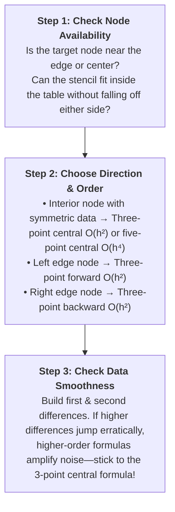

[← Previous: NM-7.1 Difference Formulas](NM-7.1_Difference_Formulas.md) | [📂 Topic Overview](_Topic_Overview.md) | [🏠 Master Index](../00_Index.md) | [Next: NM-7.3 Second Derivative →](NM-7.3_Second_Derivative.md)

---

# NM-7.2: First Derivative from Tabulated Data

> 🟠 **Priority:** Secondary | **Tested:** 4/8 years (2019, 2020, 2021, 2022) | **Typical marks:** 4–5

## What This Is (and Why It Matters)

In the exam hall, you will almost never get an abstract formula when testing numerical differentiation. Instead, the examiner hands you a raw table of numbers: time and current, time and angle, or coordinates $(x, y)$. You are asked to compute the first derivative (and sometimes the second derivative) at a specific point in that table.

The whole challenge is picking the right formula for the right situation:
- If your point is in the interior and has neighbors on both sides, use a **central difference** ($O(h^2)$ or $O(h^4)$).
- If your point sits on the boundary edge, you must use a **one-sided formula** ($O(h)$ or $O(h^2)$).
- If your points are scrambled or unequally spaced, you must sort them, fit an interpolating polynomial, and differentiate that polynomial.

This subtopic has appeared in half of all RUET semester final papers (2019, 2020, 2021, and 2022). Master the decision protocol below, and these 4 to 5 marks are guaranteed.

---

## 📝 Key Definitions

> **Tabulated derivative:** "given the set of values of $x$ and $y$, as above, we shall derive formulae to compute (i) $\frac{dy}{dx}, \frac{d^2y}{dx^2}, \dots$ for any value of $x$ in $[x_0, x_n]$" -- Jain, §6.1 (p. 207)
>
> **In simple words:** Finding the exact slope of a curve at a specific point when your only source of information is a discrete table of measurements.

> **Symmetric cancellation advantage:** "In central difference approximations, Taylor series terms with even powers of $h$ cancel out automatically, yielding an error of $O(h^2)$ without requiring extra evaluation points."
>
> **In simple words:** Central differences look equally far left and right. Because of symmetry, the leading error terms cancel each other out, making central differences vastly more accurate than one-sided differences.

> **Truncation vs round-off error balance:** "The truncation error is caused by replacing the tabulated function by means of an interpolating polynomial... The rounding error, on the other hand, is inversely proportional to $h$ in the case of first derivatives, inversely proportional to $h^2$ in the case of second derivatives... Thus, rounding error increases as $h$ decreases." -- Jain, §6.2.1 (p. 212)
>
> **In simple words:** If your step size $h$ is too large, your formula misses the curvature of the graph. But if your step size $h$ is too small, your calculator loses accuracy from subtractive cancellation and divides the remaining noise by a tiny fraction.

---

## The Decision Protocol: How to Pick Your Formula

Whenever you face a tabulated differentiation problem in an exam, follow these three steps in strict order:

---

## 🏆 Past Exam Questions

Here are the four major variations of numerical differentiation tested in RUET semester finals.

---

### Problem 1 (2021 Q.7(c)): First & Second Derivatives of $e^x$ at $x = 1.2$ [05 Marks]

**The question:** From the values of $x$ and $y$ in the following table, determine $\frac{dy}{dx}$ and $\frac{d^2y}{dx^2}$ for $x = 1.2$.

| $x$ | 1.0 | 1.2 | 1.4 | 1.6 | 1.8 | 2.0 | 2.2 |
| :-- | :--: | :--: | :--: | :--: | :--: | :--: | :--: |
| $y$ | 2.7183 | 3.3201 | 4.0552 | 4.9530 | 6.0496 | 7.3891 | 9.0250 |

**Let's solve this step by step.**

The table has uniform step size $h = 0.2$. The values are actually $e^x$ rounded to four decimal places.

> [!WARNING] The 5-point formula cannot be used at $x = 1.2$
> Many students rush to use the 5-point central formula because it has $O(h^4)$ accuracy. But 5-point central requires nodes at $x - 2h, x - h, x, x + h, x + 2h$.
>
> For $x = 1.2$ and $h = 0.2$, that requires $x = 0.8, 1.0, 1.2, 1.4, 1.6$.
> **The table has no $x = 0.8$!** The table starts at $x = 1.0$. If you try to use a 5-point central formula at $x = 1.2$, you fall off the left edge of the table.
>
> Therefore, the **three-point central formula** is the intended and correct tool.

#### Part A: First Derivative at $x = 1.2$

Using the three-point central difference with $x = 1.0, 1.2, 1.4$:

$$
\left.\frac{dy}{dx}\right|_{1.2} \approx \frac{y_{1.4} - y_{1.0}}{2h} = \frac{4.0552 - 2.7183}{2(0.2)} = \frac{1.3369}{0.4} = 3.34225
$$

Rounding to four decimal places:

$$
\left.\frac{dy}{dx}\right|_{1.2} \approx 3.3423
$$

*(For comparison, if you mistakenly used a three-point forward difference with $x = 1.2, 1.4, 1.6$:*
*$\frac{-3(3.3201) + 4(4.0552) - 4.9530}{0.4} = \frac{1.3075}{0.4} = 3.26875$.*
*The exact value is $e^{1.2} = 3.3201169$. The central formula has an error of $+0.0221$, while the forward formula has a much larger error of $-0.0514$. Central is more than twice as accurate!)*

#### Part B: Second Derivative at $x = 1.2$

Using the three-point central second-derivative formula:

$$
\left.\frac{d^2y}{dx^2}\right|_{1.2} \approx \frac{y_{1.4} - 2y_{1.2} + y_{1.0}}{h^2} = \frac{4.0552 - 2(3.3201) + 2.7183}{(0.2)^2}
$$

Calculate the numerator:

$$
4.0552 - 6.6402 + 2.7183 = 0.1333
$$

Now divide by $h^2 = 0.04$:

$$
\left.\frac{d^2y}{dx^2}\right|_{1.2} \approx \frac{0.1333}{0.04} = 3.3325
$$

*(For comparison, a three-point forward second derivative gives:*
*$\frac{y_{1.6} - 2y_{1.4} + y_{1.2}}{h^2} = \frac{4.9530 - 2(4.0552) + 3.3201}{0.04} = \frac{0.1627}{0.04} = 4.0675$.*
*The exact second derivative is also $e^{1.2} \approx 3.3201$. The central formula error is $+0.0124$, while the forward formula error is $+0.7474$. Central is 60 times better!)*

$$
\boxed{\frac{dy}{dx}\bigg|_{1.2} \approx 3.3423, \qquad \frac{d^2y}{dx^2}\bigg|_{1.2} \approx 3.3325}
$$

---

### Problem 2 (2019 Q.6(b)): Inductor Voltage from Sampled Current [05 Marks]

**The question:** A 1 Henry inductance gets current through it at different times as follows. Obtain the voltage across it at $t = 0.27\text{ sec}$ using numerical differentiation.

| $t$ (sec) | 0.25 | 0.26 | 0.27 | 0.28 | 0.29 |
| :--: | :--: | :--: | :--: | :--: | :--: |
| $I$ (amp) | 0.2474 | 0.2571 | 0.2667 | 0.2764 | 0.2860 |

**Let's solve this step by step.**

The step size is $h = 0.01\text{ s}$.
The target time is $t = 0.27\text{ s}$. It sits right in the exact center of the table, with two points to the left ($0.25, 0.26$) and two points to the right ($0.28, 0.29$).
This means the **five-point central formula** is available and will give maximum accuracy.

#### Step 1: Compute $\frac{dI}{dt}$ using 5-Point Central Difference

$$
f'(x_n) = \frac{f_{n-2} - 8f_{n-1} + 8f_{n+1} - f_{n+2}}{12h}
$$

Identify the values:
- $f_{n-2} = I(0.25) = 0.2474$
- $f_{n-1} = I(0.26) = 0.2571$
- $f_{n+1} = I(0.28) = 0.2764$
- $f_{n+2} = I(0.29) = 0.2860$

Substitute into the formula:

$$
\left.\frac{dI}{dt}\right|_{t = 0.27} = \frac{0.2474 - 8(0.2571) + 8(0.2764) - 0.2860}{12(0.01)}
$$

Calculate intermediate products:
- $8 \times 0.2571 = 2.0568$
- $8 \times 0.2764 = 2.2112$

Evaluate the numerator:

$$
0.2474 - 2.0568 + 2.2112 - 0.2860 = 0.1158
$$

Divide by $12h = 0.12$:

$$
\frac{dI}{dt} = \frac{0.1158}{0.12} = 0.965\text{ A/s}
$$

#### Step 2: Compute Inductor Voltage

From basic circuit theory, the voltage across an inductor is given by Faraday's law:

$$
v(t) = L \frac{dI}{dt}
$$

With $L = 1\text{ H}$:

$$
v(0.27) = 1 \times 0.965 = 0.965\text{ V}
$$

$$
\boxed{v(0.27) = 0.965\ \text{V}}
$$

> [!NOTE] Sanity Check with 3-Point Central Formula
> If you test the three-point central formula:
> $[I(0.28) - I(0.26)] / (2h) = (0.2764 - 0.2571) / 0.02 = 0.0193 / 0.02 = 0.965\text{ V}$.
>
> It gives the exact same $0.965\text{ V}$!
> Why do the 3-point and 5-point formulas agree so perfectly? Look at the first differences of the current:
> - $0.2571 - 0.2474 = 0.0097$
> - $0.2667 - 0.2571 = 0.0096$
> - $0.2764 - 0.2667 = 0.0097$
> - $0.2860 - 0.2764 = 0.0096$
>
> The slope is almost perfectly constant at $0.00965$ per $0.01\text{ s}$. When data is locally straight, every difference formula gives the exact same answer regardless of order!

---

### Problem 3 (2020 Q.6(c)): Angular Velocity from Angular Displacement [04 Marks]

**The question:** The following table gives the angular displacements $\theta$ (radian) at different time intervals of time $t$ (sec). Calculate the angular velocity at the instant $t = 0.06$ sec.

| $t$ | 0 | 0.02 | 0.04 | 0.06 | 0.08 | 0.10 | 0.12 |
| :-- | :--: | :--: | :--: | :--: | :--: | :--: | :--: |
| $\theta$ | 0.052 | 0.105 | 0.168 | 0.242 | 0.327 | 0.408 | 0.489 |

**Let's solve this step by step.**

#### Step 1: Identify Physical Relationship & Parameters
Angular velocity is the time derivative of angular displacement:

$$
\omega = \frac{d\theta}{dt}
$$

The step size is uniform: $h = 0.02\text{ s}$.

#### Step 2: Apply the Three-Point Central Difference Formula
The target instant $t = 0.06\text{ s}$ is an interior node with neighbors at $t = 0.04$ and $t = 0.08$:

$$
\left.\frac{d\theta}{dt}\right|_{0.06} \approx \frac{\theta_{0.08} - \theta_{0.04}}{2h} = \frac{0.327 - 0.168}{2(0.02)} = \frac{0.159}{0.04} = 3.975\text{ rad/s}
$$

$$
\boxed{\left.\frac{d\theta}{dt}\right|_{t=0.06} \approx 3.975 \text{ rad/s}}
$$

#### Step 3: What Happens if You Try 5-Point Central?
At $t = 0.06$, $t - 2h = 0.02$ and $t + 2h = 0.10$ both exist in the table, so the five-point central formula can technically be evaluated:

$$
\left.\frac{d\theta}{dt}\right|_{0.06} \approx \frac{\theta_{0.02} - 8\theta_{0.04} + 8\theta_{0.08} - \theta_{0.10}}{12h} = \frac{0.105 - 8(0.168) + 8(0.327) - 0.408}{12(0.02)}
$$

$$
= \frac{0.105 - 1.344 + 2.616 - 0.408}{0.24} = \frac{0.969}{0.24} = 4.0375\text{ rad/s}
$$

> [!WARNING] Why Do the Formulas Differ by 1.6%?
> Build the difference table to see what is happening to the data:
> - $\Delta\theta$: $0.053, 0.063, 0.074, 0.085, 0.081, 0.081$
> - $\Delta^2\theta$: $0.010, 0.011, 0.011, -0.004, 0.000$
>
> In the first four intervals, the angular velocity grows smoothly ($\Delta^2\theta \approx 0.011$). But after $t = 0.06$, the second difference suddenly crashes from $+0.011$ to $-0.004$ and $0.000$! The physical acceleration stopped abruptly.
>
> The five-point formula reaches outward to $t = 0.02$ and $t = 0.10$, capturing this irregular kink. The three-point central formula uses only the smooth local neighborhood ($0.04$ to $0.08$).
>
> In the exam, **report the three-point central answer ($3.975\text{ rad/s}$)** as your primary answer, and note that irregular higher differences make the 3-point local formula the most reliable choice.

---

### Problem 4 (2022 Q.3(b)): The Scrambled Quartic Table [04 Marks]

**The question:** A cubic function $y = f(x)$ satisfies the data $x = 0, 1, 3, 4, 2$ with $f(x) = 1, 4, 40, 85, 17$. Determine the value of $f'(4)$.

**Let's solve this step by step.**

This problem contains two exam defects that trip up unprepared students:
1. **The $x$ values are printed out of order:** $0, 1, 3, 4, 2$. You must sort them into increasing order before building any table!
2. **The question calls it a "cubic function", but it is actually a quartic!** Let's prove it with divided differences.

#### Step 1: Sort the Data & Build the Divided Difference Table

Sorted coordinate pairs: $(0, 1), (1, 4), (2, 17), (3, 40), (4, 85)$.

| $x$ | $y$ | First Divided Diff | Second Divided Diff | Third Divided Diff | Fourth Divided Diff |
| :--: | :--: | :--: | :--: | :--: | :--: |
| 0 | **1** | | | | |
| 1 | 4 | $\frac{4 - 1}{1 - 0} = \mathbf{3}$ | | | |
| 2 | 17 | $\frac{17 - 4}{2 - 1} = 13$ | $\frac{13 - 3}{2 - 0} = \mathbf{5}$ | | |
| 3 | 40 | $\frac{40 - 17}{3 - 2} = 23$ | $\frac{23 - 13}{3 - 1} = 5$ | $\frac{5 - 5}{3 - 0} = \mathbf{0}$ | |
| 4 | 85 | $\frac{85 - 40}{4 - 3} = 45$ | $\frac{45 - 23}{4 - 2} = 11$ | $\frac{11 - 5}{4 - 1} = 2$ | $\frac{2 - 0}{4 - 0} = \mathbf{\frac{1}{2}}$ |

Notice that the fourth divided difference is $\frac{1}{2}$, **not zero**! If the function were truly a cubic, the 4th divided difference would be zero. The data is mathematically a 4th-degree polynomial (a quartic).
Even though the degree label in the exam paper was imperfect, five distinct points uniquely determine a 4th-degree polynomial, so $f'(4)$ has a unique, exact answer.

#### Step 2: Construct the Polynomial

Using Newton's divided difference form with the top diagonal $[1, 3, 5, 0, \frac{1}{2}]$:

$$
f(x) = 1 + 3x + 5x(x-1) + 0 \cdot x(x-1)(x-2) + \frac{1}{2}x(x-1)(x-2)(x-3)
$$

The third divided difference is 0, so that term disappears! Expand the remaining terms:

$$
x(x-1)(x-2)(x-3) = x^4 - 6x^3 + 11x^2 - 6x
$$

$$
f(x) = 1 + 3x + 5x^2 - 5x + \frac{1}{2}\left(x^4 - 6x^3 + 11x^2 - 6x\right)
$$

Combining like terms:

$$
f(x) = \frac{x^4}{2} - 3x^3 + \left(5 + \frac{11}{2}\right)x^2 + (3 - 5 - 3)x + 1
$$

$$
\boxed{f(x) = \frac{x^4}{2} - 3x^3 + \frac{21}{2}x^2 - 5x + 1}
$$

*(Check: $f(0) = 1$, $f(1) = 0.5 - 3 + 10.5 - 5 + 1 = 4$, $f(2) = 8 - 24 + 42 - 10 + 1 = 17$, $f(3) = 40.5 - 81 + 94.5 - 15 + 1 = 40$, $f(4) = 128 - 192 + 168 - 20 + 1 = 85$. All five points match perfectly!)*

#### Step 3: Differentiate & Evaluate at $x = 4$

Take the formal derivative:

$$
f'(x) = 2x^3 - 9x^2 + 21x - 5
$$

Now substitute $x = 4$:

$$
f'(4) = 2(4^3) - 9(4^2) + 21(4) - 5
$$

$$
f'(4) = 2(64) - 9(16) + 84 - 5 = 128 - 144 + 84 - 5 = -16 + 84 - 5 = 63
$$

$$
\boxed{f'(4) = 63}
$$

> [!WARNING] Never Use a Secant Slope as a Derivative
> If you casually wrote the backward difference $\frac{f(4) - f(3)}{4 - 3} = \frac{85 - 40}{1} = 45$, you would lose almost all marks!
> A secant slope is an average slope across an entire interval of length 1, not the instantaneous derivative at $x = 4$. Because the quartic curves steeply near $x = 4$, the instantaneous slope is $63$, far higher than the chord slope $45$.

---

## 📊 Exam Variants at a Glance

| Year & Paper | What Was Asked | Key Method Used | Final Result |
| :--- | :--- | :--- | :--- |
| **2021 Q.7(c)** | $dy/dx$ and $d^2y/dx^2$ at $x = 1.2$ from $e^x$ table | 3-point central (5-point unavailable due to missing $x=0.8$) | $\boxed{\frac{dy}{dx}\bigg|_{1.2} \approx 3.3423, \quad \frac{d^2y}{dx^2}\bigg|_{1.2} \approx 3.3325}$ |
| **2019 Q.6(b)** | Inductor voltage $v = L \frac{dI}{dt}$ at $t = 0.27\text{ s}$ | 5-point central on current table | $\boxed{v(0.27) = 0.965\ \text{V}}$ |
| **2020 Q.6(c)** | Angular velocity $\omega = \frac{d\theta}{dt}$ at $t = 0.06\text{ s}$ | 3-point central on angular displacement | $\boxed{\left.\frac{d\theta}{dt}\right|_{t=0.06} \approx 3.975 \text{ rad/s}}$ |
| **2022 Q.3(b)** | $f'(4)$ from scrambled table | Sort nodes, Newton divided differences, differentiate quartic | $\boxed{f(x) = \frac{x^4}{2} - 3x^3 + \frac{21}{2}x^2 - 5x + 1}$ and $\boxed{f'(4) = 63}$ |

---

## ⚡ Quick Review

**The method in one sentence:** To find derivatives from tabulated data, verify node availability first, choose central differences for interior points, and construct an interpolating polynomial if the points are irregular or out of order.

**The three golden formulas for tabular data:**
- First derivative (3-point central):
$$
y'(x_i) = \frac{y_{i+1} - y_{i-1}}{2h}
$$
- Second derivative (3-point central):
$$
y''(x_i) = \frac{y_{i+1} - 2y_i + y_{i-1}}{h^2}
$$
- First derivative (5-point central):
$$
y'(x_i) = \frac{y_{i-2} - 8y_{i-1} + 8y_{i+1} - y_{i+2}}{12h}
$$

**The most common exam traps:**
1. Blindly applying a 5-point formula when the required neighbor node is missing from the table.
2. Dividing the second derivative by $2h$ or $h$ instead of $h^2$.
3. Forgetting to sort an out-of-order $x$ table before differencing.

**Time estimate in exam:** 8 to 10 minutes for a complete tabular calculation problem.

---

## 🔗 Connected Topics

- [← NM-7.1: Difference Formulas](NM-7.1_Difference_Formulas.md) -- the Taylor series derivations behind these difference equations.
- [→ NM-7.3: Second Derivative](NM-7.3_Second_Derivative.md) -- deriving the general second-derivative formula from Newton forward differences.
- [NM-7.4: Applied Differentiation](NM-7.4_Applied_Differentiation.md) -- physical interpretations of derivatives in circuits and kinematics.
- [NM-4.9: Divided Difference](../NM-4_Curve_Fitting/NM-4.9_Divided_Difference.md) -- building divided difference tables for unevenly spaced or scrambled nodes.

---

[← Previous: NM-7.1 Difference Formulas](NM-7.1_Difference_Formulas.md) | [📂 Topic Overview](_Topic_Overview.md) | [🏠 Master Index](../00_Index.md) | [Next: NM-7.3 Second Derivative →](NM-7.3_Second_Derivative.md)
